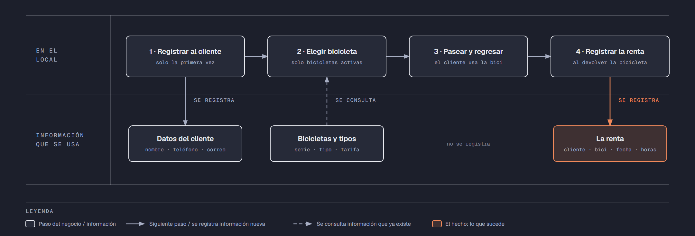

# Evidencia Integral — Caso: BiciRuta

**Alumno:** Almaguer Mireles Wisin Jesus (matrícula 2254366)
**Base de datos a crear:** `BiciRutaDB`

← [Regresar a la descripción de la evidencia](../descripcion-evidencia-integral.md)

---

## Historia de usuario

**Como** dueño de BiciRuta, **quiero** una base de datos que registre mis bicicletas, mis clientes y cada renta que hacen, **para** saber cuánto se usa cada bicicleta, quiénes son mis clientes y qué bicicletas nunca salen del local.

## El negocio

BiciRuta es un negocio de renta de bicicletas por hora en el centro de la ciudad. Maneja **tipos de bicicleta**: Urbana, Montaña y Eléctrica. Cada tipo tiene su propia **tarifa por hora**; por ejemplo, la Eléctrica cuesta más que la Urbana. **Las tarifas cambian** de vez en cuando. Aun así, el negocio necesita saber **cuánto se cobró en cada renta**, con la tarifa que estaba vigente el día de la renta.

Cada **bicicleta** es de un tipo, tiene un **número de serie** grabado en el cuadro y una **fecha de alta**, que es el día en que el negocio la compró. Cuando una bicicleta se descompone sin arreglo, se **da de baja**: no se borra, porque se quiere conservar su historial de rentas.

Los **clientes** se registran una sola vez con su nombre, su teléfono y su correo electrónico.

Si el negocio deja de manejar un tipo de bicicleta, tampoco lo borra: lo **da de baja**. Lo mismo pasa con los clientes: si un cliente ya no regresa, se lo da de baja en lugar de borrarlo. Así se conserva el historial de rentas.

## Los hechos de este negocio

En BiciRuta, **el hecho es la renta**: cada vez que un cliente renta una bicicleta, sucede una renta, en una fecha. Es la **tabla más importante** de tu modelo: tiene una fila por cada renta, es la que más crece y es donde se guarda lo que realmente pasó (quién rentó, qué bicicleta, cuándo, cuántas horas y con qué tarifa se le cobró).

**Esta tabla la propones tú**: su nombre, sus columnas y sus llaves. No viene en "Lo que el negocio ya tiene definido", porque los hechos no se definen de antemano: suceden.

## Lo que el negocio ya tiene definido

Estos datos **no los inventas**: son los que BiciRuta ya tiene. Tu base de datos debe guardarlos **exactamente así**, con los mismos nombres y valores.

Son los **datos iniciales** con los que arranca tu base de datos: **tipos de bicicleta y tarifas por hora** y **bicicletas**. Hoy todo lo que aparece en estas tablas está **activo**, salvo la bicicleta que se indica como dada de baja.

**Tipos de bicicleta y tarifas por hora**

| Tipo de bicicleta | Tarifa por hora |
|---|---|
| Urbana | $45.00 |
| Montaña | $60.00 |
| Eléctrica | $95.00 |

**Bicicletas**

| Tipo de bicicleta | Número de serie | Fecha de alta | ¿Activa? |
|---|---|---|---|
| Urbana | `UR-0001` | 15/02/2024 | Sí |
| Urbana | `UR-0002` | 15/02/2024 | Sí |
| Urbana | `UR-0003` | 01/07/2024 | Sí |
| Montaña | `MT-0007` | 10/03/2024 | Sí |
| Montaña | `MT-0008` | 10/03/2024 | Sí |
| Montaña | `MT-0009` | 20/01/2025 | Sí |
| Eléctrica | `EL-0001` | 05/09/2024 | Sí |
| Eléctrica | `EL-0002` | 18/04/2025 | Sí |
| Montaña | `MT-0010` | 10/03/2024 | **No** |
| Eléctrica | `EL-0003` | 01/10/2025 | Sí |

Todo lo demás (clientes y rentas) **lo inventas tú**, cumpliendo los mínimos de [Lo que debes construir](#lo-que-debes-construir).

## Flujo de negocio

Así funciona una operación de principio a fin. Arriba, lo que pasa en el local; abajo, la información que cada paso consulta o registra.

Con detalle, un cliente imaginario (Luis) recorriendo el flujo:

1. **Luis llega por primera vez** a BiciRuta. En recepción le piden su nombre, su teléfono y su correo, y lo **registran como cliente**. Si Luis regresa otro día, ya no se le registra de nuevo: se le busca por su correo.
2. **Luis quiere una bicicleta de montaña.** El encargado revisa qué bicicletas de tipo Montaña están **activas**; las dadas de baja ya no se rentan. Le entrega la que tiene el número de serie `MT-0007` y le recuerda la tarifa por hora de ese tipo.
3. **Luis pasea y regresa** la bicicleta 3 horas después.
4. **Al devolverla, se registra la renta:** cliente Luis, bicicleta `MT-0007`, fecha de hoy, 3 horas y la tarifa por hora con la que se le cobra. Se le cobran las horas por esa tarifa.

Si el mes siguiente sube la tarifa de las bicicletas de Montaña, la renta de Luis tiene que seguir diciendo con qué tarifa se le cobró.

Al día siguiente, Luis renta una bicicleta Eléctrica: es otra renta, del mismo cliente y de otra bicicleta. Ese mismo día, la `MT-0007` la renta otra clienta. Así, **un cliente acumula muchas rentas y una bicicleta también**.

## Reglas de negocio

- Cada bicicleta es de **un solo** tipo.
- No puede haber dos bicicletas con el mismo número de serie.
- No puede haber dos clientes con el mismo correo electrónico.
- No puede haber dos tipos de bicicleta con el mismo nombre.
- La tarifa por hora siempre es **mayor a cero**.
- Una renta dura **al menos 1 hora** y **como máximo 8 horas**, que es lo que el local está abierto.
- Una bicicleta nueva se registra como **activa**.
- Un tipo de bicicleta nuevo y un cliente nuevo también se registran como **activos**.
- Cuando cambia la tarifa de un tipo de bicicleta, las rentas que ya se hicieron **conservan la tarifa con la que se cobraron**.

## Lo que debes construir

1. El **modelo relacional**, con al menos 4 tablas, que guarde toda la información de arriba y respete las reglas de negocio con restricciones (`PRIMARY KEY`, `FOREIGN KEY`, `UNIQUE`, `CHECK`, `DEFAULT`).
2. El **paquete de instalación** y el **paquete de reversa** de `BiciRutaDB`.
3. **Datos iniciales:**
   - **Lo que el negocio ya tiene definido**, exactamente como viene arriba: los 3 tipos de bicicleta con su tarifa por hora y las 10 bicicletas.
   - **Lo que tú inventas**, como mínimo: 10 clientes y 20 rentas, con
     - 2 clientes que nunca hayan rentado;
     - 2 bicicletas que nunca se hayan rentado;
     - al menos 1 cliente dado de baja;
     - cada renta con la tarifa con la que se cobró (en tus datos, la tarifa de su tipo de bicicleta que viene arriba);
     - rentas en marzo de 2026;
     - clientes con correo `@gmail.com`.
4. **Las 10 consultas** de abajo.

## Consultas

| # | Pregunta del negocio |
|---|---|
| 1 | Lista las rentas de más de 3 horas, ordenadas de la más larga a la más corta. |
| 2 | Lista las bicicletas que siguen activas, de la más antigua a la más reciente según su fecha de alta. |
| 3 | Lista los clientes cuyo correo electrónico termina en `@gmail.com`. |
| 4 | Lista las rentas realizadas en marzo de 2026, ordenadas por fecha. |
| 5 | Muestra las 5 rentas más largas registradas. |
| 6 | Muestra cada bicicleta con su número de serie, el nombre de su tipo y su tarifa por hora. |
| 7 | Muestra cada renta con el número de serie de la bicicleta, la tarifa por hora cobrada y la tarifa por hora actual de su tipo de bicicleta. |
| 8 | Muestra cada renta con el nombre del cliente, el número de serie de la bicicleta y el nombre del tipo de bicicleta. |
| 9 | Lista los clientes que nunca han rentado una bicicleta. |
| 10 | Lista las bicicletas que nunca se han rentado. |

## Entrega

Ver [Entregables](../descripcion-evidencia-integral.md#entregables) y [Forma de entrega](../descripcion-evidencia-integral.md#forma-de-entrega) en la descripción de la evidencia.
