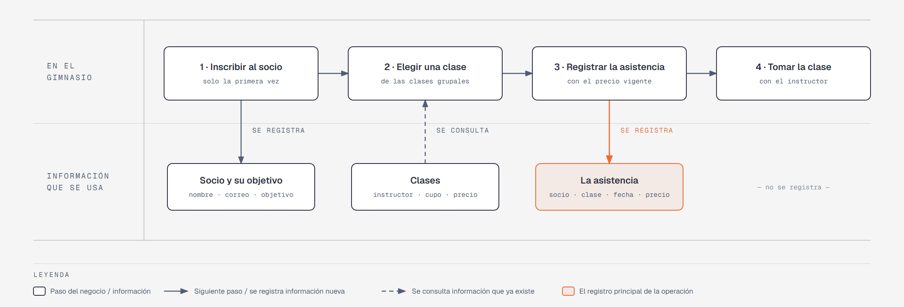

# Evidencia Integral — Caso: FitZone

**Alumno:** Alumno 2
**Base de datos a crear:** `FitZoneDB`

← [Regresar a la descripción de la evidencia](../descripcion-evidencia-integral.md)

---

## Historia de usuario

**Como** dueño de FitZone, **quiero** una base de datos que registre a mis socios, mis clases grupales y cada vez que un socio toma una clase, **para** saber qué clases se toman más, cuánto se cobró por ellas y qué socios inscritos nunca han tomado una clase.

## El negocio

FitZone es un gimnasio que ofrece **clases grupales**, como Spinning, Yoga o Box. Cada clase tiene un nombre que no se repite, un **instructor**, un **cupo máximo** de personas y un **precio por clase**: el socio paga cada clase que toma. **Los precios cambian**: el 1 de abril de 2026 subieron los de varias clases. Aun así, el negocio necesita saber **cuánto se cobró cada vez que un socio tomó una clase**, con el precio que tenía la clase ese día.

Los **socios** se inscriben una sola vez, con su nombre, su correo electrónico y la fecha de inscripción. Al inscribirse, cada socio dice cuál es su **objetivo** en el gimnasio (por ejemplo, bajar de peso), para que los instructores sepan qué clases recomendarle. El correo identifica al socio en recepción: no puede haber dos socios con el mismo. Cuando un socio deja de venir, se le **da de baja**, pero no se borra, para conservar su historial de clases.

## Lo que el negocio ya tiene definido

Estos datos **no los inventas**: son los que FitZone ya tiene. Tu base de datos debe guardarlos **exactamente así**, con los mismos nombres y valores.

**Objetivos de los socios**

| Objetivo |
|---|
| Bajar de peso |
| Ganar masa muscular |
| Acondicionamiento físico |
| Rehabilitación |

**Clases grupales y precio por clase**

El **1 de abril de 2026** subieron los precios de Spinning, Box, Pilates, CrossFit y Body Pump. Los de las demás clases no cambiaron.

| Clase | Instructor | Cupo máximo | Precio actual (desde el 1 de abril de 2026) | Precio anterior (hasta el 31 de marzo de 2026) |
|---|---|---|---|---|
| Spinning | Ricardo Ávila | 20 | $90.00 | $80.00 |
| Yoga | Mariana Leal | 15 | $80.00 | $80.00 |
| Box | Óscar Treviño | 12 | $100.00 | $90.00 |
| Pilates | Sofía Garza | 10 | $110.00 | $100.00 |
| Zumba | Paola Ramírez | 25 | $70.00 | $70.00 |
| CrossFit | Arturo Cavazos | 16 | $120.00 | $110.00 |
| Body Pump | Ricardo Ávila | 20 | $90.00 | $85.00 |
| Stretching | Mariana Leal | 12 | $60.00 | $60.00 |

Todo lo demás (socios y clases tomadas) **lo inventas tú**, cumpliendo los mínimos de [Lo que debes construir](#lo-que-debes-construir).

## Flujo de negocio

Así funciona una operación de principio a fin. Arriba, lo que pasa en el gimnasio; abajo, la información que cada paso consulta o registra.

Con detalle, una socia imaginaria (Andrea) recorriendo el flujo:

1. **Andrea llega por primera vez** a FitZone. En recepción le piden su nombre, su correo y su objetivo (quiere ganar masa muscular), y la **inscriben como socia** con la fecha de hoy. Si Andrea regresa otro día, ya no se le inscribe de nuevo: se le busca por su correo.
2. **Andrea quiere tomar Spinning.** La recepcionista revisa la clase: quién la imparte, cuál es su cupo y su **precio por clase vigente**: hoy, $90.00.
3. **Se registra la asistencia**: socia Andrea, clase Spinning, fecha de hoy y el precio con el que se le cobra ($90.00). Andrea paga la clase.
4. **Andrea toma la clase** con Ricardo Ávila. Lo que pasa dentro de la clase no se registra en la base de datos.

Si el mes siguiente Spinning sube a $95.00, la asistencia de Andrea tiene que seguir diciendo que se le cobró a $90.00.

Dos días después, Andrea toma Yoga: es otra asistencia, de la misma socia y de otra clase. Ese mismo día, otros socios toman Spinning. Así, **un socio acumula muchas asistencias y una clase también**.

## Reglas de negocio

- Cada socio tiene **un solo** objetivo.
- No puede haber dos objetivos con el mismo nombre, ni dos clases con el mismo nombre.
- No puede haber dos socios con el mismo correo electrónico.
- El cupo máximo y el precio de una clase siempre son **mayores a cero**.
- Cuando cambia el precio de una clase, las asistencias que ya se registraron **conservan el precio con el que se cobraron**.
- Un socio nuevo se registra como **activo**.

## Lo que debes construir

1. El **modelo relacional**, con al menos 4 tablas, que guarde toda la información de arriba y respete las reglas de negocio con restricciones (`PRIMARY KEY`, `FOREIGN KEY`, `UNIQUE`, `CHECK`, `DEFAULT`).
2. El **paquete de instalación** y el **paquete de reversa** de `FitZoneDB`.
3. **Datos iniciales:**
   - **Lo que el negocio ya tiene definido**, exactamente como viene arriba: los 4 objetivos y las 8 clases con su **precio actual**.
   - **Lo que tú inventas**, como mínimo: 10 socios y 20 asistencias, con
     - socios de al menos 3 objetivos distintos;
     - 2 socios que nunca hayan tomado una clase;
     - 2 clases que nunca se hayan tomado;
     - al menos 1 socio dado de baja;
     - asistencias antes **y** después del 1 de abril de 2026, de clases cuyo precio cambió y de clases cuyo precio no cambió: cada asistencia se cobra con el precio que tenía la clase **en la fecha de la asistencia** (precio anterior hasta el 31 de marzo, precio actual desde el 1 de abril);
     - asistencias en marzo de 2026;
     - socios con correo `@gmail.com`.
4. **Las 10 consultas** de abajo.

## Consultas

| # | Pregunta del negocio |
|---|---|
| 1 | Lista las clases con cupo máximo mayor a 15 personas, ordenadas de mayor a menor cupo. |
| 2 | Lista los socios activos, del más antiguo al más reciente según su fecha de inscripción. |
| 3 | Lista los socios cuyo correo electrónico termina en `@gmail.com`. |
| 4 | Lista las asistencias de marzo de 2026, ordenadas por fecha. |
| 5 | Muestra las 5 clases con mayor cupo máximo. |
| 6 | Muestra cada socio con el nombre de su objetivo. |
| 7 | Muestra las asistencias que se cobraron con un precio distinto al precio actual de su clase, con el precio cobrado y el precio actual. |
| 8 | Muestra cada asistencia con el nombre del socio, el nombre de la clase, su instructor y el precio cobrado. |
| 9 | Lista los socios que nunca han tomado una clase. |
| 10 | Lista las clases que nunca se han tomado. |

## Entrega

Ver [Entregables](../descripcion-evidencia-integral.md#entregables) y [Forma de entrega](../descripcion-evidencia-integral.md#forma-de-entrega) en la descripción de la evidencia.
