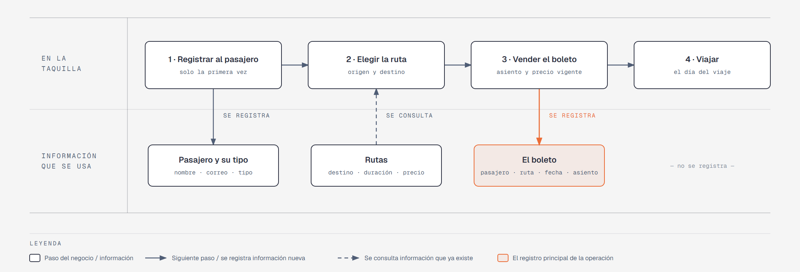

# Evidencia Integral — Caso: RutaNorte

**Alumno:** Alumno 5
**Base de datos a crear:** `RutaNorteDB`

← [Regresar a la descripción de la evidencia](../descripcion-evidencia-integral.md)

---

## Historia de usuario

**Como** gerente de RutaNorte, **quiero** una base de datos que registre a mis pasajeros, mis rutas y cada boleto que vendo, **para** saber qué rutas se venden más, cuánto se cobró por cada boleto y qué pasajeros registrados nunca han viajado.

## El negocio

RutaNorte es una línea de **autobuses foráneos** que sale de Monterrey. Tiene varias **rutas**; cada una tiene una **clave** que no se repite (por ejemplo, `MTY-SAL`), un origen, un destino, la **duración del viaje en horas** y el **precio** del boleto. **Los precios cambian** de vez en cuando. Aun así, la línea necesita saber **cuánto se cobró por cada boleto**, con el precio que tenía la ruta el día de la venta.

Los **pasajeros** se registran una sola vez con su nombre, su correo electrónico, la fecha de registro y su **tipo de pasajero** (Adulto, Estudiante o Adulto mayor). En RutaNorte **todos pagan el mismo precio**: el tipo de pasajero solo sirve para saber qué clase de pasajeros viajan. El correo identifica al pasajero: no puede haber dos pasajeros con el mismo. Cuando un pasajero pide que borren su registro, se le **da de baja**, pero no se borra, para conservar sus boletos.

Cada autobús tiene **40 asientos**, numerados del 1 al 40.

## Lo que el negocio ya tiene definido

Estos datos **no los inventas**: son los que RutaNorte ya tiene. Tu base de datos debe guardarlos **exactamente así**, con los mismos nombres y valores.

**Tipos de pasajero**

| Tipo de pasajero |
|---|
| Adulto |
| Estudiante |
| Adulto mayor |

**Rutas**

| Clave | Origen | Destino | Duración (horas) | Precio |
|---|---|---|---|---|
| MTY-SAL | Monterrey | Saltillo | 1 | $180.00 |
| MTY-REY | Monterrey | Reynosa | 3 | $420.00 |
| MTY-NLD | Monterrey | Nuevo Laredo | 3 | $450.00 |
| MTY-TRC | Monterrey | Torreón | 4 | $520.00 |
| MTY-SLP | Monterrey | San Luis Potosí | 6 | $780.00 |
| MTY-MAT | Monterrey | Matamoros | 4 | $500.00 |
| MTY-SMA | Monterrey | San Miguel de Allende | 9 | $1,150.00 |

Todo lo demás (pasajeros y boletos) **lo inventas tú**, cumpliendo los mínimos de [Lo que debes construir](#lo-que-debes-construir).

## Flujo de negocio

Así funciona una operación de principio a fin. Arriba, lo que pasa en la taquilla; abajo, la información que cada paso consulta o registra.

Con detalle, una pasajera imaginaria (Rosa) recorriendo el flujo:

1. **Rosa llega por primera vez** a la taquilla de RutaNorte. En la taquilla le piden su nombre, su correo y su tipo de pasajero (Adulto), y la **registran como pasajera** con la fecha de hoy. Si Rosa regresa otro día, ya no se le registra de nuevo: se le busca por su correo.
2. **Rosa quiere ir a Saltillo.** El taquillero revisa la ruta `MTY-SAL`: su duración y su **precio vigente**: hoy, $180.00.
3. **Se vende el boleto.** Rosa escoge el asiento 12 y se registra el boleto: pasajera Rosa, ruta `MTY-SAL`, fecha del viaje, asiento 12 y el precio con el que se le cobra ($180.00).
4. **Rosa viaja** el día del viaje. El viaje en sí no se registra en la base de datos.

Si el mes siguiente la ruta `MTY-SAL` sube a $200.00, el boleto de Rosa tiene que seguir diciendo que se le cobró a $180.00.

Un mes después, Rosa compra un boleto a Reynosa: es otro boleto, de la misma pasajera y de otra ruta. Ese mismo día, otros pasajeros compran boletos a Saltillo. Así, **un pasajero acumula muchos boletos y una ruta también**.

## Reglas de negocio

- Cada pasajero tiene **un solo** tipo de pasajero.
- No puede haber dos tipos de pasajero con el mismo nombre, ni dos rutas con la misma clave.
- No puede haber dos pasajeros con el mismo correo electrónico.
- El precio y la duración de una ruta siempre son **mayores a cero**.
- El asiento de un boleto va **del 1 al 40**.
- Cuando cambia el precio de una ruta, los boletos que ya se vendieron **conservan el precio con el que se cobraron**.
- Un pasajero nuevo se registra como **activo**.

## Lo que debes construir

1. El **modelo relacional**, con al menos 4 tablas, que guarde toda la información de arriba y respete las reglas de negocio con restricciones (`PRIMARY KEY`, `FOREIGN KEY`, `UNIQUE`, `CHECK`, `DEFAULT`).
2. El **paquete de instalación** y el **paquete de reversa** de `RutaNorteDB`.
3. **Datos iniciales:**
   - **Lo que el negocio ya tiene definido**, exactamente como viene arriba: los 3 tipos de pasajero y las 7 rutas.
   - **Lo que tú inventas**, como mínimo: 10 pasajeros y 20 boletos, con
     - pasajeros de los tres tipos;
     - 2 pasajeros que nunca hayan comprado un boleto;
     - 2 rutas que nunca hayan vendido un boleto;
     - al menos 1 pasajero dado de baja;
     - cada boleto con el precio con el que se cobró (en tus datos, el precio de la ruta que viene arriba);
     - boletos de viajes en marzo de 2026.
4. **Las 10 consultas** de abajo.

## Consultas

| # | Pregunta del negocio |
|---|---|
| 1 | Lista las rutas de más de 4 horas, ordenadas de la más larga a la más corta. |
| 2 | Lista los pasajeros activos, del más antiguo al más reciente según su fecha de registro. |
| 3 | Lista las rutas cuyo destino comienza con "San". |
| 4 | Lista los boletos de viajes de marzo de 2026, ordenados por fecha. |
| 5 | Muestra las 5 rutas más caras. |
| 6 | Muestra cada pasajero con el nombre de su tipo de pasajero. |
| 7 | Muestra cada boleto con la clave de la ruta, el precio cobrado y el precio actual de la ruta. |
| 8 | Muestra cada boleto con el nombre del pasajero, el origen y el destino de la ruta, la fecha del viaje y el asiento. |
| 9 | Lista los pasajeros que nunca han comprado un boleto. |
| 10 | Lista las rutas que nunca han vendido un boleto. |

## Entrega

Ver [Entregables](../descripcion-evidencia-integral.md#entregables) y [Forma de entrega](../descripcion-evidencia-integral.md#forma-de-entrega) en la descripción de la evidencia.
