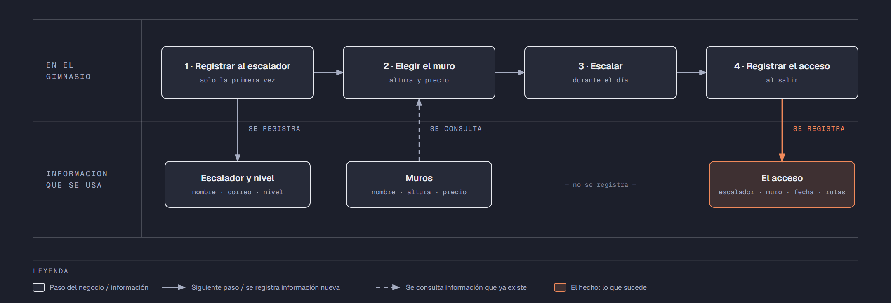

# Evidencia Integral — Caso: Vertical

**Alumno:** Castillo Medrano Jesus Alejandro (matrícula 2213212)
**Base de datos a crear:** `VerticalDB`

← [Regresar a la descripción de la evidencia](../descripcion-evidencia-integral.md)

---

## Historia de usuario

**Como** dueña de Vertical, **quiero** una base de datos que registre a mis escaladores, mis muros y cada acceso que se vende, **para** saber qué muros se usan más, cuánto se cobró por cada acceso y qué escaladores registrados nunca han vuelto a escalar.

## El negocio

Vertical es un **gimnasio de escalada**. Tiene varios **muros**; cada uno tiene un **nombre** que no se repite, una **altura en metros** y un **precio por acceso**. Un **acceso** le da al escalador el derecho de usar un muro durante el día. Cada muro tiene varias **rutas** marcadas con presas de colores, y el gimnasio lleva la cuenta de cuántas rutas completa cada escalador en su visita (puede ser cero, si no logró terminar ninguna). **Los precios cambian** de vez en cuando. Aun así, el negocio necesita saber **cuánto se cobró por cada acceso**, con el precio que tenía el muro el día del acceso.

Los **escaladores** se registran una sola vez con su nombre, su correo electrónico, la fecha de registro y su **nivel de experiencia** (Principiante, Intermedio o Avanzado). El nivel no cambia el precio: todos pagan lo mismo por el mismo muro. Sirve para que los instructores sepan a quién deben acompañar, y un escalador puede subir de nivel con el tiempo. El correo identifica al escalador: no puede haber dos escaladores con el mismo. Cuando un escalador pide que borren su registro, se le **da de baja**, pero no se borra, para conservar sus accesos.

Si el negocio deja de usar un nivel de experiencia o deja de ofrecer un muro, no se borran: se **dan de baja**, para conservar el historial de accesos.

## Los hechos de este negocio

En Vertical, **el hecho es el acceso**: cada vez que un escalador usa un muro, sucede un acceso, en una fecha. Es la **tabla más importante** de tu modelo: tiene una fila por cada acceso, es la que más crece y es donde se guarda lo que realmente pasó (quién escaló, en qué muro, cuándo, cuántas rutas completó y cuánto se le cobró).

**Esta tabla la propones tú**: su nombre, sus columnas y sus llaves. No viene en "Lo que el negocio ya tiene definido", porque los hechos no se definen de antemano: suceden.

## Lo que el negocio ya tiene definido

Estos datos **no los inventas**: son los que Vertical ya tiene. Tu base de datos debe guardarlos **exactamente así**, con los mismos nombres y valores.

Son los **datos iniciales** con los que arranca tu base de datos: **niveles de experiencia** y **muros**. Hoy todo lo que aparece en estas tablas está **activo**.

**Niveles de experiencia**

| Nivel |
|---|
| Principiante |
| Intermedio |
| Avanzado |

**Muros**

| Nombre | Altura (metros) | Precio por acceso |
|---|---|---|
| La Torre | 15.0 | $220.00 |
| El Desplome | 12.0 | $200.00 |
| La Placa | 8.0 | $150.00 |
| El Búlder | 4.5 | $120.00 |
| La Chimenea | 10.0 | $180.00 |
| El Techo | 6.0 | $160.00 |

Todo lo demás (escaladores y accesos) **lo inventas tú**, cumpliendo los mínimos de [Lo que debes construir](#lo-que-debes-construir).

## Flujo de negocio

Así funciona una operación de principio a fin. Arriba, lo que pasa en el gimnasio; abajo, la información que cada paso consulta o registra.

Con detalle, una escaladora imaginaria (Andrea) recorriendo el flujo:

1. **Andrea llega por primera vez** a Vertical. En la recepción le piden su nombre, su correo y su nivel de experiencia (Principiante), y la **registran como escaladora** con la fecha de hoy. Si Andrea regresa otro día, ya no se le registra de nuevo: se le busca por su correo.
2. **Andrea elige el muro.** La recepcionista le muestra la altura y el **precio vigente** de cada muro. Andrea elige "El Búlder" y paga el acceso: hoy, $120.00.
3. **Andrea escala** durante la tarde.
4. **Al salir, se registra el acceso:** escaladora Andrea, muro "El Búlder", fecha de hoy, las rutas que completó (3) y el precio con el que se le cobró ($120.00).

Si el mes siguiente "El Búlder" sube a $140.00, el acceso de Andrea tiene que seguir diciendo que se le cobró a $120.00.

Una semana después, Andrea regresa y escala "La Placa": es otro acceso, de la misma escaladora y de otro muro. Ese mismo día, otro escalador usa "El Búlder". Así, **un escalador acumula muchos accesos y un muro también**.

## Reglas de negocio

- Cada escalador tiene **un solo** nivel de experiencia.
- No puede haber dos niveles de experiencia con el mismo nombre, ni dos muros con el mismo nombre.
- No puede haber dos escaladores con el mismo correo electrónico.
- La altura de un muro siempre es **mayor a cero**.
- El precio por acceso siempre es **mayor a cero**.
- Las rutas completadas en un acceso **no pueden ser negativas** (cero sí se vale).
- Cuando cambia el precio de un muro, los accesos que ya se registraron **conservan el precio con el que se cobraron**.
- Un escalador nuevo se registra como **activo**.
- Un nivel de experiencia nuevo y un muro nuevo también se registran como **activos**.

## Lo que debes construir

1. El **modelo relacional**, con al menos 4 tablas, que guarde toda la información de arriba y respete las reglas de negocio con restricciones (`PRIMARY KEY`, `FOREIGN KEY`, `UNIQUE`, `CHECK`, `DEFAULT`).
2. El **paquete de instalación** y el **paquete de reversa** de `VerticalDB`.
3. **Datos iniciales:**
   - **Lo que el negocio ya tiene definido**, exactamente como viene arriba: los 3 niveles de experiencia y los 6 muros.
   - **Lo que tú inventas**, como mínimo: 10 escaladores y 20 accesos, con
     - escaladores de los tres niveles;
     - 2 escaladores que nunca hayan escalado;
     - 2 muros que nunca se hayan usado;
     - al menos 1 escalador dado de baja;
     - al menos 1 acceso en el que no se haya completado ninguna ruta;
     - cada acceso con el precio con el que se cobró (en tus datos, el precio del muro que viene arriba);
     - accesos en marzo de 2026;
     - escaladores con correo de `@outlook.com`.
4. **Las 10 consultas** de abajo.

## Consultas

| # | Pregunta del negocio |
|---|---|
| 1 | Lista los muros de más de 10 metros, del más alto al más bajo. |
| 2 | Lista los escaladores activos, del más antiguo al más reciente según su fecha de registro. |
| 3 | Lista los escaladores cuyo correo termina en "@outlook.com". |
| 4 | Lista los accesos de marzo de 2026, ordenados por fecha. |
| 5 | Muestra los 5 accesos con más rutas completadas. |
| 6 | Muestra cada escalador con el nombre de su nivel de experiencia. |
| 7 | Muestra cada acceso con el nombre del muro, el precio cobrado y el precio actual del muro. |
| 8 | Muestra cada acceso con el nombre del escalador, el nombre del muro, la fecha y las rutas completadas. |
| 9 | Lista los escaladores que nunca han escalado. |
| 10 | Lista los muros que nunca se han usado. |

## Entrega

Ver [Entregables](../descripcion-evidencia-integral.md#entregables) y [Forma de entrega](../descripcion-evidencia-integral.md#forma-de-entrega) en la descripción de la evidencia.
