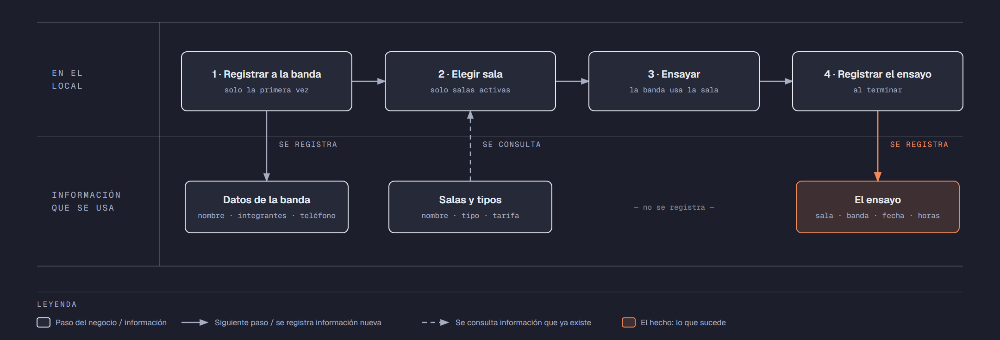

# Evidencia Integral — Caso: SalaRock

**Alumno:** Cuevas Catalan Jenifer Victoria (matrícula 2253913)
**Base de datos a crear:** `SalaRockDB`

← [Regresar a la descripción de la evidencia](../descripcion-evidencia-integral.md)

---

## Historia de usuario

**Como** dueño de SalaRock, **quiero** una base de datos que registre mis salas de ensayo, las bandas que vienen y cada ensayo que hacen, **para** saber cuánto se usa cada sala, qué bandas son mis clientes y qué salas casi nunca se rentan.

## El negocio

SalaRock es un local que renta **salas de ensayo por hora** a bandas de música. Maneja **tipos de sala**: Chica, Mediana y Grande, según su tamaño y su equipo. Cada tipo tiene su propia **tarifa por hora**; por ejemplo, la Grande cuesta más que la Chica. **Las tarifas cambian** de vez en cuando. Aun así, el negocio necesita saber **cuánto se cobró en cada ensayo**, con la tarifa que estaba vigente el día del ensayo.

Cada **sala** es de un tipo, tiene un **nombre** que no se repite (por ejemplo, "Sala Hendrix") y una **fecha de apertura**, que es el día en que se empezó a rentar. Cuando una sala se cierra para siempre (por ejemplo, porque se remodela como bodega), se **da de baja**: no se borra, porque se quiere conservar su historial de ensayos.

Las **bandas** se registran una sola vez con su nombre, el número de integrantes y un teléfono de contacto. No puede haber dos bandas con el mismo nombre.

Si el negocio deja de manejar un tipo de sala, tampoco lo borra: lo **da de baja**. Lo mismo pasa con las bandas: si una banda ya no regresa, se la da de baja en lugar de borrarla. Así se conserva el historial de ensayos.

## Los hechos de este negocio

En SalaRock, **el hecho es el ensayo**: cada vez que una banda ensaya en una sala, sucede un ensayo, en una fecha. Es la **tabla más importante** de tu modelo: tiene una fila por cada ensayo, es la que más crece y es donde se guarda lo que realmente pasó (qué banda, en qué sala, cuándo, cuántas horas y con qué tarifa se le cobró).

**Esta tabla la propones tú**: su nombre, sus columnas y sus llaves. No viene en "Lo que el negocio ya tiene definido", porque los hechos no se definen de antemano: suceden.

## Lo que el negocio ya tiene definido

Estos datos **no los inventas**: son los que SalaRock ya tiene. Tu base de datos debe guardarlos **exactamente así**, con los mismos nombres y valores.

Son los **datos iniciales** con los que arranca tu base de datos: **tipos de sala y tarifas por hora** y **salas**. Hoy todo lo que aparece en estas tablas está **activo**, salvo la sala que se indica como dada de baja.

**Tipos de sala y tarifas por hora**

| Tipo de sala | Tarifa por hora |
|---|---|
| Chica | $150.00 |
| Mediana | $220.00 |
| Grande | $300.00 |

**Salas**

| Tipo de sala | Nombre | Fecha de apertura | ¿Activa? |
|---|---|---|---|
| Chica | Sala Hendrix | 10/02/2024 | Sí |
| Chica | Sala Joplin | 10/02/2024 | Sí |
| Mediana | Sala Cobain | 20/05/2024 | Sí |
| Mediana | Sala Mercury | 01/08/2024 | Sí |
| Grande | Sala Lennon | 15/01/2025 | Sí |
| Grande | Sala Marley | 03/03/2025 | Sí |
| Mediana | Sala Bowie | 12/06/2025 | **No** |
| Chica | Sala Cash | 04/11/2025 | Sí |

Todo lo demás (bandas y ensayos) **lo inventas tú**, cumpliendo los mínimos de [Lo que debes construir](#lo-que-debes-construir).

## Flujo de negocio

Así funciona una operación de principio a fin. Arriba, lo que pasa en el local; abajo, la información que cada paso consulta o registra.

Con detalle, una banda imaginaria (Los Atómicos) recorriendo el flujo:

1. **Los Atómicos llegan por primera vez** a SalaRock. En recepción les piden el nombre de la banda, cuántos integrantes son y un teléfono de contacto, y **registran a la banda**. Si regresan otro día, ya no se les registra de nuevo: se les busca por su nombre.
2. **La banda pide una sala.** El encargado revisa qué salas están **activas**; las dadas de baja ya no se rentan. Les asigna la "Sala Cobain", que es de tipo Mediana, y les recuerda la tarifa por hora de ese tipo.
3. **La banda ensaya** 3 horas.
4. **Al terminar, se registra el ensayo:** sala Cobain, banda Los Atómicos, fecha de hoy, 3 horas y la tarifa por hora con la que se les cobra. Se les cobran las horas por esa tarifa.

Si el mes siguiente sube la tarifa de las salas Medianas, el ensayo de Los Atómicos tiene que seguir diciendo con qué tarifa se les cobró.

A la semana siguiente, Los Atómicos regresan y les toca la "Sala Lennon", que es Grande: es otro ensayo, de la misma banda y de otra sala. Ese mismo día, la Sala Cobain la renta otra banda. Así, **una banda acumula muchos ensayos y una sala también**.

## Reglas de negocio

- Cada sala es de **un solo** tipo.
- No puede haber dos tipos de sala con el mismo nombre, ni dos salas con el mismo nombre, ni dos bandas con el mismo nombre.
- La tarifa por hora siempre es **mayor a cero**.
- Una banda tiene **de 1 a 8** integrantes.
- Un ensayo dura **al menos 1 hora** y **como máximo 4 horas**.
- Una sala nueva se registra como **activa**.
- Un tipo de sala nuevo y una banda nueva también se registran como **activos**.
- Cuando cambia la tarifa de un tipo de sala, los ensayos que ya se hicieron **conservan la tarifa con la que se cobraron**.

## Lo que debes construir

1. El **modelo relacional**, con al menos 4 tablas, que guarde toda la información de arriba y respete las reglas de negocio con restricciones (`PRIMARY KEY`, `FOREIGN KEY`, `UNIQUE`, `CHECK`, `DEFAULT`).
2. El **paquete de instalación** y el **paquete de reversa** de `SalaRockDB`.
3. **Datos iniciales:**
   - **Lo que el negocio ya tiene definido**, exactamente como viene arriba: los 3 tipos de sala con su tarifa por hora y las 8 salas.
   - **Lo que tú inventas**, como mínimo: 10 bandas y 20 ensayos, con
     - 2 bandas que nunca hayan ensayado;
     - 2 salas que nunca se hayan rentado;
     - al menos 1 banda dada de baja;
     - ensayos de más de 2 horas;
     - cada ensayo con la tarifa por hora con la que se cobró (en tus datos, la tarifa de su tipo de sala que viene arriba);
     - ensayos en marzo de 2026;
     - bandas cuyo nombre comience con "Los".
4. **Las 10 consultas** de abajo.

## Consultas

| # | Pregunta del negocio |
|---|---|
| 1 | Lista los ensayos de más de 2 horas, ordenados del más largo al más corto. |
| 2 | Lista las salas activas, de la más antigua a la más reciente según su fecha de apertura. |
| 3 | Lista las bandas cuyo nombre comienza con "Los". |
| 4 | Lista los ensayos de marzo de 2026, ordenados por fecha. |
| 5 | Muestra las 5 bandas con más integrantes. |
| 6 | Muestra cada sala con el nombre de su tipo de sala y su tarifa por hora. |
| 7 | Muestra cada ensayo con el nombre de la sala, la tarifa por hora cobrada y la tarifa por hora actual de su tipo de sala. |
| 8 | Muestra cada ensayo con el nombre de la banda, el nombre de la sala, la fecha y las horas. |
| 9 | Lista las bandas que nunca han ensayado. |
| 10 | Lista las salas que nunca se han rentado. |

## Entrega

Ver [Entregables](../descripcion-evidencia-integral.md#entregables) y [Forma de entrega](../descripcion-evidencia-integral.md#forma-de-entrega) en la descripción de la evidencia.
