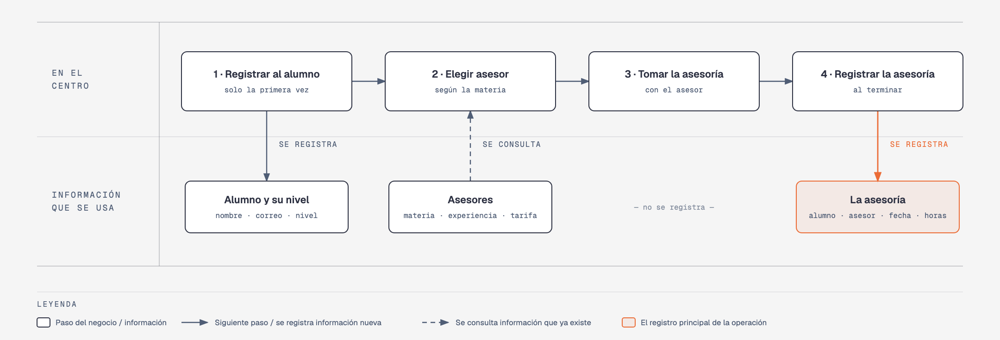

# Evidencia Integral — Caso: AsesorPro

**Alumno:** De Luna Zul Christian Gael (matrícula 2253894)
**Base de datos a crear:** `AsesorProDB`

← [Regresar a la descripción de la evidencia](../descripcion-evidencia-integral.md)

---

## Historia de usuario

**Como** directora de AsesorPro, **quiero** una base de datos que registre a mis alumnos, a mis asesores y cada asesoría que se da, **para** saber qué asesores tienen más trabajo, cuánto se cobró por cada asesoría y qué alumnos registrados nunca han tomado una.

## El negocio

AsesorPro es un centro de **asesorías escolares presenciales**. Cada **asesor** enseña **una materia** (Matemáticas, Física, Inglés, etc.), tiene sus **años de experiencia** y cobra su propia **tarifa por hora**: un asesor con más experiencia puede cobrar más. **Las tarifas cambian** de vez en cuando. Aun así, el centro necesita saber **cuánto se cobró en cada asesoría**, con la tarifa que tenía el asesor ese día.

Los **alumnos** se registran una sola vez con su nombre, su correo electrónico, la fecha de registro y su **nivel escolar** (Secundaria, Preparatoria o Universidad). El nivel sirve para saber a qué alumnos atiende el centro; no cambia el precio. Cuando un alumno pasa de secundaria a preparatoria, se le actualiza el nivel. El correo identifica al alumno: no puede haber dos alumnos con el mismo. Cuando un alumno deja de venir, se le **da de baja**, pero no se borra, para conservar su historial de asesorías.

Si el negocio deja de usar un nivel escolar o deja de ofrecer un asesor, no se borran: se **dan de baja**, para conservar el historial de asesorías.

## Lo que el negocio ya tiene definido

Estos datos **no los inventas**: son los que AsesorPro ya tiene. Tu base de datos debe guardarlos **exactamente así**, con los mismos nombres y valores.

Son los **datos iniciales** con los que arranca tu base de datos: **niveles escolares** y **asesores**. Hoy todo lo que aparece en estas tablas está **activo**.

**Niveles escolares**

| Nivel escolar |
|---|
| Secundaria |
| Preparatoria |
| Universidad |

**Asesores**

| Asesor | Correo electrónico | Materia | Tarifa por hora | Años de experiencia |
|---|---|---|---|---|
| Laura Garza Ríos | laura.garza@asesorpro.mx | Matemáticas | $250.00 | 8 |
| Jorge Treviño Salas | jorge.trevino@asesorpro.mx | Física | $280.00 | 12 |
| Mónica Leal Cantú | monica.leal@asesorpro.mx | Química | $260.00 | 5 |
| Ricardo Peña Ortiz | ricardo.pena@asesorpro.mx | Inglés | $200.00 | 3 |
| Sofía Villarreal Mata | sofia.villarreal@asesorpro.mx | Programación | $300.00 | 7 |
| Andrés Cavazos Lara | andres.cavazos@asesorpro.mx | Español | $180.00 | 2 |

Todo lo demás (alumnos y asesorías) **lo inventas tú**, cumpliendo los mínimos de [Lo que debes construir](#lo-que-debes-construir).

## Flujo de negocio

Así funciona una operación de principio a fin. Arriba, lo que pasa en el centro; abajo, la información que cada paso consulta o registra.

Con detalle, una alumna imaginaria (Valeria) recorriendo el flujo:

1. **Valeria llega por primera vez** a AsesorPro. Está en preparatoria. En recepción le piden su nombre, su correo y su nivel escolar, y la **registran como alumna** con la fecha de hoy. Si Valeria regresa otro día, ya no se le registra de nuevo: se le busca por su correo.
2. **Valeria necesita ayuda en Matemáticas.** La recepcionista revisa qué asesor da esa materia, cuánta experiencia tiene y su **tarifa por hora vigente**: Laura Garza, a $250.00 la hora.
3. **Valeria toma la asesoría** con Laura durante 2 horas.
4. **Al terminar, se registra la asesoría:** alumna Valeria, asesora Laura Garza, fecha de hoy, 2 horas y la tarifa por hora con la que se le cobra ($250.00). Se le cobran las horas por esa tarifa.

Si el mes siguiente Laura sube su tarifa a $270.00, la asesoría de Valeria tiene que seguir diciendo que se le cobró a $250.00.

La semana siguiente, Valeria toma una asesoría de Física con Jorge Treviño: es otra asesoría, de la misma alumna y de otro asesor. Ese mismo día, Laura atiende a otro alumno. Así, **un alumno acumula muchas asesorías y un asesor también**.

## Reglas de negocio

- Cada alumno tiene **un solo** nivel escolar, y cada asesor enseña **una sola** materia.
- No puede haber dos niveles escolares con el mismo nombre.
- No puede haber dos alumnos con el mismo correo electrónico, ni dos asesores con el mismo correo electrónico.
- La tarifa por hora siempre es **mayor a cero**, y todo asesor tiene **al menos 1 año** de experiencia.
- Una asesoría dura **al menos 1 hora** y **como máximo 3 horas**.
- Cuando cambia la tarifa de un asesor, las asesorías que ya se dieron **conservan la tarifa con la que se cobraron**.
- Un alumno nuevo se registra como **activo**.
- Un nivel escolar nuevo y un asesor nuevo también se registran como **activos**.

## Lo que debes construir

1. El **modelo relacional**, con al menos 4 tablas, que guarde toda la información de arriba y respete las reglas de negocio con restricciones (`PRIMARY KEY`, `FOREIGN KEY`, `UNIQUE`, `CHECK`, `DEFAULT`).
2. El **paquete de instalación** y el **paquete de reversa** de `AsesorProDB`.
3. **Datos iniciales:**
   - **Lo que el negocio ya tiene definido**, exactamente como viene arriba: los 3 niveles escolares y los 6 asesores.
   - **Lo que tú inventas**, como mínimo: 10 alumnos y 20 asesorías, con
     - alumnos de los tres niveles escolares;
     - 2 alumnos que nunca hayan tomado una asesoría;
     - 2 asesores que nunca hayan dado una asesoría;
     - al menos 1 alumno dado de baja;
     - cada asesoría con la tarifa por hora con la que se cobró (en tus datos, la tarifa del asesor que viene arriba);
     - asesorías en marzo de 2026;
     - alumnos con correo `@gmail.com`.
4. **Las 10 consultas** de abajo.

## Consultas

| # | Pregunta del negocio |
|---|---|
| 1 | Lista los asesores con más de 5 años de experiencia, ordenados de mayor a menor experiencia. |
| 2 | Lista los alumnos activos, del más antiguo al más reciente según su fecha de registro. |
| 3 | Lista los alumnos cuyo correo electrónico termina en `@gmail.com`. |
| 4 | Lista las asesorías de marzo de 2026, ordenadas por fecha. |
| 5 | Muestra los 5 asesores con la tarifa por hora más alta. |
| 6 | Muestra cada alumno con el nombre de su nivel escolar. |
| 7 | Muestra cada asesoría con el nombre del asesor, la tarifa por hora cobrada y la tarifa por hora actual del asesor. |
| 8 | Muestra cada asesoría con el nombre del alumno, el nombre del asesor, la materia y las horas. |
| 9 | Lista los alumnos que nunca han tomado una asesoría. |
| 10 | Lista los asesores que nunca han dado una asesoría. |

## Entrega

Ver [Entregables](../descripcion-evidencia-integral.md#entregables) y [Forma de entrega](../descripcion-evidencia-integral.md#forma-de-entrega) en la descripción de la evidencia.
