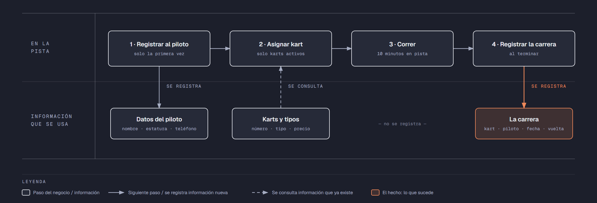

# Evidencia Integral — Caso: VeloKart

**Alumno:** Gomez Ordaz Bryan Omar (matrícula 2254247)
**Base de datos a crear:** `VeloKartDB`

← [Regresar a la descripción de la evidencia](../descripcion-evidencia-integral.md)

---

## Historia de usuario

**Como** dueño de VeloKart, **quiero** una base de datos que registre mis karts, a los pilotos que vienen y cada carrera que corren, **para** saber cuánto se usa cada kart, cuánto se cobró por cada carrera y qué pilotos registrados nunca han vuelto a correr.

## El negocio

VeloKart es una **pista de go-karts**. Cada **carrera** es una tanda de 10 minutos en la pista con un kart. Maneja **tipos de kart**: Infantil, Estándar y Profesional, según su tamaño y su motor. Cada tipo tiene su propio **precio por carrera**; por ejemplo, el Profesional cuesta más que el Infantil. **Los precios cambian** de vez en cuando. Aun así, el negocio necesita saber **cuánto se cobró por cada carrera**, con el precio que estaba vigente el día de la carrera.

Cada **kart** es de un tipo, tiene un **número** pintado que no se repite (por ejemplo, `K-07`) y una **fecha de alta**, que es el día en que empezó a usarse en la pista. Cuando un kart ya no sirve (por ejemplo, porque se le desgastó el motor), se **da de baja**: no se borra, porque se quiere conservar su historial de carreras.

Los **pilotos** se registran una sola vez con su nombre, su **estatura en centímetros** y su teléfono. El teléfono identifica al piloto: no puede haber dos pilotos con el mismo. Por seguridad, solo se registra a pilotos que miden **al menos 120 cm**.

Al terminar cada carrera, el cronómetro de la pista marca la **mejor vuelta** del piloto, en segundos (por ejemplo, 42.35 segundos).

Si el negocio deja de manejar un tipo de kart, tampoco lo borra: lo **da de baja**. Lo mismo pasa con los pilotos: si un piloto ya no regresa, se lo da de baja en lugar de borrarlo. Así se conserva el historial de carreras.

## Los hechos de este negocio

En VeloKart, **el hecho es la carrera**: cada vez que un piloto corre en un kart, sucede una carrera, en una fecha. Es la **tabla más importante** de tu modelo: tiene una fila por cada carrera, es la que más crece y es donde se guarda lo que realmente pasó (quién corrió, en qué kart, cuándo, cuál fue su mejor vuelta y cuánto se le cobró).

**Esta tabla la propones tú**: su nombre, sus columnas y sus llaves. No viene en "Lo que el negocio ya tiene definido", porque los hechos no se definen de antemano: suceden.

## Lo que el negocio ya tiene definido

Estos datos **no los inventas**: son los que VeloKart ya tiene. Tu base de datos debe guardarlos **exactamente así**, con los mismos nombres y valores.

Son los **datos iniciales** con los que arranca tu base de datos: **tipos de kart y precio por carrera** y **karts**. Hoy todo lo que aparece en estas tablas está **activo**, salvo el kart que se indica como dado de baja.

**Tipos de kart y precio por carrera**

| Tipo de kart | Precio por carrera |
|---|---|
| Infantil | $180.00 |
| Estándar | $250.00 |
| Profesional | $350.00 |

**Karts**

| Tipo de kart | Número | Fecha de alta | ¿Activo? |
|---|---|---|---|
| Infantil | `K-01` | 01/03/2024 | Sí |
| Infantil | `K-02` | 01/03/2024 | Sí |
| Estándar | `K-07` | 01/03/2024 | Sí |
| Estándar | `K-08` | 15/06/2024 | Sí |
| Profesional | `K-12` | 10/09/2024 | Sí |
| Profesional | `K-13` | 20/02/2025 | Sí |
| Estándar | `K-09` | 15/06/2024 | **No** |
| Infantil | `K-03` | 05/10/2025 | Sí |

Todo lo demás (pilotos y carreras) **lo inventas tú**, cumpliendo los mínimos de [Lo que debes construir](#lo-que-debes-construir).

## Flujo de negocio

Así funciona una operación de principio a fin. Arriba, lo que pasa en la pista; abajo, la información que cada paso consulta o registra.

Con detalle, un piloto imaginario (Marco) recorriendo el flujo:

1. **Marco llega por primera vez** a VeloKart. En el mostrador le piden su nombre y su teléfono, lo miden (172 cm) y lo **registran como piloto**. Si Marco regresa otro día, ya no se le registra de nuevo: se le busca por su teléfono.
2. **Se le asigna un kart.** El encargado revisa qué karts están **activos**; los dados de baja ya no salen a la pista. Le asigna el kart `K-07`, que es de tipo Estándar, y le dice el precio por carrera de ese tipo: hoy, $250.00.
3. **Marco corre la carrera:** 10 minutos en la pista.
4. **Al terminar, se registra la carrera:** kart `K-07`, piloto Marco, fecha de hoy, su mejor vuelta (41.80 segundos) y el precio con el que se le cobra ($250.00).

Si el mes siguiente sube el precio de los karts Estándar a $280.00, la carrera de Marco tiene que seguir diciendo que se le cobró a $250.00.

A la semana siguiente, Marco regresa y le toca el kart `K-12`, que es Profesional: es otra carrera, del mismo piloto y de otro kart. Ese mismo día, el kart `K-07` lo usa otro piloto. Así, **un piloto acumula muchas carreras y un kart también**.

## Reglas de negocio

- Cada kart es de **un solo** tipo.
- No puede haber dos tipos de kart con el mismo nombre, ni dos karts con el mismo número, ni dos pilotos con el mismo teléfono.
- El precio por carrera siempre es **mayor a cero**.
- Un piloto mide **al menos 120 cm**.
- La mejor vuelta de una carrera siempre es **mayor a cero** segundos.
- Un kart nuevo se registra como **activo**.
- Un tipo de kart nuevo y un piloto nuevo también se registran como **activos**.
- Cuando cambia el precio de un tipo de kart, las carreras que ya se corrieron **conservan el precio con el que se cobraron**.

## Lo que debes construir

1. El **modelo relacional**, con al menos 4 tablas, que guarde toda la información de arriba y respete las reglas de negocio con restricciones (`PRIMARY KEY`, `FOREIGN KEY`, `UNIQUE`, `CHECK`, `DEFAULT`).
2. El **paquete de instalación** y el **paquete de reversa** de `VeloKartDB`.
3. **Datos iniciales:**
   - **Lo que el negocio ya tiene definido**, exactamente como viene arriba: los 3 tipos de kart con su precio por carrera y los 8 karts.
   - **Lo que tú inventas**, como mínimo: 10 pilotos y 20 carreras, con
     - 2 pilotos que nunca hayan corrido;
     - 2 karts que nunca se hayan usado;
     - al menos 1 piloto dado de baja;
     - pilotos que midan más de 170 cm;
     - cada carrera con el precio con el que se cobró (en tus datos, el precio de su tipo de kart que viene arriba);
     - carreras en marzo de 2026;
     - pilotos cuyo nombre comience con "Luis".
4. **Las 10 consultas** de abajo.

## Consultas

| # | Pregunta del negocio |
|---|---|
| 1 | Lista los pilotos que miden más de 170 cm, del más alto al más bajo. |
| 2 | Lista los karts activos, del más antiguo al más reciente según su fecha de alta. |
| 3 | Lista los pilotos cuyo nombre comienza con "Luis". |
| 4 | Lista las carreras de marzo de 2026, ordenadas por fecha. |
| 5 | Muestra las 5 carreras con la mejor vuelta más rápida. |
| 6 | Muestra cada kart con el nombre de su tipo de kart y su precio por carrera. |
| 7 | Muestra cada carrera con el número del kart, el precio cobrado y el precio actual de su tipo de kart. |
| 8 | Muestra cada carrera con el nombre del piloto, el número del kart, la fecha y la mejor vuelta. |
| 9 | Lista los pilotos que nunca han corrido. |
| 10 | Lista los karts que nunca se han usado. |

## Entrega

Ver [Entregables](../descripcion-evidencia-integral.md#entregables) y [Forma de entrega](../descripcion-evidencia-integral.md#forma-de-entrega) en la descripción de la evidencia.
