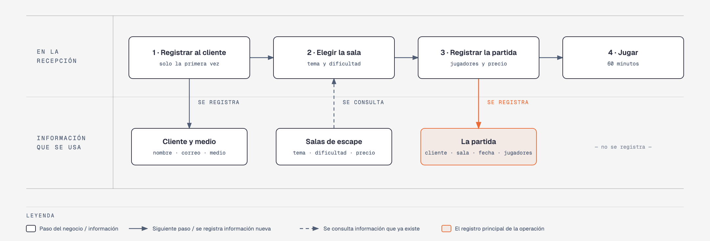

# Evidencia Integral — Caso: EnigmaRoom

**Alumno:** Gonzalez Hernandez Iker Emmanuel (matrícula 2253970)
**Base de datos a crear:** `EnigmaRoomDB`

← [Regresar a la descripción de la evidencia](../descripcion-evidencia-integral.md)

---

## Historia de usuario

**Como** dueña de EnigmaRoom, **quiero** una base de datos que registre a mis clientes, mis salas de escape y cada partida que se juega, **para** saber qué salas se juegan más, cuánto se cobró por cada partida y cómo se enteran los clientes de mi negocio.

## El negocio

EnigmaRoom es un negocio de **salas de escape** (*escape rooms*): un grupo de amigos entra a una sala ambientada y tiene 60 minutos para resolver acertijos y salir. Tiene varias **salas de escape**; cada una tiene un **nombre** que no se repite, un tema, una **dificultad** del 1 (la más fácil) al 5 (la más difícil) y un **precio por partida**. El precio es por grupo: se cobra lo mismo sin importar cuántos jugadores entren. **Los precios cambian** de vez en cuando. Aun así, el negocio necesita saber **cuánto se cobró por cada partida**, con el precio que tenía la sala el día de la partida.

Los **clientes** son las personas que reservan las partidas. Se registran una sola vez con su nombre, su correo electrónico, la fecha de registro y el **medio por el que conocieron el negocio** (por ejemplo, Redes sociales o Recomendación). El medio no cambia el precio: solo sirve para saber qué publicidad funciona. El correo identifica al cliente: no puede haber dos clientes con el mismo. Cuando un cliente pide que borren su registro, se le **da de baja**, pero no se borra, para conservar sus partidas.

En cada partida entran **de 2 a 6 jugadores**.

Si el negocio deja de usar un medio o deja de ofrecer una sala de escape, no se borran: se **dan de baja**, para conservar el historial de partidas.

## Lo que el negocio ya tiene definido

Estos datos **no los inventas**: son los que EnigmaRoom ya tiene. Tu base de datos debe guardarlos **exactamente así**, con los mismos nombres y valores.

Son los **datos iniciales** con los que arranca tu base de datos: **medios por los que los clientes conocen el negocio** y **salas de escape**. Hoy todo lo que aparece en estas tablas está **activo**.

**Medios por los que los clientes conocen el negocio**

| Medio |
|---|
| Redes sociales |
| Recomendación |
| Volante |
| Búsqueda en internet |

**Salas de escape**

| Nombre | Tema | Dificultad | Precio por partida |
|---|---|---|---|
| El Laboratorio | Ciencia | 3 | $900.00 |
| La Cripta | Terror | 5 | $1,100.00 |
| El Gran Robo | Robo de banco | 4 | $1,000.00 |
| La Cabaña | Misterio | 2 | $800.00 |
| El Submarino | Aventura | 3 | $950.00 |
| La Escuela de Magia | Fantasía | 1 | $750.00 |

Todo lo demás (clientes y partidas) **lo inventas tú**, cumpliendo los mínimos de [Lo que debes construir](#lo-que-debes-construir).

## Flujo de negocio

Así funciona una operación de principio a fin. Arriba, lo que pasa en la recepción; abajo, la información que cada paso consulta o registra.

Con detalle, una clienta imaginaria (Paola) recorriendo el flujo:

1. **Paola llega por primera vez** a EnigmaRoom con tres amigas. En la recepción le piden su nombre, su correo y cómo se enteró del negocio (Redes sociales), y la **registran como clienta** con la fecha de hoy. Si Paola regresa otro día, ya no se le registra de nuevo: se le busca por su correo.
2. **Paola elige la sala.** La recepcionista le muestra el tema, la dificultad y el **precio vigente** de cada sala. Paola elige "El Laboratorio": hoy, $900.00 por partida.
3. **Se registra la partida:** clienta Paola, sala "El Laboratorio", fecha de hoy, 4 jugadores y el precio con el que se le cobra ($900.00).
4. **El grupo juega** sus 60 minutos. Si escapan o no, no se registra en la base de datos.

Si el mes siguiente "El Laboratorio" sube a $980.00, la partida de Paola tiene que seguir diciendo que se le cobró a $900.00.

Un mes después, Paola regresa y juega "La Cripta": es otra partida, de la misma clienta y de otra sala. Ese mismo día, otro cliente juega "El Laboratorio". Así, **un cliente acumula muchas partidas y una sala también**.

## Reglas de negocio

- Cada cliente tiene **un solo** medio por el que conoció el negocio.
- No puede haber dos medios con el mismo nombre, ni dos salas de escape con el mismo nombre.
- No puede haber dos clientes con el mismo correo electrónico.
- La dificultad de una sala va **del 1 al 5**.
- El precio por partida siempre es **mayor a cero**.
- En una partida entran **de 2 a 6** jugadores.
- Cuando cambia el precio de una sala, las partidas que ya se jugaron **conservan el precio con el que se cobraron**.
- Un cliente nuevo se registra como **activo**.
- Un medio nuevo y una sala de escape nueva también se registran como **activos**.

## Lo que debes construir

1. El **modelo relacional**, con al menos 4 tablas, que guarde toda la información de arriba y respete las reglas de negocio con restricciones (`PRIMARY KEY`, `FOREIGN KEY`, `UNIQUE`, `CHECK`, `DEFAULT`).
2. El **paquete de instalación** y el **paquete de reversa** de `EnigmaRoomDB`.
3. **Datos iniciales:**
   - **Lo que el negocio ya tiene definido**, exactamente como viene arriba: los 4 medios y las 6 salas de escape.
   - **Lo que tú inventas**, como mínimo: 10 clientes y 20 partidas, con
     - clientes de los cuatro medios;
     - 2 clientes que nunca hayan jugado;
     - 2 salas que nunca se hayan jugado;
     - al menos 1 cliente dado de baja;
     - cada partida con el precio con el que se cobró (en tus datos, el precio de la sala que viene arriba);
     - partidas en marzo de 2026;
     - clientes con correo de `@hotmail.com`.
4. **Las 10 consultas** de abajo.

## Consultas

| # | Pregunta del negocio |
|---|---|
| 1 | Lista las salas de escape con dificultad de 3 o más, de la más difícil a la más fácil. |
| 2 | Lista los clientes activos, del más antiguo al más reciente según su fecha de registro. |
| 3 | Lista los clientes cuyo correo termina en "@hotmail.com". |
| 4 | Lista las partidas de marzo de 2026, ordenadas por fecha. |
| 5 | Muestra las 5 partidas con más jugadores. |
| 6 | Muestra cada cliente con el nombre del medio por el que conoció el negocio. |
| 7 | Muestra cada partida con el nombre de la sala, el precio cobrado y el precio actual de la sala. |
| 8 | Muestra cada partida con el nombre del cliente, el nombre de la sala, la fecha y el número de jugadores. |
| 9 | Lista los clientes que nunca han jugado. |
| 10 | Lista las salas de escape que nunca se han jugado. |

## Entrega

Ver [Entregables](../descripcion-evidencia-integral.md#entregables) y [Forma de entrega](../descripcion-evidencia-integral.md#forma-de-entrega) en la descripción de la evidencia.
