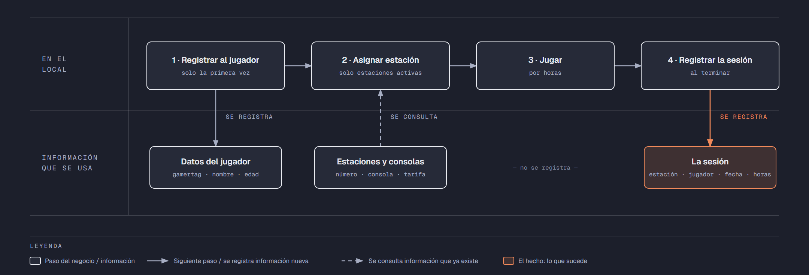

# Evidencia Integral — Caso: GameZone

**Alumno:** Guerrero Gutiérrez David (matrícula 2213053)
**Base de datos a crear:** `GameZoneDB`

← [Regresar a la descripción de la evidencia](../descripcion-evidencia-integral.md)

---

## Historia de usuario

**Como** dueño de GameZone, **quiero** una base de datos que registre mis estaciones de juego, a los jugadores que vienen y cada sesión que juegan, **para** saber cuánto se usa cada estación, cuánto se cobró por cada sesión y qué jugadores registrados nunca han vuelto a jugar.

## El negocio

GameZone es un **centro de videojuegos** que renta consolas por hora. Cada **sesión** es el tiempo que un jugador pasa en una estación. Maneja **tipos de consola**: PlayStation 5, Xbox Series X, Nintendo Switch y PC Gamer. Cada tipo tiene su propia **tarifa por hora**; por ejemplo, la PC Gamer cuesta más que el Nintendo Switch. **Las tarifas cambian** de vez en cuando. Aun así, el negocio necesita saber **cuánto se cobró en cada sesión**, con la tarifa que estaba vigente el día de la sesión.

Cada **estación** es un lugar del local con una consola, su pantalla y sus controles. Tiene una consola de un solo tipo, un **número** que no se repite (por ejemplo, `E-04`) y una **fecha de instalación**, que es el día en que empezó a usarse. Cuando la consola de una estación se descompone sin arreglo, la estación se **da de baja**: no se borra, porque se quiere conservar su historial de sesiones.

Los **jugadores** se registran una sola vez con su nombre, su **gamertag** (el apodo con el que juegan, por ejemplo `DiegoRayo15`) y su **edad**. El gamertag identifica al jugador: no puede haber dos jugadores con el mismo. Por los juegos que hay en el local, solo se registra a jugadores de **al menos 8 años**.

Una sesión dura **de 1 a 5 horas** completas; no se rentan fracciones de hora.

Si el negocio deja de manejar un tipo de consola, tampoco lo borra: lo **da de baja**. Lo mismo pasa con los jugadores: si un jugador ya no regresa, se lo da de baja en lugar de borrarlo. Así se conserva el historial de sesiones.

## Los hechos de este negocio

En GameZone, **el hecho es la sesión**: cada vez que un jugador usa una estación, sucede una sesión, en una fecha. Es la **tabla más importante** de tu modelo: tiene una fila por cada sesión, es la que más crece y es donde se guarda lo que realmente pasó (quién jugó, en qué estación, cuándo, cuántas horas y con qué tarifa se le cobró).

**Esta tabla la propones tú**: su nombre, sus columnas y sus llaves. No viene en "Lo que el negocio ya tiene definido", porque los hechos no se definen de antemano: suceden.

## Lo que el negocio ya tiene definido

Estos datos **no los inventas**: son los que GameZone ya tiene. Tu base de datos debe guardarlos **exactamente así**, con los mismos nombres y valores.

Son los **datos iniciales** con los que arranca tu base de datos: **tipos de consola y tarifa por hora** y **estaciones**. Hoy todo lo que aparece en estas tablas está **activo**, salvo la estación que se indica como dada de baja.

**Tipos de consola y tarifa por hora**

| Tipo de consola | Tarifa por hora |
|---|---|
| PlayStation 5 | $60.00 |
| Xbox Series X | $55.00 |
| Nintendo Switch | $45.00 |
| PC Gamer | $75.00 |

**Estaciones**

| Tipo de consola | Número | Fecha de instalación | ¿Activa? |
|---|---|---|---|
| PlayStation 5 | `E-01` | 10/05/2024 | Sí |
| PlayStation 5 | `E-02` | 10/05/2024 | Sí |
| PlayStation 5 | `E-04` | 10/05/2024 | Sí |
| Xbox Series X | `E-05` | 20/08/2024 | Sí |
| Xbox Series X | `E-06` | 20/08/2024 | Sí |
| Nintendo Switch | `E-07` | 15/11/2024 | Sí |
| Nintendo Switch | `E-08` | 25/01/2025 | Sí |
| PC Gamer | `E-09` | 03/03/2025 | Sí |
| PC Gamer | `E-10` | 12/06/2025 | **No** |
| Nintendo Switch | `E-03` | 01/10/2025 | Sí |

Todo lo demás (jugadores y sesiones) **lo inventas tú**, cumpliendo los mínimos de [Lo que debes construir](#lo-que-debes-construir).

## Flujo de negocio

Así funciona una operación de principio a fin. Arriba, lo que pasa en el local; abajo, la información que cada paso consulta o registra.

Con detalle, un jugador imaginario (Diego) recorriendo el flujo:

1. **Diego llega por primera vez** a GameZone. En el mostrador le piden su nombre, su gamertag (`DiegoRayo15`) y su edad (15 años), y lo **registran como jugador**. Si Diego regresa otro día, ya no se le registra de nuevo: se le busca por su gamertag.
2. **Se le asigna una estación.** El encargado revisa qué estaciones están **activas**; las dadas de baja ya no se rentan. Le asigna la estación `E-04`, que tiene un PlayStation 5, y le dice la tarifa por hora de ese tipo de consola: hoy, $60.00.
3. **Diego juega** 2 horas.
4. **Al terminar, se registra la sesión:** estación `E-04`, jugador Diego, fecha de hoy, 2 horas y la tarifa por hora con la que se le cobra ($60.00). Se le cobran las horas por esa tarifa.

Si el mes siguiente sube la tarifa del PlayStation 5 a $70.00, la sesión de Diego tiene que seguir diciendo que se le cobró a $60.00 la hora.

A la semana siguiente, Diego regresa y le toca la estación `E-09`, que es una PC Gamer: es otra sesión, del mismo jugador y de otra estación. Ese mismo día, la `E-04` la usa otra jugadora. Así, **un jugador acumula muchas sesiones y una estación también**.

## Reglas de negocio

- Cada estación tiene consola de **un solo** tipo.
- No puede haber dos tipos de consola con el mismo nombre, ni dos estaciones con el mismo número, ni dos jugadores con el mismo gamertag.
- La tarifa por hora siempre es **mayor a cero**.
- Un jugador tiene **al menos 8 años**.
- Una sesión dura **al menos 1 hora** y **como máximo 5 horas**.
- Una estación nueva se registra como **activa**.
- Un tipo de consola nuevo y un jugador nuevo también se registran como **activos**.
- Cuando cambia la tarifa de un tipo de consola, las sesiones que ya se jugaron **conservan la tarifa con la que se cobraron**.

## Lo que debes construir

1. El **modelo relacional**, con al menos 4 tablas, que guarde toda la información de arriba y respete las reglas de negocio con restricciones (`PRIMARY KEY`, `FOREIGN KEY`, `UNIQUE`, `CHECK`, `DEFAULT`).
2. El **paquete de instalación** y el **paquete de reversa** de `GameZoneDB`.
3. **Datos iniciales:**
   - **Lo que el negocio ya tiene definido**, exactamente como viene arriba: los 4 tipos de consola con su tarifa por hora y las 10 estaciones.
   - **Lo que tú inventas**, como mínimo: 10 jugadores y 20 sesiones, con
     - 2 jugadores que nunca hayan jugado;
     - 2 estaciones que nunca se hayan usado;
     - al menos 1 jugador dado de baja;
     - jugadores de 18 años o más;
     - cada sesión con la tarifa con la que se cobró (en tus datos, la tarifa de su tipo de consola que viene arriba);
     - sesiones en marzo de 2026;
     - jugadores cuyo gamertag contenga la palabra "Pro".
4. **Las 10 consultas** de abajo.

## Consultas

| # | Pregunta del negocio |
|---|---|
| 1 | Lista los jugadores de 18 años o más, del mayor al menor. |
| 2 | Lista las estaciones activas, de la más antigua a la más reciente según su fecha de instalación. |
| 3 | Lista los jugadores cuyo gamertag contiene la palabra "Pro". |
| 4 | Lista las sesiones de marzo de 2026, ordenadas por fecha. |
| 5 | Muestra las 5 sesiones más largas. |
| 6 | Muestra cada estación con el nombre de su tipo de consola y su tarifa por hora. |
| 7 | Muestra cada sesión con el número de la estación, la tarifa por hora cobrada y la tarifa por hora actual de su tipo de consola. |
| 8 | Muestra cada sesión con el gamertag del jugador, el número de la estación, la fecha y las horas. |
| 9 | Lista los jugadores que nunca han jugado. |
| 10 | Lista las estaciones que nunca se han usado. |

## Entrega

Ver [Entregables](../descripcion-evidencia-integral.md#entregables) y [Forma de entrega](../descripcion-evidencia-integral.md#forma-de-entrega) en la descripción de la evidencia.
