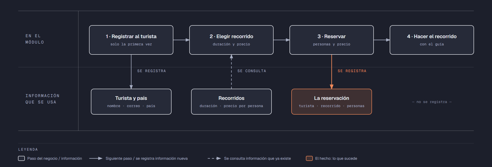

# Evidencia Integral — Caso: RecorreMTY

**Alumno:** Hernandez Arreola Walter Daniel (matrícula 2253626)
**Base de datos a crear:** `RecorreMTYDB`

← [Regresar a la descripción de la evidencia](../descripcion-evidencia-integral.md)

---

## Historia de usuario

**Como** dueña de RecorreMTY, **quiero** una base de datos que registre a mis turistas, mis recorridos y cada reservación que hacen, **para** saber qué recorridos se venden más, cuánto se cobró en cada reservación y de qué países vienen mis turistas.

## El negocio

RecorreMTY es un negocio de **recorridos turísticos guiados por Monterrey**. Tiene un módulo de atención en la Macroplaza, donde los turistas reservan. Ofrece varios **recorridos**; cada uno tiene un **nombre** que no se repite, una **duración en horas** (por ejemplo, 1.5 horas) y un **precio por persona**. **Los precios cambian** de vez en cuando. Aun así, el negocio necesita saber **cuánto se cobró en cada reservación**, con el precio por persona que tenía el recorrido el día que se reservó.

Los **turistas** son las personas que hacen las reservaciones. Se registran una sola vez con su nombre, su correo electrónico, la fecha de registro y su **país de origen**. El país no cambia el precio: todos pagan lo mismo; solo sirve para saber de dónde vienen los turistas. El correo identifica al turista: no puede haber dos turistas con el mismo. Cuando un turista pide que borren su registro, se le **da de baja**, pero no se borra, para conservar sus reservaciones.

En cada reservación, el turista aparta lugar para **de 1 a 10 personas** (él y sus acompañantes), que es lo que cabe en la camioneta del recorrido.

Si el negocio deja de usar un país o deja de ofrecer un recorrido, no se borran: se **dan de baja**, para conservar el historial de reservaciones.

## Los hechos de este negocio

En RecorreMTY, **el hecho es la reservación**: cada vez que un turista reserva un recorrido, sucede una reservación, en una fecha. Es la **tabla más importante** de tu modelo: tiene una fila por cada reservación, es la que más crece y es donde se guarda lo que realmente pasó (quién reservó, qué recorrido, para qué fecha, cuántas personas y con qué precio por persona se le cobró).

**Esta tabla la propones tú**: su nombre, sus columnas y sus llaves. No viene en "Lo que el negocio ya tiene definido", porque los hechos no se definen de antemano: suceden.

## Lo que el negocio ya tiene definido

Estos datos **no los inventas**: son los que RecorreMTY ya tiene. Tu base de datos debe guardarlos **exactamente así**, con los mismos nombres y valores.

Son los **datos iniciales** con los que arranca tu base de datos: **países de origen de los turistas** y **recorridos**. Hoy todo lo que aparece en estas tablas está **activo**.

**Países de origen de los turistas**

| País |
|---|
| México |
| Estados Unidos |
| Canadá |
| España |
| Colombia |

**Recorridos**

| Nombre | Duración (horas) | Precio por persona |
|---|---|---|
| Barrio Antiguo | 2.0 | $250.00 |
| Paseo Santa Lucía | 1.5 | $200.00 |
| Parque Fundidora | 3.0 | $300.00 |
| Chipinque | 4.0 | $450.00 |
| Cerro de la Silla | 5.0 | $550.00 |
| Grutas de García | 6.0 | $650.00 |

Todo lo demás (turistas y reservaciones) **lo inventas tú**, cumpliendo los mínimos de [Lo que debes construir](#lo-que-debes-construir).

## Flujo de negocio

Así funciona una operación de principio a fin. Arriba, lo que pasa en el módulo de atención; abajo, la información que cada paso consulta o registra.

Con detalle, una turista imaginaria (Emily) recorriendo el flujo:

1. **Emily llega por primera vez** al módulo de RecorreMTY. Le piden su nombre, su correo y su país de origen (Canadá), y la **registran como turista** con la fecha de hoy. Si Emily regresa otro día, ya no se le registra de nuevo: se le busca por su correo.
2. **Emily elige el recorrido.** El encargado le muestra la duración y el **precio por persona vigente** de cada recorrido. Emily elige "Barrio Antiguo": hoy, $250.00 por persona.
3. **Se registra la reservación:** turista Emily, recorrido "Barrio Antiguo", fecha del recorrido, 3 personas (ella y dos amigas) y el precio por persona con el que se le cobra ($250.00). Se le cobran las personas por ese precio.
4. **El grupo hace el recorrido** con el guía. Lo que pasa durante el paseo no se registra en la base de datos.

Si el mes siguiente "Barrio Antiguo" sube a $280.00 por persona, la reservación de Emily tiene que seguir diciendo que se le cobró a $250.00 por persona.

Dos días después, Emily reserva "Chipinque": es otra reservación, de la misma turista y de otro recorrido. Ese mismo día, otro turista reserva "Barrio Antiguo". Así, **un turista acumula muchas reservaciones y un recorrido también**.

## Reglas de negocio

- Cada turista tiene **un solo** país de origen.
- No puede haber dos países con el mismo nombre, ni dos recorridos con el mismo nombre.
- No puede haber dos turistas con el mismo correo electrónico.
- La duración de un recorrido siempre es **mayor a cero**.
- El precio por persona siempre es **mayor a cero**.
- En una reservación se aparta lugar para **de 1 a 10** personas.
- Cuando cambia el precio de un recorrido, las reservaciones que ya se hicieron **conservan el precio con el que se cobraron**.
- Un turista nuevo se registra como **activo**.
- Un país nuevo y un recorrido nuevo también se registran como **activos**.

## Lo que debes construir

1. El **modelo relacional**, con al menos 4 tablas, que guarde toda la información de arriba y respete las reglas de negocio con restricciones (`PRIMARY KEY`, `FOREIGN KEY`, `UNIQUE`, `CHECK`, `DEFAULT`).
2. El **paquete de instalación** y el **paquete de reversa** de `RecorreMTYDB`.
3. **Datos iniciales:**
   - **Lo que el negocio ya tiene definido**, exactamente como viene arriba: los 5 países y los 6 recorridos.
   - **Lo que tú inventas**, como mínimo: 10 turistas y 20 reservaciones, con
     - turistas de los cinco países;
     - 2 turistas que nunca hayan reservado;
     - 2 recorridos que nunca se hayan reservado;
     - al menos 1 turista dado de baja;
     - cada reservación con el precio por persona con el que se cobró (en tus datos, el precio del recorrido que viene arriba);
     - reservaciones en marzo de 2026;
     - turistas con correo de `@outlook.com`.
4. **Las 10 consultas** de abajo.

## Consultas

| # | Pregunta del negocio |
|---|---|
| 1 | Lista los recorridos de 3 horas o más, del más largo al más corto. |
| 2 | Lista los turistas activos, del más antiguo al más reciente según su fecha de registro. |
| 3 | Lista los turistas cuyo correo termina en "@outlook.com". |
| 4 | Lista las reservaciones de marzo de 2026, ordenadas por fecha. |
| 5 | Muestra las 5 reservaciones con más personas. |
| 6 | Muestra cada turista con el nombre de su país de origen. |
| 7 | Muestra cada reservación con el nombre del recorrido, el precio por persona cobrado y el precio por persona actual del recorrido. |
| 8 | Muestra cada reservación con el nombre del turista, el nombre del recorrido, la fecha y el número de personas. |
| 9 | Lista los turistas que nunca han reservado. |
| 10 | Lista los recorridos que nunca se han reservado. |

## Entrega

Ver [Entregables](../descripcion-evidencia-integral.md#entregables) y [Forma de entrega](../descripcion-evidencia-integral.md#forma-de-entrega) en la descripción de la evidencia.
