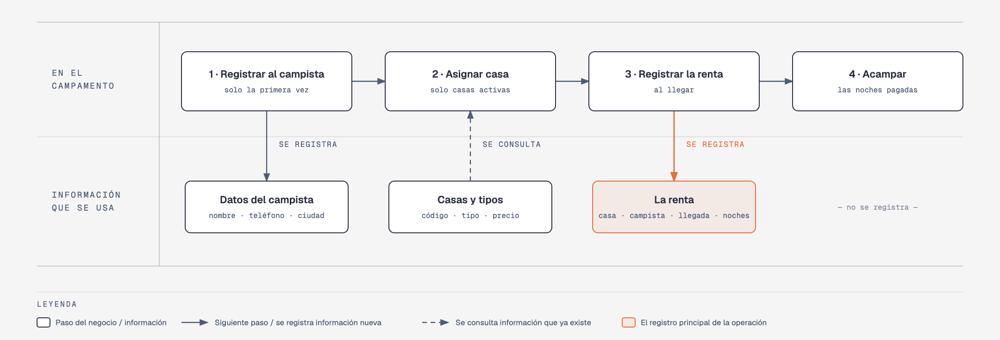

# Evidencia Integral — Caso: CampoVerde

**Alumno:** Hernandez Juarez Brenda Ivonne (matrícula 2253945)
**Base de datos a crear:** `CampoVerdeDB`

← [Regresar a la descripción de la evidencia](../descripcion-evidencia-integral.md)

---

## Historia de usuario

**Como** dueña de CampoVerde, **quiero** una base de datos que registre mis casas de campaña, a los campistas que vienen y cada renta que hacen, **para** saber cuánto se usa cada casa de campaña, cuánto se cobró por cada renta y qué campistas registrados nunca han vuelto a acampar.

## El negocio

CampoVerde es un **campamento** en la sierra que renta **casas de campaña por noche**. Maneja **tipos de casa de campaña** según cuántas personas caben en ella: 2 personas, 4 personas y 6 personas. Cada tipo tiene su propio **precio por noche**; por ejemplo, la de 6 personas cuesta más que la de 2. **Los precios cambian** de vez en cuando. Aun así, el negocio necesita saber **cuánto se cobró en cada renta**, con el precio por noche que estaba vigente el día en que llegó el campista.

Cada **casa de campaña** es de un tipo, tiene un **código** que no se repite (por ejemplo, `T-03`) y una **fecha de compra**. Cuando una casa de campaña ya no sirve (por ejemplo, porque se rompió con el viento), se **da de baja**: no se borra, porque se quiere conservar su historial de rentas.

Los **campistas** se registran una sola vez con su nombre, su teléfono y la ciudad de donde vienen. El teléfono identifica al campista: no puede haber dos campistas con el mismo.

Cada renta es **de 1 a 7 noches**: el campamento no renta por más de una semana seguida.

Si el negocio deja de manejar un tipo de casa de campaña, tampoco lo borra: lo **da de baja**. Lo mismo pasa con los campistas: si un campista ya no regresa, se lo da de baja en lugar de borrarlo. Así se conserva el historial de rentas.

## Lo que el negocio ya tiene definido

Estos datos **no los inventas**: son los que CampoVerde ya tiene. Tu base de datos debe guardarlos **exactamente así**, con los mismos nombres y valores.

Son los **datos iniciales** con los que arranca tu base de datos: **tipos de casa de campaña y precio por noche** y **casas de campaña**. Hoy todo lo que aparece en estas tablas está **activo**, salvo la casa de campaña que se indica como dada de baja.

**Tipos de casa de campaña y precio por noche**

| Tipo de casa de campaña | Precio por noche |
|---|---|
| 2 personas | $250.00 |
| 4 personas | $380.00 |
| 6 personas | $520.00 |

**Casas de campaña**

| Tipo de casa de campaña | Código | Fecha de compra | ¿Activa? |
|---|---|---|---|
| 2 personas | `T-01` | 10/02/2024 | Sí |
| 2 personas | `T-02` | 10/02/2024 | Sí |
| 4 personas | `T-03` | 15/03/2024 | Sí |
| 4 personas | `T-04` | 05/07/2024 | Sí |
| 6 personas | `T-05` | 05/07/2024 | Sí |
| 6 personas | `T-06` | 20/01/2025 | Sí |
| 4 personas | `T-07` | 18/11/2023 | **No** |
| 2 personas | `T-08` | 15/11/2025 | Sí |

Todo lo demás (campistas y rentas) **lo inventas tú**, cumpliendo los mínimos de [Lo que debes construir](#lo-que-debes-construir).

## Flujo de negocio

Así funciona una operación de principio a fin. Arriba, lo que pasa en el campamento; abajo, la información que cada paso consulta o registra.

Con detalle, una campista imaginaria (Rocío) recorriendo el flujo:

1. **Rocío llega por primera vez** a CampoVerde con su familia. En la caseta de entrada le piden su nombre, su teléfono y la ciudad de donde viene (Monterrey), y la **registran como campista**. Si Rocío regresa otro día, ya no se le registra de nuevo: se le busca por su teléfono.
2. **Se le asigna una casa de campaña.** El encargado revisa qué casas de campaña están **activas**; las dadas de baja ya no se rentan. Como son cuatro, le asigna la `T-03`, que es de 4 personas, y le dice el precio por noche de ese tipo: hoy, $380.00.
3. **Se registra la renta al llegar:** casa de campaña `T-03`, campista Rocío, fecha de llegada de hoy, 2 noches y el precio por noche con el que se le cobra ($380.00). Se le cobran las noches por ese precio.
4. **La familia acampa** las 2 noches que pagó y al final entrega la casa de campaña.

Si el mes siguiente sube el precio de las casas de campaña de 4 personas a $420.00, la renta de Rocío tiene que seguir diciendo que se le cobró a $380.00 por noche.

En vacaciones, Rocío regresa y le toca la `T-05`, que es de 6 personas: es otra renta, de la misma campista y de otra casa de campaña. Ese mismo fin de semana, la `T-03` la renta otro campista. Así, **un campista acumula muchas rentas y una casa de campaña también**.

## Reglas de negocio

- Cada casa de campaña es de **un solo** tipo.
- No puede haber dos tipos de casa de campaña con el mismo nombre, ni dos casas de campaña con el mismo código, ni dos campistas con el mismo teléfono.
- El precio por noche siempre es **mayor a cero**.
- Una renta es de **al menos 1 noche** y **como máximo 7 noches**.
- Una casa de campaña nueva se registra como **activa**.
- Un tipo de casa de campaña nuevo y un campista nuevo también se registran como **activos**.
- Cuando cambia el precio de un tipo de casa de campaña, las rentas que ya se hicieron **conservan el precio con el que se cobraron**.

## Lo que debes construir

1. El **modelo relacional**, con al menos 4 tablas, que guarde toda la información de arriba y respete las reglas de negocio con restricciones (`PRIMARY KEY`, `FOREIGN KEY`, `UNIQUE`, `CHECK`, `DEFAULT`).
2. El **paquete de instalación** y el **paquete de reversa** de `CampoVerdeDB`.
3. **Datos iniciales:**
   - **Lo que el negocio ya tiene definido**, exactamente como viene arriba: los 3 tipos de casa de campaña con su precio por noche y las 8 casas de campaña.
   - **Lo que tú inventas**, como mínimo: 10 campistas y 20 rentas, con
     - 2 campistas que nunca hayan rentado;
     - 2 casas de campaña que nunca se hayan rentado;
     - al menos 1 campista dado de baja;
     - rentas de más de 2 noches;
     - cada renta con el precio por noche con el que se cobró (en tus datos, el precio de su tipo de casa de campaña que viene arriba);
     - rentas con llegada en marzo de 2026;
     - campistas de ciudades cuyo nombre comience con "San" (por ejemplo, San Pedro Garza García).
4. **Las 10 consultas** de abajo.

## Consultas

| # | Pregunta del negocio |
|---|---|
| 1 | Lista las rentas de más de 2 noches, de la más larga a la más corta. |
| 2 | Lista las casas de campaña activas, de la más antigua a la más reciente según su fecha de compra. |
| 3 | Lista los campistas cuya ciudad comienza con "San". |
| 4 | Lista las rentas con llegada en marzo de 2026, ordenadas por fecha. |
| 5 | Muestra las 5 rentas con más noches. |
| 6 | Muestra cada casa de campaña con el nombre de su tipo y su precio por noche. |
| 7 | Muestra cada renta con el código de la casa de campaña, el precio por noche cobrado y el precio por noche actual de su tipo. |
| 8 | Muestra cada renta con el nombre del campista, el código de la casa de campaña, la fecha de llegada y las noches. |
| 9 | Lista los campistas que nunca han rentado. |
| 10 | Lista las casas de campaña que nunca se han rentado. |

## Entrega

Ver [Entregables](../descripcion-evidencia-integral.md#entregables) y [Forma de entrega](../descripcion-evidencia-integral.md#forma-de-entrega) en la descripción de la evidencia.
