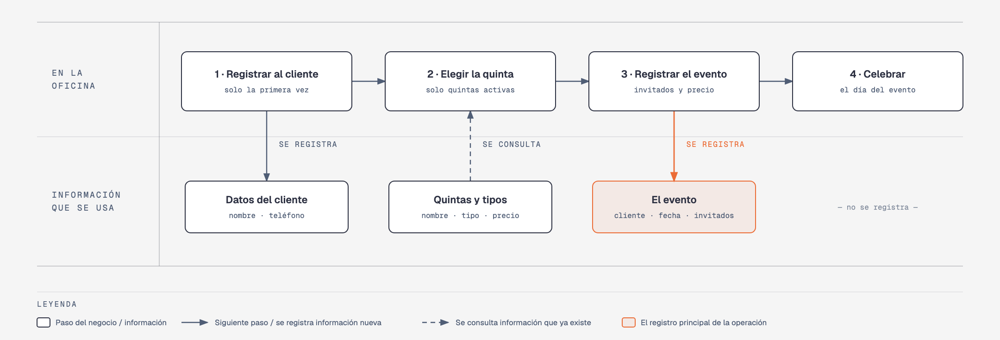

# Evidencia Integral — Caso: QuintaSol

**Alumno:** Hernandez Martínez Alexander Kalet (matrícula 2212470)
**Base de datos a crear:** `QuintaSolDB`

← [Regresar a la descripción de la evidencia](../descripcion-evidencia-integral.md)

---

## Historia de usuario

**Como** dueña de QuintaSol, **quiero** una base de datos que registre mis quintas, a los clientes que las rentan y cada evento que se celebra en ellas, **para** saber qué quintas se rentan más, cuánto se cobró por cada evento y qué clientes registrados nunca han hecho una fiesta con nosotros.

## El negocio

QuintaSol **renta quintas para fiestas**: bodas, XV años, bautizos y cumpleaños. Cada quinta se renta **por día**: un **evento** ocupa la quinta un día completo. Maneja **tipos de quinta**: Chica, Mediana y Grande, según el tamaño del jardín y del salón. Cada tipo tiene su propio **precio por día**; por ejemplo, una quinta Grande cuesta más que una Chica. **Los precios cambian** de vez en cuando. Aun así, el negocio necesita saber **cuánto se cobró por cada evento**, con el precio que estaba vigente cuando se rentó la quinta.

Cada **quinta** es de un tipo, tiene un **nombre** que no se repite (por ejemplo, "Los Nogales") y una **fecha de apertura**, que es el día en que empezó a rentarse. Cuando una quinta deja de rentarse (por ejemplo, porque el dueño del terreno ya no la presta), se **da de baja**: no se borra, porque se quiere conservar su historial de eventos.

Los **clientes** se registran una sola vez con su nombre y su teléfono. El teléfono identifica al cliente: no puede haber dos clientes con el mismo.

En cada evento se anota cuántos **invitados** van a asistir. Por reglamento de protección civil, un evento tiene **de 10 a 200 invitados**.

Si el negocio deja de manejar un tipo de quinta, tampoco lo borra: lo **da de baja**. Lo mismo pasa con los clientes: si un cliente ya no regresa, se lo da de baja en lugar de borrarlo. Así se conserva el historial de eventos.

## Lo que el negocio ya tiene definido

Estos datos **no los inventas**: son los que QuintaSol ya tiene. Tu base de datos debe guardarlos **exactamente así**, con los mismos nombres y valores.

Son los **datos iniciales** con los que arranca tu base de datos: **tipos de quinta y precio por día** y **quintas**. Hoy todo lo que aparece en estas tablas está **activo**, salvo la quinta que se indica como dada de baja.

**Tipos de quinta y precio por día**

| Tipo de quinta | Precio por día |
|---|---|
| Chica | $3,500.00 |
| Mediana | $5,500.00 |
| Grande | $8,000.00 |

**Quintas**

| Tipo de quinta | Nombre | Fecha de apertura | ¿Activa? |
|---|---|---|---|
| Mediana | Los Nogales | 01/04/2019 | Sí |
| Chica | El Encino | 15/02/2020 | Sí |
| Grande | Las Palmas | 10/09/2018 | Sí |
| Chica | Los Sauces | 01/06/2021 | Sí |
| Grande | La Hacienda | 20/03/2022 | Sí |
| Mediana | El Mezquite | 10/01/2023 | Sí |
| Mediana | Los Álamos | 05/11/2019 | **No** |
| Chica | La Huerta | 01/08/2025 | Sí |

Todo lo demás (clientes y eventos) **lo inventas tú**, cumpliendo los mínimos de [Lo que debes construir](#lo-que-debes-construir).

## Flujo de negocio

Así funciona una operación de principio a fin. Arriba, lo que pasa en la oficina de QuintaSol; abajo, la información que cada paso consulta o registra.

Con detalle, una clienta imaginaria (Gabriela) recorriendo el flujo:

1. **Gabriela llega por primera vez** a QuintaSol para organizar los XV años de su hija. En la oficina le piden su nombre y su teléfono, y la **registran como clienta**. Si Gabriela regresa otro día, ya no se le registra de nuevo: se le busca por su teléfono.
2. **Gabriela elige la quinta.** La encargada le muestra las quintas **activas**; las dadas de baja ya no se rentan. Gabriela elige "Los Nogales", que es Mediana, y la encargada le dice el precio por día de ese tipo: hoy, $5,500.00.
3. **Se registra el evento:** quinta "Los Nogales", clienta Gabriela, la fecha de la fiesta, 120 invitados y el precio con el que se le cobra ($5,500.00).
4. **El día del evento**, la familia celebra la fiesta en la quinta. Cómo estuvo la fiesta no se registra en la base de datos.

Si el mes siguiente sube el precio de las quintas Medianas a $6,000.00, el evento de Gabriela tiene que seguir diciendo que se le cobró a $5,500.00.

Al año siguiente, Gabriela regresa a festejar el cumpleaños de su esposo y renta "El Encino", que es Chica: es otro evento, de la misma clienta y de otra quinta. Una semana después, otro cliente renta "Los Nogales" para una boda. Así, **un cliente acumula muchos eventos y una quinta también**.

## Reglas de negocio

- Cada quinta es de **un solo** tipo.
- No puede haber dos tipos de quinta con el mismo nombre, ni dos quintas con el mismo nombre, ni dos clientes con el mismo teléfono.
- El precio por día siempre es **mayor a cero**.
- Un evento tiene **de 10 a 200** invitados.
- Una quinta nueva se registra como **activa**.
- Un tipo de quinta nuevo y un cliente nuevo también se registran como **activos**.
- Cuando cambia el precio de un tipo de quinta, los eventos que ya se rentaron **conservan el precio con el que se cobraron**.

## Lo que debes construir

1. El **modelo relacional**, con al menos 4 tablas, que guarde toda la información de arriba y respete las reglas de negocio con restricciones (`PRIMARY KEY`, `FOREIGN KEY`, `UNIQUE`, `CHECK`, `DEFAULT`).
2. El **paquete de instalación** y el **paquete de reversa** de `QuintaSolDB`.
3. **Datos iniciales:**
   - **Lo que el negocio ya tiene definido**, exactamente como viene arriba: los 3 tipos de quinta con su precio por día y las 8 quintas.
   - **Lo que tú inventas**, como mínimo: 10 clientes y 20 eventos, con
     - 2 clientes que nunca hayan hecho un evento;
     - 2 quintas que nunca se hayan rentado;
     - al menos 1 cliente dado de baja;
     - eventos con más de 100 invitados;
     - cada evento con el precio con el que se cobró (en tus datos, el precio de su tipo de quinta que viene arriba);
     - eventos en marzo de 2026.
4. **Las 10 consultas** de abajo.

## Consultas

| # | Pregunta del negocio |
|---|---|
| 1 | Lista los eventos con más de 100 invitados, del que tuvo más invitados al que tuvo menos. |
| 2 | Lista las quintas activas, de la más antigua a la más reciente según su fecha de apertura. |
| 3 | Lista las quintas cuyo nombre comienza con "Los". |
| 4 | Lista los eventos de marzo de 2026, ordenados por fecha. |
| 5 | Muestra los 5 eventos más recientes. |
| 6 | Muestra cada quinta con el nombre de su tipo de quinta y su precio por día. |
| 7 | Muestra cada evento con el nombre de la quinta, el precio cobrado y el precio actual de su tipo de quinta. |
| 8 | Muestra cada evento con el nombre del cliente, el nombre de la quinta, la fecha y el número de invitados. |
| 9 | Lista los clientes que nunca han hecho un evento. |
| 10 | Lista las quintas que nunca se han rentado. |

## Entrega

Ver [Entregables](../descripcion-evidencia-integral.md#entregables) y [Forma de entrega](../descripcion-evidencia-integral.md#forma-de-entrega) en la descripción de la evidencia.
