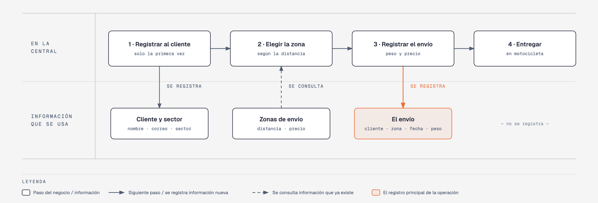

# Evidencia Integral — Caso: EnvíaYa

**Alumno:** Lopez Sustaita Jesus Alejandro (matrícula 2212897)
**Base de datos a crear:** `EnviaYaDB`

← [Regresar a la descripción de la evidencia](../descripcion-evidencia-integral.md)

---

## Historia de usuario

**Como** dueño de EnvíaYa, **quiero** una base de datos que registre a mis clientes, mis zonas de envío y cada paquete que mandamos, **para** saber a qué zonas se envía más, cuánto se cobró por cada envío y qué tipo de clientes usan más el servicio.

## El negocio

EnvíaYa es un servicio de **mensajería en motocicleta**: un repartidor recoge un paquete y lo lleva a su destino dentro de la ciudad. El precio depende de la **zona de envío**, que se decide por la distancia entre el lugar donde se recoge el paquete y su destino. Cada zona tiene un **nombre** que no se repite, una **distancia máxima en kilómetros** y un **precio por envío**. **Los precios cambian** de vez en cuando. Aun así, el negocio necesita saber **cuánto se cobró por cada envío**, con el precio que tenía la zona el día del envío.

Los **clientes** pueden ser negocios o personas. Se registran una sola vez con su nombre, su correo electrónico, la fecha de registro y su **sector** (por ejemplo, Comercio o Salud). El sector no cambia el precio: solo sirve para saber qué clase de clientes usan el servicio. El correo identifica al cliente: no puede haber dos clientes con el mismo. Cuando un cliente pide que borren su registro, se le **da de baja**, pero no se borra, para conservar sus envíos.

En cada envío se anota el **peso del paquete en kilogramos**. Como el paquete viaja en la caja de la motocicleta, pesa **más de 0 y hasta 20 kg**.

Si el negocio deja de usar un sector o deja de ofrecer una zona de envío, no se borran: se **dan de baja**, para conservar el historial de envíos.

## Lo que el negocio ya tiene definido

Estos datos **no los inventas**: son los que EnvíaYa ya tiene. Tu base de datos debe guardarlos **exactamente así**, con los mismos nombres y valores.

Son los **datos iniciales** con los que arranca tu base de datos: **sectores de los clientes** y **zonas de envío**. Hoy todo lo que aparece en estas tablas está **activo**.

**Sectores de los clientes**

| Sector |
|---|
| Comercio |
| Salud |
| Educación |
| Particular |

**Zonas de envío**

| Nombre | Distancia máxima (km) | Precio por envío |
|---|---|---|
| Centro | 5 | $60.00 |
| Cercana | 10 | $85.00 |
| Metropolitana | 20 | $120.00 |
| Periferia | 30 | $160.00 |
| Foránea | 45 | $230.00 |

Todo lo demás (clientes y envíos) **lo inventas tú**, cumpliendo los mínimos de [Lo que debes construir](#lo-que-debes-construir).

## Flujo de negocio

Así funciona una operación de principio a fin. Arriba, lo que pasa en la central de EnvíaYa; abajo, la información que cada paso consulta o registra.

Con detalle, un cliente imaginario (Ramiro, dueño de la Farmacia Ramírez) recorriendo el flujo:

1. **Ramiro llama por primera vez** a EnvíaYa para mandar medicinas a un cliente de su farmacia. En la central le piden el nombre del negocio (Farmacia Ramírez), su correo y su sector (Salud), y lo **registran como cliente** con la fecha de hoy. Si Ramiro vuelve a llamar otro día, ya no se le registra de nuevo: se le busca por su correo.
2. **Se elige la zona.** Con la dirección del destino, la operadora calcula la distancia (8 km) y la ubica en la zona "Cercana", que llega hasta 10 km. Le dice el **precio vigente** de esa zona: hoy, $85.00.
3. **Se registra el envío:** cliente Farmacia Ramírez, zona "Cercana", fecha de hoy, peso del paquete (3.5 kg) y el precio con el que se le cobra ($85.00).
4. **El repartidor entrega el paquete** en su motocicleta. La hora de entrega no se registra en la base de datos.

Si el mes siguiente la zona "Cercana" sube a $95.00, el envío de Ramiro tiene que seguir diciendo que se le cobró a $85.00.

Al día siguiente, Ramiro manda otro paquete a la zona "Centro": es otro envío, del mismo cliente y de otra zona. Esa misma tarde, una papelería manda un paquete a la zona "Cercana". Así, **un cliente acumula muchos envíos y una zona también**.

## Reglas de negocio

- Cada cliente tiene **un solo** sector.
- No puede haber dos sectores con el mismo nombre, ni dos zonas de envío con el mismo nombre.
- No puede haber dos clientes con el mismo correo electrónico.
- La distancia máxima de una zona siempre es **mayor a cero**.
- El precio por envío siempre es **mayor a cero**.
- Un paquete pesa **más de 0 y hasta 20 kg**.
- Cuando cambia el precio de una zona, los envíos que ya se hicieron **conservan el precio con el que se cobraron**.
- Un cliente nuevo se registra como **activo**.
- Un sector nuevo y una zona de envío nueva también se registran como **activos**.

## Lo que debes construir

1. El **modelo relacional**, con al menos 4 tablas, que guarde toda la información de arriba y respete las reglas de negocio con restricciones (`PRIMARY KEY`, `FOREIGN KEY`, `UNIQUE`, `CHECK`, `DEFAULT`).
2. El **paquete de instalación** y el **paquete de reversa** de `EnviaYaDB`.
3. **Datos iniciales:**
   - **Lo que el negocio ya tiene definido**, exactamente como viene arriba: los 4 sectores y las 5 zonas de envío.
   - **Lo que tú inventas**, como mínimo: 10 clientes y 20 envíos, con
     - clientes de los cuatro sectores;
     - 2 clientes que nunca hayan hecho un envío;
     - 2 zonas a las que nunca se haya enviado;
     - al menos 1 cliente dado de baja;
     - cada envío con el precio con el que se cobró (en tus datos, el precio de la zona que viene arriba);
     - envíos en marzo de 2026;
     - clientes con correo de `@outlook.com`.
4. **Las 10 consultas** de abajo.

## Consultas

| # | Pregunta del negocio |
|---|---|
| 1 | Lista las zonas de envío con distancia máxima de 20 km o más, de la más lejana a la más cercana. |
| 2 | Lista los clientes activos, del más antiguo al más reciente según su fecha de registro. |
| 3 | Lista los clientes cuyo correo termina en "@outlook.com". |
| 4 | Lista los envíos de marzo de 2026, ordenados por fecha. |
| 5 | Muestra los 5 envíos más pesados. |
| 6 | Muestra cada cliente con el nombre de su sector. |
| 7 | Muestra cada envío con el nombre de la zona, el precio cobrado y el precio actual de la zona. |
| 8 | Muestra cada envío con el nombre del cliente, el nombre de la zona, la fecha y el peso del paquete. |
| 9 | Lista los clientes que nunca han hecho un envío. |
| 10 | Lista las zonas de envío a las que nunca se ha enviado. |

## Entrega

Ver [Entregables](../descripcion-evidencia-integral.md#entregables) y [Forma de entrega](../descripcion-evidencia-integral.md#forma-de-entrega) en la descripción de la evidencia.
