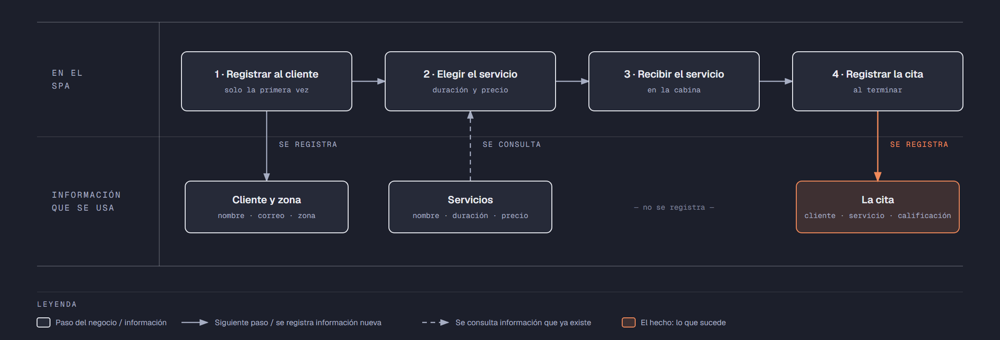

# Evidencia Integral — Caso: SpaZen

**Alumno:** Montoya Moreno Ana Valeria (matrícula 2254069)
**Base de datos a crear:** `SpaZenDB`

← [Regresar a la descripción de la evidencia](../descripcion-evidencia-integral.md)

---

## Historia de usuario

**Como** dueño de SpaZen, **quiero** una base de datos que registre a mis clientes, mis servicios y cada cita que se atiende, **para** saber qué servicios se piden más, cuánto se cobró por cada cita, qué tan contentos salen los clientes y de qué zonas de la ciudad vienen.

## El negocio

SpaZen es un **spa** que ofrece servicios de relajación, como masajes y faciales. Tiene varios **servicios**; cada uno tiene un **nombre** que no se repite, una **duración en minutos** y un **precio**. **Los precios cambian** de vez en cuando. Aun así, el negocio necesita saber **cuánto se cobró por cada cita**, con el precio que tenía el servicio el día de la cita.

Los **clientes** se registran una sola vez con su nombre, su correo electrónico, la fecha de registro y la **zona de la ciudad donde viven** (Norte, Sur, Centro, Poniente u Oriente). La zona no cambia el precio: solo sirve para saber de dónde vienen los clientes y dónde conviene repartir publicidad. El correo identifica al cliente: no puede haber dos clientes con el mismo. Cuando un cliente pide que borren su registro, se le **da de baja**, pero no se borra, para conservar sus citas.

Cada **cita** es un servicio para un cliente. Al terminar, el cliente **califica** el servicio del 1 (muy malo) al 5 (excelente).

Si el negocio deja de usar una zona o deja de ofrecer un servicio, no se borran: se **dan de baja**, para conservar el historial de citas.

## Los hechos de este negocio

En SpaZen, **el hecho es la cita**: cada vez que un cliente recibe un servicio, sucede una cita, en una fecha. Es la **tabla más importante** de tu modelo: tiene una fila por cada cita, es la que más crece y es donde se guarda lo que realmente pasó (qué cliente, qué servicio, cuándo, qué calificación le dio y cuánto se le cobró).

**Esta tabla la propones tú**: su nombre, sus columnas y sus llaves. No viene en "Lo que el negocio ya tiene definido", porque los hechos no se definen de antemano: suceden.

## Lo que el negocio ya tiene definido

Estos datos **no los inventas**: son los que SpaZen ya tiene. Tu base de datos debe guardarlos **exactamente así**, con los mismos nombres y valores.

Son los **datos iniciales** con los que arranca tu base de datos: **zonas de la ciudad** y **servicios**. Hoy todo lo que aparece en estas tablas está **activo**.

**Zonas de la ciudad**

| Zona |
|---|
| Norte |
| Sur |
| Centro |
| Poniente |
| Oriente |

**Servicios**

| Nombre | Duración (minutos) | Precio |
|---|---|---|
| Masaje relajante | 60 | $750.00 |
| Masaje con piedras calientes | 90 | $1,100.00 |
| Facial hidratante | 45 | $600.00 |
| Reflexología | 40 | $500.00 |
| Aromaterapia | 50 | $650.00 |
| Exfoliación corporal | 60 | $800.00 |

Todo lo demás (clientes y citas) **lo inventas tú**, cumpliendo los mínimos de [Lo que debes construir](#lo-que-debes-construir).

## Flujo de negocio

Así funciona una operación de principio a fin. Arriba, lo que pasa en el spa; abajo, la información que cada paso consulta o registra.

Con detalle, una clienta imaginaria (Andrea) recorriendo el flujo:

1. **Andrea llega por primera vez** a SpaZen. En la recepción le piden su nombre, su correo y la zona donde vive (Norte), y la **registran como clienta** con la fecha de hoy. Si Andrea regresa otro día, ya no se le registra de nuevo: se le busca por su correo.
2. **Andrea elige el servicio.** La recepcionista le muestra la duración y el **precio vigente** de cada servicio. Andrea elige el "Masaje relajante": 60 minutos y, hoy, $750.00.
3. **Andrea recibe el servicio** en una de las cabinas del spa.
4. **Al terminar, se registra la cita:** clienta Andrea, servicio "Masaje relajante", fecha de hoy, la calificación que ella le da (5) y el precio con el que se le cobra ($750.00).

Si el mes siguiente el "Masaje relajante" sube a $820.00, la cita de Andrea tiene que seguir diciendo que se le cobró a $750.00.

Dos semanas después, Andrea regresa y pide el "Facial hidratante": es otra cita, de la misma clienta y de otro servicio. Ese mismo día, otro cliente pide el "Masaje relajante". Así, **un cliente acumula muchas citas y un servicio también**.

## Reglas de negocio

- Cada cliente vive en **una sola** zona.
- No puede haber dos zonas con el mismo nombre, ni dos servicios con el mismo nombre.
- No puede haber dos clientes con el mismo correo electrónico.
- La duración de un servicio siempre es **mayor a cero** minutos.
- El precio de un servicio siempre es **mayor a cero**.
- La calificación de una cita va **del 1 al 5**.
- Cuando cambia el precio de un servicio, las citas que ya se atendieron **conservan el precio con el que se cobraron**.
- Un cliente nuevo se registra como **activo**.
- Una zona nueva y un servicio nuevo también se registran como **activos**.

## Lo que debes construir

1. El **modelo relacional**, con al menos 4 tablas, que guarde toda la información de arriba y respete las reglas de negocio con restricciones (`PRIMARY KEY`, `FOREIGN KEY`, `UNIQUE`, `CHECK`, `DEFAULT`).
2. El **paquete de instalación** y el **paquete de reversa** de `SpaZenDB`.
3. **Datos iniciales:**
   - **Lo que el negocio ya tiene definido**, exactamente como viene arriba: las 5 zonas y los 6 servicios.
   - **Lo que tú inventas**, como mínimo: 10 clientes y 20 citas, con
     - clientes de las cinco zonas;
     - 2 clientes que nunca hayan tenido una cita;
     - 2 servicios que nunca se hayan dado;
     - al menos 1 cliente dado de baja;
     - citas con distintas calificaciones;
     - cada cita con el precio con el que se cobró (en tus datos, el precio del servicio que viene arriba);
     - citas en marzo de 2026;
     - clientes con correo de `@outlook.com`.
4. **Las 10 consultas** de abajo.

## Consultas

| # | Pregunta del negocio |
|---|---|
| 1 | Lista los servicios que duran 60 minutos o más, del más largo al más corto. |
| 2 | Lista los clientes activos, del más antiguo al más reciente según su fecha de registro. |
| 3 | Lista los clientes cuyo correo termina en "@outlook.com". |
| 4 | Lista las citas de marzo de 2026, ordenadas por fecha. |
| 5 | Muestra los 3 servicios más caros. |
| 6 | Muestra cada cliente con el nombre de la zona donde vive. |
| 7 | Muestra cada cita con el nombre del servicio, el precio cobrado y el precio actual del servicio. |
| 8 | Muestra cada cita con el nombre del cliente, el nombre del servicio, la fecha y la calificación. |
| 9 | Lista los clientes que nunca han tenido una cita. |
| 10 | Lista los servicios que nunca se han dado. |

## Entrega

Ver [Entregables](../descripcion-evidencia-integral.md#entregables) y [Forma de entrega](../descripcion-evidencia-integral.md#forma-de-entrega) en la descripción de la evidencia.
