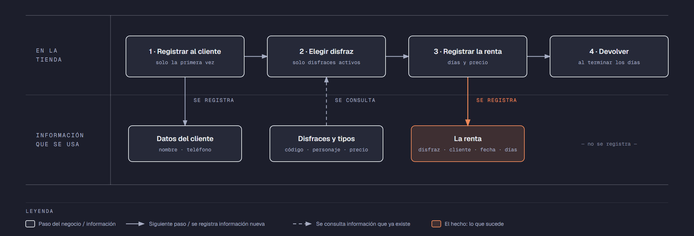

# Evidencia Integral — Caso: DisfracesMil

**Alumno:** Morales Ordaz Alberto Alejandro (matrícula 2253858)
**Base de datos a crear:** `DisfracesMilDB`

← [Regresar a la descripción de la evidencia](../descripcion-evidencia-integral.md)

---

## Historia de usuario

**Como** dueño de DisfracesMil, **quiero** una base de datos que registre mis disfraces, a los clientes que vienen y cada renta que hacen, **para** saber cuánto se renta cada disfraz, cuánto se cobró por cada renta y qué disfraces casi nunca salen de la tienda.

## El negocio

DisfracesMil es una tienda que **renta disfraces por día** para fiestas, festivales escolares y obras de teatro. Maneja **tipos de disfraz**: Infantil, Adulto y Premium (los Premium son los más elaborados, con accesorios y maquillaje incluido). Cada tipo tiene su propio **precio por día**; por ejemplo, el Premium cuesta más que el Infantil. **Los precios cambian** de vez en cuando. Aun así, el negocio necesita saber **cuánto se cobró en cada renta**, con el precio por día que estaba vigente el día de la renta.

Cada **disfraz** es de un tipo, tiene un **código** que no se repite (por ejemplo, `D-004`), el **personaje** que representa (por ejemplo, "Pirata" o "Catrina") y una **fecha de compra**. Cuando un disfraz ya no se puede rentar (por ejemplo, porque se rompió o se manchó), se **da de baja**: no se borra, porque se quiere conservar su historial de rentas.

Los **clientes** se registran una sola vez con su nombre y su teléfono. El teléfono identifica al cliente: no puede haber dos clientes con el mismo.

Cada renta es **de 1 a 3 días**: después de eso el disfraz tiene que regresar a la tienda para lavarse.

Si el negocio deja de manejar un tipo de disfraz, tampoco lo borra: lo **da de baja**. Lo mismo pasa con los clientes: si un cliente ya no regresa, se lo da de baja en lugar de borrarlo. Así se conserva el historial de rentas.

## Los hechos de este negocio

En DisfracesMil, **el hecho es la renta**: cada vez que un cliente renta un disfraz, sucede una renta, en una fecha. Es la **tabla más importante** de tu modelo: tiene una fila por cada renta, es la que más crece y es donde se guarda lo que realmente pasó (quién lo rentó, qué disfraz, cuándo, cuántos días y con qué precio por día se le cobró).

**Esta tabla la propones tú**: su nombre, sus columnas y sus llaves. No viene en "Lo que el negocio ya tiene definido", porque los hechos no se definen de antemano: suceden.

## Lo que el negocio ya tiene definido

Estos datos **no los inventas**: son los que DisfracesMil ya tiene. Tu base de datos debe guardarlos **exactamente así**, con los mismos nombres y valores.

Son los **datos iniciales** con los que arranca tu base de datos: **tipos de disfraz y precio por día** y **disfraces**. Hoy todo lo que aparece en estas tablas está **activo**, salvo el disfraz que se indica como dado de baja.

**Tipos de disfraz y precio por día**

| Tipo de disfraz | Precio por día |
|---|---|
| Infantil | $120.00 |
| Adulto | $200.00 |
| Premium | $350.00 |

**Disfraces**

| Tipo de disfraz | Código | Personaje | Fecha de compra | ¿Activo? |
|---|---|---|---|---|
| Infantil | `D-001` | Superhéroe | 15/09/2024 | Sí |
| Infantil | `D-002` | Princesa | 15/09/2024 | Sí |
| Adulto | `D-003` | Pirata | 01/10/2024 | Sí |
| Adulto | `D-004` | Superheroína | 10/01/2025 | Sí |
| Premium | `D-005` | Catrina | 14/02/2025 | Sí |
| Premium | `D-006` | Astronauta | 20/06/2025 | Sí |
| Adulto | `D-007` | Vampiro | 20/08/2024 | **No** |
| Infantil | `D-008` | Dinosaurio | 01/12/2025 | Sí |

Todo lo demás (clientes y rentas) **lo inventas tú**, cumpliendo los mínimos de [Lo que debes construir](#lo-que-debes-construir).

## Flujo de negocio

Así funciona una operación de principio a fin. Arriba, lo que pasa en la tienda; abajo, la información que cada paso consulta o registra.

Con detalle, una clienta imaginaria (Brenda) recorriendo el flujo:

1. **Brenda llega por primera vez** a DisfracesMil: su hijo tiene un festival en la escuela. En el mostrador le piden su nombre y su teléfono, y la **registran como clienta**. Si Brenda regresa otro día, ya no se le registra de nuevo: se le busca por su teléfono.
2. **Brenda elige un disfraz.** El encargado le muestra los disfraces **activos**; los dados de baja ya no se rentan. Brenda elige el `D-001`, un "Superhéroe" de tipo Infantil, y el encargado le dice el precio por día de ese tipo: hoy, $120.00.
3. **Se registra la renta:** disfraz `D-001`, clienta Brenda, fecha de hoy, 2 días y el precio por día con el que se le cobra ($120.00). Se le cobran los días por ese precio.
4. **Brenda devuelve el disfraz** al terminar los 2 días.

Si el mes siguiente sube el precio de los disfraces Infantiles a $150.00, la renta de Brenda tiene que seguir diciendo que se le cobró a $120.00 por día.

Para Día de Muertos, Brenda regresa y renta la "Catrina" `D-005`, que es Premium: es otra renta, de la misma clienta y de otro disfraz. Esa misma semana, el `D-001` lo renta otro cliente. Así, **un cliente acumula muchas rentas y un disfraz también**.

## Reglas de negocio

- Cada disfraz es de **un solo** tipo.
- No puede haber dos tipos de disfraz con el mismo nombre, ni dos disfraces con el mismo código, ni dos clientes con el mismo teléfono.
- El precio por día siempre es **mayor a cero**.
- Una renta es de **al menos 1 día** y **como máximo 3 días**.
- Un disfraz nuevo se registra como **activo**.
- Un tipo de disfraz nuevo y un cliente nuevo también se registran como **activos**.
- Cuando cambia el precio de un tipo de disfraz, las rentas que ya se hicieron **conservan el precio con el que se cobraron**.

## Lo que debes construir

1. El **modelo relacional**, con al menos 4 tablas, que guarde toda la información de arriba y respete las reglas de negocio con restricciones (`PRIMARY KEY`, `FOREIGN KEY`, `UNIQUE`, `CHECK`, `DEFAULT`).
2. El **paquete de instalación** y el **paquete de reversa** de `DisfracesMilDB`.
3. **Datos iniciales:**
   - **Lo que el negocio ya tiene definido**, exactamente como viene arriba: los 3 tipos de disfraz con su precio por día y los 8 disfraces.
   - **Lo que tú inventas**, como mínimo: 10 clientes y 20 rentas, con
     - 2 clientes que nunca hayan rentado;
     - 2 disfraces que nunca se hayan rentado;
     - al menos 1 cliente dado de baja;
     - rentas de más de 1 día;
     - cada renta con el precio por día con el que se cobró (en tus datos, el precio de su tipo de disfraz que viene arriba);
     - rentas en marzo de 2026.
4. **Las 10 consultas** de abajo.

## Consultas

| # | Pregunta del negocio |
|---|---|
| 1 | Lista las rentas de más de 1 día, de la más larga a la más corta. |
| 2 | Lista los disfraces activos, del más antiguo al más reciente según su fecha de compra. |
| 3 | Lista los disfraces cuyo personaje comienza con "Super". |
| 4 | Lista las rentas de marzo de 2026, ordenadas por fecha. |
| 5 | Muestra los 5 disfraces comprados más recientemente. |
| 6 | Muestra cada disfraz con el nombre de su tipo de disfraz y su precio por día. |
| 7 | Muestra cada renta con el código del disfraz, el precio por día cobrado y el precio por día actual de su tipo de disfraz. |
| 8 | Muestra cada renta con el nombre del cliente, el personaje del disfraz, la fecha y los días. |
| 9 | Lista los clientes que nunca han rentado. |
| 10 | Lista los disfraces que nunca se han rentado. |

## Entrega

Ver [Entregables](../descripcion-evidencia-integral.md#entregables) y [Forma de entrega](../descripcion-evidencia-integral.md#forma-de-entrega) en la descripción de la evidencia.
