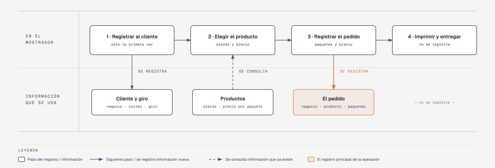

# Evidencia Integral — Caso: ImprimeYa

**Alumno:** Morua Tello Said Lestat (matrícula 2166472)
**Base de datos a crear:** `ImprimeYaDB`

← [Regresar a la descripción de la evidencia](../descripcion-evidencia-integral.md)

---

## Historia de usuario

**Como** dueño de ImprimeYa, **quiero** una base de datos que registre a los negocios que me compran, los productos que imprimo y cada pedido que me hacen, **para** saber qué productos se piden más, cuánto se cobró por cada pedido y qué clientes registrados nunca me han hecho un pedido.

## El negocio

ImprimeYa es una **imprenta rápida** que trabaja para negocios: les imprime tarjetas de presentación, volantes, menús, etiquetas y otros productos. Cada **producto** tiene un **nombre** que no se repite, se vende **por paquete** (por ejemplo, un paquete de tarjetas de presentación trae 100 tarjetas) y tiene un **precio por paquete**. **Los precios cambian** de vez en cuando. Aun así, la imprenta necesita saber **cuánto se cobró por cada pedido**, con el precio por paquete que tenía el producto el día del pedido.

Los **clientes** son negocios. Se registran una sola vez con el nombre del negocio, su correo electrónico, la fecha de registro y su **giro** (por ejemplo, Restaurante o Escuela). El giro no cambia el precio: solo sirve para saber a qué tipo de negocios se les vende más. El correo identifica al cliente: no puede haber dos clientes con el mismo. Cuando un negocio cierra o deja de comprar, se le **da de baja**, pero no se borra, para conservar sus pedidos.

En cada pedido, el cliente pide **un producto** y **de 1 a 50 paquetes** de ese producto. Si un negocio quiere dos productos distintos, se registran dos pedidos.

Si el negocio deja de usar un giro o deja de ofrecer un producto, no se borran: se **dan de baja**, para conservar el historial de pedidos.

## Lo que el negocio ya tiene definido

Estos datos **no los inventas**: son los que ImprimeYa ya tiene. Tu base de datos debe guardarlos **exactamente así**, con los mismos nombres y valores.

Son los **datos iniciales** con los que arranca tu base de datos: **giros de los negocios cliente** y **productos**. Hoy todo lo que aparece en estas tablas está **activo**.

**Giros de los negocios cliente**

| Giro |
|---|
| Restaurante |
| Escuela |
| Tienda |
| Despacho |

**Productos**

| Nombre | Piezas por paquete | Precio por paquete |
|---|---|---|
| Tarjetas de presentación | 100 | $250.00 |
| Volantes media carta | 500 | $450.00 |
| Menús enmicados | 10 | $380.00 |
| Etiquetas adhesivas | 200 | $300.00 |
| Lona de 1 x 2 metros | 1 | $420.00 |
| Folders impresos | 50 | $600.00 |
| Calendarios de pared | 25 | $520.00 |

Todo lo demás (clientes y pedidos) **lo inventas tú**, cumpliendo los mínimos de [Lo que debes construir](#lo-que-debes-construir).

## Flujo de negocio

Así funciona una operación de principio a fin. Arriba, lo que pasa en el mostrador; abajo, la información que cada paso consulta o registra.

Con detalle, un cliente imaginario (Ernesto, dueño de la Taquería El Güero) recorriendo el flujo:

1. **Ernesto llega por primera vez** a ImprimeYa. En el mostrador le piden el nombre de su negocio, su correo y su giro (Restaurante), y **registran a la taquería como cliente** con la fecha de hoy. Si Ernesto regresa otro día, ya no se le registra de nuevo: se le busca por su correo.
2. **Ernesto elige el producto.** El encargado le muestra cuántas piezas trae cada paquete y el **precio vigente** de cada producto. Ernesto elige "Menús enmicados": un paquete trae 10 menús y hoy cuesta $380.00.
3. **Se registra el pedido:** cliente Taquería El Güero, producto "Menús enmicados", fecha de hoy, 2 paquetes y el precio por paquete con el que se le cobra ($380.00).
4. **Se imprime y se entrega** el pedido. La entrega no se registra en la base de datos.

Si el mes siguiente los menús enmicados suben a $420.00 por paquete, el pedido de Ernesto tiene que seguir diciendo que se le cobró a $380.00 por paquete.

Un mes después, Ernesto regresa y pide volantes: es otro pedido, del mismo cliente y de otro producto. Ese mismo día, una cafetería pide menús enmicados. Así, **un cliente acumula muchos pedidos y un producto también**.

## Reglas de negocio

- Cada cliente tiene **un solo** giro.
- No puede haber dos giros con el mismo nombre, ni dos productos con el mismo nombre.
- No puede haber dos clientes con el mismo correo electrónico.
- Las piezas por paquete de un producto siempre son **mayores a cero**.
- El precio por paquete siempre es **mayor a cero**.
- En un pedido se piden **de 1 a 50** paquetes.
- Cuando cambia el precio de un producto, los pedidos que ya se hicieron **conservan el precio con el que se cobraron**.
- Un cliente nuevo se registra como **activo**.
- Un giro nuevo y un producto nuevo también se registran como **activos**.

## Lo que debes construir

1. El **modelo relacional**, con al menos 4 tablas, que guarde toda la información de arriba y respete las reglas de negocio con restricciones (`PRIMARY KEY`, `FOREIGN KEY`, `UNIQUE`, `CHECK`, `DEFAULT`).
2. El **paquete de instalación** y el **paquete de reversa** de `ImprimeYaDB`.
3. **Datos iniciales:**
   - **Lo que el negocio ya tiene definido**, exactamente como viene arriba: los 4 giros y los 7 productos.
   - **Lo que tú inventas**, como mínimo: 10 clientes y 20 pedidos, con
     - clientes de los cuatro giros;
     - 2 clientes que nunca hayan hecho un pedido;
     - 2 productos que nunca se hayan pedido;
     - al menos 1 cliente dado de baja;
     - cada pedido con el precio por paquete con el que se cobró (en tus datos, el precio del producto que viene arriba);
     - pedidos en marzo de 2026;
     - clientes cuyo nombre de negocio contenga la palabra "Colegio".
4. **Las 10 consultas** de abajo.

## Consultas

| # | Pregunta del negocio |
|---|---|
| 1 | Lista los productos que traen más de 50 piezas por paquete, del que trae más piezas al que trae menos. |
| 2 | Lista los clientes activos, del más antiguo al más reciente según su fecha de registro. |
| 3 | Lista los clientes cuyo nombre de negocio contiene la palabra "Colegio". |
| 4 | Lista los pedidos de marzo de 2026, ordenados por fecha. |
| 5 | Muestra los 5 pedidos con más paquetes. |
| 6 | Muestra cada cliente con el nombre de su giro. |
| 7 | Muestra cada pedido con el nombre del producto, el precio por paquete cobrado y el precio por paquete actual del producto. |
| 8 | Muestra cada pedido con el nombre del negocio, el nombre del producto, la fecha y el número de paquetes. |
| 9 | Lista los clientes que nunca han hecho un pedido. |
| 10 | Lista los productos que nunca se han pedido. |

## Entrega

Ver [Entregables](../descripcion-evidencia-integral.md#entregables) y [Forma de entrega](../descripcion-evidencia-integral.md#forma-de-entrega) en la descripción de la evidencia.
