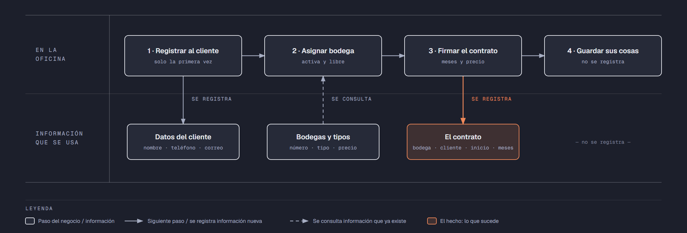

# Evidencia Integral — Caso: GuardaTodo

**Alumno:** Mota Ortiz Raul Andres (matrícula 2166161)
**Base de datos a crear:** `GuardaTodoDB`

← [Regresar a la descripción de la evidencia](../descripcion-evidencia-integral.md)

---

## Historia de usuario

**Como** dueña de GuardaTodo, **quiero** una base de datos que registre mis bodegas, a mis clientes y cada contrato de renta que firmo, **para** saber qué bodegas se rentan más, cuánto se cobra por mes en cada contrato y qué bodegas nunca se han rentado.

## El negocio

GuardaTodo renta **minibodegas por mes**: espacios cerrados con candado donde las personas guardan muebles, cajas o mercancía. Maneja **tipos de bodega**: Chica (del tamaño de un clóset grande), Mediana (del tamaño de una recámara) y Grande (del tamaño de una cochera). Cada tipo tiene su propio **precio por mes**. **Los precios cambian** de vez en cuando. Aun así, el negocio necesita saber **cuánto se cobra por mes en cada contrato**, con el precio que estaba vigente el día en que se firmó; ese precio se queda fijo mientras dura el contrato.

El edificio tiene dos pisos. Cada **bodega** es de un tipo, tiene un **número** que no se repite y una **fecha de apertura**, que es el día en que empezó a rentarse. El número empieza con la letra B, luego el piso y luego el número de la bodega en ese piso: `B-104` es la bodega 4 del piso 1 y `B-203` es la bodega 3 del piso 2. Cuando una bodega se daña (por ejemplo, por una gotera) y ya no se puede rentar, se **da de baja**: no se borra, porque se quiere conservar su historial de contratos.

Los **clientes** se registran una sola vez con su nombre, su teléfono y su correo electrónico. El teléfono identifica al cliente: no puede haber dos clientes con el mismo.

Cada **contrato** es de una bodega para un cliente, empieza en una fecha y dura **de 1 a 12 meses**.

Si el negocio deja de manejar un tipo de bodega, tampoco lo borra: lo **da de baja**. Lo mismo pasa con los clientes: si un cliente ya no regresa, se lo da de baja en lugar de borrarlo. Así se conserva el historial de contratos.

## Los hechos de este negocio

En GuardaTodo, **el hecho es el contrato**: cada vez que un cliente renta una bodega, se firma un contrato, en una fecha. Es la **tabla más importante** de tu modelo: tiene una fila por cada contrato, es la que más crece y es donde se guarda lo que realmente pasó (quién la rentó, qué bodega, desde qué fecha, cuántos meses y con qué precio por mes se le cobró).

**Esta tabla la propones tú**: su nombre, sus columnas y sus llaves. No viene en "Lo que el negocio ya tiene definido", porque los hechos no se definen de antemano: suceden.

## Lo que el negocio ya tiene definido

Estos datos **no los inventas**: son los que GuardaTodo ya tiene. Tu base de datos debe guardarlos **exactamente así**, con los mismos nombres y valores.

Son los **datos iniciales** con los que arranca tu base de datos: **tipos de bodega y precio por mes** y **bodegas**. Hoy todo lo que aparece en estas tablas está **activo**, salvo la bodega que se indica como dada de baja.

**Tipos de bodega y precio por mes**

| Tipo de bodega | Precio por mes |
|---|---|
| Chica | $900.00 |
| Mediana | $1,500.00 |
| Grande | $2,400.00 |

**Bodegas**

| Tipo de bodega | Número | Fecha de apertura | ¿Activa? |
|---|---|---|---|
| Chica | `B-101` | 02/05/2023 | Sí |
| Chica | `B-102` | 02/05/2023 | Sí |
| Mediana | `B-103` | 02/05/2023 | Sí |
| Grande | `B-104` | 02/05/2023 | Sí |
| Mediana | `B-105` | 02/05/2023 | **No** |
| Chica | `B-201` | 15/02/2024 | Sí |
| Mediana | `B-202` | 15/02/2024 | Sí |
| Grande | `B-203` | 15/02/2024 | Sí |
| Mediana | `B-204` | 01/08/2025 | Sí |
| Grande | `B-205` | 01/08/2025 | Sí |

Todo lo demás (clientes y contratos) **lo inventas tú**, cumpliendo los mínimos de [Lo que debes construir](#lo-que-debes-construir).

## Flujo de negocio

Así funciona una operación de principio a fin. Arriba, lo que pasa en la oficina; abajo, la información que cada paso consulta o registra.

Con detalle, un cliente imaginario (Alberto) recorriendo el flujo:

1. **Alberto llega por primera vez** a GuardaTodo porque se va a cambiar de casa. En la oficina le piden su nombre, su teléfono y su correo, y lo **registran como cliente**. Si Alberto regresa otro día, ya no se le registra de nuevo: se le busca por su teléfono.
2. **Se le asigna una bodega.** La encargada revisa qué bodegas están **activas** y libres; las dadas de baja ya no se rentan. Le asigna la bodega `B-104`, que es Grande, y le dice el precio por mes de ese tipo: hoy, $2,400.00.
3. **Alberto firma el contrato.** Se registra el contrato: bodega `B-104`, cliente Alberto, fecha de inicio de hoy, 2 meses y el precio por mes con el que se le cobra ($2,400.00).
4. **Alberto guarda sus cosas** en la bodega. Las veces que entra y sale no se registran en la base de datos.

Si el mes siguiente las bodegas Grandes suben a $2,600.00 por mes, el contrato de Alberto tiene que seguir diciendo que se le cobra a $2,400.00 por mes.

Cuando termina su contrato, Alberto renta la bodega `B-101`, que es Chica: es otro contrato, del mismo cliente y de otra bodega. Mientras tanto, la bodega `B-104` la renta otra clienta. Así, **un cliente acumula muchos contratos y una bodega también**.

## Reglas de negocio

- Cada bodega es de **un solo** tipo.
- No puede haber dos tipos de bodega con el mismo nombre, ni dos bodegas con el mismo número, ni dos clientes con el mismo teléfono.
- El precio por mes siempre es **mayor a cero**.
- Un contrato dura **de 1 a 12** meses.
- Una bodega nueva se registra como **activa**.
- Un tipo de bodega nuevo y un cliente nuevo también se registran como **activos**.
- Cuando cambia el precio de un tipo de bodega, los contratos que ya se firmaron **conservan el precio con el que se cobran**.

## Lo que debes construir

1. El **modelo relacional**, con al menos 4 tablas, que guarde toda la información de arriba y respete las reglas de negocio con restricciones (`PRIMARY KEY`, `FOREIGN KEY`, `UNIQUE`, `CHECK`, `DEFAULT`).
2. El **paquete de instalación** y el **paquete de reversa** de `GuardaTodoDB`.
3. **Datos iniciales:**
   - **Lo que el negocio ya tiene definido**, exactamente como viene arriba: los 3 tipos de bodega con su precio por mes y las 10 bodegas.
   - **Lo que tú inventas**, como mínimo: 10 clientes y 20 contratos, con
     - 2 clientes que nunca hayan rentado una bodega;
     - 2 bodegas que nunca se hayan rentado;
     - al menos 1 cliente dado de baja;
     - contratos de 6 meses o más;
     - cada contrato con el precio por mes con el que se cobra (en tus datos, el precio de su tipo de bodega que viene arriba);
     - contratos que empiecen en marzo de 2026.
4. **Las 10 consultas** de abajo.

## Consultas

| # | Pregunta del negocio |
|---|---|
| 1 | Lista los contratos de 6 meses o más, del más largo al más corto. |
| 2 | Lista las bodegas activas, de la más antigua a la más reciente según su fecha de apertura. |
| 3 | Lista las bodegas del piso 2 (su número comienza con "B-2"). |
| 4 | Lista los contratos que empezaron en marzo de 2026, ordenados por fecha de inicio. |
| 5 | Muestra los 5 contratos más recientes según su fecha de inicio. |
| 6 | Muestra cada bodega con el nombre de su tipo de bodega y su precio por mes. |
| 7 | Muestra cada contrato con el número de la bodega, el precio por mes cobrado y el precio por mes actual de su tipo de bodega. |
| 8 | Muestra cada contrato con el nombre del cliente, el número de la bodega, la fecha de inicio y los meses. |
| 9 | Lista los clientes que nunca han rentado una bodega. |
| 10 | Lista las bodegas que nunca se han rentado. |

## Entrega

Ver [Entregables](../descripcion-evidencia-integral.md#entregables) y [Forma de entrega](../descripcion-evidencia-integral.md#forma-de-entrega) en la descripción de la evidencia.
