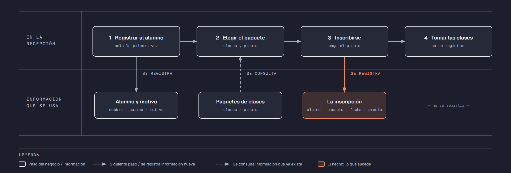

# Evidencia Integral — Caso: VolanteSeguro

**Alumno:** Perez Ruiz Jesus Alejandro (matrícula 2166837)
**Base de datos a crear:** `VolanteSeguroDB`

← [Regresar a la descripción de la evidencia](../descripcion-evidencia-integral.md)

---

## Historia de usuario

**Como** director de VolanteSeguro, **quiero** una base de datos que registre a mis alumnos, mis paquetes de clases y cada inscripción, **para** saber qué paquetes se venden más, cuánto se cobró por cada inscripción y por qué motivo vienen los alumnos a aprender a manejar.

## El negocio

VolanteSeguro es una **escuela de manejo**. Vende **paquetes de clases**; cada paquete tiene un **nombre** que no se repite, un **número de clases** (cada clase es de una hora, con un instructor y en un auto de la escuela) y un **precio**. **Los precios cambian** de vez en cuando. Aun así, la escuela necesita saber **cuánto se cobró por cada inscripción**, con el precio que tenía el paquete el día en que el alumno se inscribió.

Los **alumnos** se registran una sola vez con su nombre, su correo electrónico, la fecha de registro y su **motivo** para tomar el curso (por ejemplo, Primera licencia o Perder el miedo). El motivo no cambia el precio: sirve para que el instructor sepa qué practicar con cada alumno. El correo identifica al alumno: no puede haber dos alumnos con el mismo. Cuando un alumno pide que borren su registro, se le **da de baja**, pero no se borra, para conservar sus inscripciones.

Cada vez que un alumno compra un paquete, se registra una **inscripción**. Un alumno puede inscribirse a varios paquetes a lo largo del tiempo: por ejemplo, primero el Básico y después el de Carretera.

Si el negocio deja de usar un motivo o deja de ofrecer un paquete de clases, no se borran: se **dan de baja**, para conservar el historial de inscripciones.

## Los hechos de este negocio

En VolanteSeguro, **el hecho es la inscripción**: cada vez que un alumno se inscribe a un paquete de clases, sucede una inscripción, en una fecha. Es la **tabla más importante** de tu modelo: tiene una fila por cada inscripción, es la que más crece y es donde se guarda lo que realmente pasó (qué alumno, a qué paquete, cuándo y cuánto se le cobró).

**Esta tabla la propones tú**: su nombre, sus columnas y sus llaves. No viene en "Lo que el negocio ya tiene definido", porque los hechos no se definen de antemano: suceden.

## Lo que el negocio ya tiene definido

Estos datos **no los inventas**: son los que VolanteSeguro ya tiene. Tu base de datos debe guardarlos **exactamente así**, con los mismos nombres y valores.

Son los **datos iniciales** con los que arranca tu base de datos: **motivos para tomar el curso** y **paquetes de clases**. Hoy todo lo que aparece en estas tablas está **activo**.

**Motivos para tomar el curso**

| Motivo |
|---|
| Primera licencia |
| Perder el miedo |
| Manejar en carretera |

**Paquetes de clases**

| Nombre | Número de clases | Precio |
|---|---|---|
| Básico | 5 | $2,500.00 |
| Intermedio | 10 | $4,500.00 |
| Completo | 15 | $6,300.00 |
| Carretera | 4 | $3,200.00 |
| Estacionamiento | 3 | $1,500.00 |
| Repaso | 2 | $1,100.00 |

Todo lo demás (alumnos e inscripciones) **lo inventas tú**, cumpliendo los mínimos de [Lo que debes construir](#lo-que-debes-construir).

## Flujo de negocio

Así funciona una operación de principio a fin. Arriba, lo que pasa en la recepción; abajo, la información que cada paso consulta o registra.

Con detalle, una alumna imaginaria (Valeria) recorriendo el flujo:

1. **Valeria llega por primera vez** a VolanteSeguro. En la recepción le piden su nombre, su correo y su motivo para tomar el curso (Primera licencia), y la **registran como alumna** con la fecha de hoy. Si Valeria regresa otro día, ya no se le registra de nuevo: se le busca por su correo.
2. **Valeria elige el paquete.** La recepcionista le muestra cuántas clases trae cada paquete y su **precio vigente**. Valeria elige el paquete "Básico": 5 clases y hoy cuesta $2,500.00.
3. **Se registra la inscripción:** alumna Valeria, paquete "Básico", fecha de hoy y el precio con el que se le cobra ($2,500.00).
4. **Valeria toma sus clases** con un instructor. Las clases en sí no se registran en la base de datos.

Si el mes siguiente el paquete "Básico" sube a $2,800.00, la inscripción de Valeria tiene que seguir diciendo que se le cobró a $2,500.00.

Dos meses después, Valeria se inscribe al paquete "Carretera": es otra inscripción, de la misma alumna y de otro paquete. Ese mismo día, otro alumno se inscribe al "Básico". Así, **un alumno acumula muchas inscripciones y un paquete también**.

## Reglas de negocio

- Cada alumno tiene **un solo** motivo para tomar el curso.
- No puede haber dos motivos con el mismo nombre, ni dos paquetes con el mismo nombre.
- No puede haber dos alumnos con el mismo correo electrónico.
- El número de clases de un paquete siempre es **mayor a cero**.
- El precio siempre es **mayor a cero**.
- Cuando cambia el precio de un paquete, las inscripciones que ya se hicieron **conservan el precio con el que se cobraron**.
- Un alumno nuevo se registra como **activo**.
- Un motivo nuevo y un paquete de clases nuevo también se registran como **activos**.

## Lo que debes construir

1. El **modelo relacional**, con al menos 4 tablas, que guarde toda la información de arriba y respete las reglas de negocio con restricciones (`PRIMARY KEY`, `FOREIGN KEY`, `UNIQUE`, `CHECK`, `DEFAULT`).
2. El **paquete de instalación** y el **paquete de reversa** de `VolanteSeguroDB`.
3. **Datos iniciales:**
   - **Lo que el negocio ya tiene definido**, exactamente como viene arriba: los 3 motivos y los 6 paquetes de clases.
   - **Lo que tú inventas**, como mínimo: 10 alumnos y 20 inscripciones, con
     - alumnos de los tres motivos;
     - 2 alumnos que nunca se hayan inscrito a un paquete;
     - 2 paquetes a los que nunca se haya inscrito nadie;
     - al menos 1 alumno dado de baja;
     - cada inscripción con el precio con el que se cobró (en tus datos, el precio del paquete que viene arriba);
     - inscripciones en marzo de 2026;
     - alumnos con correo de `@outlook.com`.
4. **Las 10 consultas** de abajo.

## Consultas

| # | Pregunta del negocio |
|---|---|
| 1 | Lista los paquetes de más de 4 clases, del que tiene más clases al que tiene menos. |
| 2 | Lista los alumnos activos, del más antiguo al más reciente según su fecha de registro. |
| 3 | Lista los alumnos cuyo correo termina en "@outlook.com". |
| 4 | Lista las inscripciones de marzo de 2026, ordenadas por fecha. |
| 5 | Muestra las 5 inscripciones más recientes. |
| 6 | Muestra cada alumno con el nombre de su motivo para tomar el curso. |
| 7 | Muestra cada inscripción con el nombre del paquete, el precio cobrado y el precio actual del paquete. |
| 8 | Muestra cada inscripción con el nombre del alumno, el nombre del paquete, la fecha de inscripción y el número de clases del paquete. |
| 9 | Lista los alumnos que nunca se han inscrito a un paquete. |
| 10 | Lista los paquetes a los que nunca se ha inscrito nadie. |

## Entrega

Ver [Entregables](../descripcion-evidencia-integral.md#entregables) y [Forma de entrega](../descripcion-evidencia-integral.md#forma-de-entrega) en la descripción de la evidencia.
