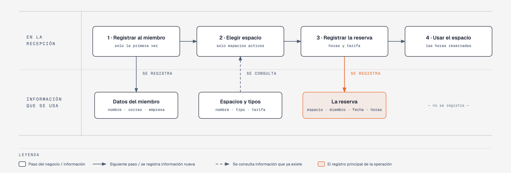

# Evidencia Integral — Caso: EspacioUno

**Alumno:** Ramírez Palacios Debora Dayan (matrícula 2253742)
**Base de datos a crear:** `EspacioUnoDB`

← [Regresar a la descripción de la evidencia](../descripcion-evidencia-integral.md)

---

## Historia de usuario

**Como** dueña de EspacioUno, **quiero** una base de datos que registre mis espacios de trabajo, a los miembros que los usan y cada reserva que hacen, **para** saber qué espacios se rentan más, cuánto se cobró por cada reserva y qué miembros registrados nunca han reservado.

## El negocio

EspacioUno es un **coworking**: un lugar donde personas que trabajan por su cuenta o para empresas pequeñas rentan un espacio **por hora**. Maneja **tipos de espacio**: Escritorio, Oficina privada y Sala de juntas. Cada tipo tiene su propia **tarifa por hora**; por ejemplo, la Sala de juntas cuesta más que un Escritorio. **Las tarifas cambian** de vez en cuando. Aun así, el negocio necesita saber **cuánto se cobró por cada reserva**, con la tarifa que estaba vigente el día de la reserva.

Cada **espacio** es de un tipo, tiene un **nombre** que no se repite (por ejemplo, "Escritorio Ventana" u "Oficina Chipinque") y una **fecha de apertura**, que es el día en que empezó a rentarse. Un espacio nunca cambia de tipo. Cuando un espacio deja de rentarse (por ejemplo, porque se convirtió en bodega), se **da de baja**: no se borra, porque se quiere conservar su historial de reservas.

Los **miembros** se registran una sola vez con su nombre, su correo electrónico y la **empresa** para la que trabajan (si trabajan por su cuenta, se anota "Independiente"). El correo identifica al miembro: no puede haber dos miembros con el mismo.

Cada reserva es **de 1 a 8 horas**, que es lo que dura la jornada del coworking.

Si el negocio deja de manejar un tipo de espacio, tampoco lo borra: lo **da de baja**. Lo mismo pasa con los miembros: si un miembro ya no regresa, se lo da de baja en lugar de borrarlo. Así se conserva el historial de reservas.

## Lo que el negocio ya tiene definido

Estos datos **no los inventas**: son los que EspacioUno ya tiene. Tu base de datos debe guardarlos **exactamente así**, con los mismos nombres y valores.

Son los **datos iniciales** con los que arranca tu base de datos: **tipos de espacio y tarifa por hora** y **espacios**. Hoy todo lo que aparece en estas tablas está **activo**, salvo el espacio que se indica como dado de baja.

**Tipos de espacio y tarifa por hora**

| Tipo de espacio | Tarifa por hora |
|---|---|
| Escritorio | $80.00 |
| Oficina privada | $200.00 |
| Sala de juntas | $350.00 |

**Espacios**

| Tipo de espacio | Nombre | Fecha de apertura | ¿Activo? |
|---|---|---|---|
| Escritorio | Escritorio Ventana | 01/02/2024 | Sí |
| Escritorio | Escritorio Terraza | 01/02/2024 | Sí |
| Escritorio | Escritorio Jardín | 15/08/2024 | Sí |
| Oficina privada | Oficina Cerro de la Silla | 01/02/2024 | Sí |
| Oficina privada | Oficina Chipinque | 04/11/2024 | Sí |
| Sala de juntas | Sala Fundidora | 01/02/2024 | Sí |
| Sala de juntas | Sala Santa Lucía | 10/06/2025 | Sí |
| Oficina privada | Oficina Mitras | 15/08/2024 | **No** |
| Escritorio | Escritorio Biblioteca | 04/05/2026 | Sí |

Todo lo demás (miembros y reservas) **lo inventas tú**, cumpliendo los mínimos de [Lo que debes construir](#lo-que-debes-construir).

## Flujo de negocio

Así funciona una operación de principio a fin. Arriba, lo que pasa en la recepción; abajo, la información que cada paso consulta o registra.

Con detalle, una miembro imaginaria (Andrea) recorriendo el flujo:

1. **Andrea llega por primera vez** a EspacioUno. Es diseñadora y trabaja por su cuenta. En la recepción le piden su nombre, su correo y su empresa ("Independiente") y la **registran como miembro**. Si Andrea regresa otro día, ya no se le registra de nuevo: se le busca por su correo.
2. **Andrea elige un espacio.** La recepcionista revisa qué espacios están **activos**; los dados de baja ya no se rentan. Andrea elige el "Escritorio Ventana", que es de tipo Escritorio, y le dicen la tarifa por hora de ese tipo: hoy, $80.00.
3. **Se registra la reserva:** espacio "Escritorio Ventana", miembro Andrea, fecha de hoy, 4 horas y la tarifa con la que se le cobra ($80.00 por hora).
4. **Andrea usa el espacio** las 4 horas que reservó.

Si el mes siguiente sube la tarifa de los Escritorios a $95.00, la reserva de Andrea tiene que seguir diciendo que se le cobró a $80.00 por hora.

A la semana siguiente, Andrea tiene una junta con un cliente y reserva la "Sala Fundidora", que es Sala de juntas: es otra reserva, de la misma miembro y de otro espacio. Ese mismo día, el "Escritorio Ventana" lo usa otro miembro. Así, **un miembro acumula muchas reservas y un espacio también**.

## Reglas de negocio

- Cada espacio es de **un solo** tipo.
- No puede haber dos tipos de espacio con el mismo nombre, ni dos espacios con el mismo nombre.
- No puede haber dos miembros con el mismo correo electrónico.
- La tarifa por hora siempre es **mayor a cero**.
- Una reserva es **de 1 a 8** horas.
- Un espacio nuevo se registra como **activo**.
- Un tipo de espacio nuevo y un miembro nuevo también se registran como **activos**.
- Cuando cambia la tarifa de un tipo de espacio, las reservas que ya se hicieron **conservan la tarifa con la que se cobraron**.

## Lo que debes construir

1. El **modelo relacional**, con al menos 4 tablas, que guarde toda la información de arriba y respete las reglas de negocio con restricciones (`PRIMARY KEY`, `FOREIGN KEY`, `UNIQUE`, `CHECK`, `DEFAULT`).
2. El **paquete de instalación** y el **paquete de reversa** de `EspacioUnoDB`.
3. **Datos iniciales:**
   - **Lo que el negocio ya tiene definido**, exactamente como viene arriba: los 3 tipos de espacio con su tarifa por hora y los 9 espacios.
   - **Lo que tú inventas**, como mínimo: 10 miembros y 20 reservas, con
     - 2 miembros que nunca hayan reservado;
     - 2 espacios que nunca se hayan reservado;
     - al menos 1 miembro dado de baja;
     - reservas de 4 horas o más;
     - cada reserva con la tarifa con la que se cobró (en tus datos, la tarifa de su tipo de espacio que viene arriba);
     - reservas en marzo de 2026;
     - miembros con correo de `@outlook.com`.
4. **Las 10 consultas** de abajo.

## Consultas

| # | Pregunta del negocio |
|---|---|
| 1 | Lista las reservas de 4 horas o más, de la más larga a la más corta. |
| 2 | Lista los espacios activos, del más antiguo al más reciente según su fecha de apertura. |
| 3 | Lista los miembros cuyo correo termina en "@outlook.com". |
| 4 | Lista las reservas de marzo de 2026, ordenadas por fecha. |
| 5 | Muestra las 5 reservas más recientes. |
| 6 | Muestra cada espacio con el nombre de su tipo de espacio y su tarifa por hora. |
| 7 | Muestra cada reserva con el nombre del espacio, la tarifa cobrada y la tarifa actual de su tipo de espacio. |
| 8 | Muestra cada reserva con el nombre del miembro, el nombre del espacio, la fecha y las horas. |
| 9 | Lista los miembros que nunca han reservado. |
| 10 | Lista los espacios que nunca se han reservado. |

## Entrega

Ver [Entregables](../descripcion-evidencia-integral.md#entregables) y [Forma de entrega](../descripcion-evidencia-integral.md#forma-de-entrega) en la descripción de la evidencia.
