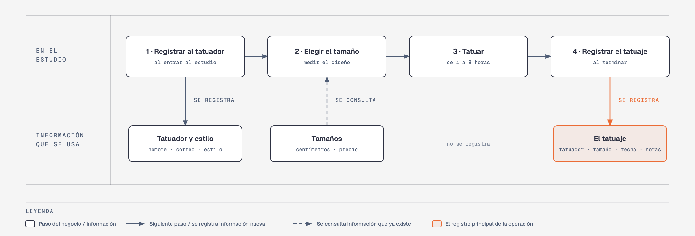

# Evidencia Integral — Caso: TatuArte

**Alumno:** Rodriguez Zavala Jeronimo (matrícula 2262913)
**Base de datos a crear:** `TatuArteDB`

← [Regresar a la descripción de la evidencia](../descripcion-evidencia-integral.md)

---

## Historia de usuario

**Como** dueño de TatuArte, **quiero** una base de datos que registre a mis tatuadores, los tamaños de tatuaje que manejo y cada tatuaje que se hace en el estudio, **para** saber cuánto trabaja cada tatuador, cuánto se cobró por cada tatuaje y qué tamaños se piden más.

## El negocio

TatuArte es un **estudio de tatuajes**. El precio de un tatuaje depende de su **tamaño**: el estudio maneja varios tamaños, cada uno con un **nombre** que no se repite, la **medida máxima en centímetros** que puede tener el diseño y un **precio**. Por ejemplo, un tatuaje "Chico" mide hasta 10 cm. El precio depende solo del tamaño: no cambia por las horas que tarde ni por quién lo haga. **Los precios cambian** de vez en cuando. Aun así, el negocio necesita saber **cuánto se cobró por cada tatuaje**, con el precio que tenía el tamaño el día del tatuaje.

Los **tatuadores** son los artistas que trabajan en el estudio. Se registran una sola vez, cuando entran a trabajar, con su nombre, su correo electrónico, su **fecha de ingreso** y el **estilo** en el que se especializan (por ejemplo, Realismo o Acuarela). El estilo no cambia el precio: sirve para saber a quién mandar a cada cliente. El correo identifica al tatuador: no puede haber dos tatuadores con el mismo. Cuando un tatuador deja el estudio, se le **da de baja**, pero no se borra, para conservar los tatuajes que hizo.

El estudio **no guarda datos de sus clientes**: solo registra qué tatuador hizo cada tatuaje, de qué tamaño, cuándo, cuántas horas tardó (**de 1 a 8**, lo que dura una sesión) y cuánto se cobró.

Si el negocio deja de usar un estilo o deja de ofrecer un tamaño de tatuaje, no se borran: se **dan de baja**, para conservar el historial de tatuajes.

## Lo que el negocio ya tiene definido

Estos datos **no los inventas**: son los que TatuArte ya tiene. Tu base de datos debe guardarlos **exactamente así**, con los mismos nombres y valores.

Son los **datos iniciales** con los que arranca tu base de datos: **estilos de los tatuadores** y **tamaños de tatuaje**. Hoy todo lo que aparece en estas tablas está **activo**.

**Estilos de los tatuadores**

| Estilo |
|---|
| Tradicional |
| Realismo |
| Acuarela |
| Minimalista |

**Tamaños de tatuaje**

| Nombre | Centímetros máximos | Precio |
|---|---|---|
| Mini | 5 | $500.00 |
| Chico | 10 | $900.00 |
| Mediano | 15 | $1,500.00 |
| Grande | 25 | $2,500.00 |
| Extra grande | 40 | $4,000.00 |
| Espalda completa | 60 | $7,000.00 |

Todo lo demás (tatuadores y tatuajes) **lo inventas tú**, cumpliendo los mínimos de [Lo que debes construir](#lo-que-debes-construir).

## Flujo de negocio

Así funciona una operación de principio a fin. Arriba, lo que pasa en el estudio; abajo, la información que cada paso consulta o registra.

Con detalle, un tatuador imaginario (Iker) recorriendo el flujo:

1. **Iker entra a trabajar** a TatuArte. Le piden su nombre, su correo y su estilo (Realismo), y lo **registran como tatuador** con la fecha de hoy. No se le vuelve a registrar cada vez que hace un tatuaje: se le busca por su correo.
2. **Llega una clienta con su diseño** y pide que se lo haga Iker. Miden el diseño (13 cm) y le dicen el tamaño que le toca y su **precio vigente**: Mediano, hoy $1,500.00.
3. **Iker hace el tatuaje:** tarda 3 horas.
4. **Al terminar, se registra el tatuaje:** tatuador Iker, tamaño Mediano, fecha de hoy, 3 horas y el precio con el que se cobró ($1,500.00). De la clienta no se guarda nada.

Si el mes siguiente el tamaño Mediano sube a $1,700.00, el tatuaje que hizo Iker tiene que seguir diciendo que se cobró a $1,500.00.

Al día siguiente, Iker hace un tatuaje Grande a otro cliente: es otro tatuaje, del mismo tatuador y de otro tamaño. Ese mismo día, otra tatuadora hace un tatuaje Mediano. Así, **un tatuador acumula muchos tatuajes y un tamaño también**.

## Reglas de negocio

- Cada tatuador tiene **un solo** estilo.
- No puede haber dos estilos con el mismo nombre, ni dos tamaños con el mismo nombre.
- No puede haber dos tatuadores con el mismo correo electrónico.
- Los centímetros máximos de un tamaño siempre son **mayores a cero**.
- El precio de un tamaño siempre es **mayor a cero**.
- Un tatuaje tarda **de 1 a 8** horas.
- Cuando cambia el precio de un tamaño, los tatuajes que ya se hicieron **conservan el precio con el que se cobraron**.
- Un tatuador nuevo se registra como **activo**.
- Un estilo nuevo y un tamaño de tatuaje nuevo también se registran como **activos**.

## Lo que debes construir

1. El **modelo relacional**, con al menos 4 tablas, que guarde toda la información de arriba y respete las reglas de negocio con restricciones (`PRIMARY KEY`, `FOREIGN KEY`, `UNIQUE`, `CHECK`, `DEFAULT`).
2. El **paquete de instalación** y el **paquete de reversa** de `TatuArteDB`.
3. **Datos iniciales:**
   - **Lo que el negocio ya tiene definido**, exactamente como viene arriba: los 4 estilos y los 6 tamaños.
   - **Lo que tú inventas**, como mínimo: 10 tatuadores y 20 tatuajes, con
     - tatuadores de los cuatro estilos;
     - 2 tatuadores que nunca hayan hecho un tatuaje;
     - 2 tamaños que nunca se hayan tatuado;
     - al menos 1 tatuador dado de baja;
     - cada tatuaje con el precio con el que se cobró (en tus datos, el precio del tamaño que viene arriba);
     - tatuajes en marzo de 2026;
     - tatuadores cuyo nombre comience con "Mar".
4. **Las 10 consultas** de abajo.

## Consultas

| # | Pregunta del negocio |
|---|---|
| 1 | Lista los tamaños de más de 10 cm, del más grande al más chico. |
| 2 | Lista los tatuadores activos, del más antiguo al más reciente según su fecha de ingreso. |
| 3 | Lista los tatuadores cuyo nombre comienza con "Mar". |
| 4 | Lista los tatuajes de marzo de 2026, ordenados por fecha. |
| 5 | Muestra los 5 tatuajes que más horas tardaron. |
| 6 | Muestra cada tatuador con el nombre de su estilo. |
| 7 | Muestra cada tatuaje con el nombre del tamaño, el precio cobrado y el precio actual del tamaño. |
| 8 | Muestra cada tatuaje con el nombre del tatuador, el nombre del tamaño, la fecha y las horas. |
| 9 | Lista los tatuadores que nunca han hecho un tatuaje. |
| 10 | Lista los tamaños que nunca se han tatuado. |

## Entrega

Ver [Entregables](../descripcion-evidencia-integral.md#entregables) y [Forma de entrega](../descripcion-evidencia-integral.md#forma-de-entrega) en la descripción de la evidencia.
