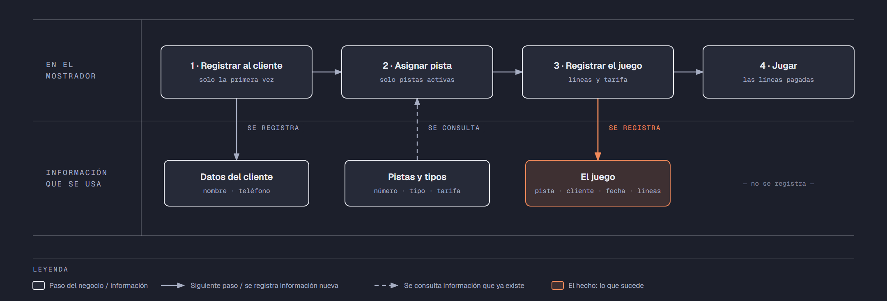

# Evidencia Integral — Caso: StrikeMax

**Alumno:** Sanchez Guillen Cristian Otoniel (matrícula 2166215)
**Base de datos a crear:** `StrikeMaxDB`

← [Regresar a la descripción de la evidencia](../descripcion-evidencia-integral.md)

---

## Historia de usuario

**Como** dueño de StrikeMax, **quiero** una base de datos que registre mis pistas de boliche, a los clientes que vienen y cada juego que se hace, **para** saber cuánto se usa cada pista, cuánto se cobró por cada juego y qué clientes registrados nunca han vuelto a jugar.

## El negocio

StrikeMax es un **boliche**. Se cobra **por línea**: una línea es un juego completo de 10 turnos para todo el grupo. Maneja **tipos de pista**: Normal, Infantil (con barreras para que la bola no se salga) y VIP (con sillones y servicio a la pista). Cada tipo tiene su propia **tarifa por línea**; por ejemplo, la VIP cuesta más que la Normal. **Las tarifas cambian** de vez en cuando. Aun así, el negocio necesita saber **cuánto se cobró por cada juego**, con la tarifa que estaba vigente el día del juego.

Cada **pista** es de un tipo, tiene un **número** que no se repite (1, 2, 3…) y una **fecha de instalación**. Una pista nunca cambia de tipo. Cuando una pista se descompone y ya no se va a reparar, se **da de baja**: no se borra, porque se quiere conservar su historial de juegos.

Los **clientes** se registran una sola vez con su nombre y su teléfono. El teléfono identifica al cliente: no puede haber dos clientes con el mismo.

En cada juego se pagan **de 1 a 5 líneas**.

Si el negocio deja de manejar un tipo de pista, tampoco lo borra: lo **da de baja**. Lo mismo pasa con los clientes: si un cliente ya no regresa, se lo da de baja en lugar de borrarlo. Así se conserva el historial de juegos.

## Los hechos de este negocio

En StrikeMax, **el hecho es el juego**: cada vez que un cliente juega en una pista, sucede un juego, en una fecha. Es la **tabla más importante** de tu modelo: tiene una fila por cada juego, es la que más crece y es donde se guarda lo que realmente pasó (qué cliente, en qué pista, cuándo, cuántas líneas y con qué tarifa por línea se le cobró).

**Esta tabla la propones tú**: su nombre, sus columnas y sus llaves. No viene en "Lo que el negocio ya tiene definido", porque los hechos no se definen de antemano: suceden.

## Lo que el negocio ya tiene definido

Estos datos **no los inventas**: son los que StrikeMax ya tiene. Tu base de datos debe guardarlos **exactamente así**, con los mismos nombres y valores.

Son los **datos iniciales** con los que arranca tu base de datos: **tipos de pista y tarifa por línea** y **pistas**. Hoy todo lo que aparece en estas tablas está **activo**, salvo la pista que se indica como dada de baja.

**Tipos de pista y tarifa por línea**

| Tipo de pista | Tarifa por línea |
|---|---|
| Normal | $90.00 |
| Infantil | $70.00 |
| VIP | $150.00 |

**Pistas**

| Tipo de pista | Número | Fecha de instalación | ¿Activa? |
|---|---|---|---|
| Infantil | 1 | 01/06/2023 | Sí |
| Infantil | 2 | 01/06/2023 | Sí |
| Normal | 3 | 01/06/2023 | Sí |
| Normal | 4 | 01/06/2023 | Sí |
| Normal | 5 | 01/06/2023 | Sí |
| Normal | 6 | 15/04/2024 | **No** |
| VIP | 7 | 15/04/2024 | Sí |
| VIP | 8 | 15/04/2024 | Sí |
| Normal | 9 | 01/09/2025 | Sí |
| VIP | 10 | 15/05/2026 | Sí |

Todo lo demás (clientes y juegos) **lo inventas tú**, cumpliendo los mínimos de [Lo que debes construir](#lo-que-debes-construir).

## Flujo de negocio

Así funciona una operación de principio a fin. Arriba, lo que pasa en el mostrador; abajo, la información que cada paso consulta o registra.

Con detalle, un cliente imaginario (Rodrigo) recorriendo el flujo:

1. **Rodrigo llega por primera vez** a StrikeMax con sus amigos. En el mostrador le piden su nombre y su teléfono y lo **registran como cliente**. Si Rodrigo regresa otro día, ya no se le registra de nuevo: se le busca por su teléfono.
2. **Se le asigna una pista.** El encargado revisa qué pistas están **activas**; las dadas de baja ya no se usan. Le asigna la pista 7, que es VIP, y le dice la tarifa por línea de ese tipo: hoy, $150.00.
3. **Se registra el juego:** pista 7, cliente Rodrigo, fecha de hoy, 3 líneas y la tarifa con la que se le cobra ($150.00 por línea).
4. **El grupo juega** las 3 líneas que pagó.

Si el mes siguiente sube la tarifa de las pistas VIP a $170.00, el juego de Rodrigo tiene que seguir diciendo que se le cobró a $150.00 por línea.

Dos semanas después, Rodrigo regresa con su familia y le toca la pista 1, que es Infantil: es otro juego, del mismo cliente y de otra pista. Ese mismo día, la pista 7 la usa otro cliente. Así, **un cliente acumula muchos juegos y una pista también**.

## Reglas de negocio

- Cada pista es de **un solo** tipo.
- No puede haber dos tipos de pista con el mismo nombre, ni dos pistas con el mismo número, ni dos clientes con el mismo teléfono.
- La tarifa por línea siempre es **mayor a cero**.
- En un juego se pagan **de 1 a 5** líneas.
- Una pista nueva se registra como **activa**.
- Un tipo de pista nuevo y un cliente nuevo también se registran como **activos**.
- Cuando cambia la tarifa de un tipo de pista, los juegos que ya se hicieron **conservan la tarifa con la que se cobraron**.

## Lo que debes construir

1. El **modelo relacional**, con al menos 4 tablas, que guarde toda la información de arriba y respete las reglas de negocio con restricciones (`PRIMARY KEY`, `FOREIGN KEY`, `UNIQUE`, `CHECK`, `DEFAULT`).
2. El **paquete de instalación** y el **paquete de reversa** de `StrikeMaxDB`.
3. **Datos iniciales:**
   - **Lo que el negocio ya tiene definido**, exactamente como viene arriba: los 3 tipos de pista con su tarifa por línea y las 10 pistas.
   - **Lo que tú inventas**, como mínimo: 10 clientes y 20 juegos, con
     - 2 clientes que nunca hayan jugado;
     - 2 pistas que nunca se hayan usado;
     - al menos 1 cliente dado de baja;
     - juegos de 3 líneas o más;
     - cada juego con la tarifa con la que se cobró (en tus datos, la tarifa de su tipo de pista que viene arriba);
     - juegos en marzo de 2026;
     - clientes que tengan "Garza" en su nombre.
4. **Las 10 consultas** de abajo.

## Consultas

| # | Pregunta del negocio |
|---|---|
| 1 | Lista los juegos de 3 líneas o más, del que tuvo más líneas al que tuvo menos. |
| 2 | Lista las pistas activas, de la más antigua a la más reciente según su fecha de instalación. |
| 3 | Lista los clientes que tienen "Garza" en su nombre. |
| 4 | Lista los juegos de marzo de 2026, ordenados por fecha. |
| 5 | Muestra los 5 juegos más recientes. |
| 6 | Muestra cada pista con el nombre de su tipo de pista y su tarifa por línea. |
| 7 | Muestra cada juego con el número de la pista, la tarifa cobrada y la tarifa actual de su tipo de pista. |
| 8 | Muestra cada juego con el nombre del cliente, el número de la pista, la fecha y las líneas. |
| 9 | Lista los clientes que nunca han jugado. |
| 10 | Lista las pistas que nunca se han usado. |

## Entrega

Ver [Entregables](../descripcion-evidencia-integral.md#entregables) y [Forma de entrega](../descripcion-evidencia-integral.md#forma-de-entrega) en la descripción de la evidencia.
