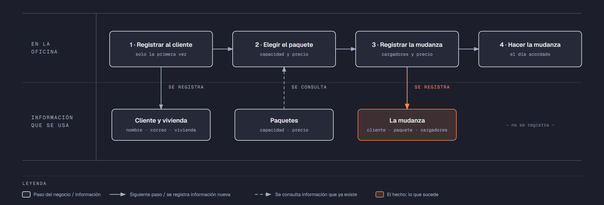

# Evidencia Integral — Caso: MudaFacil

**Alumno:** Sifuentes Emiliano Mucio Rafael (matrícula 2212513)
**Base de datos a crear:** `MudaFacilDB`

← [Regresar a la descripción de la evidencia](../descripcion-evidencia-integral.md)

---

## Historia de usuario

**Como** dueño de MudaFacil, **quiero** una base de datos que registre a mis clientes, mis paquetes de mudanza y cada mudanza que hacemos, **para** saber qué paquetes se contratan más, cuánto se cobró por cada mudanza y qué clientes registrados nunca han contratado una.

## El negocio

MudaFacil es una empresa de **mudanzas** dentro de la ciudad. Ofrece varios **paquetes de mudanza**; cada uno tiene un **nombre** que no se repite, la **capacidad del camión en toneladas** (por ejemplo, 3.5 toneladas) y un **precio por mudanza**. **Los precios cambian** de vez en cuando. Aun así, el negocio necesita saber **cuánto se cobró por cada mudanza**, con el precio que tenía el paquete el día que se contrató.

Los **clientes** se registran una sola vez con su nombre, su correo electrónico, la fecha de registro y su **tipo de vivienda**: Casa, Departamento u Oficina. El tipo de vivienda no cambia el precio: solo sirve para saber a qué clientes atiende más el negocio. El correo identifica al cliente: no puede haber dos clientes con el mismo. Cuando un cliente pide que borren su registro, se le **da de baja**, pero no se borra, para conservar sus mudanzas.

En cada mudanza trabajan **de 1 a 6 cargadores**, según lo que haya que mover. El precio del paquete es por mudanza y ya incluye a los cargadores.

Si el negocio deja de usar un tipo de vivienda o deja de ofrecer un paquete de mudanza, no se borran: se **dan de baja**, para conservar el historial de mudanzas.

## Los hechos de este negocio

En MudaFacil, **el hecho es la mudanza**: cada vez que un cliente contrata un paquete para cambiarse de casa, sucede una mudanza, en una fecha. Es la **tabla más importante** de tu modelo: tiene una fila por cada mudanza, es la que más crece y es donde se guarda lo que realmente pasó (qué cliente, qué paquete, para qué fecha, cuántos cargadores y cuánto se le cobró).

**Esta tabla la propones tú**: su nombre, sus columnas y sus llaves. No viene en "Lo que el negocio ya tiene definido", porque los hechos no se definen de antemano: suceden.

## Lo que el negocio ya tiene definido

Estos datos **no los inventas**: son los que MudaFacil ya tiene. Tu base de datos debe guardarlos **exactamente así**, con los mismos nombres y valores.

Son los **datos iniciales** con los que arranca tu base de datos: **tipos de vivienda** y **paquetes de mudanza**. Hoy todo lo que aparece en estas tablas está **activo**.

**Tipos de vivienda**

| Tipo de vivienda |
|---|
| Casa |
| Departamento |
| Oficina |

**Paquetes de mudanza**

| Nombre | Capacidad (toneladas) | Precio por mudanza |
|---|---|---|
| Express | 0.5 | $1,800.00 |
| Chico | 1.5 | $3,500.00 |
| Mediano | 3.5 | $6,000.00 |
| Grande | 5.0 | $8,500.00 |
| Familiar | 7.0 | $11,000.00 |
| Corporativo | 10.0 | $15,000.00 |

Todo lo demás (clientes y mudanzas) **lo inventas tú**, cumpliendo los mínimos de [Lo que debes construir](#lo-que-debes-construir).

## Flujo de negocio

Así funciona una operación de principio a fin. Arriba, lo que pasa en la oficina; abajo, la información que cada paso consulta o registra.

Con detalle, una clienta imaginaria (Sofía) recorriendo el flujo:

1. **Sofía llama por primera vez** a MudaFacil porque se cambia de casa. En la oficina le piden su nombre, su correo y su tipo de vivienda (Casa), y la **registran como clienta** con la fecha de hoy. Si Sofía vuelve a llamar otro día, ya no se le registra de nuevo: se le busca por su correo.
2. **Sofía elige el paquete.** El encargado le muestra la capacidad y el **precio vigente** de cada paquete. Sofía elige el paquete "Chico": hoy, $3,500.00 por mudanza.
3. **Se registra la mudanza:** clienta Sofía, paquete "Chico", la fecha en que se hará la mudanza, 3 cargadores y el precio con el que se le cobra ($3,500.00).
4. **El día acordado se hace la mudanza.** Cuánto tardan en cargar y descargar no se registra en la base de datos.

Si el mes siguiente el paquete "Chico" sube a $3,900.00, la mudanza de Sofía tiene que seguir diciendo que se le cobró a $3,500.00.

Dos meses después, Sofía contrata otra mudanza para llevar los muebles de su mamá, ahora con el paquete "Express": es otra mudanza, de la misma clienta y de otro paquete. Esa misma semana, otro cliente contrata el paquete "Chico". Así, **un cliente acumula muchas mudanzas y un paquete también**.

## Reglas de negocio

- Cada cliente tiene **un solo** tipo de vivienda.
- No puede haber dos tipos de vivienda con el mismo nombre, ni dos paquetes con el mismo nombre.
- No puede haber dos clientes con el mismo correo electrónico.
- La capacidad de un paquete siempre es **mayor a cero** toneladas.
- El precio por mudanza siempre es **mayor a cero**.
- En una mudanza trabajan **de 1 a 6** cargadores.
- Cuando cambia el precio de un paquete, las mudanzas que ya se contrataron **conservan el precio con el que se cobraron**.
- Un cliente nuevo se registra como **activo**.
- Un tipo de vivienda nuevo y un paquete de mudanza nuevo también se registran como **activos**.

## Lo que debes construir

1. El **modelo relacional**, con al menos 4 tablas, que guarde toda la información de arriba y respete las reglas de negocio con restricciones (`PRIMARY KEY`, `FOREIGN KEY`, `UNIQUE`, `CHECK`, `DEFAULT`).
2. El **paquete de instalación** y el **paquete de reversa** de `MudaFacilDB`.
3. **Datos iniciales:**
   - **Lo que el negocio ya tiene definido**, exactamente como viene arriba: los 3 tipos de vivienda y los 6 paquetes de mudanza.
   - **Lo que tú inventas**, como mínimo: 10 clientes y 20 mudanzas, con
     - clientes de los tres tipos de vivienda;
     - 2 clientes que nunca hayan contratado una mudanza;
     - 2 paquetes que nunca se hayan contratado;
     - al menos 1 cliente dado de baja;
     - mudanzas con distinto número de cargadores;
     - cada mudanza con el precio con el que se cobró (en tus datos, el precio del paquete que viene arriba);
     - mudanzas en marzo de 2026;
     - clientes con correo de `@outlook.com`.
4. **Las 10 consultas** de abajo.

## Consultas

| # | Pregunta del negocio |
|---|---|
| 1 | Lista los paquetes con capacidad de más de 3 toneladas, del más grande al más chico. |
| 2 | Lista los clientes activos, del más antiguo al más reciente según su fecha de registro. |
| 3 | Lista los clientes cuyo correo termina en "@outlook.com". |
| 4 | Lista las mudanzas de marzo de 2026, ordenadas por fecha. |
| 5 | Muestra las 5 mudanzas con más cargadores. |
| 6 | Muestra cada cliente con el nombre de su tipo de vivienda. |
| 7 | Muestra cada mudanza con el nombre del paquete, el precio cobrado y el precio actual del paquete. |
| 8 | Muestra cada mudanza con el nombre del cliente, el nombre del paquete, la fecha y el número de cargadores. |
| 9 | Lista los clientes que nunca han contratado una mudanza. |
| 10 | Lista los paquetes que nunca se han contratado. |

## Entrega

Ver [Entregables](../descripcion-evidencia-integral.md#entregables) y [Forma de entrega](../descripcion-evidencia-integral.md#forma-de-entrega) en la descripción de la evidencia.
