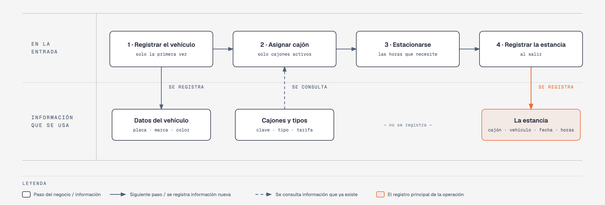

# Evidencia Integral — Caso: EstacionaYa

**Alumno:** Silva Maldonado Josue David (matrícula 2253856)
**Base de datos a crear:** `EstacionaYaDB`

← [Regresar a la descripción de la evidencia](../descripcion-evidencia-integral.md)

---

## Historia de usuario

**Como** dueña de EstacionaYa, **quiero** una base de datos que registre mis cajones, los vehículos que se estacionan y cada estancia, **para** saber cuánto se usa cada cajón, cuánto se cobró por cada estancia y qué vehículos registrados nunca han vuelto.

## El negocio

EstacionaYa es un **estacionamiento que cobra por hora**. Maneja **tipos de cajón**: Motocicleta, Automóvil y Camioneta, según el tamaño del vehículo que cabe en él. Cada tipo tiene su propia **tarifa por hora**; por ejemplo, el de Camioneta cuesta más que el de Motocicleta. **Las tarifas cambian** de vez en cuando. Aun así, el negocio necesita saber **cuánto se cobró por cada estancia**, con la tarifa que estaba vigente el día de la estancia.

Cada **cajón** es de un tipo, tiene una **clave** pintada en el piso que no se repite (por ejemplo, `A-01`) y una **fecha de habilitado**, que es el día en que empezó a usarse. Cuando un cajón ya no se puede usar (por ejemplo, porque ahí se instaló una columna o una rampa), se **da de baja**: no se borra, porque se quiere conservar su historial de estancias.

Los **vehículos** se registran una sola vez con su **placa**, su marca y su color. La placa identifica al vehículo: no puede haber dos vehículos con la misma placa (por ejemplo, `RNB-482-A`).

Se cobran **horas completas**: si un vehículo se queda 2 horas y 10 minutos, se cobran 3 horas. Una estancia dura **de 1 a 24 horas**.

Si el negocio deja de manejar un tipo de cajón, tampoco lo borra: lo **da de baja**. Lo mismo pasa con los vehículos: si un vehículo ya no regresa, se lo da de baja en lugar de borrarlo. Así se conserva el historial de estancias.

## Lo que el negocio ya tiene definido

Estos datos **no los inventas**: son los que EstacionaYa ya tiene. Tu base de datos debe guardarlos **exactamente así**, con los mismos nombres y valores.

Son los **datos iniciales** con los que arranca tu base de datos: **tipos de cajón y tarifa por hora** y **cajones**. Hoy todo lo que aparece en estas tablas está **activo**, salvo el cajón que se indica como dado de baja.

**Tipos de cajón y tarifa por hora**

| Tipo de cajón | Tarifa por hora |
|---|---|
| Motocicleta | $10.00 |
| Automóvil | $20.00 |
| Camioneta | $30.00 |

**Cajones**

| Tipo de cajón | Clave | Fecha en que se habilitó | ¿Activo? |
|---|---|---|---|
| Motocicleta | `M-01` | 01/05/2024 | Sí |
| Motocicleta | `M-02` | 01/05/2024 | Sí |
| Automóvil | `A-01` | 01/05/2024 | Sí |
| Automóvil | `A-02` | 01/05/2024 | Sí |
| Camioneta | `C-01` | 12/08/2024 | Sí |
| Camioneta | `C-02` | 20/01/2025 | Sí |
| Automóvil | `A-03` | 01/05/2024 | **No** |
| Automóvil | `A-04` | 15/09/2025 | Sí |

Todo lo demás (vehículos y estancias) **lo inventas tú**, cumpliendo los mínimos de [Lo que debes construir](#lo-que-debes-construir).

## Flujo de negocio

Así funciona una operación de principio a fin. Arriba, lo que pasa en la entrada del estacionamiento; abajo, la información que cada paso consulta o registra.

Con detalle, un conductor imaginario (Rodrigo) recorriendo el flujo:

1. **Rodrigo llega por primera vez** a EstacionaYa en su Nissan blanco. En la entrada anotan su placa (`RNB-482-A`), la marca y el color, y **registran el vehículo**. Si Rodrigo regresa otro día, ya no se registra de nuevo: se le busca por su placa.
2. **Se le asigna un cajón.** El encargado revisa qué cajones están **activos**; los dados de baja ya no se usan. Le asigna el cajón `A-01`, que es de tipo Automóvil, y le dice la tarifa por hora de ese tipo: hoy, $20.00.
3. **Rodrigo deja el auto estacionado** mientras hace sus compras.
4. **Al salir, se registra la estancia:** cajón `A-01`, la placa del vehículo, fecha de hoy, las horas que se quedó (2) y la tarifa por hora con la que se le cobra ($20.00).

Si el mes siguiente sube la tarifa de los cajones de Automóvil a $25.00, la estancia de Rodrigo tiene que seguir diciendo que se le cobró a $20.00 por hora.

A la semana siguiente, Rodrigo regresa y le toca el cajón `A-02`: es otra estancia, del mismo vehículo y de otro cajón. Ese mismo día, el cajón `A-01` lo usa otro vehículo. Así, **un vehículo acumula muchas estancias y un cajón también**.

## Reglas de negocio

- Cada cajón es de **un solo** tipo.
- No puede haber dos tipos de cajón con el mismo nombre, ni dos cajones con la misma clave, ni dos vehículos con la misma placa.
- La tarifa por hora siempre es **mayor a cero**.
- Una estancia dura **de 1 a 24** horas.
- Un cajón nuevo se registra como **activo**.
- Un tipo de cajón nuevo y un vehículo nuevo también se registran como **activos**.
- Cuando cambia la tarifa de un tipo de cajón, las estancias que ya se registraron **conservan la tarifa con la que se cobraron**.

## Lo que debes construir

1. El **modelo relacional**, con al menos 4 tablas, que guarde toda la información de arriba y respete las reglas de negocio con restricciones (`PRIMARY KEY`, `FOREIGN KEY`, `UNIQUE`, `CHECK`, `DEFAULT`).
2. El **paquete de instalación** y el **paquete de reversa** de `EstacionaYaDB`.
3. **Datos iniciales:**
   - **Lo que el negocio ya tiene definido**, exactamente como viene arriba: los 3 tipos de cajón con su tarifa por hora y los 8 cajones.
   - **Lo que tú inventas**, como mínimo: 10 vehículos y 20 estancias, con
     - 2 vehículos que nunca se hayan estacionado;
     - 2 cajones que nunca se hayan usado;
     - al menos 1 vehículo dado de baja;
     - estancias de más de 3 horas;
     - cada estancia con la tarifa por hora con la que se cobró (en tus datos, la tarifa de su tipo de cajón que viene arriba);
     - estancias en marzo de 2026;
     - vehículos cuya placa comience con "RN".
4. **Las 10 consultas** de abajo.

## Consultas

| # | Pregunta del negocio |
|---|---|
| 1 | Lista las estancias de más de 3 horas, ordenadas de la más larga a la más corta. |
| 2 | Lista los cajones activos, del más antiguo al más reciente según su fecha de habilitado. |
| 3 | Lista los vehículos cuya placa comienza con "RN". |
| 4 | Lista las estancias de marzo de 2026, ordenadas por fecha. |
| 5 | Muestra los 5 cajones habilitados más recientemente. |
| 6 | Muestra cada cajón con el nombre de su tipo de cajón y su tarifa por hora. |
| 7 | Muestra cada estancia con la clave del cajón, la tarifa por hora cobrada y la tarifa por hora actual de su tipo de cajón. |
| 8 | Muestra cada estancia con la placa del vehículo, la clave del cajón, la fecha y las horas. |
| 9 | Lista los vehículos que nunca se han estacionado. |
| 10 | Lista los cajones que nunca se han usado. |

## Entrega

Ver [Entregables](../descripcion-evidencia-integral.md#entregables) y [Forma de entrega](../descripcion-evidencia-integral.md#forma-de-entrega) en la descripción de la evidencia.
