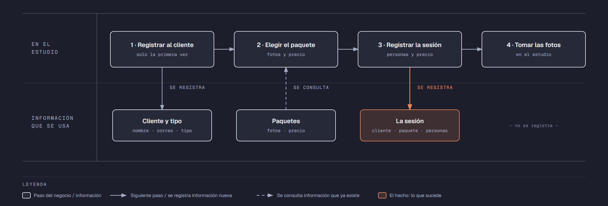

# Evidencia Integral — Caso: ClickEstudio

**Alumno:** Torres Maldonado Emma Valentina (matrícula 2254263)
**Base de datos a crear:** `ClickEstudioDB`

← [Regresar a la descripción de la evidencia](../descripcion-evidencia-integral.md)

---

## Historia de usuario

**Como** dueña de ClickEstudio, **quiero** una base de datos que registre a mis clientes, mis paquetes de fotos y cada sesión que hacemos, **para** saber qué paquetes se contratan más, cuánto se cobró por cada sesión y qué tipo de clientes atendemos.

## El negocio

ClickEstudio es un **estudio de fotografía**. Ofrece varios **paquetes de fotos**; cada uno tiene un **nombre** que no se repite, el **número de fotos** que se entregan (por ejemplo, 20 fotos editadas) y un **precio por sesión**. El precio es por sesión: se cobra lo mismo sin importar cuántas personas salgan en las fotos. **Los precios cambian** de vez en cuando. Aun así, el negocio necesita saber **cuánto se cobró por cada sesión**, con el precio que tenía el paquete el día de la sesión.

Los **clientes** se registran una sola vez con su nombre, su correo electrónico, la fecha de registro y su **tipo de cliente**: Particular, Empresa o Escuela. Si es una empresa o una escuela, el nombre es el de la empresa o el de la escuela (por ejemplo, "Colegio Los Pinos"). El tipo de cliente no cambia el precio: solo sirve para saber a quién atiende más el estudio. El correo identifica al cliente: no puede haber dos clientes con el mismo. Cuando un cliente pide que borren su registro, se le **da de baja**, pero no se borra, para conservar sus sesiones.

En cada sesión salen **de 1 a 20 personas** en las fotos.

Si el negocio deja de usar un tipo de cliente o deja de ofrecer un paquete de fotos, no se borran: se **dan de baja**, para conservar el historial de sesiones.

## Los hechos de este negocio

En ClickEstudio, **el hecho es la sesión**: cada vez que un cliente va al estudio a tomarse fotos, sucede una sesión, en una fecha. Es la **tabla más importante** de tu modelo: tiene una fila por cada sesión, es la que más crece y es donde se guarda lo que realmente pasó (qué cliente, qué paquete, cuándo, cuántas personas y cuánto se le cobró).

**Esta tabla la propones tú**: su nombre, sus columnas y sus llaves. No viene en "Lo que el negocio ya tiene definido", porque los hechos no se definen de antemano: suceden.

## Lo que el negocio ya tiene definido

Estos datos **no los inventas**: son los que ClickEstudio ya tiene. Tu base de datos debe guardarlos **exactamente así**, con los mismos nombres y valores.

Son los **datos iniciales** con los que arranca tu base de datos: **tipos de cliente** y **paquetes de fotos**. Hoy todo lo que aparece en estas tablas está **activo**.

**Tipos de cliente**

| Tipo de cliente |
|---|
| Particular |
| Empresa |
| Escuela |

**Paquetes de fotos**

| Nombre | Número de fotos | Precio por sesión |
|---|---|---|
| Retrato | 10 | $900.00 |
| Familiar | 20 | $1,600.00 |
| Graduación | 30 | $2,200.00 |
| Corporativo | 40 | $2,800.00 |
| Mascotas | 15 | $1,200.00 |
| Evento | 60 | $4,800.00 |

Todo lo demás (clientes y sesiones) **lo inventas tú**, cumpliendo los mínimos de [Lo que debes construir](#lo-que-debes-construir).

## Flujo de negocio

Así funciona una operación de principio a fin. Arriba, lo que pasa en el estudio; abajo, la información que cada paso consulta o registra.

Con detalle, una clienta imaginaria (Lucía) recorriendo el flujo:

1. **Lucía llega por primera vez** a ClickEstudio para unas fotos con su familia. En la recepción le piden su nombre y su correo, anotan que es cliente Particular y la **registran como clienta** con la fecha de hoy. Si Lucía regresa otro día, ya no se le registra de nuevo: se le busca por su correo.
2. **Lucía elige el paquete.** La recepcionista le muestra cuántas fotos trae y el **precio vigente** de cada paquete. Lucía elige el paquete "Familiar": hoy, $1,600.00 por sesión.
3. **Se registra la sesión:** clienta Lucía, paquete "Familiar", fecha de hoy, 4 personas y el precio con el que se le cobra ($1,600.00).
4. **Se toman las fotos** en el estudio. Cuáles fotos elige Lucía para editar no se registra en la base de datos.

Si el mes siguiente el paquete "Familiar" sube a $1,750.00, la sesión de Lucía tiene que seguir diciendo que se le cobró a $1,600.00.

Dos meses después, Lucía regresa por un "Retrato" para su currículum: es otra sesión, de la misma clienta y de otro paquete. Ese mismo día, otro cliente contrata el paquete "Familiar". Así, **un cliente acumula muchas sesiones y un paquete también**.

## Reglas de negocio

- Cada cliente es de **un solo** tipo de cliente.
- No puede haber dos tipos de cliente con el mismo nombre, ni dos paquetes con el mismo nombre.
- No puede haber dos clientes con el mismo correo electrónico.
- El número de fotos de un paquete siempre es **mayor a cero**.
- El precio por sesión siempre es **mayor a cero**.
- En una sesión salen **de 1 a 20** personas.
- Cuando cambia el precio de un paquete, las sesiones que ya se hicieron **conservan el precio con el que se cobraron**.
- Un cliente nuevo se registra como **activo**.
- Un tipo de cliente nuevo y un paquete de fotos nuevo también se registran como **activos**.

## Lo que debes construir

1. El **modelo relacional**, con al menos 4 tablas, que guarde toda la información de arriba y respete las reglas de negocio con restricciones (`PRIMARY KEY`, `FOREIGN KEY`, `UNIQUE`, `CHECK`, `DEFAULT`).
2. El **paquete de instalación** y el **paquete de reversa** de `ClickEstudioDB`.
3. **Datos iniciales:**
   - **Lo que el negocio ya tiene definido**, exactamente como viene arriba: los 3 tipos de cliente y los 6 paquetes de fotos.
   - **Lo que tú inventas**, como mínimo: 10 clientes y 20 sesiones, con
     - clientes de los tres tipos;
     - 2 clientes que nunca hayan tenido una sesión;
     - 2 paquetes que nunca se hayan contratado;
     - al menos 1 cliente dado de baja;
     - sesiones con distinto número de personas;
     - cada sesión con el precio con el que se cobró (en tus datos, el precio del paquete que viene arriba);
     - sesiones en marzo de 2026;
     - clientes cuyo nombre comience con "Colegio".
4. **Las 10 consultas** de abajo.

## Consultas

| # | Pregunta del negocio |
|---|---|
| 1 | Lista los paquetes que incluyen más de 20 fotos, del que incluye más al que incluye menos. |
| 2 | Lista los clientes activos, del más antiguo al más reciente según su fecha de registro. |
| 3 | Lista los clientes cuyo nombre comienza con "Colegio". |
| 4 | Lista las sesiones de marzo de 2026, ordenadas por fecha. |
| 5 | Muestra las 5 sesiones con más personas. |
| 6 | Muestra cada cliente con el nombre de su tipo de cliente. |
| 7 | Muestra cada sesión con el nombre del paquete, el precio cobrado y el precio actual del paquete. |
| 8 | Muestra cada sesión con el nombre del cliente, el nombre del paquete, la fecha y el número de personas. |
| 9 | Lista los clientes que nunca han tenido una sesión. |
| 10 | Lista los paquetes que nunca se han contratado. |

## Entrega

Ver [Entregables](../descripcion-evidencia-integral.md#entregables) y [Forma de entrega](../descripcion-evidencia-integral.md#forma-de-entrega) en la descripción de la evidencia.
