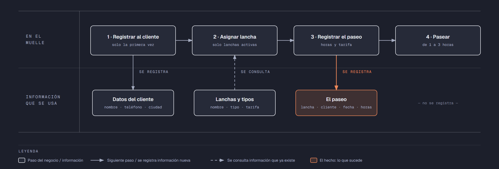

# Evidencia Integral — Caso: LagoAzul

**Alumno:** Tristan Acuña Orlando (matrícula 2254051)
**Base de datos a crear:** `LagoAzulDB`

← [Regresar a la descripción de la evidencia](../descripcion-evidencia-integral.md)

---

## Historia de usuario

**Como** dueño de LagoAzul, **quiero** una base de datos que registre mis lanchas, a los clientes que vienen y cada paseo que hacen, **para** saber cuánto se usa cada lancha, cuánto se cobró por cada paseo y qué clientes registrados nunca han vuelto a pasear.

## El negocio

LagoAzul es un negocio de **renta de lanchas por hora** en un lago. Cada **paseo** es la renta de una lancha para recorrer el lago. Maneja **tipos de lancha**: Pedal, Remo y Motor. Cada tipo tiene su propia **tarifa por hora**; por ejemplo, la de motor cuesta más que la de remo. **Las tarifas cambian** de vez en cuando. Aun así, el negocio necesita saber **cuánto se cobró por cada paseo**, con la tarifa que estaba vigente el día del paseo.

Cada **lancha** es de un tipo y tiene un **nombre** pintado en el costado que no se repite (por ejemplo, "Gaviota") y una **fecha de compra**. Cuando una lancha ya no sirve (por ejemplo, porque se le rajó el casco), se **da de baja**: no se borra, porque se quiere conservar su historial de paseos.

Los **clientes** se registran una sola vez con su nombre, su teléfono y la **ciudad** de donde vienen, porque al lago llegan visitantes de varias ciudades. El teléfono identifica al cliente: no puede haber dos clientes con el mismo.

Cada paseo dura **de 1 a 3 horas**; el cliente elige cuántas horas quiere antes de subirse a la lancha.

Si el negocio deja de manejar un tipo de lancha, tampoco lo borra: lo **da de baja**. Lo mismo pasa con los clientes: si un cliente ya no regresa, se lo da de baja en lugar de borrarlo. Así se conserva el historial de paseos.

## Los hechos de este negocio

En LagoAzul, **el hecho es el paseo**: cada vez que un cliente renta una lancha, sucede un paseo, en una fecha. Es la **tabla más importante** de tu modelo: tiene una fila por cada paseo, es la que más crece y es donde se guarda lo que realmente pasó (qué cliente, qué lancha, cuándo, cuántas horas y con qué tarifa se le cobró).

**Esta tabla la propones tú**: su nombre, sus columnas y sus llaves. No viene en "Lo que el negocio ya tiene definido", porque los hechos no se definen de antemano: suceden.

## Lo que el negocio ya tiene definido

Estos datos **no los inventas**: son los que LagoAzul ya tiene. Tu base de datos debe guardarlos **exactamente así**, con los mismos nombres y valores.

Son los **datos iniciales** con los que arranca tu base de datos: **tipos de lancha y tarifa por hora** y **lanchas**. Hoy todo lo que aparece en estas tablas está **activo**, salvo la lancha que se indica como dada de baja.

**Tipos de lancha y tarifa por hora**

| Tipo de lancha | Tarifa por hora |
|---|---|
| Pedal | $150.00 |
| Remo | $120.00 |
| Motor | $350.00 |

**Lanchas**

| Tipo de lancha | Nombre | Fecha de compra | ¿Activa? |
|---|---|---|---|
| Pedal | Gaviota | 10/04/2023 | Sí |
| Pedal | Pelícano | 10/04/2023 | Sí |
| Remo | Tortuga | 15/03/2022 | Sí |
| Remo | Nutria | 20/02/2024 | Sí |
| Motor | Delfín | 01/06/2023 | Sí |
| Motor | Flamenco | 05/03/2025 | Sí |
| Remo | Libélula | 15/03/2022 | **No** |
| Pedal | Colibrí | 12/11/2025 | Sí |

Todo lo demás (clientes y paseos) **lo inventas tú**, cumpliendo los mínimos de [Lo que debes construir](#lo-que-debes-construir).

## Flujo de negocio

Así funciona una operación de principio a fin. Arriba, lo que pasa en el muelle; abajo, la información que cada paso consulta o registra.

Con detalle, una clienta imaginaria (Rosa) recorriendo el flujo:

1. **Rosa llega por primera vez** a LagoAzul con su familia. En el muelle le piden su nombre, su teléfono y su ciudad (Monterrey), y la **registran como clienta**. Si Rosa regresa otro día, ya no se le registra de nuevo: se le busca por su teléfono.
2. **Se le asigna una lancha.** El encargado revisa qué lanchas están **activas**; las dadas de baja ya no salen al lago. Le asigna la lancha "Gaviota", que es de pedal, y le dice la tarifa por hora de ese tipo: hoy, $150.00.
3. **Se registra el paseo:** lancha "Gaviota", clienta Rosa, fecha de hoy, 2 horas y la tarifa por hora con la que se le cobra ($150.00).
4. **Rosa pasea por el lago** sus 2 horas y regresa la lancha al muelle.

Si el mes siguiente sube la tarifa de las lanchas de pedal a $170.00, el paseo de Rosa tiene que seguir diciendo que se le cobró a $150.00 la hora.

Un mes después, Rosa regresa y le toca la lancha "Delfín", que es de motor: es otro paseo, de la misma clienta y de otra lancha. Ese mismo día, la "Gaviota" la usa otro cliente. Así, **un cliente acumula muchos paseos y una lancha también**.

## Reglas de negocio

- Cada lancha es de **un solo** tipo.
- No puede haber dos tipos de lancha con el mismo nombre, ni dos lanchas con el mismo nombre, ni dos clientes con el mismo teléfono.
- La tarifa por hora siempre es **mayor a cero**.
- Un paseo dura **de 1 a 3** horas.
- Una lancha nueva se registra como **activa**.
- Un tipo de lancha nuevo y un cliente nuevo también se registran como **activos**.
- Cuando cambia la tarifa de un tipo de lancha, los paseos que ya se hicieron **conservan la tarifa con la que se cobraron**.

## Lo que debes construir

1. El **modelo relacional**, con al menos 4 tablas, que guarde toda la información de arriba y respete las reglas de negocio con restricciones (`PRIMARY KEY`, `FOREIGN KEY`, `UNIQUE`, `CHECK`, `DEFAULT`).
2. El **paquete de instalación** y el **paquete de reversa** de `LagoAzulDB`.
3. **Datos iniciales:**
   - **Lo que el negocio ya tiene definido**, exactamente como viene arriba: los 3 tipos de lancha con su tarifa por hora y las 8 lanchas.
   - **Lo que tú inventas**, como mínimo: 10 clientes y 20 paseos, con
     - 2 clientes que nunca hayan paseado;
     - 2 lanchas que nunca se hayan usado;
     - al menos 1 cliente dado de baja;
     - clientes de Monterrey y de otras ciudades;
     - cada paseo con la tarifa por hora con la que se cobró (en tus datos, la tarifa de su tipo de lancha que viene arriba);
     - paseos en marzo de 2026;
     - clientes con el apellido "Garza".
4. **Las 10 consultas** de abajo.

## Consultas

| # | Pregunta del negocio |
|---|---|
| 1 | Lista los clientes que no son de Monterrey, ordenados por ciudad. |
| 2 | Lista las lanchas activas, de la más antigua a la más reciente según su fecha de compra. |
| 3 | Lista los clientes que tienen el apellido "Garza". |
| 4 | Lista los paseos de marzo de 2026, ordenados por fecha. |
| 5 | Muestra las 5 lanchas compradas más recientemente. |
| 6 | Muestra cada lancha con el nombre de su tipo de lancha y su tarifa por hora. |
| 7 | Muestra cada paseo con el nombre de la lancha, la tarifa cobrada y la tarifa actual de su tipo de lancha. |
| 8 | Muestra cada paseo con el nombre del cliente, el nombre de la lancha, la fecha y las horas. |
| 9 | Lista los clientes que nunca han paseado. |
| 10 | Lista las lanchas que nunca se han usado. |

## Entrega

Ver [Entregables](../descripcion-evidencia-integral.md#entregables) y [Forma de entrega](../descripcion-evidencia-integral.md#forma-de-entrega) en la descripción de la evidencia.
