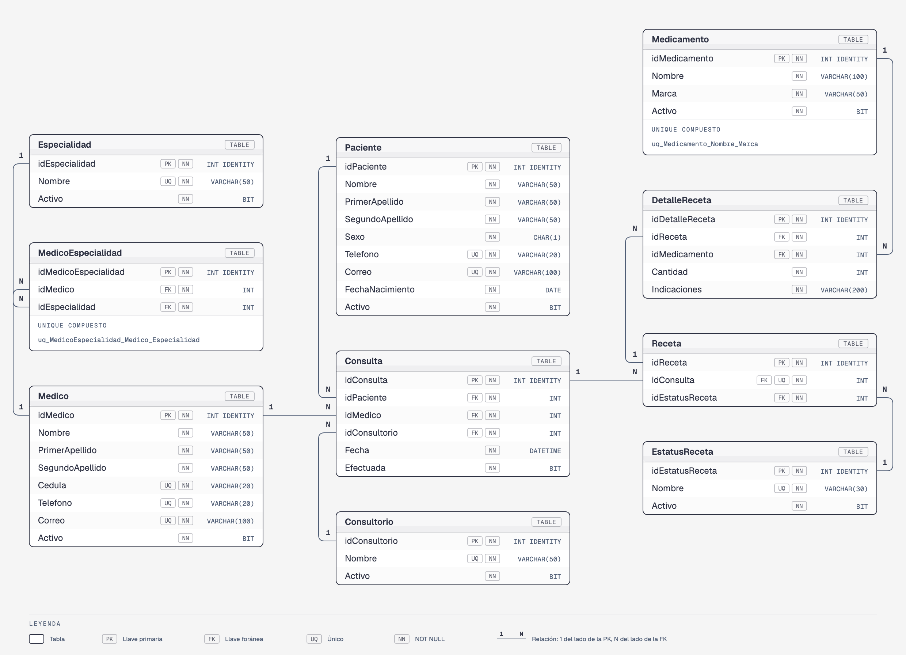

# Ejemplo resuelto — HospitalDB

Solución completa del [caso HospitalDB](caso.md). Muestra lo que se espera en los cuatro entregables de la Evidencia Integral:

| Entregable | En este ejemplo |
|------------|-----------------|
| `EvidenciaIntegral_ApellidoNombre_Matricula.pdf` | [`EvidenciaIntegral_HilarioMedranoDanielGustavo_1234567.pdf`](EvidenciaIntegral_HilarioMedranoDanielGustavo_1234567.pdf): así debe verse tu PDF. Su contenido también está abajo |
| `Instalacion_ApellidoNombre_Matricula.zip` | Los scripts de [`HospitalDB/instalacion/`](HospitalDB/instalacion) |
| `Reversa_ApellidoNombre_Matricula.zip` | Los scripts de [`HospitalDB/reversa/`](HospitalDB/reversa) |
| `Consultas_ApellidoNombre_Matricula.zip` | Los 10 archivos de [`HospitalDB/consultas/`](HospitalDB/consultas) |

← [Regresar a la descripción de la evidencia](../descripcion-evidencia-integral.md)

---

# Contenido del PDF

## Portada

- **Nombre:** (nombre completo del alumno)
- **Matrícula:** (matrícula)
- **Caso:** HospitalDB — consultas y recetas de un hospital

## 1. Modelo relacional



> **En tu PDF, el diagrama se hace en [dbdiagram.io](https://dbdiagram.io).** Este ejemplo usa la herramienta de diagramas del curso, pero el contenido es el mismo: tablas, columnas, tipos, llaves y relaciones. Este es el código de dbdiagram.io que genera el mismo modelo:

```
Table Especialidad {
  idEspecialidad int [pk, increment]
  Nombre varchar(50) [not null, unique]
  Activo bit [not null, default: 1]
}

Table Medico {
  idMedico int [pk, increment]
  Nombre varchar(50) [not null]
  PrimerApellido varchar(50) [not null]
  SegundoApellido varchar(50) [not null]
  Cedula varchar(20) [not null, unique]
  Telefono varchar(20) [not null, unique]
  Correo varchar(100) [not null, unique]
  Activo bit [not null, default: 1]
}

Table MedicoEspecialidad {
  idMedicoEspecialidad int [pk, increment]
  idMedico int [not null, ref: > Medico.idMedico]
  idEspecialidad int [not null, ref: > Especialidad.idEspecialidad]

  indexes {
    (idMedico, idEspecialidad) [unique]
  }
}

Table Paciente {
  idPaciente int [pk, increment]
  Nombre varchar(50) [not null]
  PrimerApellido varchar(50) [not null]
  SegundoApellido varchar(50) [not null]
  Sexo char(1) [not null, note: 'CHECK (Sexo IN ('M', 'F'))']
  Telefono varchar(20) [not null, unique]
  Correo varchar(100) [not null, unique]
  FechaNacimiento date [not null]
  Activo bit [not null, default: 1]
}

Table Consultorio {
  idConsultorio int [pk, increment]
  Nombre varchar(50) [not null, unique]
  Activo bit [not null, default: 1]
}

Table EstatusReceta {
  idEstatusReceta int [pk, increment]
  Nombre varchar(30) [not null, unique]
  Activo bit [not null, default: 1]
}

Table Consulta {
  idConsulta int [pk, increment]
  idPaciente int [not null, ref: > Paciente.idPaciente]
  idMedico int [not null, ref: > Medico.idMedico]
  idConsultorio int [not null, ref: > Consultorio.idConsultorio]
  Fecha datetime [not null]
  Efectuada bit [not null, default: 0]
}

Table Receta {
  idReceta int [pk, increment]
  idConsulta int [not null, ref: > Consulta.idConsulta, unique]
  idEstatusReceta int [not null, ref: > EstatusReceta.idEstatusReceta]
}

Table Medicamento {
  idMedicamento int [pk, increment]
  Nombre varchar(100) [not null]
  Marca varchar(50) [not null]
  Activo bit [not null, default: 1]

  indexes {
    (Nombre, Marca) [unique]
  }
}

Table DetalleReceta {
  idDetalleReceta int [pk, increment]
  idReceta int [not null, ref: > Receta.idReceta]
  idMedicamento int [not null, ref: > Medicamento.idMedicamento]
  Cantidad int [not null, note: 'CHECK (Cantidad > 0)']
  Indicaciones varchar(200) [not null]
}
```

## 2. Descripción del negocio y de la base de datos

El hospital registra a sus médicos con las especialidades que ejerce cada uno, a sus pacientes y sus consultorios. Cuando un paciente pide una cita se agenda una consulta con un médico, en un consultorio, en una fecha y hora; cuando el médico la atiende, la consulta se marca como efectuada y puede generar una receta con uno o varios medicamentos, cada uno con su cantidad e indicaciones. Cada receta tiene un estatus que cambia conforme se surte.

La base de datos **HospitalDB** tiene 10 tablas. Cinco son catálogos que el hospital ya tiene definidos: `Especialidad`, `Medico`, `Consultorio`, `EstatusReceta` y `Medicamento`. `MedicoEspecialidad` une a médicos y especialidades. `Paciente` guarda a los pacientes; `Consulta` registra cada cita; `Receta` registra la receta de una consulta y `DetalleReceta`, los medicamentos de cada receta.

## 3. Plan de instalación

| Orden | Script | Descripción |
|---|---|---|
| 1 | `01-create-database.sql` | Crea la base de datos `HospitalDB` |
| 2 | `02-create-table-especialidad.sql` | Crea la tabla `Especialidad` |
| 3 | `03-create-table-medico.sql` | Crea la tabla `Medico` |
| 4 | `04-create-table-medico-especialidad.sql` | Crea la tabla `MedicoEspecialidad`, con llaves foráneas a `Medico` y a `Especialidad` |
| 5 | `05-create-table-paciente.sql` | Crea la tabla `Paciente` |
| 6 | `06-create-table-consultorio.sql` | Crea la tabla `Consultorio` |
| 7 | `07-create-table-estatus-receta.sql` | Crea la tabla `EstatusReceta` |
| 8 | `08-create-table-consulta.sql` | Crea la tabla `Consulta`, con llaves foráneas a `Paciente`, `Medico` y `Consultorio` |
| 9 | `09-create-table-receta.sql` | Crea la tabla `Receta`, con llaves foráneas a `Consulta` y a `EstatusReceta` |
| 10 | `10-create-table-medicamento.sql` | Crea la tabla `Medicamento` |
| 11 | `11-create-table-detalle-receta.sql` | Crea la tabla `DetalleReceta`, con llaves foráneas a `Receta` y a `Medicamento` |
| 12 | `12-insert-especialidad.sql` | Inserta las 10 especialidades del hospital |
| 13 | `13-insert-medico.sql` | Inserta los 10 médicos del hospital |
| 14 | `14-insert-medico-especialidad.sql` | Inserta las 13 especialidades que ejerce cada médico (un médico puede tener más de una) |
| 15 | `15-insert-paciente.sql` | Inserta 15 pacientes (el 15 está dado de baja) |
| 16 | `16-insert-consultorio.sql` | Inserta los 10 consultorios del hospital |
| 17 | `17-insert-estatus-receta.sql` | Inserta los 5 estatus que puede tener una receta |
| 18 | `18-insert-consulta.sql` | Inserta 17 consultas de septiembre y octubre de 2026 (las 16 y 17 todavía no se efectúan ni tienen receta) |
| 19 | `19-insert-receta.sql` | Inserta 15 recetas, una por consulta efectuada (las recetas 1, 2 y 3 no tienen medicamentos) |
| 20 | `20-insert-medicamento.sql` | Inserta 15 medicamentos (el 11 está dado de baja) |
| 21 | `21-insert-detalle-receta.sql` | Inserta 16 medicamentos recetados |

> Cada script, excepto el 1, empieza con `USE HospitalDB;`, así que puede ejecutarse sin importar qué base de datos esté seleccionada en SSMS.

## 4. Plan de reversa

| Orden | Script | Descripción |
|---|---|---|
| 1 | `01-drop-tables.sql` | Elimina las tablas en orden inverso a las llaves foráneas: `DetalleReceta`, `Medicamento`, `Receta`, `EstatusReceta`, `Consulta`, `Consultorio`, `Paciente`, `MedicoEspecialidad`, `Medico` y `Especialidad` |
| 2 | `02-drop-database.sql` | Elimina la base de datos `HospitalDB` |

> Antes de ejecutar el script 2, selecciona **otra** base de datos en el dropdown de SSMS (por ejemplo, `master`): no se puede eliminar la base de datos a la que estás conectado.

## 5. Decisiones de diseño

### `Especialidad`

Es un catálogo. Las especialidades tienen su propia tabla para escribir cada nombre una sola vez y no repetirlo en cada médico. `Nombre` es `UNIQUE` para no tener dos "Cardiología". `Activo` tiene `DEFAULT 1`: toda especialidad nueva empieza activa y, si el hospital deja de ofrecerla, se marca en `0` en lugar de borrarla, para no perder a los médicos que la ejercieron.

### `Medico`

No tiene llaves foráneas: sus especialidades no van aquí, porque un médico puede tener **varias** y una columna solo guarda un valor (ver `MedicoEspecialidad`). `Cedula`, `Telefono` y `Correo` son `UNIQUE` porque cada uno identifica a un solo médico. `Activo` tiene `DEFAULT 1`; si un médico deja el hospital se marca en `0` en lugar de borrarlo, para no perder sus consultas.

### `MedicoEspecialidad`

Resuelve la relación **N:M** entre médicos y especialidades: un médico ejerce muchas especialidades y una especialidad la ejercen muchos médicos. Por eso tiene dos llaves foráneas (`idMedico` e `idEspecialidad`). El `UNIQUE` compuesto `(idMedico, idEspecialidad)` impide registrar dos veces la misma especialidad al mismo médico; cada columna por separado sí se repite.

### `Paciente`

No depende de otra tabla. `Telefono` y `Correo` son `UNIQUE` porque con ellos se busca al paciente cuando regresa. `Sexo` tiene un `CHECK (Sexo IN ('M', 'F'))` para que solo acepte esos dos valores. Guarda la `FechaNacimiento` y no la edad, porque la edad cambia cada año y la fecha no. `Activo` tiene `DEFAULT 1`; si el paciente pide su baja se marca en `0`, para no perder sus consultas.

### `Consultorio`

Es un catálogo. `Nombre` es `UNIQUE` y `Activo` tiene `DEFAULT 1`: si un consultorio se cierra se da de baja, y las consultas que se dieron ahí conservan su referencia.

### `EstatusReceta`

Es un catálogo con los estados posibles de una receta. Tenerlos en una tabla evita escribir el texto en cada receta y errores como "Surtida" y "surtida". `Nombre` es `UNIQUE` y `Activo` tiene `DEFAULT 1`.

### `Consulta`

Une a un paciente, un médico y un consultorio en una fecha y hora: tiene tres llaves foráneas, porque una consulta es de **un** paciente, con **un** médico y en **un** consultorio, y cada uno de ellos tiene **muchas** consultas (relaciones 1:N; la llave foránea va del lado de "muchos"). `Fecha` es `DATETIME` porque importa la hora de la cita. `Efectuada` tiene `DEFAULT 0` porque toda consulta se agenda antes de atenderse.

### `Receta`

Cada receta pertenece a una consulta. `idConsulta` es llave foránea **y además `UNIQUE`**: así una consulta tiene **como máximo una** receta (relación 1:1). Sin el `UNIQUE`, la llave foránea permitiría varias recetas por consulta. `idEstatusReceta` es llave foránea a `EstatusReceta`.

### `Medicamento`

Es un catálogo. El `UNIQUE` es **compuesto**, `(Nombre, Marca)`: puede haber dos medicamentos con el mismo nombre si son de distinta marca, o de la misma marca con distinto nombre, pero no los dos iguales. `Activo` tiene `DEFAULT 1`; si un medicamento sale del mercado se da de baja y las recetas anteriores lo conservan.

### `DetalleReceta`

Resuelve la relación **N:M** entre recetas y medicamentos: una receta lleva muchos medicamentos y un medicamento aparece en muchas recetas. Además de las dos llaves foráneas, guarda los datos que pertenecen a **esa** combinación: la `Cantidad`, con un `CHECK (Cantidad > 0)`, y las `Indicaciones`.

> **Las consultas no van en el PDF.** Van en el ZIP de consultas (`Consultas_ApellidoNombre_Matricula.zip`).

---

# Contenido del ZIP de consultas

Diez archivos, uno por consulta, con **solo el código**: sin cabecera y sin comentarios. El número de la consulta lo da el nombre del archivo. Se ejecutan después de la instalación, con `HospitalDB` seleccionada.

| Archivo | Pregunta |
|---------|----------|
| [`01-consulta.sql`](HospitalDB/consultas/01-consulta.sql) | Lista los medicamentos recetados en una cantidad mayor a 10, de la cantidad mayor a la menor. |
| [`02-consulta.sql`](HospitalDB/consultas/02-consulta.sql) | Lista los pacientes activos, del de mayor edad al más joven. |
| [`03-consulta.sql`](HospitalDB/consultas/03-consulta.sql) | Lista los pacientes cuyo correo es de Gmail. |
| [`04-consulta.sql`](HospitalDB/consultas/04-consulta.sql) | Lista las consultas efectuadas en septiembre de 2026, ordenadas por fecha. |
| [`05-consulta.sql`](HospitalDB/consultas/05-consulta.sql) | Muestra los 5 pacientes de mayor edad. |
| [`06-consulta.sql`](HospitalDB/consultas/06-consulta.sql) | Muestra cada receta con el nombre de su estatus. |
| [`07-consulta.sql`](HospitalDB/consultas/07-consulta.sql) | Muestra cada médico con las especialidades que ejerce. |
| [`08-consulta.sql`](HospitalDB/consultas/08-consulta.sql) | Muestra cada consulta con el nombre del paciente, el nombre del médico, el consultorio y la fecha. |
| [`09-consulta.sql`](HospitalDB/consultas/09-consulta.sql) | Lista las consultas que no tienen receta. |
| [`10-consulta.sql`](HospitalDB/consultas/10-consulta.sql) | Lista las recetas que no tienen ningún medicamento. |

Por ejemplo, `09-consulta.sql`:

```sql
SELECT C.idConsulta, C.idPaciente, C.Fecha, C.Efectuada
FROM Consulta C
LEFT JOIN Receta R ON R.idConsulta = C.idConsulta
WHERE R.idReceta IS NULL
```

Con los datos iniciales regresa 2 consultas: la 16 y la 17, que todavía no se efectúan.
