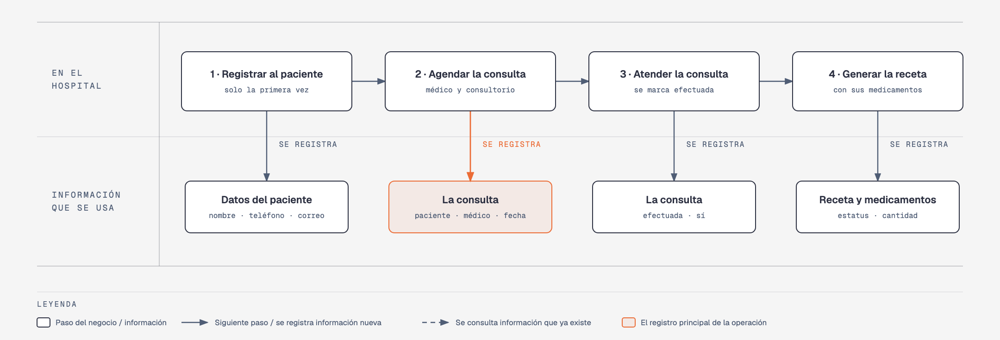

# Ejemplo resuelto — Caso: HospitalDB

**Base de datos a crear:** `HospitalDB`

← [Regresar al ejemplo resuelto](README.md)

---

## Historia de usuario

**Como** director de un hospital, **quiero** una base de datos que registre a los médicos y sus especialidades, a los pacientes, las consultas que se agendan y las recetas que se generan en cada consulta, **para** saber qué médico atendió a cada paciente, en qué consultorio, qué medicamentos se recetaron y en qué estatus está cada receta.

## El negocio

El hospital tiene **médicos**. De cada uno se registra su nombre, sus dos apellidos, su **cédula profesional**, su teléfono y su correo; ninguno de estos tres últimos datos se puede repetir entre médicos. Cada médico ejerce **una o más especialidades** (Cardiología, Pediatría, etc.), y una especialidad la ejercen varios médicos; a un médico no se le puede registrar dos veces la misma especialidad.

Los **pacientes** se registran una sola vez con su nombre, sus dos apellidos, su sexo (`M` o `F`), su teléfono, su correo y su fecha de nacimiento. El teléfono y el correo identifican al paciente: no puede haber dos pacientes con el mismo.

Cuando un paciente pide una cita, se **agenda una consulta**: paciente, médico, consultorio, fecha y hora. Toda consulta nueva queda como **no efectuada**; cuando el médico la atiende, se marca como **efectuada**.

En una consulta efectuada, el médico puede generar **una receta** (como máximo una por consulta). La receta tiene un **estatus** (Creada, En atención, Surtida, Surtida parcialmente o Cancelada) y una lista de **medicamentos**, cada uno con la cantidad (siempre mayor a cero) y las indicaciones para tomarlo. Un medicamento se identifica por su nombre y su marca: no puede haber dos medicamentos con el mismo nombre y la misma marca.

Nada se borra: si un médico deja el hospital, si una especialidad o un consultorio dejan de usarse, si un estatus ya no se usa, si un medicamento sale del mercado o si un paciente pide su baja, se **da de baja**, para conservar el historial de consultas y recetas.

## Lo que el negocio ya tiene definido

Estos datos **no los inventas**: son los que el hospital ya tiene. Tu base de datos debe guardarlos **exactamente así**, con los mismos nombres y valores.

Son los **datos iniciales** con los que arranca tu base de datos: **especialidades**, **médicos** (con sus especialidades), **consultorios**, **estatus de receta** y **medicamentos**. Hoy todo está **activo**, salvo el medicamento que se indica como dado de baja.

**Especialidades**

| Especialidad | ¿Activa? |
|---|---|
| Medicina General | Sí |
| Pediatría | Sí |
| Cardiología | Sí |
| Dermatología | Sí |
| Ginecología | Sí |
| Traumatología | Sí |
| Oftalmología | Sí |
| Otorrinolaringología | Sí |
| Psiquiatría | Sí |
| Endocrinología | Sí |

**Médicos**

| Nombre | Primer apellido | Segundo apellido | Cédula | Teléfono | Correo | Especialidades | ¿Activo? |
|---|---|---|---|---|---|---|---|
| Carlos | García | López | 10234501 | 8112000001 | carlos.garcia@hospitaldb.com | Medicina General, Cardiología | Sí |
| Ana | Hernández | Ramírez | 10234502 | 8112000002 | ana.hernandez@hospitaldb.com | Pediatría | Sí |
| Miguel | Rodríguez | Silva | 10234503 | 8112000003 | miguel.rodriguez@hospitaldb.com | Cardiología | Sí |
| Valeria | Torres | Gutiérrez | 10234504 | 8112000004 | valeria.torres@hospitaldb.com | Dermatología | Sí |
| Luis | Pérez | Morales | 10234505 | 8112000005 | luis.perez@hospitaldb.com | Ginecología, Endocrinología | Sí |
| Sofía | Sánchez | Vega | 10234506 | 8112000006 | sofia.sanchez@hospitaldb.com | Traumatología | Sí |
| Alejandro | Ramírez | Cruz | 10234507 | 8112000007 | alejandro.ramirez@hospitaldb.com | Oftalmología | Sí |
| Daniela | Jiménez | Flores | 10234508 | 8112000008 | daniela.jimenez@hospitaldb.com | Otorrinolaringología | Sí |
| Ricardo | Gómez | Reyes | 10234509 | 8112000009 | ricardo.gomez@hospitaldb.com | Psiquiatría | Sí |
| Mariana | Delgado | Ortiz | 10234510 | 8112000010 | mariana.delgado@hospitaldb.com | Endocrinología, Medicina General | Sí |

**Consultorios**

| Consultorio | ¿Activo? |
|---|---|
| Consultorio 1 | Sí |
| Consultorio 2 | Sí |
| Consultorio 3 | Sí |
| Consultorio 4 | Sí |
| Consultorio 5 | Sí |
| Consultorio 6 | Sí |
| Consultorio 7 | Sí |
| Consultorio 8 | Sí |
| Consultorio 9 | Sí |
| Consultorio 10 | Sí |

**Estatus de receta**

| Estatus | ¿Activo? |
|---|---|
| Creada | Sí |
| En atención | Sí |
| Surtida | Sí |
| Surtida parcialmente | Sí |
| Cancelada | Sí |

**Medicamentos**

| Medicamento | Marca | ¿Activo? |
|---|---|---|
| Paracetamol 500mg | Tempra | Sí |
| Ibuprofeno 400mg | Advil | Sí |
| Amoxicilina 500mg | Amoxil | Sí |
| Omeprazol 20mg | Losec | Sí |
| Loratadina 10mg | Clarityne | Sí |
| Metformina 850mg | Glucophage | Sí |
| Losartán 50mg | Cozaar | Sí |
| Naproxeno 250mg | Flanax | Sí |
| Ambroxol Jarabe | Mucosolvan | Sí |
| Diclofenaco 100mg | Voltaren | Sí |
| Ranitidina 150mg | Zantac | **No** |
| Captopril 25mg | Capotena | Sí |
| Salbutamol Inhalador | Ventolin | Sí |
| Ciprofloxacino 500mg | Ciproxina | Sí |
| Clotrimazol Crema | Canesten | Sí |

Todo lo demás (pacientes, consultas, recetas y los medicamentos de cada receta) **lo inventas tú**, cumpliendo los mínimos de [Lo que debes construir](#lo-que-debes-construir).

## Flujo de negocio

Así funciona una operación de principio a fin. Arriba, lo que pasa en el hospital; abajo, la información que cada paso consulta o registra.

Con detalle, una paciente imaginaria (Adriana) recorriendo el flujo:

1. **Adriana llega por primera vez** al hospital. En recepción le piden su nombre, sus apellidos, su sexo, su teléfono, su correo y su fecha de nacimiento, y la **registran como paciente**. Si Adriana regresa otro día, ya no se le registra de nuevo: se le busca por su teléfono o su correo.
2. **Se agenda su consulta** con la Dra. Valeria Torres (Dermatología) en el Consultorio 4, el 2 de septiembre de 2026 a las 11:00. La consulta queda como **no efectuada**.
3. **La médica atiende a Adriana** y la consulta se marca como **efectuada**.
4. **La médica genera la receta** de esa consulta y le receta dos medicamentos: 20 tabletas de Paracetamol 500mg (Tempra), "Tomar 1 tableta cada 8 horas por 5 días", y 10 de Ibuprofeno 400mg (Advil), "Tomar 1 tableta cada 12 horas por 5 días". El estatus de la receta cambia conforme la farmacia la surte; hoy está En atención.

Una consulta tiene como máximo una receta, pero una receta puede tener varios medicamentos. Y como Adriana puede volver muchas veces, **un paciente acumula muchas consultas, un médico también, y un medicamento aparece en muchas recetas**.

## Reglas de negocio

- No puede haber dos especialidades, dos consultorios ni dos estatus de receta con el mismo nombre.
- No puede haber dos médicos con la misma cédula, el mismo teléfono o el mismo correo.
- Un médico tiene una o más especialidades, y no se le registra dos veces la misma.
- No puede haber dos pacientes con el mismo teléfono o el mismo correo.
- El sexo de un paciente es `M` o `F`.
- Toda consulta nueva se registra como **no efectuada**.
- Una consulta tiene **como máximo una** receta.
- No puede haber dos medicamentos con el mismo nombre y la misma marca.
- La cantidad recetada de un medicamento siempre es **mayor a cero**.
- Toda especialidad, médico, paciente, consultorio, estatus o medicamento nuevo se registra como **activo**.

## Lo que debes construir

1. El **modelo relacional** que guarde toda la información de arriba y respete las reglas de negocio con restricciones (`PRIMARY KEY`, `FOREIGN KEY`, `UNIQUE`, `CHECK`, `DEFAULT`).
2. El **paquete de instalación** y el **paquete de reversa** de `HospitalDB`.
3. **Datos iniciales:**
   - **Lo que el negocio ya tiene definido**, exactamente como viene arriba.
   - **Lo que tú inventas**, como mínimo: 15 pacientes, 17 consultas, 15 recetas y 16 medicamentos recetados, con
     - pacientes de los dos sexos;
     - al menos 1 paciente dado de baja;
     - consultas en septiembre de 2026;
     - 2 consultas todavía no efectuadas, sin receta;
     - recetas en distintos estatus;
     - al menos 1 receta sin medicamentos;
     - una receta con más de un medicamento;
     - pacientes con correo de Gmail.
4. **Las 10 consultas** de abajo.

## Consultas

| # | Pregunta del negocio |
|---|---|
| 1 | Lista los medicamentos recetados en una cantidad mayor a 10, de la cantidad mayor a la menor. |
| 2 | Lista los pacientes activos, del de mayor edad al más joven. |
| 3 | Lista los pacientes cuyo correo es de Gmail. |
| 4 | Lista las consultas efectuadas en septiembre de 2026, ordenadas por fecha. |
| 5 | Muestra los 5 pacientes de mayor edad. |
| 6 | Muestra cada receta con el nombre de su estatus. |
| 7 | Muestra cada médico con las especialidades que ejerce. |
| 8 | Muestra cada consulta con el nombre del paciente, el nombre del médico, el consultorio y la fecha. |
| 9 | Lista las consultas que no tienen receta. |
| 10 | Lista las recetas que no tienen ningún medicamento. |

## Solución

Ver el [ejemplo resuelto](README.md): el contenido del PDF, el PDF y los scripts de instalación, reversa y consultas.
