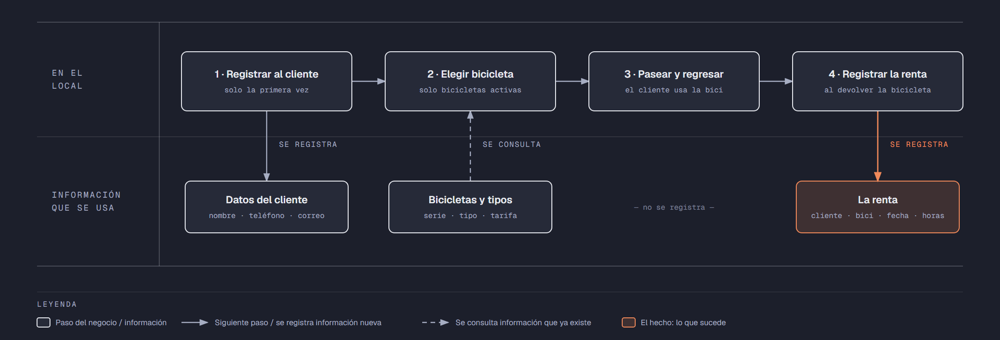

# PIA — Caso: BiciRuta

**Alumno:** Aguilar Hernandez Marcos Fernando (matrícula 2254024)
**Base de datos a crear:** `BiciRutaDB`

← [Regresar a la descripción del PIA](../../descripcion-pia.md)

---

## Historia de usuario

**Como** dueño de BiciRuta, **quiero** una base de datos que registre mis bicicletas, mis clientes y cada renta que hacen, y que además **cuide las reglas del negocio por sí misma**, **para** registrar la operación del día sin errores, saber cuánto se cobró en cada renta y conservar la historia de cada cambio de precio.

## El negocio

BiciRuta es un negocio de renta de bicicletas por hora en el centro de la ciudad. Maneja **tipos de bicicleta**: Urbana, Montaña y Eléctrica. Cada tipo tiene su propia **tarifa por hora**; por ejemplo, la Eléctrica cuesta más que la Urbana. **Las tarifas cambian** de vez en cuando. Aun así, el negocio necesita saber **cuánto se cobró en cada renta**, con la tarifa que estaba vigente el día de la renta.

Cada **bicicleta** es de un tipo, tiene un **número de serie** grabado en el cuadro y una **fecha de alta**, que es el día en que el negocio la compró. Cuando una bicicleta se descompone sin arreglo, se **da de baja**: no se borra, porque se quiere conservar su historial de rentas.

Los **clientes** se registran una sola vez con su nombre, su teléfono y su correo electrónico.

Si el negocio deja de manejar un tipo de bicicleta, tampoco lo borra: lo **da de baja**. Lo mismo pasa con los clientes: si un cliente ya no regresa, se lo da de baja en lugar de borrarlo. Así se conserva el historial de rentas.

## Los hechos de este negocio

En BiciRuta, **el hecho es la renta**: cada vez que un cliente renta una bicicleta, sucede una renta, en una fecha. Es la **tabla más importante** de tu modelo: tiene una fila por cada renta, es la que más crece y es donde se guarda lo que realmente pasó (quién rentó, qué bicicleta, cuándo, cuántas horas y con qué tarifa se le cobró).

**Esta tabla la propones tú**: su nombre, sus columnas y sus llaves. No viene en "Lo que el negocio ya tiene definido", porque los hechos no se definen de antemano: suceden.

## Lo que el negocio ya tiene definido

Estos datos **no los inventas**: son los que BiciRuta ya tiene. Tu base de datos debe guardarlos **exactamente así**, con los mismos nombres y valores. Los casos de prueba de los objetos dependen de ellos.

Son los **datos iniciales** con los que arranca tu base de datos: **tipos de bicicleta y tarifas por hora** y **bicicletas**. Hoy todo lo que aparece en estas tablas está **activo**, salvo la bicicleta que se indica como dada de baja.

**Tipos de bicicleta y tarifas por hora**

| Tipo de bicicleta | Tarifa por hora |
|---|---|
| Urbana | $45.00 |
| Montaña | $60.00 |
| Eléctrica | $95.00 |

**Bicicletas**

| Tipo de bicicleta | Número de serie | Fecha de alta | ¿Activa? |
|---|---|---|---|
| Urbana | `UR-0001` | 15/02/2024 | Sí |
| Urbana | `UR-0002` | 15/02/2024 | Sí |
| Urbana | `UR-0003` | 01/07/2024 | Sí |
| Montaña | `MT-0007` | 10/03/2024 | Sí |
| Montaña | `MT-0008` | 10/03/2024 | Sí |
| Montaña | `MT-0009` | 20/01/2025 | Sí |
| Eléctrica | `EL-0001` | 05/09/2024 | Sí |
| Eléctrica | `EL-0002` | 18/04/2025 | Sí |
| Montaña | `MT-0010` | 10/03/2024 | **No** |
| Eléctrica | `EL-0003` | 01/10/2025 | Sí |

Todo lo demás (clientes y rentas) **lo inventas tú**, cumpliendo los mínimos de [Lo que debes construir](#lo-que-debes-construir).

## Flujo de negocio

Así funciona una operación de principio a fin. Arriba, lo que pasa en el local; abajo, la información que cada paso consulta o registra.

Con detalle, un cliente imaginario (Luis) recorriendo el flujo:

1. **Luis llega por primera vez** a BiciRuta. En recepción le piden su nombre, su teléfono y su correo, y lo **registran como cliente**. Si Luis regresa otro día, ya no se le registra de nuevo: se le busca por su correo.
2. **Luis quiere una bicicleta de montaña.** El encargado revisa qué bicicletas de tipo Montaña están **activas**; las dadas de baja ya no se rentan. Le entrega la que tiene el número de serie `MT-0007` y le recuerda la tarifa por hora de ese tipo.
3. **Luis pasea y regresa** la bicicleta 3 horas después.
4. **Al devolverla, se registra la renta:** cliente Luis, bicicleta `MT-0007`, fecha de hoy, 3 horas y la tarifa por hora con la que se le cobra. Se le cobran las horas por esa tarifa.

Si el mes siguiente sube la tarifa de las bicicletas de Montaña, la renta de Luis tiene que seguir diciendo con qué tarifa se le cobró.

Al día siguiente, Luis renta una bicicleta Eléctrica: es otra renta, del mismo cliente y de otra bicicleta. Ese mismo día, la `MT-0007` la renta otra clienta. Así, **un cliente acumula muchas rentas y una bicicleta también**.

## Reglas de negocio

- Cada bicicleta es de **un solo** tipo.
- No puede haber dos bicicletas con el mismo número de serie.
- No puede haber dos clientes con el mismo correo electrónico.
- No puede haber dos tipos de bicicleta con el mismo nombre.
- La tarifa por hora siempre es **mayor a cero**.
- Una renta dura **al menos 1 hora** y **como máximo 8 horas**, que es lo que el local está abierto.
- Una bicicleta nueva se registra como **activa**.
- Un tipo de bicicleta nuevo y un cliente nuevo también se registran como **activos**.
- Cuando cambia la tarifa de un tipo de bicicleta, las rentas que ya se hicieron **conservan la tarifa con la que se cobraron**.
- **Nuevo:** cada cambio de la tarifa por hora de un tipo de bicicleta queda registrado en el **histórico de precios** (ver abajo).

## Lo nuevo: el histórico de precios

La tarifa por hora de cada tipo de bicicleta dice cuánto cuesta **hoy**, y cada renta guarda cuánto se cobró **ese día**. Pero el negocio quiere saber también **cómo ha cambiado el precio con el tiempo**: cuándo subió, cuándo bajó y de cuánto a cuánto.

Por eso, cada vez que cambia la tarifa por hora de un tipo de bicicleta, el negocio guarda un registro con:

- **qué tipo de bicicleta** cambió de precio;
- el **precio anterior**;
- el **precio nuevo**;
- la **fecha y hora** del cambio.

Así funciona:

- El histórico **arranca vacío**: los precios de "Lo que el negocio ya tiene definido" son los iniciales, no un cambio.
- **Nadie escribe a mano** en el histórico. Lo llena un trigger ([`trg_registrarHistoricoPrecio`](11-trigger-trg_registrarHistoricoPrecio.md)) cada vez que cambia un precio, venga de donde venga el cambio.
- Si un `UPDATE` toca un tipo de bicicleta pero **no le cambia el precio** (por ejemplo, solo lo da de baja), no se registra nada.
- Un registro del histórico **nunca se modifica ni se borra**.

**El nombre de la tabla, sus columnas y sus llaves los propones tú**, igual que la tabla de las rentas.

## Lo que debes construir

1. El **modelo relacional**, con las tablas de tu caso **más la tabla del histórico de precios**, que respete las reglas de negocio con restricciones (`PRIMARY KEY`, `FOREIGN KEY`, `UNIQUE`, `CHECK`, `DEFAULT`).
2. El **paquete de instalación** de `BiciRutaDB`: tablas, datos iniciales y los **11 objetos programados** de abajo.
3. El **paquete de reversa**, que deje el servidor sin rastro de `BiciRutaDB`.
4. **Datos iniciales:**
   - **Lo que el negocio ya tiene definido**, exactamente como viene arriba: los 3 tipos de bicicleta con su tarifa por hora y las 10 bicicletas.
   - **Lo que tú inventas**, como mínimo: 10 clientes y 20 rentas, con
     - 2 clientes que nunca hayan rentado;
     - 2 bicicletas que nunca se hayan rentado;
     - al menos 1 cliente dado de baja;
     - cada renta con la tarifa con la que se cobró (en tus datos, la tarifa de su tipo de bicicleta que viene arriba).
   - El histórico de precios **vacío**.
5. Los **11 objetos programados**, cada uno con su ficha:

| # | Objeto | Tipo | Qué hace |
|---|---|---|---|
| 01 | [`usp_insertarCliente`](01-procedimiento-usp_insertarCliente.md) | Procedimiento | Registra un cliente nuevo |
| 02 | [`usp_darDeBajaCliente`](02-procedimiento-usp_darDeBajaCliente.md) | Procedimiento | Da de baja a un cliente |
| 03 | [`usp_insertarBicicleta`](03-procedimiento-usp_insertarBicicleta.md) | Procedimiento | Registra una bicicleta nueva |
| 04 | [`usp_actualizarTarifaTipoBicicleta`](04-procedimiento-usp_actualizarTarifaTipoBicicleta.md) | Procedimiento | Cambia la tarifa por hora de un tipo de bicicleta |
| 05 | [`usp_registrarRenta`](05-procedimiento-usp_registrarRenta.md) | Procedimiento | Registra una renta con el precio vigente |
| 06 | [`usp_obtenerRentasPorFecha`](06-procedimiento-usp_obtenerRentasPorFecha.md) | Procedimiento | Lista las rentas de un rango de fechas |
| 07 | [`ufn_totalCobradoBicicleta`](07-funcion-ufn_totalCobradoBicicleta.md) | Función escalar | Total cobrado por cada bicicleta |
| 08 | [`ufn_nivelCliente`](08-funcion-ufn_nivelCliente.md) | Función escalar | Qué tan seguido viene un cliente |
| 09 | [`vw_DetalleRenta`](09-vista-vw_DetalleRenta.md) | Vista | Cada renta con su precio cobrado y el actual |
| 10 | [`vw_ResumenTipoBicicleta`](10-vista-vw_ResumenTipoBicicleta.md) | Vista | Totales por tipo de bicicleta |
| 11 | [`trg_registrarHistoricoPrecio`](11-trigger-trg_registrarHistoricoPrecio.md) | Trigger | Llena el histórico de precios |

Los objetos están en el orden en que conviene construirlos: los casos de prueba de cada uno usan los procedimientos anteriores para preparar sus datos.

## Cómo probar tus objetos

- **Cada ficha trae sus casos de prueba.** Todos parten de una **instalación limpia**: ejecuta tu reversa y tu instalación completa, y después las pruebas de esa ficha, en orden.
- Los resultados esperados dependen de **Lo que el negocio ya tiene definido**, no de tus datos inventados. Por eso los objetos reciben datos del negocio (nombres, claves, correos o teléfonos) y no ids.
- Las pruebas usan clientes con correo electrónico `prueba1@correo.com` y `prueba2@correo.com`, la bicicleta `UR-0020` y el tipo de bicicleta `Nuevo tipo`, y rentas de **diciembre de 2026**. **No uses esos valores ni esas fechas en tus datos inventados**, para que no choquen con las pruebas.
- Algunas pruebas escriben directamente en tus tablas. Como tú eliges los nombres, vienen con marcas como `<TuTablaDeRentas>`: cámbialas por los nombres de tu modelo.
- Los casos de prueba son para que compruebes tu trabajo: **no se entregan**.

## Convenciones de código

- Palabras reservadas en **MAYÚSCULAS**; nombres de tablas y columnas en **PascalCase** y en singular; columnas id con prefijo `id` (`idBicicleta`).
- Nombre de cada objeto **exactamente** como se indica en su ficha (respeta mayúsculas y minúsculas), y parámetros con los nombres y tipos indicados.
- `SELECT` y `FROM` en líneas separadas; los campos comienzan en la misma línea del `SELECT`; máximo 5 campos por renglón.
- En los procedimientos, las validaciones se escriben como *guard clauses*: guarda el dato en una variable (`SELECT ... FROM ... WHERE`), revísala con `IF @variable IS NULL` / `IS NOT NULL` y, si falla, regresa el error y sal con `RETURN`. `IF EXISTS (SELECT ...)` y los `IF` anidados se permiten, pero se evitan.
- Los procedimientos regresan su resultado con el formato `ErrCodigo` / `ErrMensaje` ([Validaciones](../../../temas/Etapa-2/04-Validaciones.md)).
- Las funciones se llaman con el prefijo `dbo.`.
- Las vistas no llevan `ORDER BY`.

## Entrega

Ver [Entregables](../../descripcion-pia.md#entregables) y [Forma de entrega](../../descripcion-pia.md#forma-de-entrega) en la descripción del PIA.
