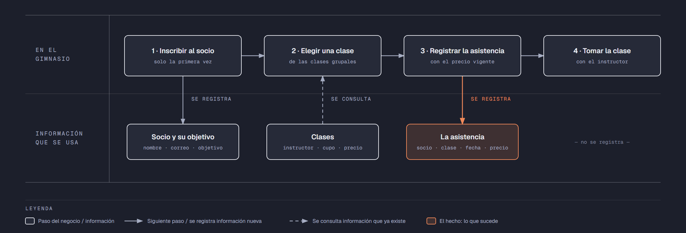

# PIA — Caso: FitZone

**Alumno:** Espinoza Juarez Angel De Jesus (matrícula 2253562)
**Base de datos a crear:** `FitZoneDB`

← [Regresar a la descripción del PIA](../../descripcion-pia.md)

---

## Historia de usuario

**Como** dueño de FitZone, **quiero** una base de datos que registre a mis socios, mis clases grupales y cada vez que un socio toma una clase, y que además **cuide las reglas del negocio por sí misma**, **para** registrar la operación del día sin errores, saber cuánto se cobró en cada asistencia y conservar la historia de cada cambio de precio.

## El negocio

FitZone es un gimnasio que ofrece **clases grupales**, como Spinning, Yoga o Box. Cada clase tiene un nombre que no se repite, un **instructor**, un **cupo máximo** de personas y un **precio por clase**: el socio paga cada clase que toma. **Los precios cambian** de vez en cuando. Aun así, el negocio necesita saber **cuánto se cobró cada vez que un socio tomó una clase**, con el precio que tenía la clase ese día.

Los **socios** se inscriben una sola vez, con su nombre, su correo electrónico y la fecha de inscripción. Al inscribirse, cada socio dice cuál es su **objetivo** en el gimnasio (por ejemplo, bajar de peso), para que los instructores sepan qué clases recomendarle. El correo identifica al socio en recepción: no puede haber dos socios con el mismo. Cuando un socio deja de venir, se le **da de baja**, pero no se borra, para conservar su historial de clases.

Si el negocio deja de usar un objetivo o deja de ofrecer una clase, no se borran: se **dan de baja**, para conservar el historial de asistencias.

## Los hechos de este negocio

En FitZone, **el hecho es la asistencia**: cada vez que un socio toma una clase, sucede una asistencia, en una fecha. Es la **tabla más importante** de tu modelo: tiene una fila por cada asistencia, es la que más crece y es donde se guarda lo que realmente pasó (qué socio, qué clase, cuándo y cuánto se le cobró).

**Esta tabla la propones tú**: su nombre, sus columnas y sus llaves. No viene en "Lo que el negocio ya tiene definido", porque los hechos no se definen de antemano: suceden.

## Lo que el negocio ya tiene definido

Estos datos **no los inventas**: son los que FitZone ya tiene. Tu base de datos debe guardarlos **exactamente así**, con los mismos nombres y valores. Los casos de prueba de los objetos dependen de ellos.

Son los **datos iniciales** con los que arranca tu base de datos: **objetivos de los socios** y **clases grupales**. Hoy todo lo que aparece en estas tablas está **activo**.

**Objetivos de los socios**

| Objetivo |
|---|
| Bajar de peso |
| Ganar masa muscular |
| Acondicionamiento físico |
| Rehabilitación |

**Clases grupales**

| Clase | Instructor | Cupo máximo | Precio por clase |
|---|---|---|---|
| Spinning | Ricardo Ávila | 20 | $90.00 |
| Yoga | Mariana Leal | 15 | $80.00 |
| Box | Óscar Treviño | 12 | $100.00 |
| Pilates | Sofía Garza | 10 | $110.00 |
| Zumba | Paola Ramírez | 25 | $70.00 |
| CrossFit | Arturo Cavazos | 16 | $120.00 |
| Body Pump | Ricardo Ávila | 20 | $90.00 |
| Stretching | Mariana Leal | 12 | $60.00 |

Todo lo demás (socios y clases tomadas) **lo inventas tú**, cumpliendo los mínimos de [Lo que debes construir](#lo-que-debes-construir).

## Flujo de negocio

Así funciona una operación de principio a fin. Arriba, lo que pasa en el gimnasio; abajo, la información que cada paso consulta o registra.

Con detalle, una socia imaginaria (Andrea) recorriendo el flujo:

1. **Andrea llega por primera vez** a FitZone. En recepción le piden su nombre, su correo y su objetivo (quiere ganar masa muscular), y la **inscriben como socia** con la fecha de hoy. Si Andrea regresa otro día, ya no se le inscribe de nuevo: se le busca por su correo.
2. **Andrea quiere tomar Spinning.** La recepcionista revisa la clase: quién la imparte, cuál es su cupo y su **precio por clase vigente**: hoy, $90.00.
3. **Se registra la asistencia**: socia Andrea, clase Spinning, fecha de hoy y el precio con el que se le cobra ($90.00). Andrea paga la clase.
4. **Andrea toma la clase** con Ricardo Ávila. Lo que pasa dentro de la clase no se registra en la base de datos.

Si el mes siguiente Spinning sube a $95.00, la asistencia de Andrea tiene que seguir diciendo que se le cobró a $90.00.

Dos días después, Andrea toma Yoga: es otra asistencia, de la misma socia y de otra clase. Ese mismo día, otros socios toman Spinning. Así, **un socio acumula muchas asistencias y una clase también**.

## Reglas de negocio

- Cada socio tiene **un solo** objetivo.
- No puede haber dos objetivos con el mismo nombre, ni dos clases con el mismo nombre.
- No puede haber dos socios con el mismo correo electrónico.
- El cupo máximo y el precio de una clase siempre son **mayores a cero**.
- Cuando cambia el precio de una clase, las asistencias que ya se registraron **conservan el precio con el que se cobraron**.
- Un socio nuevo se registra como **activo**.
- Un objetivo nuevo y una clase nueva también se registran como **activos**.
- **Nuevo:** cada cambio del precio por clase de una clase queda registrado en el **histórico de precios** (ver abajo).

## Lo nuevo: el histórico de precios

El precio por clase de cada clase dice cuánto cuesta **hoy**, y cada asistencia guarda cuánto se cobró **ese día**. Pero el negocio quiere saber también **cómo ha cambiado el precio con el tiempo**: cuándo subió, cuándo bajó y de cuánto a cuánto.

Por eso, cada vez que cambia el precio por clase de una clase, el negocio guarda un registro con:

- **qué clase** cambió de precio;
- el **precio anterior**;
- el **precio nuevo**;
- la **fecha y hora** del cambio.

Así funciona:

- El histórico **arranca vacío**: los precios de "Lo que el negocio ya tiene definido" son los iniciales, no un cambio.
- **Nadie escribe a mano** en el histórico. Lo llena un trigger ([`trg_registrarHistoricoPrecio`](11-trigger-trg_registrarHistoricoPrecio.md)) cada vez que cambia un precio, venga de donde venga el cambio.
- Si un `UPDATE` toca una clase pero **no le cambia el precio** (por ejemplo, solo la da de baja), no se registra nada.
- Un registro del histórico **nunca se modifica ni se borra**.

**El nombre de la tabla, sus columnas y sus llaves los propones tú**, igual que la tabla de las asistencias.

## Lo que debes construir

1. El **modelo relacional**, con las tablas de tu caso **más la tabla del histórico de precios**, que respete las reglas de negocio con restricciones (`PRIMARY KEY`, `FOREIGN KEY`, `UNIQUE`, `CHECK`, `DEFAULT`).
2. El **paquete de instalación** de `FitZoneDB`: tablas, datos iniciales y los **11 objetos programados** de abajo.
3. El **paquete de reversa**, que deje el servidor sin rastro de `FitZoneDB`.
4. **Datos iniciales:**
   - **Lo que el negocio ya tiene definido**, exactamente como viene arriba: los 4 objetivos y las 8 clases.
   - **Lo que tú inventas**, como mínimo: 10 socios y 20 asistencias, con
     - 2 socios que nunca hayan tomado una clase;
     - 2 clases que nunca se hayan tomado;
     - al menos 1 socio dado de baja;
     - cada asistencia con el precio con el que se cobró (en tus datos, el precio de la clase que viene arriba).
   - El histórico de precios **vacío**.
5. Los **11 objetos programados**, cada uno con su ficha:

| # | Objeto | Tipo | Qué hace |
|---|---|---|---|
| 01 | [`usp_insertarSocio`](01-procedimiento-usp_insertarSocio.md) | Procedimiento | Registra un socio nuevo |
| 02 | [`usp_darDeBajaSocio`](02-procedimiento-usp_darDeBajaSocio.md) | Procedimiento | Da de baja a un socio |
| 03 | [`usp_insertarClase`](03-procedimiento-usp_insertarClase.md) | Procedimiento | Registra una clase nueva |
| 04 | [`usp_actualizarPrecioClase`](04-procedimiento-usp_actualizarPrecioClase.md) | Procedimiento | Cambia el precio por clase de una clase |
| 05 | [`usp_registrarAsistencia`](05-procedimiento-usp_registrarAsistencia.md) | Procedimiento | Registra una asistencia con el precio vigente |
| 06 | [`usp_obtenerAsistenciasPorFecha`](06-procedimiento-usp_obtenerAsistenciasPorFecha.md) | Procedimiento | Lista las asistencias de un rango de fechas |
| 07 | [`ufn_totalCobradoClase`](07-funcion-ufn_totalCobradoClase.md) | Función escalar | Total cobrado por cada clase |
| 08 | [`ufn_nivelSocio`](08-funcion-ufn_nivelSocio.md) | Función escalar | Qué tan seguido viene un socio |
| 09 | [`vw_DetalleAsistencia`](09-vista-vw_DetalleAsistencia.md) | Vista | Cada asistencia con su precio cobrado y el actual |
| 10 | [`vw_ResumenClase`](10-vista-vw_ResumenClase.md) | Vista | Totales por clase |
| 11 | [`trg_registrarHistoricoPrecio`](11-trigger-trg_registrarHistoricoPrecio.md) | Trigger | Llena el histórico de precios |

Los objetos están en el orden en que conviene construirlos: los casos de prueba de cada uno usan los procedimientos anteriores para preparar sus datos.

## Cómo probar tus objetos

- **Cada ficha trae sus casos de prueba.** Todos parten de una **instalación limpia**: ejecuta tu reversa y tu instalación completa, y después las pruebas de esa ficha, en orden.
- Los resultados esperados dependen de **Lo que el negocio ya tiene definido**, no de tus datos inventados. Por eso los objetos reciben datos del negocio (nombres, claves, correos o teléfonos) y no ids.
- Las pruebas usan socios con correo electrónico `prueba1@correo.com` y `prueba2@correo.com` y la clase `Clase de Prueba`, y asistencias de **diciembre de 2026**. **No uses esos valores ni esas fechas en tus datos inventados**, para que no choquen con las pruebas.
- Algunas pruebas escriben directamente en tus tablas. Como tú eliges los nombres, vienen con marcas como `<TuTablaDeAsistencias>`: cámbialas por los nombres de tu modelo.
- Los casos de prueba son para que compruebes tu trabajo: **no se entregan**.

## Convenciones de código

- Palabras reservadas en **MAYÚSCULAS**; nombres de tablas y columnas en **PascalCase** y en singular; columnas id con prefijo `id` (`idClase`).
- Nombre de cada objeto **exactamente** como se indica en su ficha (respeta mayúsculas y minúsculas), y parámetros con los nombres y tipos indicados.
- `SELECT` y `FROM` en líneas separadas; los campos comienzan en la misma línea del `SELECT`; máximo 5 campos por renglón.
- En los procedimientos, las validaciones se escriben como *guard clauses*: guarda el dato en una variable (`SELECT ... FROM ... WHERE`), revísala con `IF @variable IS NULL` / `IS NOT NULL` y, si falla, regresa el error y sal con `RETURN`. `IF EXISTS (SELECT ...)` y los `IF` anidados se permiten, pero se evitan.
- Los procedimientos regresan su resultado con el formato `ErrCodigo` / `ErrMensaje` ([Validaciones](../../../temas/Etapa-2/04-Validaciones.md)).
- Las funciones se llaman con el prefijo `dbo.`.
- Las vistas no llevan `ORDER BY`.

## Entrega

Ver [Entregables](../../descripcion-pia.md#entregables) y [Forma de entrega](../../descripcion-pia.md#forma-de-entrega) en la descripción del PIA.
