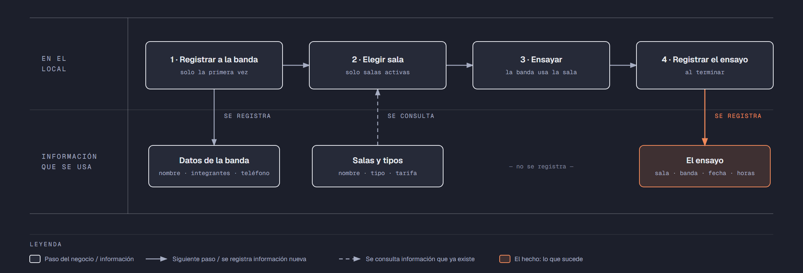

# PIA — Caso: SalaRock

**Alumno:** Garcia Martinez Marisol (matrícula 2253587)
**Base de datos a crear:** `SalaRockDB`

← [Regresar a la descripción del PIA](../../descripcion-pia.md)

---

## Historia de usuario

**Como** dueño de SalaRock, **quiero** una base de datos que registre mis salas de ensayo, las bandas que vienen y cada ensayo que hacen, y que además **cuide las reglas del negocio por sí misma**, **para** registrar la operación del día sin errores, saber cuánto se cobró en cada ensayo y conservar la historia de cada cambio de precio.

## El negocio

SalaRock es un local que renta **salas de ensayo por hora** a bandas de música. Maneja **tipos de sala**: Chica, Mediana y Grande, según su tamaño y su equipo. Cada tipo tiene su propia **tarifa por hora**; por ejemplo, la Grande cuesta más que la Chica. **Las tarifas cambian** de vez en cuando. Aun así, el negocio necesita saber **cuánto se cobró en cada ensayo**, con la tarifa que estaba vigente el día del ensayo.

Cada **sala** es de un tipo, tiene un **nombre** que no se repite (por ejemplo, "Sala Hendrix") y una **fecha de apertura**, que es el día en que se empezó a rentar. Cuando una sala se cierra para siempre (por ejemplo, porque se remodela como bodega), se **da de baja**: no se borra, porque se quiere conservar su historial de ensayos.

Las **bandas** se registran una sola vez con su nombre, el número de integrantes y un teléfono de contacto. No puede haber dos bandas con el mismo nombre.

Si el negocio deja de manejar un tipo de sala, tampoco lo borra: lo **da de baja**. Lo mismo pasa con las bandas: si una banda ya no regresa, se la da de baja en lugar de borrarla. Así se conserva el historial de ensayos.

## Los hechos de este negocio

En SalaRock, **el hecho es el ensayo**: cada vez que una banda ensaya en una sala, sucede un ensayo, en una fecha. Es la **tabla más importante** de tu modelo: tiene una fila por cada ensayo, es la que más crece y es donde se guarda lo que realmente pasó (qué banda, en qué sala, cuándo, cuántas horas y con qué tarifa se le cobró).

**Esta tabla la propones tú**: su nombre, sus columnas y sus llaves. No viene en "Lo que el negocio ya tiene definido", porque los hechos no se definen de antemano: suceden.

## Lo que el negocio ya tiene definido

Estos datos **no los inventas**: son los que SalaRock ya tiene. Tu base de datos debe guardarlos **exactamente así**, con los mismos nombres y valores. Los casos de prueba de los objetos dependen de ellos.

Son los **datos iniciales** con los que arranca tu base de datos: **tipos de sala y tarifas por hora** y **salas**. Hoy todo lo que aparece en estas tablas está **activo**, salvo la sala que se indica como dada de baja.

**Tipos de sala y tarifas por hora**

| Tipo de sala | Tarifa por hora |
|---|---|
| Chica | $150.00 |
| Mediana | $220.00 |
| Grande | $300.00 |

**Salas**

| Tipo de sala | Nombre | Fecha de apertura | ¿Activa? |
|---|---|---|---|
| Chica | Sala Hendrix | 10/02/2024 | Sí |
| Chica | Sala Joplin | 10/02/2024 | Sí |
| Mediana | Sala Cobain | 20/05/2024 | Sí |
| Mediana | Sala Mercury | 01/08/2024 | Sí |
| Grande | Sala Lennon | 15/01/2025 | Sí |
| Grande | Sala Marley | 03/03/2025 | Sí |
| Mediana | Sala Bowie | 12/06/2025 | **No** |
| Chica | Sala Cash | 04/11/2025 | Sí |

Todo lo demás (bandas y ensayos) **lo inventas tú**, cumpliendo los mínimos de [Lo que debes construir](#lo-que-debes-construir).

## Flujo de negocio

Así funciona una operación de principio a fin. Arriba, lo que pasa en el local; abajo, la información que cada paso consulta o registra.

Con detalle, una banda imaginaria (Los Atómicos) recorriendo el flujo:

1. **Los Atómicos llegan por primera vez** a SalaRock. En recepción les piden el nombre de la banda, cuántos integrantes son y un teléfono de contacto, y **registran a la banda**. Si regresan otro día, ya no se les registra de nuevo: se les busca por su nombre.
2. **La banda pide una sala.** El encargado revisa qué salas están **activas**; las dadas de baja ya no se rentan. Les asigna la "Sala Cobain", que es de tipo Mediana, y les recuerda la tarifa por hora de ese tipo.
3. **La banda ensaya** 3 horas.
4. **Al terminar, se registra el ensayo:** sala Cobain, banda Los Atómicos, fecha de hoy, 3 horas y la tarifa por hora con la que se les cobra. Se les cobran las horas por esa tarifa.

Si el mes siguiente sube la tarifa de las salas Medianas, el ensayo de Los Atómicos tiene que seguir diciendo con qué tarifa se les cobró.

A la semana siguiente, Los Atómicos regresan y les toca la "Sala Lennon", que es Grande: es otro ensayo, de la misma banda y de otra sala. Ese mismo día, la Sala Cobain la renta otra banda. Así, **una banda acumula muchos ensayos y una sala también**.

## Reglas de negocio

- Cada sala es de **un solo** tipo.
- No puede haber dos tipos de sala con el mismo nombre, ni dos salas con el mismo nombre, ni dos bandas con el mismo nombre.
- La tarifa por hora siempre es **mayor a cero**.
- Una banda tiene **de 1 a 8** integrantes.
- Un ensayo dura **al menos 1 hora** y **como máximo 4 horas**.
- Una sala nueva se registra como **activa**.
- Un tipo de sala nuevo y una banda nueva también se registran como **activos**.
- Cuando cambia la tarifa de un tipo de sala, los ensayos que ya se hicieron **conservan la tarifa con la que se cobraron**.
- **Nuevo:** cada cambio de la tarifa por hora de un tipo de sala queda registrado en el **histórico de precios** (ver abajo).

## Lo nuevo: el histórico de precios

La tarifa por hora de cada tipo de sala dice cuánto cuesta **hoy**, y cada ensayo guarda cuánto se cobró **ese día**. Pero el negocio quiere saber también **cómo ha cambiado el precio con el tiempo**: cuándo subió, cuándo bajó y de cuánto a cuánto.

Por eso, cada vez que cambia la tarifa por hora de un tipo de sala, el negocio guarda un registro con:

- **qué tipo de sala** cambió de precio;
- el **precio anterior**;
- el **precio nuevo**;
- la **fecha y hora** del cambio.

Así funciona:

- El histórico **arranca vacío**: los precios de "Lo que el negocio ya tiene definido" son los iniciales, no un cambio.
- **Nadie escribe a mano** en el histórico. Lo llena un trigger ([`trg_registrarHistoricoPrecio`](11-trigger-trg_registrarHistoricoPrecio.md)) cada vez que cambia un precio, venga de donde venga el cambio.
- Si un `UPDATE` toca un tipo de sala pero **no le cambia el precio** (por ejemplo, solo lo da de baja), no se registra nada.
- Un registro del histórico **nunca se modifica ni se borra**.

**El nombre de la tabla, sus columnas y sus llaves los propones tú**, igual que la tabla de los ensayos.

## Lo que debes construir

1. El **modelo relacional**, con las tablas de tu caso **más la tabla del histórico de precios**, que respete las reglas de negocio con restricciones (`PRIMARY KEY`, `FOREIGN KEY`, `UNIQUE`, `CHECK`, `DEFAULT`).
2. El **paquete de instalación** de `SalaRockDB`: tablas, datos iniciales y los **11 objetos programados** de abajo.
3. El **paquete de reversa**, que deje el servidor sin rastro de `SalaRockDB`.
4. **Datos iniciales:**
   - **Lo que el negocio ya tiene definido**, exactamente como viene arriba: los 3 tipos de sala con su tarifa por hora y las 8 salas.
   - **Lo que tú inventas**, como mínimo: 10 bandas y 20 ensayos, con
     - 2 bandas que nunca hayan ensayado;
     - 2 salas que nunca se hayan rentado;
     - al menos 1 banda dada de baja;
     - cada ensayo con la tarifa por hora con la que se cobró (en tus datos, la tarifa de su tipo de sala que viene arriba).
   - El histórico de precios **vacío**.
5. Los **11 objetos programados**, cada uno con su ficha:

| # | Objeto | Tipo | Qué hace |
|---|---|---|---|
| 01 | [`usp_insertarBanda`](01-procedimiento-usp_insertarBanda.md) | Procedimiento | Registra una banda nueva |
| 02 | [`usp_darDeBajaBanda`](02-procedimiento-usp_darDeBajaBanda.md) | Procedimiento | Da de baja a una banda |
| 03 | [`usp_insertarSala`](03-procedimiento-usp_insertarSala.md) | Procedimiento | Registra una sala nueva |
| 04 | [`usp_actualizarTarifaTipoSala`](04-procedimiento-usp_actualizarTarifaTipoSala.md) | Procedimiento | Cambia la tarifa por hora de un tipo de sala |
| 05 | [`usp_registrarEnsayo`](05-procedimiento-usp_registrarEnsayo.md) | Procedimiento | Registra un ensayo con el precio vigente |
| 06 | [`usp_obtenerEnsayosPorFecha`](06-procedimiento-usp_obtenerEnsayosPorFecha.md) | Procedimiento | Lista los ensayos de un rango de fechas |
| 07 | [`ufn_totalCobradoSala`](07-funcion-ufn_totalCobradoSala.md) | Función escalar | Total cobrado por cada sala |
| 08 | [`ufn_nivelBanda`](08-funcion-ufn_nivelBanda.md) | Función escalar | Qué tan seguido viene una banda |
| 09 | [`vw_DetalleEnsayo`](09-vista-vw_DetalleEnsayo.md) | Vista | Cada ensayo con su precio cobrado y el actual |
| 10 | [`vw_ResumenTipoSala`](10-vista-vw_ResumenTipoSala.md) | Vista | Totales por tipo de sala |
| 11 | [`trg_registrarHistoricoPrecio`](11-trigger-trg_registrarHistoricoPrecio.md) | Trigger | Llena el histórico de precios |

Los objetos están en el orden en que conviene construirlos: los casos de prueba de cada uno usan los procedimientos anteriores para preparar sus datos.

## Cómo probar tus objetos

- **Cada ficha trae sus casos de prueba.** Todos parten de una **instalación limpia**: ejecuta tu reversa y tu instalación completa, y después las pruebas de esa ficha, en orden.
- Los resultados esperados dependen de **Lo que el negocio ya tiene definido**, no de tus datos inventados. Por eso los objetos reciben datos del negocio (nombres, claves, correos o teléfonos) y no ids.
- Las pruebas usan bandas con nombre de banda `Banda de Prueba` y `Banda Dos`, la sala `Sala Prueba` y el tipo de sala `Nuevo tipo`, y ensayos de **diciembre de 2026**. **No uses esos valores ni esas fechas en tus datos inventados**, para que no choquen con las pruebas.
- Algunas pruebas escriben directamente en tus tablas. Como tú eliges los nombres, vienen con marcas como `<TuTablaDeEnsayos>`: cámbialas por los nombres de tu modelo.
- Los casos de prueba son para que compruebes tu trabajo: **no se entregan**.

## Convenciones de código

- Palabras reservadas en **MAYÚSCULAS**; nombres de tablas y columnas en **PascalCase** y en singular; columnas id con prefijo `id` (`idSala`).
- Nombre de cada objeto **exactamente** como se indica en su ficha (respeta mayúsculas y minúsculas), y parámetros con los nombres y tipos indicados.
- `SELECT` y `FROM` en líneas separadas; los campos comienzan en la misma línea del `SELECT`; máximo 5 campos por renglón.
- En los procedimientos, las validaciones se escriben como *guard clauses*: guarda el dato en una variable (`SELECT ... FROM ... WHERE`), revísala con `IF @variable IS NULL` / `IS NOT NULL` y, si falla, regresa el error y sal con `RETURN`. `IF EXISTS (SELECT ...)` y los `IF` anidados se permiten, pero se evitan.
- Los procedimientos regresan su resultado con el formato `ErrCodigo` / `ErrMensaje` ([Validaciones](../../../temas/Etapa-2/04-Validaciones.md)).
- Las funciones se llaman con el prefijo `dbo.`.
- Las vistas no llevan `ORDER BY`.

## Entrega

Ver [Entregables](../../descripcion-pia.md#entregables) y [Forma de entrega](../../descripcion-pia.md#forma-de-entrega) en la descripción del PIA.
