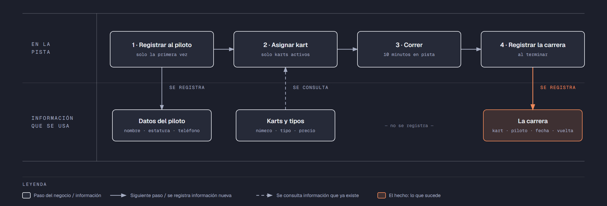

# PIA — Caso: VeloKart

**Alumno:** Gomez Ordaz Bryan Omar (matrícula 2254247)
**Base de datos a crear:** `VeloKartDB`

← [Regresar a la descripción del PIA](../../descripcion-pia.md)

---

## Historia de usuario

**Como** dueño de VeloKart, **quiero** una base de datos que registre mis karts, a los pilotos que vienen y cada carrera que corren, y que además **cuide las reglas del negocio por sí misma**, **para** registrar la operación del día sin errores, saber cuánto se cobró por cada carrera y conservar la historia de cada cambio de precio.

## El negocio

VeloKart es una **pista de go-karts**. Cada **carrera** es una tanda de 10 minutos en la pista con un kart. Maneja **tipos de kart**: Infantil, Estándar y Profesional, según su tamaño y su motor. Cada tipo tiene su propio **precio por carrera**; por ejemplo, el Profesional cuesta más que el Infantil. **Los precios cambian** de vez en cuando. Aun así, el negocio necesita saber **cuánto se cobró por cada carrera**, con el precio que estaba vigente el día de la carrera.

Cada **kart** es de un tipo, tiene un **número** pintado que no se repite (por ejemplo, `K-07`) y una **fecha de alta**, que es el día en que empezó a usarse en la pista. Cuando un kart ya no sirve (por ejemplo, porque se le desgastó el motor), se **da de baja**: no se borra, porque se quiere conservar su historial de carreras.

Los **pilotos** se registran una sola vez con su nombre, su **estatura en centímetros** y su teléfono. El teléfono identifica al piloto: no puede haber dos pilotos con el mismo. Por seguridad, solo se registra a pilotos que miden **al menos 120 cm**.

Al terminar cada carrera, el cronómetro de la pista marca la **mejor vuelta** del piloto, en segundos (por ejemplo, 42.35 segundos).

Si el negocio deja de manejar un tipo de kart, tampoco lo borra: lo **da de baja**. Lo mismo pasa con los pilotos: si un piloto ya no regresa, se lo da de baja en lugar de borrarlo. Así se conserva el historial de carreras.

## Los hechos de este negocio

En VeloKart, **el hecho es la carrera**: cada vez que un piloto corre en un kart, sucede una carrera, en una fecha. Es la **tabla más importante** de tu modelo: tiene una fila por cada carrera, es la que más crece y es donde se guarda lo que realmente pasó (quién corrió, en qué kart, cuándo, cuál fue su mejor vuelta y cuánto se le cobró).

**Esta tabla la propones tú**: su nombre, sus columnas y sus llaves. No viene en "Lo que el negocio ya tiene definido", porque los hechos no se definen de antemano: suceden.

## Lo que el negocio ya tiene definido

Estos datos **no los inventas**: son los que VeloKart ya tiene. Tu base de datos debe guardarlos **exactamente así**, con los mismos nombres y valores. Los casos de prueba de los objetos dependen de ellos.

Son los **datos iniciales** con los que arranca tu base de datos: **tipos de kart y precio por carrera** y **karts**. Hoy todo lo que aparece en estas tablas está **activo**, salvo el kart que se indica como dado de baja.

**Tipos de kart y precio por carrera**

| Tipo de kart | Precio por carrera |
|---|---|
| Infantil | $180.00 |
| Estándar | $250.00 |
| Profesional | $350.00 |

**Karts**

| Tipo de kart | Número | Fecha de alta | ¿Activo? |
|---|---|---|---|
| Infantil | `K-01` | 01/03/2024 | Sí |
| Infantil | `K-02` | 01/03/2024 | Sí |
| Estándar | `K-07` | 01/03/2024 | Sí |
| Estándar | `K-08` | 15/06/2024 | Sí |
| Profesional | `K-12` | 10/09/2024 | Sí |
| Profesional | `K-13` | 20/02/2025 | Sí |
| Estándar | `K-09` | 15/06/2024 | **No** |
| Infantil | `K-03` | 05/10/2025 | Sí |

Todo lo demás (pilotos y carreras) **lo inventas tú**, cumpliendo los mínimos de [Lo que debes construir](#lo-que-debes-construir).

## Flujo de negocio

Así funciona una operación de principio a fin. Arriba, lo que pasa en la pista; abajo, la información que cada paso consulta o registra.

Con detalle, un piloto imaginario (Marco) recorriendo el flujo:

1. **Marco llega por primera vez** a VeloKart. En el mostrador le piden su nombre y su teléfono, lo miden (172 cm) y lo **registran como piloto**. Si Marco regresa otro día, ya no se le registra de nuevo: se le busca por su teléfono.
2. **Se le asigna un kart.** El encargado revisa qué karts están **activos**; los dados de baja ya no salen a la pista. Le asigna el kart `K-07`, que es de tipo Estándar, y le dice el precio por carrera de ese tipo: hoy, $250.00.
3. **Marco corre la carrera:** 10 minutos en la pista.
4. **Al terminar, se registra la carrera:** kart `K-07`, piloto Marco, fecha de hoy, su mejor vuelta (41.80 segundos) y el precio con el que se le cobra ($250.00).

Si el mes siguiente sube el precio de los karts Estándar a $280.00, la carrera de Marco tiene que seguir diciendo que se le cobró a $250.00.

A la semana siguiente, Marco regresa y le toca el kart `K-12`, que es Profesional: es otra carrera, del mismo piloto y de otro kart. Ese mismo día, el kart `K-07` lo usa otro piloto. Así, **un piloto acumula muchas carreras y un kart también**.

## Reglas de negocio

- Cada kart es de **un solo** tipo.
- No puede haber dos tipos de kart con el mismo nombre, ni dos karts con el mismo número, ni dos pilotos con el mismo teléfono.
- El precio por carrera siempre es **mayor a cero**.
- Un piloto mide **al menos 120 cm**.
- La mejor vuelta de una carrera siempre es **mayor a cero** segundos.
- Un kart nuevo se registra como **activo**.
- Un tipo de kart nuevo y un piloto nuevo también se registran como **activos**.
- Cuando cambia el precio de un tipo de kart, las carreras que ya se corrieron **conservan el precio con el que se cobraron**.
- **Nuevo:** cada cambio de precio de un tipo de kart queda registrado en el **histórico de precios** (ver abajo).

## Lo nuevo: el histórico de precios

El precio actual de cada tipo de kart dice cuánto cuesta **hoy**, y cada carrera guarda cuánto se cobró **ese día**. Pero el dueño quiere saber también **cómo ha cambiado el precio con el tiempo**: cuándo subió, cuándo bajó y de cuánto a cuánto.

Por eso, cada vez que cambia el precio por carrera de un tipo de kart, el negocio guarda un registro con:

- **qué tipo de kart** cambió de precio;
- el **precio anterior**;
- el **precio nuevo**;
- la **fecha y hora** del cambio.

Así funciona:

- El histórico **arranca vacío**: los precios de "Lo que el negocio ya tiene definido" son los iniciales, no un cambio.
- **Nadie escribe a mano** en el histórico. Lo llena un trigger ([`trg_registrarHistoricoPrecio`](11-trigger-trg_registrarHistoricoPrecio.md)) cada vez que cambia un precio, venga de donde venga el cambio.
- Si un `UPDATE` toca un tipo de kart pero **no le cambia el precio** (por ejemplo, solo lo da de baja), no se registra nada.
- Un registro del histórico **nunca se modifica ni se borra**.

**El nombre de la tabla, sus columnas y sus llaves los propones tú**, igual que la tabla de las carreras.

## Lo que debes construir

1. El **modelo relacional**, con las tablas de tu caso **más la tabla del histórico de precios**, que respete las reglas de negocio con restricciones (`PRIMARY KEY`, `FOREIGN KEY`, `UNIQUE`, `CHECK`, `DEFAULT`).
2. El **paquete de instalación** de `VeloKartDB`: tablas, datos iniciales y los **11 objetos programados** de abajo.
3. El **paquete de reversa**, que deje el servidor sin rastro de `VeloKartDB`.
4. **Datos iniciales:**
   - **Lo que el negocio ya tiene definido**, exactamente como viene arriba: los 3 tipos de kart con su precio por carrera y los 8 karts.
   - **Lo que tú inventas**, como mínimo: 10 pilotos y 20 carreras, con
     - 2 pilotos que nunca hayan corrido;
     - 2 karts que nunca se hayan usado;
     - al menos 1 piloto dado de baja;
     - cada carrera con el precio con el que se cobró (en tus datos, el precio de su tipo de kart que viene arriba).
   - El histórico de precios **vacío**.
5. Los **11 objetos programados**, cada uno con su ficha:

| # | Objeto | Tipo | Qué hace |
|---|--------|------|----------|
| 01 | [`usp_insertarPiloto`](01-procedimiento-usp_insertarPiloto.md) | Procedimiento | Registra un piloto nuevo |
| 02 | [`usp_darDeBajaPiloto`](02-procedimiento-usp_darDeBajaPiloto.md) | Procedimiento | Da de baja a un piloto |
| 03 | [`usp_insertarKart`](03-procedimiento-usp_insertarKart.md) | Procedimiento | Registra un kart nuevo |
| 04 | [`usp_actualizarPrecioTipoKart`](04-procedimiento-usp_actualizarPrecioTipoKart.md) | Procedimiento | Cambia el precio por carrera de un tipo de kart |
| 05 | [`usp_registrarCarrera`](05-procedimiento-usp_registrarCarrera.md) | Procedimiento | Registra una carrera con el precio vigente |
| 06 | [`usp_obtenerCarrerasPorFecha`](06-procedimiento-usp_obtenerCarrerasPorFecha.md) | Procedimiento | Lista las carreras de un rango de fechas |
| 07 | [`ufn_totalCobradoKart`](07-funcion-ufn_totalCobradoKart.md) | Función escalar | Total cobrado por cada kart |
| 08 | [`ufn_nivelPiloto`](08-funcion-ufn_nivelPiloto.md) | Función escalar | Qué tan seguido corre un piloto |
| 09 | [`vw_DetalleCarrera`](09-vista-vw_DetalleCarrera.md) | Vista | Cada carrera con su precio cobrado y el actual |
| 10 | [`vw_ResumenTipoKart`](10-vista-vw_ResumenTipoKart.md) | Vista | Totales por tipo de kart |
| 11 | [`trg_registrarHistoricoPrecio`](11-trigger-trg_registrarHistoricoPrecio.md) | Trigger | Llena el histórico de precios |

Los objetos están en el orden en que conviene construirlos: los casos de prueba de cada uno usan los procedimientos anteriores para preparar sus datos.

## Cómo probar tus objetos

- **Cada ficha trae sus casos de prueba.** Todos parten de una **instalación limpia**: ejecuta tu reversa y tu instalación completa, y después las pruebas de esa ficha, en orden.
- Los resultados esperados dependen de **Lo que el negocio ya tiene definido**, no de tus datos inventados. Por eso los objetos reciben datos del negocio (el número del kart, el teléfono del piloto, el nombre del tipo) y no ids.
- Las pruebas usan pilotos con teléfonos `8199990001` y `8199990002`, el kart `K-20` y carreras de **diciembre de 2026**. **No uses esos teléfonos, ese número de kart ni esas fechas en tus datos inventados**, para que no choquen con las pruebas.
- Algunas pruebas escriben directamente en tus tablas. Como tú eliges los nombres, vienen con marcas como `<TuTablaDeCarreras>`: cámbialas por los nombres de tu modelo.

## Si también presentas la 3ra o 5ta oportunidad de Base de Datos I

Tu caso del PIA es el **mismo negocio** que el de tu Evidencia Integral de Base de Datos I, pero son **dos entregas distintas**, cada una con su propio paquete de instalación:

| | Evidencia Integral (BD1) | PIA (BD2) |
|---|---|---|
| Tablas | Las de tu caso | Las de tu caso **más el histórico de precios** |
| Objetos programados | No | **Los 11** de este caso |
| `USE` en los scripts | En todos, menos el que crea la base de datos | Solo en los de tablas y datos; **nunca** en los de los objetos |
| Consultas | Las 10, en su propio ZIP | No se piden |
| PDF | Secciones 1 a 5 | Secciones 1 a 6 (agrega los objetos programados) |
| Dónde se entrega | Teams | NEXUS, en tres lugares |

Puedes partir de tu paquete de Base de Datos I, pero **arma y prueba cada uno por separado**: no subas el mismo ZIP en los dos lugares.

## Convenciones de código

- Palabras reservadas en **MAYÚSCULAS**; nombres de tablas y columnas en **PascalCase** y en singular; columnas id con prefijo `id` (`idKart`).
- Nombre de cada objeto **exactamente** como se indica en su ficha (respeta mayúsculas y minúsculas), y parámetros con los nombres y tipos indicados.
- `SELECT` y `FROM` en líneas separadas; los campos comienzan en la misma línea del `SELECT`; máximo 5 campos por renglón.
- En los procedimientos, las validaciones se escriben como *guard clauses*: guarda el dato en una variable (`SELECT ... FROM ... WHERE`), revísala con `IF @variable IS NULL` / `IS NOT NULL` y, si falla, regresa el error y sal con `RETURN`. `IF EXISTS (SELECT ...)` y los `IF` anidados se permiten, pero se evitan.
- Los procedimientos regresan su resultado con el formato `ErrCodigo` / `ErrMensaje` ([Validaciones](../../../temas/Etapa-2/04-Validaciones.md)).
- Las funciones se llaman con el prefijo `dbo.`: `SELECT dbo.ufn_nombreFuncion('K-07')`.
- Las vistas no llevan `ORDER BY`.

## Entrega

Ver [Entregables](../../descripcion-pia.md#entregables) y [Forma de entrega](../../descripcion-pia.md#forma-de-entrega) en la descripción del PIA.
