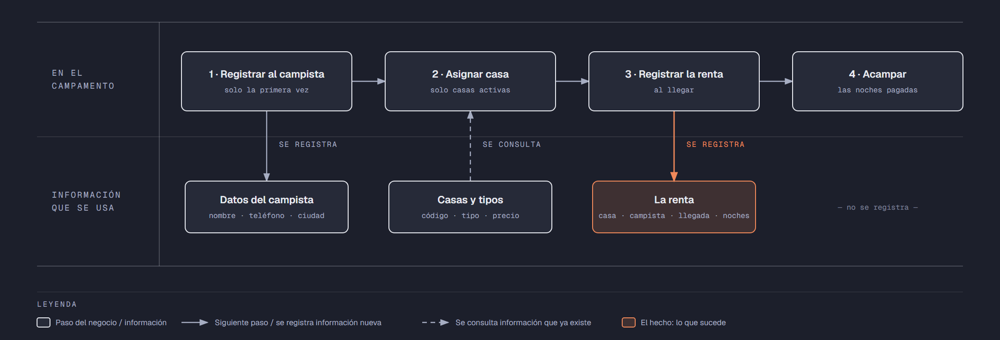

# PIA — Caso: CampoVerde

**Alumno:** Hernandez Juarez Brenda Ivonne (matrícula 2253945)
**Base de datos a crear:** `CampoVerdeDB`

← [Regresar a la descripción del PIA](../../descripcion-pia.md)

---

## Historia de usuario

**Como** dueña de CampoVerde, **quiero** una base de datos que registre mis casas de campaña, a los campistas que vienen y cada renta que hacen, y que además **cuide las reglas del negocio por sí misma**, **para** registrar la operación del día sin errores, saber cuánto se cobró en cada renta y conservar la historia de cada cambio de precio.

## El negocio

CampoVerde es un **campamento** en la sierra que renta **casas de campaña por noche**. Maneja **tipos de casa de campaña** según cuántas personas caben en ella: 2 personas, 4 personas y 6 personas. Cada tipo tiene su propio **precio por noche**; por ejemplo, la de 6 personas cuesta más que la de 2. **Los precios cambian** de vez en cuando. Aun así, el negocio necesita saber **cuánto se cobró en cada renta**, con el precio por noche que estaba vigente el día en que llegó el campista.

Cada **casa de campaña** es de un tipo, tiene un **código** que no se repite (por ejemplo, `T-03`) y una **fecha de compra**. Cuando una casa de campaña ya no sirve (por ejemplo, porque se rompió con el viento), se **da de baja**: no se borra, porque se quiere conservar su historial de rentas.

Los **campistas** se registran una sola vez con su nombre, su teléfono y la ciudad de donde vienen. El teléfono identifica al campista: no puede haber dos campistas con el mismo.

Cada renta es **de 1 a 7 noches**: el campamento no renta por más de una semana seguida.

Si el negocio deja de manejar un tipo de casa de campaña, tampoco lo borra: lo **da de baja**. Lo mismo pasa con los campistas: si un campista ya no regresa, se lo da de baja en lugar de borrarlo. Así se conserva el historial de rentas.

## Los hechos de este negocio

En CampoVerde, **el hecho es la renta**: cada vez que un campista renta una casa de campaña, sucede una renta, en una fecha. Es la **tabla más importante** de tu modelo: tiene una fila por cada renta, es la que más crece y es donde se guarda lo que realmente pasó (quién la rentó, qué casa de campaña, desde qué fecha, cuántas noches y con qué precio por noche se le cobró).

**Esta tabla la propones tú**: su nombre, sus columnas y sus llaves. No viene en "Lo que el negocio ya tiene definido", porque los hechos no se definen de antemano: suceden.

## Lo que el negocio ya tiene definido

Estos datos **no los inventas**: son los que CampoVerde ya tiene. Tu base de datos debe guardarlos **exactamente así**, con los mismos nombres y valores. Los casos de prueba de los objetos dependen de ellos.

Son los **datos iniciales** con los que arranca tu base de datos: **tipos de casa de campaña y precio por noche** y **casas de campaña**. Hoy todo lo que aparece en estas tablas está **activo**, salvo la casa de campaña que se indica como dada de baja.

**Tipos de casa de campaña y precio por noche**

| Tipo de casa de campaña | Precio por noche |
|---|---|
| 2 personas | $250.00 |
| 4 personas | $380.00 |
| 6 personas | $520.00 |

**Casas de campaña**

| Tipo de casa de campaña | Código | Fecha de compra | ¿Activa? |
|---|---|---|---|
| 2 personas | `T-01` | 10/02/2024 | Sí |
| 2 personas | `T-02` | 10/02/2024 | Sí |
| 4 personas | `T-03` | 15/03/2024 | Sí |
| 4 personas | `T-04` | 05/07/2024 | Sí |
| 6 personas | `T-05` | 05/07/2024 | Sí |
| 6 personas | `T-06` | 20/01/2025 | Sí |
| 4 personas | `T-07` | 18/11/2023 | **No** |
| 2 personas | `T-08` | 15/11/2025 | Sí |

Todo lo demás (campistas y rentas) **lo inventas tú**, cumpliendo los mínimos de [Lo que debes construir](#lo-que-debes-construir).

## Flujo de negocio

Así funciona una operación de principio a fin. Arriba, lo que pasa en el campamento; abajo, la información que cada paso consulta o registra.

Con detalle, una campista imaginaria (Rocío) recorriendo el flujo:

1. **Rocío llega por primera vez** a CampoVerde con su familia. En la caseta de entrada le piden su nombre, su teléfono y la ciudad de donde viene (Monterrey), y la **registran como campista**. Si Rocío regresa otro día, ya no se le registra de nuevo: se le busca por su teléfono.
2. **Se le asigna una casa de campaña.** El encargado revisa qué casas de campaña están **activas**; las dadas de baja ya no se rentan. Como son cuatro, le asigna la `T-03`, que es de 4 personas, y le dice el precio por noche de ese tipo: hoy, $380.00.
3. **Se registra la renta al llegar:** casa de campaña `T-03`, campista Rocío, fecha de llegada de hoy, 2 noches y el precio por noche con el que se le cobra ($380.00). Se le cobran las noches por ese precio.
4. **La familia acampa** las 2 noches que pagó y al final entrega la casa de campaña.

Si el mes siguiente sube el precio de las casas de campaña de 4 personas a $420.00, la renta de Rocío tiene que seguir diciendo que se le cobró a $380.00 por noche.

En vacaciones, Rocío regresa y le toca la `T-05`, que es de 6 personas: es otra renta, de la misma campista y de otra casa de campaña. Ese mismo fin de semana, la `T-03` la renta otro campista. Así, **un campista acumula muchas rentas y una casa de campaña también**.

## Reglas de negocio

- Cada casa de campaña es de **un solo** tipo.
- No puede haber dos tipos de casa de campaña con el mismo nombre, ni dos casas de campaña con el mismo código, ni dos campistas con el mismo teléfono.
- El precio por noche siempre es **mayor a cero**.
- Una renta es de **al menos 1 noche** y **como máximo 7 noches**.
- Una casa de campaña nueva se registra como **activa**.
- Un tipo de casa de campaña nuevo y un campista nuevo también se registran como **activos**.
- Cuando cambia el precio de un tipo de casa de campaña, las rentas que ya se hicieron **conservan el precio con el que se cobraron**.
- **Nuevo:** cada cambio del precio por noche de un tipo de casa de campaña queda registrado en el **histórico de precios** (ver abajo).

## Lo nuevo: el histórico de precios

El precio por noche de cada tipo de casa de campaña dice cuánto cuesta **hoy**, y cada renta guarda cuánto se cobró **ese día**. Pero el negocio quiere saber también **cómo ha cambiado el precio con el tiempo**: cuándo subió, cuándo bajó y de cuánto a cuánto.

Por eso, cada vez que cambia el precio por noche de un tipo de casa de campaña, el negocio guarda un registro con:

- **qué tipo de casa de campaña** cambió de precio;
- el **precio anterior**;
- el **precio nuevo**;
- la **fecha y hora** del cambio.

Así funciona:

- El histórico **arranca vacío**: los precios de "Lo que el negocio ya tiene definido" son los iniciales, no un cambio.
- **Nadie escribe a mano** en el histórico. Lo llena un trigger ([`trg_registrarHistoricoPrecio`](11-trigger-trg_registrarHistoricoPrecio.md)) cada vez que cambia un precio, venga de donde venga el cambio.
- Si un `UPDATE` toca un tipo de casa de campaña pero **no le cambia el precio** (por ejemplo, solo lo da de baja), no se registra nada.
- Un registro del histórico **nunca se modifica ni se borra**.

**El nombre de la tabla, sus columnas y sus llaves los propones tú**, igual que la tabla de las rentas.

## Lo que debes construir

1. El **modelo relacional**, con las tablas de tu caso **más la tabla del histórico de precios**, que respete las reglas de negocio con restricciones (`PRIMARY KEY`, `FOREIGN KEY`, `UNIQUE`, `CHECK`, `DEFAULT`).
2. El **paquete de instalación** de `CampoVerdeDB`: tablas, datos iniciales y los **11 objetos programados** de abajo.
3. El **paquete de reversa**, que deje el servidor sin rastro de `CampoVerdeDB`.
4. **Datos iniciales:**
   - **Lo que el negocio ya tiene definido**, exactamente como viene arriba: los 3 tipos de casa de campaña con su precio por noche y las 8 casas de campaña.
   - **Lo que tú inventas**, como mínimo: 10 campistas y 20 rentas, con
     - 2 campistas que nunca hayan rentado;
     - 2 casas de campaña que nunca se hayan rentado;
     - al menos 1 campista dado de baja;
     - cada renta con el precio por noche con el que se cobró (en tus datos, el precio de su tipo de casa de campaña que viene arriba).
   - El histórico de precios **vacío**.
5. Los **11 objetos programados**, cada uno con su ficha:

| # | Objeto | Tipo | Qué hace |
|---|---|---|---|
| 01 | [`usp_insertarCampista`](01-procedimiento-usp_insertarCampista.md) | Procedimiento | Registra un campista nuevo |
| 02 | [`usp_darDeBajaCampista`](02-procedimiento-usp_darDeBajaCampista.md) | Procedimiento | Da de baja a un campista |
| 03 | [`usp_insertarTienda`](03-procedimiento-usp_insertarTienda.md) | Procedimiento | Registra una casa de campaña nueva |
| 04 | [`usp_actualizarPrecioTipoTienda`](04-procedimiento-usp_actualizarPrecioTipoTienda.md) | Procedimiento | Cambia el precio por noche de un tipo de casa de campaña |
| 05 | [`usp_registrarRenta`](05-procedimiento-usp_registrarRenta.md) | Procedimiento | Registra una renta con el precio vigente |
| 06 | [`usp_obtenerRentasPorFecha`](06-procedimiento-usp_obtenerRentasPorFecha.md) | Procedimiento | Lista las rentas de un rango de fechas |
| 07 | [`ufn_totalCobradoTienda`](07-funcion-ufn_totalCobradoTienda.md) | Función escalar | Total cobrado por cada casa de campaña |
| 08 | [`ufn_nivelCampista`](08-funcion-ufn_nivelCampista.md) | Función escalar | Qué tan seguido viene un campista |
| 09 | [`vw_DetalleRenta`](09-vista-vw_DetalleRenta.md) | Vista | Cada renta con su precio cobrado y el actual |
| 10 | [`vw_ResumenTipoTienda`](10-vista-vw_ResumenTipoTienda.md) | Vista | Totales por tipo de casa de campaña |
| 11 | [`trg_registrarHistoricoPrecio`](11-trigger-trg_registrarHistoricoPrecio.md) | Trigger | Llena el histórico de precios |

Los objetos están en el orden en que conviene construirlos: los casos de prueba de cada uno usan los procedimientos anteriores para preparar sus datos.

## Cómo probar tus objetos

- **Cada ficha trae sus casos de prueba.** Todos parten de una **instalación limpia**: ejecuta tu reversa y tu instalación completa, y después las pruebas de esa ficha, en orden.
- Los resultados esperados dependen de **Lo que el negocio ya tiene definido**, no de tus datos inventados. Por eso los objetos reciben datos del negocio (nombres, claves, correos o teléfonos) y no ids.
- Las pruebas usan campistas con teléfono `8199990001` y `8199990002`, la casa de campaña `T-20` y el tipo de casa de campaña `Nuevo tipo`, y rentas de **diciembre de 2026**. **No uses esos valores ni esas fechas en tus datos inventados**, para que no choquen con las pruebas.
- Algunas pruebas escriben directamente en tus tablas. Como tú eliges los nombres, vienen con marcas como `<TuTablaDeRentas>`: cámbialas por los nombres de tu modelo.
- Los casos de prueba son para que compruebes tu trabajo: **no se entregan**.

## Si también presentas la 3ra o 5ta oportunidad de Base de Datos I

Tu caso del PIA es el **mismo negocio** que el de tu Evidencia Integral de Base de Datos I, pero son **dos entregas distintas**, cada una con su propio paquete de instalación:

| | Evidencia Integral (BD1) | PIA (BD2) |
|---|---|---|
| Tablas | Las de tu caso | Las de tu caso **más el histórico de precios** |
| Objetos programados | No | **Los 11** de este caso |
| `USE` en los scripts | En todos, menos el que crea la base de datos | Solo en los de tablas y datos; **nunca** en los de los objetos |
| Consultas | Las 10, en su propio ZIP | No se piden |
| PDF | Secciones 1 a 5 | Secciones 1 a 6 (agrega los objetos programados) |
| Dónde se entrega | Teams | NEXUS, en tres lugares |

Puedes partir de tu paquete de Base de Datos I, pero **arma y prueba cada uno por separado**: no subas el mismo ZIP en los dos lugares.

## Convenciones de código

- Palabras reservadas en **MAYÚSCULAS**; nombres de tablas y columnas en **PascalCase** y en singular; columnas id con prefijo `id` (`idTienda`).
- Nombre de cada objeto **exactamente** como se indica en su ficha (respeta mayúsculas y minúsculas), y parámetros con los nombres y tipos indicados.
- `SELECT` y `FROM` en líneas separadas; los campos comienzan en la misma línea del `SELECT`; máximo 5 campos por renglón.
- En los procedimientos, las validaciones se escriben como *guard clauses*: guarda el dato en una variable (`SELECT ... FROM ... WHERE`), revísala con `IF @variable IS NULL` / `IS NOT NULL` y, si falla, regresa el error y sal con `RETURN`. `IF EXISTS (SELECT ...)` y los `IF` anidados se permiten, pero se evitan.
- Los procedimientos regresan su resultado con el formato `ErrCodigo` / `ErrMensaje` ([Validaciones](../../../temas/Etapa-2/04-Validaciones.md)).
- Las funciones se llaman con el prefijo `dbo.`.
- Las vistas no llevan `ORDER BY`.

## Entrega

Ver [Entregables](../../descripcion-pia.md#entregables) y [Forma de entrega](../../descripcion-pia.md#forma-de-entrega) en la descripción del PIA.
