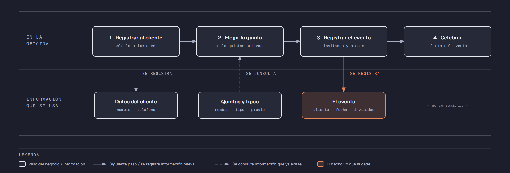

# PIA — Caso: QuintaSol

**Alumno:** Hernandez Martínez Alexander Kalet (matrícula 2212470)
**Base de datos a crear:** `QuintaSolDB`

← [Regresar a la descripción del PIA](../../descripcion-pia.md)

---

## Historia de usuario

**Como** dueña de QuintaSol, **quiero** una base de datos que registre mis quintas, a los clientes que las rentan y cada evento que se celebra en ellas, y que además **cuide las reglas del negocio por sí misma**, **para** registrar la operación del día sin errores, saber cuánto se cobró en cada evento y conservar la historia de cada cambio de precio.

## El negocio

QuintaSol **renta quintas para fiestas**: bodas, XV años, bautizos y cumpleaños. Cada quinta se renta **por día**: un **evento** ocupa la quinta un día completo. Maneja **tipos de quinta**: Chica, Mediana y Grande, según el tamaño del jardín y del salón. Cada tipo tiene su propio **precio por día**; por ejemplo, una quinta Grande cuesta más que una Chica. **Los precios cambian** de vez en cuando. Aun así, el negocio necesita saber **cuánto se cobró por cada evento**, con el precio que estaba vigente cuando se rentó la quinta.

Cada **quinta** es de un tipo, tiene un **nombre** que no se repite (por ejemplo, "Los Nogales") y una **fecha de apertura**, que es el día en que empezó a rentarse. Cuando una quinta deja de rentarse (por ejemplo, porque el dueño del terreno ya no la presta), se **da de baja**: no se borra, porque se quiere conservar su historial de eventos.

Los **clientes** se registran una sola vez con su nombre y su teléfono. El teléfono identifica al cliente: no puede haber dos clientes con el mismo.

En cada evento se anota cuántos **invitados** van a asistir. Por reglamento de protección civil, un evento tiene **de 10 a 200 invitados**.

Si el negocio deja de manejar un tipo de quinta, tampoco lo borra: lo **da de baja**. Lo mismo pasa con los clientes: si un cliente ya no regresa, se lo da de baja en lugar de borrarlo. Así se conserva el historial de eventos.

## Los hechos de este negocio

En QuintaSol, **el hecho es el evento**: cada vez que un cliente renta una quinta para una fiesta, sucede un evento, en una fecha. Es la **tabla más importante** de tu modelo: tiene una fila por cada evento, es la que más crece y es donde se guarda lo que realmente pasó (quién la rentó, qué quinta, para qué fecha, cuántos invitados y cuánto se le cobró).

**Esta tabla la propones tú**: su nombre, sus columnas y sus llaves. No viene en "Lo que el negocio ya tiene definido", porque los hechos no se definen de antemano: suceden.

## Lo que el negocio ya tiene definido

Estos datos **no los inventas**: son los que QuintaSol ya tiene. Tu base de datos debe guardarlos **exactamente así**, con los mismos nombres y valores. Los casos de prueba de los objetos dependen de ellos.

Son los **datos iniciales** con los que arranca tu base de datos: **tipos de quinta y precio por día** y **quintas**. Hoy todo lo que aparece en estas tablas está **activo**, salvo la quinta que se indica como dada de baja.

**Tipos de quinta y precio por día**

| Tipo de quinta | Precio por día |
|---|---|
| Chica | $3,500.00 |
| Mediana | $5,500.00 |
| Grande | $8,000.00 |

**Quintas**

| Tipo de quinta | Nombre | Fecha de apertura | ¿Activa? |
|---|---|---|---|
| Mediana | Los Nogales | 01/04/2019 | Sí |
| Chica | El Encino | 15/02/2020 | Sí |
| Grande | Las Palmas | 10/09/2018 | Sí |
| Chica | Los Sauces | 01/06/2021 | Sí |
| Grande | La Hacienda | 20/03/2022 | Sí |
| Mediana | El Mezquite | 10/01/2023 | Sí |
| Mediana | Los Álamos | 05/11/2019 | **No** |
| Chica | La Huerta | 01/08/2025 | Sí |

Todo lo demás (clientes y eventos) **lo inventas tú**, cumpliendo los mínimos de [Lo que debes construir](#lo-que-debes-construir).

## Flujo de negocio

Así funciona una operación de principio a fin. Arriba, lo que pasa en la oficina de QuintaSol; abajo, la información que cada paso consulta o registra.

Con detalle, una clienta imaginaria (Gabriela) recorriendo el flujo:

1. **Gabriela llega por primera vez** a QuintaSol para organizar los XV años de su hija. En la oficina le piden su nombre y su teléfono, y la **registran como clienta**. Si Gabriela regresa otro día, ya no se le registra de nuevo: se le busca por su teléfono.
2. **Gabriela elige la quinta.** La encargada le muestra las quintas **activas**; las dadas de baja ya no se rentan. Gabriela elige "Los Nogales", que es Mediana, y la encargada le dice el precio por día de ese tipo: hoy, $5,500.00.
3. **Se registra el evento:** quinta "Los Nogales", clienta Gabriela, la fecha de la fiesta, 120 invitados y el precio con el que se le cobra ($5,500.00).
4. **El día del evento**, la familia celebra la fiesta en la quinta. Cómo estuvo la fiesta no se registra en la base de datos.

Si el mes siguiente sube el precio de las quintas Medianas a $6,000.00, el evento de Gabriela tiene que seguir diciendo que se le cobró a $5,500.00.

Al año siguiente, Gabriela regresa a festejar el cumpleaños de su esposo y renta "El Encino", que es Chica: es otro evento, de la misma clienta y de otra quinta. Una semana después, otro cliente renta "Los Nogales" para una boda. Así, **un cliente acumula muchos eventos y una quinta también**.

## Reglas de negocio

- Cada quinta es de **un solo** tipo.
- No puede haber dos tipos de quinta con el mismo nombre, ni dos quintas con el mismo nombre, ni dos clientes con el mismo teléfono.
- El precio por día siempre es **mayor a cero**.
- Un evento tiene **de 10 a 200** invitados.
- Una quinta nueva se registra como **activa**.
- Un tipo de quinta nuevo y un cliente nuevo también se registran como **activos**.
- Cuando cambia el precio de un tipo de quinta, los eventos que ya se rentaron **conservan el precio con el que se cobraron**.
- **Nuevo:** cada cambio del precio por día de un tipo de quinta queda registrado en el **histórico de precios** (ver abajo).

## Lo nuevo: el histórico de precios

El precio por día de cada tipo de quinta dice cuánto cuesta **hoy**, y cada evento guarda cuánto se cobró **ese día**. Pero el negocio quiere saber también **cómo ha cambiado el precio con el tiempo**: cuándo subió, cuándo bajó y de cuánto a cuánto.

Por eso, cada vez que cambia el precio por día de un tipo de quinta, el negocio guarda un registro con:

- **qué tipo de quinta** cambió de precio;
- el **precio anterior**;
- el **precio nuevo**;
- la **fecha y hora** del cambio.

Así funciona:

- El histórico **arranca vacío**: los precios de "Lo que el negocio ya tiene definido" son los iniciales, no un cambio.
- **Nadie escribe a mano** en el histórico. Lo llena un trigger ([`trg_registrarHistoricoPrecio`](11-trigger-trg_registrarHistoricoPrecio.md)) cada vez que cambia un precio, venga de donde venga el cambio.
- Si un `UPDATE` toca un tipo de quinta pero **no le cambia el precio** (por ejemplo, solo lo da de baja), no se registra nada.
- Un registro del histórico **nunca se modifica ni se borra**.

**El nombre de la tabla, sus columnas y sus llaves los propones tú**, igual que la tabla de los eventos.

## Lo que debes construir

1. El **modelo relacional**, con las tablas de tu caso **más la tabla del histórico de precios**, que respete las reglas de negocio con restricciones (`PRIMARY KEY`, `FOREIGN KEY`, `UNIQUE`, `CHECK`, `DEFAULT`).
2. El **paquete de instalación** de `QuintaSolDB`: tablas, datos iniciales y los **11 objetos programados** de abajo.
3. El **paquete de reversa**, que deje el servidor sin rastro de `QuintaSolDB`.
4. **Datos iniciales:**
   - **Lo que el negocio ya tiene definido**, exactamente como viene arriba: los 3 tipos de quinta con su precio por día y las 8 quintas.
   - **Lo que tú inventas**, como mínimo: 10 clientes y 20 eventos, con
     - 2 clientes que nunca hayan hecho un evento;
     - 2 quintas que nunca se hayan rentado;
     - al menos 1 cliente dado de baja;
     - cada evento con el precio con el que se cobró (en tus datos, el precio de su tipo de quinta que viene arriba).
   - El histórico de precios **vacío**.
5. Los **11 objetos programados**, cada uno con su ficha:

| # | Objeto | Tipo | Qué hace |
|---|---|---|---|
| 01 | [`usp_insertarCliente`](01-procedimiento-usp_insertarCliente.md) | Procedimiento | Registra un cliente nuevo |
| 02 | [`usp_darDeBajaCliente`](02-procedimiento-usp_darDeBajaCliente.md) | Procedimiento | Da de baja a un cliente |
| 03 | [`usp_insertarQuinta`](03-procedimiento-usp_insertarQuinta.md) | Procedimiento | Registra una quinta nueva |
| 04 | [`usp_actualizarPrecioTipoQuinta`](04-procedimiento-usp_actualizarPrecioTipoQuinta.md) | Procedimiento | Cambia el precio por día de un tipo de quinta |
| 05 | [`usp_registrarEvento`](05-procedimiento-usp_registrarEvento.md) | Procedimiento | Registra un evento con el precio vigente |
| 06 | [`usp_obtenerEventosPorFecha`](06-procedimiento-usp_obtenerEventosPorFecha.md) | Procedimiento | Lista los eventos de un rango de fechas |
| 07 | [`ufn_totalCobradoQuinta`](07-funcion-ufn_totalCobradoQuinta.md) | Función escalar | Total cobrado por cada quinta |
| 08 | [`ufn_nivelCliente`](08-funcion-ufn_nivelCliente.md) | Función escalar | Qué tan seguido viene un cliente |
| 09 | [`vw_DetalleEvento`](09-vista-vw_DetalleEvento.md) | Vista | Cada evento con su precio cobrado y el actual |
| 10 | [`vw_ResumenTipoQuinta`](10-vista-vw_ResumenTipoQuinta.md) | Vista | Totales por tipo de quinta |
| 11 | [`trg_registrarHistoricoPrecio`](11-trigger-trg_registrarHistoricoPrecio.md) | Trigger | Llena el histórico de precios |

Los objetos están en el orden en que conviene construirlos: los casos de prueba de cada uno usan los procedimientos anteriores para preparar sus datos.

## Cómo probar tus objetos

- **Cada ficha trae sus casos de prueba.** Todos parten de una **instalación limpia**: ejecuta tu reversa y tu instalación completa, y después las pruebas de esa ficha, en orden.
- Los resultados esperados dependen de **Lo que el negocio ya tiene definido**, no de tus datos inventados. Por eso los objetos reciben datos del negocio (nombres, claves, correos o teléfonos) y no ids.
- Las pruebas usan clientes con teléfono `8199990001` y `8199990002`, la quinta `Quinta Prueba` y el tipo de quinta `Nuevo tipo`, y eventos de **diciembre de 2026**. **No uses esos valores ni esas fechas en tus datos inventados**, para que no choquen con las pruebas.
- Algunas pruebas escriben directamente en tus tablas. Como tú eliges los nombres, vienen con marcas como `<TuTablaDeEventos>`: cámbialas por los nombres de tu modelo.
- Los casos de prueba son para que compruebes tu trabajo: **no se entregan**.

## Si también presentas la 3ra o 5ta oportunidad de Base de Datos I

Tu caso del PIA es el **mismo negocio** que el de tu Evidencia Integral de Base de Datos I, pero son **dos entregas distintas**, cada una con su propio paquete de instalación:

| | Evidencia Integral (BD1) | PIA (BD2) |
|---|---|---|
| Tablas | Las de tu caso | Las de tu caso **más el histórico de precios** |
| Objetos programados | No | **Los 11** de este caso |
| `USE` en los scripts | En todos, menos el que crea la base de datos | Solo en los de tablas y datos; **nunca** en los de los objetos |
| Consultas | Las 10, en su propio ZIP | No se piden |
| PDF | Secciones 1 a 5 | Secciones 1 a 6 (agrega los objetos programados) |
| Dónde se entrega | Teams | NEXUS, en tres lugares |

Puedes partir de tu paquete de Base de Datos I, pero **arma y prueba cada uno por separado**: no subas el mismo ZIP en los dos lugares.

## Convenciones de código

- Palabras reservadas en **MAYÚSCULAS**; nombres de tablas y columnas en **PascalCase** y en singular; columnas id con prefijo `id` (`idQuinta`).
- Nombre de cada objeto **exactamente** como se indica en su ficha (respeta mayúsculas y minúsculas), y parámetros con los nombres y tipos indicados.
- `SELECT` y `FROM` en líneas separadas; los campos comienzan en la misma línea del `SELECT`; máximo 5 campos por renglón.
- En los procedimientos, las validaciones se escriben como *guard clauses*: guarda el dato en una variable (`SELECT ... FROM ... WHERE`), revísala con `IF @variable IS NULL` / `IS NOT NULL` y, si falla, regresa el error y sal con `RETURN`. `IF EXISTS (SELECT ...)` y los `IF` anidados se permiten, pero se evitan.
- Los procedimientos regresan su resultado con el formato `ErrCodigo` / `ErrMensaje` ([Validaciones](../../../temas/Etapa-2/04-Validaciones.md)).
- Las funciones se llaman con el prefijo `dbo.`.
- Las vistas no llevan `ORDER BY`.

## Entrega

Ver [Entregables](../../descripcion-pia.md#entregables) y [Forma de entrega](../../descripcion-pia.md#forma-de-entrega) en la descripción del PIA.
