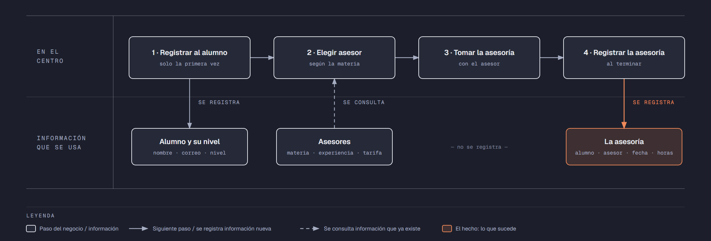

# PIA — Caso: AsesorPro

**Alumno:** Hernandez Perez Jose Ivan (matrícula 2253557)
**Base de datos a crear:** `AsesorProDB`

← [Regresar a la descripción del PIA](../../descripcion-pia.md)

---

## Historia de usuario

**Como** directora de AsesorPro, **quiero** una base de datos que registre a mis alumnos, a mis asesores y cada asesoría que se da, y que además **cuide las reglas del negocio por sí misma**, **para** registrar la operación del día sin errores, saber cuánto se cobró en cada asesoría y conservar la historia de cada cambio de precio.

## El negocio

AsesorPro es un centro de **asesorías escolares presenciales**. Cada **asesor** enseña **una materia** (Matemáticas, Física, Inglés, etc.), tiene sus **años de experiencia** y cobra su propia **tarifa por hora**: un asesor con más experiencia puede cobrar más. **Las tarifas cambian** de vez en cuando. Aun así, el centro necesita saber **cuánto se cobró en cada asesoría**, con la tarifa que tenía el asesor ese día.

Los **alumnos** se registran una sola vez con su nombre, su correo electrónico, la fecha de registro y su **nivel escolar** (Secundaria, Preparatoria o Universidad). El nivel sirve para saber a qué alumnos atiende el centro; no cambia el precio. Cuando un alumno pasa de secundaria a preparatoria, se le actualiza el nivel. El correo identifica al alumno: no puede haber dos alumnos con el mismo. Cuando un alumno deja de venir, se le **da de baja**, pero no se borra, para conservar su historial de asesorías.

Si el negocio deja de usar un nivel escolar o deja de ofrecer un asesor, no se borran: se **dan de baja**, para conservar el historial de asesorías.

## Los hechos de este negocio

En AsesorPro, **el hecho es la asesoría**: cada vez que un alumno recibe ayuda de un asesor, sucede una asesoría, en una fecha. Es la **tabla más importante** de tu modelo: tiene una fila por cada asesoría, es la que más crece y es donde se guarda lo que realmente pasó (qué alumno, con qué asesor, cuándo, cuántas horas y con qué tarifa se le cobró).

**Esta tabla la propones tú**: su nombre, sus columnas y sus llaves. No viene en "Lo que el negocio ya tiene definido", porque los hechos no se definen de antemano: suceden.

## Lo que el negocio ya tiene definido

Estos datos **no los inventas**: son los que AsesorPro ya tiene. Tu base de datos debe guardarlos **exactamente así**, con los mismos nombres y valores. Los casos de prueba de los objetos dependen de ellos.

Son los **datos iniciales** con los que arranca tu base de datos: **niveles escolares** y **asesores**. Hoy todo lo que aparece en estas tablas está **activo**.

**Niveles escolares**

| Nivel escolar |
|---|
| Secundaria |
| Preparatoria |
| Universidad |

**Asesores**

| Asesor | Correo electrónico | Materia | Tarifa por hora | Años de experiencia |
|---|---|---|---|---|
| Laura Garza Ríos | laura.garza@asesorpro.mx | Matemáticas | $250.00 | 8 |
| Jorge Treviño Salas | jorge.trevino@asesorpro.mx | Física | $280.00 | 12 |
| Mónica Leal Cantú | monica.leal@asesorpro.mx | Química | $260.00 | 5 |
| Ricardo Peña Ortiz | ricardo.pena@asesorpro.mx | Inglés | $200.00 | 3 |
| Sofía Villarreal Mata | sofia.villarreal@asesorpro.mx | Programación | $300.00 | 7 |
| Andrés Cavazos Lara | andres.cavazos@asesorpro.mx | Español | $180.00 | 2 |

Todo lo demás (alumnos y asesorías) **lo inventas tú**, cumpliendo los mínimos de [Lo que debes construir](#lo-que-debes-construir).

## Flujo de negocio

Así funciona una operación de principio a fin. Arriba, lo que pasa en el centro; abajo, la información que cada paso consulta o registra.

Con detalle, una alumna imaginaria (Valeria) recorriendo el flujo:

1. **Valeria llega por primera vez** a AsesorPro. Está en preparatoria. En recepción le piden su nombre, su correo y su nivel escolar, y la **registran como alumna** con la fecha de hoy. Si Valeria regresa otro día, ya no se le registra de nuevo: se le busca por su correo.
2. **Valeria necesita ayuda en Matemáticas.** La recepcionista revisa qué asesor da esa materia, cuánta experiencia tiene y su **tarifa por hora vigente**: Laura Garza, a $250.00 la hora.
3. **Valeria toma la asesoría** con Laura durante 2 horas.
4. **Al terminar, se registra la asesoría:** alumna Valeria, asesora Laura Garza, fecha de hoy, 2 horas y la tarifa por hora con la que se le cobra ($250.00). Se le cobran las horas por esa tarifa.

Si el mes siguiente Laura sube su tarifa a $270.00, la asesoría de Valeria tiene que seguir diciendo que se le cobró a $250.00.

La semana siguiente, Valeria toma una asesoría de Física con Jorge Treviño: es otra asesoría, de la misma alumna y de otro asesor. Ese mismo día, Laura atiende a otro alumno. Así, **un alumno acumula muchas asesorías y un asesor también**.

## Reglas de negocio

- Cada alumno tiene **un solo** nivel escolar, y cada asesor enseña **una sola** materia.
- No puede haber dos niveles escolares con el mismo nombre.
- No puede haber dos alumnos con el mismo correo electrónico, ni dos asesores con el mismo correo electrónico.
- La tarifa por hora siempre es **mayor a cero**, y todo asesor tiene **al menos 1 año** de experiencia.
- Una asesoría dura **al menos 1 hora** y **como máximo 3 horas**.
- Cuando cambia la tarifa de un asesor, las asesorías que ya se dieron **conservan la tarifa con la que se cobraron**.
- Un alumno nuevo se registra como **activo**.
- Un nivel escolar nuevo y un asesor nuevo también se registran como **activos**.
- **Nuevo:** cada cambio de la tarifa por hora de un asesor queda registrado en el **histórico de precios** (ver abajo).

## Lo nuevo: el histórico de precios

La tarifa por hora de cada asesor dice cuánto cuesta **hoy**, y cada asesoría guarda cuánto se cobró **ese día**. Pero el negocio quiere saber también **cómo ha cambiado el precio con el tiempo**: cuándo subió, cuándo bajó y de cuánto a cuánto.

Por eso, cada vez que cambia la tarifa por hora de un asesor, el negocio guarda un registro con:

- **qué asesor** cambió de precio;
- el **precio anterior**;
- el **precio nuevo**;
- la **fecha y hora** del cambio.

Así funciona:

- El histórico **arranca vacío**: los precios de "Lo que el negocio ya tiene definido" son los iniciales, no un cambio.
- **Nadie escribe a mano** en el histórico. Lo llena un trigger ([`trg_registrarHistoricoPrecio`](11-trigger-trg_registrarHistoricoPrecio.md)) cada vez que cambia un precio, venga de donde venga el cambio.
- Si un `UPDATE` toca un asesor pero **no le cambia el precio** (por ejemplo, solo lo da de baja), no se registra nada.
- Un registro del histórico **nunca se modifica ni se borra**.

**El nombre de la tabla, sus columnas y sus llaves los propones tú**, igual que la tabla de las asesorías.

## Lo que debes construir

1. El **modelo relacional**, con las tablas de tu caso **más la tabla del histórico de precios**, que respete las reglas de negocio con restricciones (`PRIMARY KEY`, `FOREIGN KEY`, `UNIQUE`, `CHECK`, `DEFAULT`).
2. El **paquete de instalación** de `AsesorProDB`: tablas, datos iniciales y los **11 objetos programados** de abajo.
3. El **paquete de reversa**, que deje el servidor sin rastro de `AsesorProDB`.
4. **Datos iniciales:**
   - **Lo que el negocio ya tiene definido**, exactamente como viene arriba: los 3 niveles escolares y los 6 asesores.
   - **Lo que tú inventas**, como mínimo: 10 alumnos y 20 asesorías, con
     - alumnos de los tres niveles escolares;
     - 2 alumnos que nunca hayan tomado una asesoría;
     - 2 asesores que nunca hayan dado una asesoría;
     - al menos 1 alumno dado de baja;
     - cada asesoría con la tarifa por hora con la que se cobró (en tus datos, la tarifa del asesor que viene arriba).
   - El histórico de precios **vacío**.
5. Los **11 objetos programados**, cada uno con su ficha:

| # | Objeto | Tipo | Qué hace |
|---|---|---|---|
| 01 | [`usp_insertarAlumno`](01-procedimiento-usp_insertarAlumno.md) | Procedimiento | Registra un alumno nuevo |
| 02 | [`usp_darDeBajaAlumno`](02-procedimiento-usp_darDeBajaAlumno.md) | Procedimiento | Da de baja a un alumno |
| 03 | [`usp_insertarAsesor`](03-procedimiento-usp_insertarAsesor.md) | Procedimiento | Registra un asesor nuevo |
| 04 | [`usp_actualizarTarifaAsesor`](04-procedimiento-usp_actualizarTarifaAsesor.md) | Procedimiento | Cambia la tarifa por hora de un asesor |
| 05 | [`usp_registrarAsesoria`](05-procedimiento-usp_registrarAsesoria.md) | Procedimiento | Registra una asesoría con el precio vigente |
| 06 | [`usp_obtenerAsesoriasPorFecha`](06-procedimiento-usp_obtenerAsesoriasPorFecha.md) | Procedimiento | Lista las asesorías de un rango de fechas |
| 07 | [`ufn_totalCobradoAsesor`](07-funcion-ufn_totalCobradoAsesor.md) | Función escalar | Total cobrado por cada asesor |
| 08 | [`ufn_nivelAlumno`](08-funcion-ufn_nivelAlumno.md) | Función escalar | Qué tan seguido viene un alumno |
| 09 | [`vw_DetalleAsesoria`](09-vista-vw_DetalleAsesoria.md) | Vista | Cada asesoría con su precio cobrado y el actual |
| 10 | [`vw_ResumenAsesor`](10-vista-vw_ResumenAsesor.md) | Vista | Totales por asesor |
| 11 | [`trg_registrarHistoricoPrecio`](11-trigger-trg_registrarHistoricoPrecio.md) | Trigger | Llena el histórico de precios |

Los objetos están en el orden en que conviene construirlos: los casos de prueba de cada uno usan los procedimientos anteriores para preparar sus datos.

## Cómo probar tus objetos

- **Cada ficha trae sus casos de prueba.** Todos parten de una **instalación limpia**: ejecuta tu reversa y tu instalación completa, y después las pruebas de esa ficha, en orden.
- Los resultados esperados dependen de **Lo que el negocio ya tiene definido**, no de tus datos inventados. Por eso los objetos reciben datos del negocio (nombres, claves, correos o teléfonos) y no ids.
- Las pruebas usan alumnos con correo electrónico `prueba1@correo.com` y `prueba2@correo.com` y el asesor `asesor.prueba@asesorpro.mx`, y asesorías de **diciembre de 2026**. **No uses esos valores ni esas fechas en tus datos inventados**, para que no choquen con las pruebas.
- Algunas pruebas escriben directamente en tus tablas. Como tú eliges los nombres, vienen con marcas como `<TuTablaDeAsesorías>`: cámbialas por los nombres de tu modelo.
- Los casos de prueba son para que compruebes tu trabajo: **no se entregan**.

## Convenciones de código

- Palabras reservadas en **MAYÚSCULAS**; nombres de tablas y columnas en **PascalCase** y en singular; columnas id con prefijo `id` (`idAsesor`).
- Nombre de cada objeto **exactamente** como se indica en su ficha (respeta mayúsculas y minúsculas), y parámetros con los nombres y tipos indicados.
- `SELECT` y `FROM` en líneas separadas; los campos comienzan en la misma línea del `SELECT`; máximo 5 campos por renglón.
- En los procedimientos, las validaciones se escriben como *guard clauses*: guarda el dato en una variable (`SELECT ... FROM ... WHERE`), revísala con `IF @variable IS NULL` / `IS NOT NULL` y, si falla, regresa el error y sal con `RETURN`. `IF EXISTS (SELECT ...)` y los `IF` anidados se permiten, pero se evitan.
- Los procedimientos regresan su resultado con el formato `ErrCodigo` / `ErrMensaje` ([Validaciones](../../../temas/Etapa-2/04-Validaciones.md)).
- Las funciones se llaman con el prefijo `dbo.`.
- Las vistas no llevan `ORDER BY`.

## Entrega

Ver [Entregables](../../descripcion-pia.md#entregables) y [Forma de entrega](../../descripcion-pia.md#forma-de-entrega) en la descripción del PIA.
