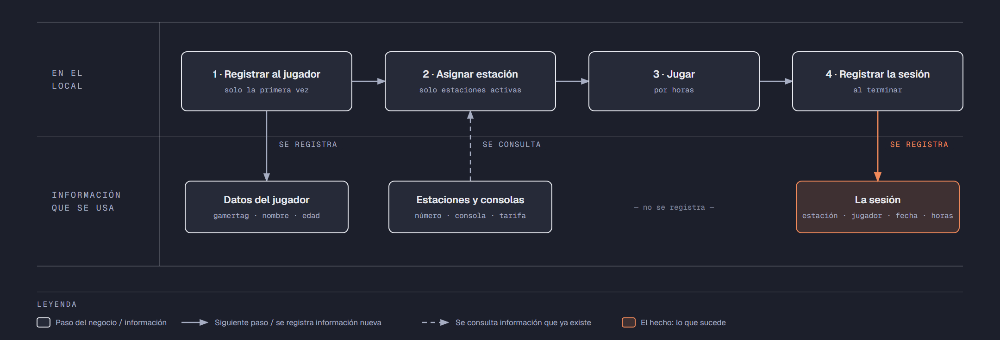

# PIA — Caso: GameZone

**Alumno:** Mejia Garcia Ricardo Azael (matrícula 2253586)
**Base de datos a crear:** `GameZoneDB`

← [Regresar a la descripción del PIA](../../descripcion-pia.md)

---

## Historia de usuario

**Como** dueño de GameZone, **quiero** una base de datos que registre mis estaciones de juego, a los jugadores que vienen y cada sesión que juegan, y que además **cuide las reglas del negocio por sí misma**, **para** registrar la operación del día sin errores, saber cuánto se cobró en cada sesión y conservar la historia de cada cambio de precio.

## El negocio

GameZone es un **centro de videojuegos** que renta consolas por hora. Cada **sesión** es el tiempo que un jugador pasa en una estación. Maneja **tipos de consola**: PlayStation 5, Xbox Series X, Nintendo Switch y PC Gamer. Cada tipo tiene su propia **tarifa por hora**; por ejemplo, la PC Gamer cuesta más que el Nintendo Switch. **Las tarifas cambian** de vez en cuando. Aun así, el negocio necesita saber **cuánto se cobró en cada sesión**, con la tarifa que estaba vigente el día de la sesión.

Cada **estación** es un lugar del local con una consola, su pantalla y sus controles. Tiene una consola de un solo tipo, un **número** que no se repite (por ejemplo, `E-04`) y una **fecha de instalación**, que es el día en que empezó a usarse. Cuando la consola de una estación se descompone sin arreglo, la estación se **da de baja**: no se borra, porque se quiere conservar su historial de sesiones.

Los **jugadores** se registran una sola vez con su nombre, su **gamertag** (el apodo con el que juegan, por ejemplo `DiegoRayo15`) y su **edad**. El gamertag identifica al jugador: no puede haber dos jugadores con el mismo. Por los juegos que hay en el local, solo se registra a jugadores de **al menos 8 años**.

Una sesión dura **de 1 a 5 horas** completas; no se rentan fracciones de hora.

Si el negocio deja de manejar un tipo de consola, tampoco lo borra: lo **da de baja**. Lo mismo pasa con los jugadores: si un jugador ya no regresa, se lo da de baja en lugar de borrarlo. Así se conserva el historial de sesiones.

## Los hechos de este negocio

En GameZone, **el hecho es la sesión**: cada vez que un jugador usa una estación, sucede una sesión, en una fecha. Es la **tabla más importante** de tu modelo: tiene una fila por cada sesión, es la que más crece y es donde se guarda lo que realmente pasó (quién jugó, en qué estación, cuándo, cuántas horas y con qué tarifa se le cobró).

**Esta tabla la propones tú**: su nombre, sus columnas y sus llaves. No viene en "Lo que el negocio ya tiene definido", porque los hechos no se definen de antemano: suceden.

## Lo que el negocio ya tiene definido

Estos datos **no los inventas**: son los que GameZone ya tiene. Tu base de datos debe guardarlos **exactamente así**, con los mismos nombres y valores. Los casos de prueba de los objetos dependen de ellos.

Son los **datos iniciales** con los que arranca tu base de datos: **tipos de consola y tarifa por hora** y **estaciones**. Hoy todo lo que aparece en estas tablas está **activo**, salvo la estación que se indica como dada de baja.

**Tipos de consola y tarifa por hora**

| Tipo de consola | Tarifa por hora |
|---|---|
| PlayStation 5 | $60.00 |
| Xbox Series X | $55.00 |
| Nintendo Switch | $45.00 |
| PC Gamer | $75.00 |

**Estaciones**

| Tipo de consola | Número | Fecha de instalación | ¿Activa? |
|---|---|---|---|
| PlayStation 5 | `E-01` | 10/05/2024 | Sí |
| PlayStation 5 | `E-02` | 10/05/2024 | Sí |
| PlayStation 5 | `E-04` | 10/05/2024 | Sí |
| Xbox Series X | `E-05` | 20/08/2024 | Sí |
| Xbox Series X | `E-06` | 20/08/2024 | Sí |
| Nintendo Switch | `E-07` | 15/11/2024 | Sí |
| Nintendo Switch | `E-08` | 25/01/2025 | Sí |
| PC Gamer | `E-09` | 03/03/2025 | Sí |
| PC Gamer | `E-10` | 12/06/2025 | **No** |
| Nintendo Switch | `E-03` | 01/10/2025 | Sí |

Todo lo demás (jugadores y sesiones) **lo inventas tú**, cumpliendo los mínimos de [Lo que debes construir](#lo-que-debes-construir).

## Flujo de negocio

Así funciona una operación de principio a fin. Arriba, lo que pasa en el local; abajo, la información que cada paso consulta o registra.

Con detalle, un jugador imaginario (Diego) recorriendo el flujo:

1. **Diego llega por primera vez** a GameZone. En el mostrador le piden su nombre, su gamertag (`DiegoRayo15`) y su edad (15 años), y lo **registran como jugador**. Si Diego regresa otro día, ya no se le registra de nuevo: se le busca por su gamertag.
2. **Se le asigna una estación.** El encargado revisa qué estaciones están **activas**; las dadas de baja ya no se rentan. Le asigna la estación `E-04`, que tiene un PlayStation 5, y le dice la tarifa por hora de ese tipo de consola: hoy, $60.00.
3. **Diego juega** 2 horas.
4. **Al terminar, se registra la sesión:** estación `E-04`, jugador Diego, fecha de hoy, 2 horas y la tarifa por hora con la que se le cobra ($60.00). Se le cobran las horas por esa tarifa.

Si el mes siguiente sube la tarifa del PlayStation 5 a $70.00, la sesión de Diego tiene que seguir diciendo que se le cobró a $60.00 la hora.

A la semana siguiente, Diego regresa y le toca la estación `E-09`, que es una PC Gamer: es otra sesión, del mismo jugador y de otra estación. Ese mismo día, la `E-04` la usa otra jugadora. Así, **un jugador acumula muchas sesiones y una estación también**.

## Reglas de negocio

- Cada estación tiene consola de **un solo** tipo.
- No puede haber dos tipos de consola con el mismo nombre, ni dos estaciones con el mismo número, ni dos jugadores con el mismo gamertag.
- La tarifa por hora siempre es **mayor a cero**.
- Un jugador tiene **al menos 8 años**.
- Una sesión dura **al menos 1 hora** y **como máximo 5 horas**.
- Una estación nueva se registra como **activa**.
- Un tipo de consola nuevo y un jugador nuevo también se registran como **activos**.
- Cuando cambia la tarifa de un tipo de consola, las sesiones que ya se jugaron **conservan la tarifa con la que se cobraron**.
- **Nuevo:** cada cambio de la tarifa por hora de un tipo de consola queda registrado en el **histórico de precios** (ver abajo).

## Lo nuevo: el histórico de precios

La tarifa por hora de cada tipo de consola dice cuánto cuesta **hoy**, y cada sesión guarda cuánto se cobró **ese día**. Pero el negocio quiere saber también **cómo ha cambiado el precio con el tiempo**: cuándo subió, cuándo bajó y de cuánto a cuánto.

Por eso, cada vez que cambia la tarifa por hora de un tipo de consola, el negocio guarda un registro con:

- **qué tipo de consola** cambió de precio;
- el **precio anterior**;
- el **precio nuevo**;
- la **fecha y hora** del cambio.

Así funciona:

- El histórico **arranca vacío**: los precios de "Lo que el negocio ya tiene definido" son los iniciales, no un cambio.
- **Nadie escribe a mano** en el histórico. Lo llena un trigger ([`trg_registrarHistoricoPrecio`](11-trigger-trg_registrarHistoricoPrecio.md)) cada vez que cambia un precio, venga de donde venga el cambio.
- Si un `UPDATE` toca un tipo de consola pero **no le cambia el precio** (por ejemplo, solo lo da de baja), no se registra nada.
- Un registro del histórico **nunca se modifica ni se borra**.

**El nombre de la tabla, sus columnas y sus llaves los propones tú**, igual que la tabla de las sesiones.

## Lo que debes construir

1. El **modelo relacional**, con las tablas de tu caso **más la tabla del histórico de precios**, que respete las reglas de negocio con restricciones (`PRIMARY KEY`, `FOREIGN KEY`, `UNIQUE`, `CHECK`, `DEFAULT`).
2. El **paquete de instalación** de `GameZoneDB`: tablas, datos iniciales y los **11 objetos programados** de abajo.
3. El **paquete de reversa**, que deje el servidor sin rastro de `GameZoneDB`.
4. **Datos iniciales:**
   - **Lo que el negocio ya tiene definido**, exactamente como viene arriba: los 4 tipos de consola con su tarifa por hora y las 10 estaciones.
   - **Lo que tú inventas**, como mínimo: 10 jugadores y 20 sesiones, con
     - 2 jugadores que nunca hayan jugado;
     - 2 estaciones que nunca se hayan usado;
     - al menos 1 jugador dado de baja;
     - jugadores de 18 años o más;
     - cada sesión con la tarifa con la que se cobró (en tus datos, la tarifa de su tipo de consola que viene arriba);
     - jugadores cuyo gamertag contenga la palabra "Pro".
   - El histórico de precios **vacío**.
5. Los **11 objetos programados**, cada uno con su ficha:

| # | Objeto | Tipo | Qué hace |
|---|---|---|---|
| 01 | [`usp_insertarJugador`](01-procedimiento-usp_insertarJugador.md) | Procedimiento | Registra un jugador nuevo |
| 02 | [`usp_darDeBajaJugador`](02-procedimiento-usp_darDeBajaJugador.md) | Procedimiento | Da de baja a un jugador |
| 03 | [`usp_insertarEstacion`](03-procedimiento-usp_insertarEstacion.md) | Procedimiento | Registra una estación nueva |
| 04 | [`usp_actualizarTarifaTipoConsola`](04-procedimiento-usp_actualizarTarifaTipoConsola.md) | Procedimiento | Cambia la tarifa por hora de un tipo de consola |
| 05 | [`usp_registrarSesion`](05-procedimiento-usp_registrarSesion.md) | Procedimiento | Registra una sesión con el precio vigente |
| 06 | [`usp_obtenerSesionesPorFecha`](06-procedimiento-usp_obtenerSesionesPorFecha.md) | Procedimiento | Lista las sesiones de un rango de fechas |
| 07 | [`ufn_totalCobradoEstacion`](07-funcion-ufn_totalCobradoEstacion.md) | Función escalar | Total cobrado por cada estación |
| 08 | [`ufn_nivelJugador`](08-funcion-ufn_nivelJugador.md) | Función escalar | Qué tan seguido viene un jugador |
| 09 | [`vw_DetalleSesion`](09-vista-vw_DetalleSesion.md) | Vista | Cada sesión con su precio cobrado y el actual |
| 10 | [`vw_ResumenTipoConsola`](10-vista-vw_ResumenTipoConsola.md) | Vista | Totales por tipo de consola |
| 11 | [`trg_registrarHistoricoPrecio`](11-trigger-trg_registrarHistoricoPrecio.md) | Trigger | Llena el histórico de precios |

Los objetos están en el orden en que conviene construirlos: los casos de prueba de cada uno usan los procedimientos anteriores para preparar sus datos.

## Cómo probar tus objetos

- **Cada ficha trae sus casos de prueba.** Todos parten de una **instalación limpia**: ejecuta tu reversa y tu instalación completa, y después las pruebas de esa ficha, en orden.
- Los resultados esperados dependen de **Lo que el negocio ya tiene definido**, no de tus datos inventados. Por eso los objetos reciben datos del negocio (nombres, claves, correos o teléfonos) y no ids.
- Las pruebas usan jugadores con gamertag `Prueba01` y `Prueba02`, la estación `E-20` y el tipo de consola `Nuevo tipo`, y sesiones de **diciembre de 2026**. **No uses esos valores ni esas fechas en tus datos inventados**, para que no choquen con las pruebas.
- Algunas pruebas escriben directamente en tus tablas. Como tú eliges los nombres, vienen con marcas como `<TuTablaDeSesiones>`: cámbialas por los nombres de tu modelo.
- Los casos de prueba son para que compruebes tu trabajo: **no se entregan**.

## Convenciones de código

- Palabras reservadas en **MAYÚSCULAS**; nombres de tablas y columnas en **PascalCase** y en singular; columnas id con prefijo `id` (`idEstacion`).
- Nombre de cada objeto **exactamente** como se indica en su ficha (respeta mayúsculas y minúsculas), y parámetros con los nombres y tipos indicados.
- `SELECT` y `FROM` en líneas separadas; los campos comienzan en la misma línea del `SELECT`; máximo 5 campos por renglón.
- En los procedimientos, las validaciones se escriben como *guard clauses*: guarda el dato en una variable (`SELECT ... FROM ... WHERE`), revísala con `IF @variable IS NULL` / `IS NOT NULL` y, si falla, regresa el error y sal con `RETURN`. `IF EXISTS (SELECT ...)` y los `IF` anidados se permiten, pero se evitan.
- Los procedimientos regresan su resultado con el formato `ErrCodigo` / `ErrMensaje` ([Validaciones](../../../temas/Etapa-2/04-Validaciones.md)).
- Las funciones se llaman con el prefijo `dbo.`.
- Las vistas no llevan `ORDER BY`.

## Entrega

Ver [Entregables](../../descripcion-pia.md#entregables) y [Forma de entrega](../../descripcion-pia.md#forma-de-entrega) en la descripción del PIA.
