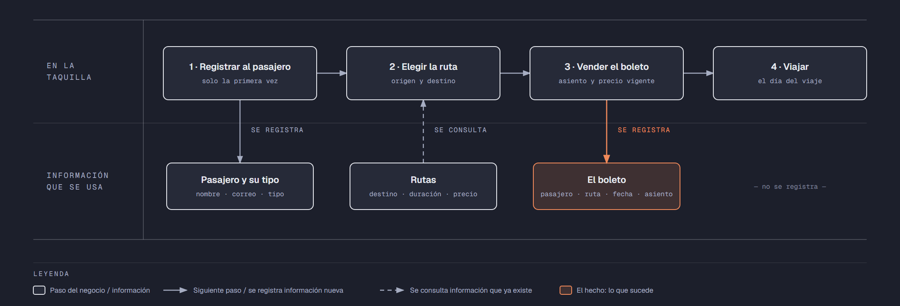

# PIA — Caso: RutaNorte

**Alumno:** Mendez Cantu Raúl Ángel (matrícula 2212484)
**Base de datos a crear:** `RutaNorteDB`

← [Regresar a la descripción del PIA](../../descripcion-pia.md)

---

## Historia de usuario

**Como** gerente de RutaNorte, **quiero** una base de datos que registre a mis pasajeros, mis rutas y cada boleto que vendo, y que además **cuide las reglas del negocio por sí misma**, **para** registrar la operación del día sin errores, saber cuánto se cobró en cada boleto y conservar la historia de cada cambio de precio.

## El negocio

RutaNorte es una línea de **autobuses foráneos** que sale de Monterrey. Tiene varias **rutas**; cada una tiene una **clave** que no se repite (por ejemplo, `MTY-SAL`), un origen, un destino, la **duración del viaje en horas** y el **precio** del boleto. **Los precios cambian** de vez en cuando. Aun así, la línea necesita saber **cuánto se cobró por cada boleto**, con el precio que tenía la ruta el día de la venta.

Los **pasajeros** se registran una sola vez con su nombre, su correo electrónico, la fecha de registro y su **tipo de pasajero** (Adulto, Estudiante o Adulto mayor). En RutaNorte **todos pagan el mismo precio**: el tipo de pasajero solo sirve para saber qué clase de pasajeros viajan. El correo identifica al pasajero: no puede haber dos pasajeros con el mismo. Cuando un pasajero pide que borren su registro, se le **da de baja**, pero no se borra, para conservar sus boletos.

Cada autobús tiene **40 asientos**, numerados del 1 al 40.

Si el negocio deja de usar un tipo de pasajero o deja de ofrecer una ruta, no se borran: se **dan de baja**, para conservar el historial de boletos.

## Los hechos de este negocio

En RutaNorte, **el hecho es el boleto**: cada vez que un pasajero compra un viaje en una ruta, se vende un boleto, en una fecha. Es la **tabla más importante** de tu modelo: tiene una fila por cada boleto, es la que más crece y es donde se guarda lo que realmente pasó (quién viaja, en qué ruta, en qué fecha, en qué asiento y cuánto se le cobró).

**Esta tabla la propones tú**: su nombre, sus columnas y sus llaves. No viene en "Lo que el negocio ya tiene definido", porque los hechos no se definen de antemano: suceden.

## Lo que el negocio ya tiene definido

Estos datos **no los inventas**: son los que RutaNorte ya tiene. Tu base de datos debe guardarlos **exactamente así**, con los mismos nombres y valores. Los casos de prueba de los objetos dependen de ellos.

Son los **datos iniciales** con los que arranca tu base de datos: **tipos de pasajero** y **rutas**. Hoy todo lo que aparece en estas tablas está **activo**.

**Tipos de pasajero**

| Tipo de pasajero |
|---|
| Adulto |
| Estudiante |
| Adulto mayor |

**Rutas**

| Clave | Origen | Destino | Duración (horas) | Precio |
|---|---|---|---|---|
| MTY-SAL | Monterrey | Saltillo | 1 | $180.00 |
| MTY-REY | Monterrey | Reynosa | 3 | $420.00 |
| MTY-NLD | Monterrey | Nuevo Laredo | 3 | $450.00 |
| MTY-TRC | Monterrey | Torreón | 4 | $520.00 |
| MTY-SLP | Monterrey | San Luis Potosí | 6 | $780.00 |
| MTY-MAT | Monterrey | Matamoros | 4 | $500.00 |
| MTY-SMA | Monterrey | San Miguel de Allende | 9 | $1,150.00 |

Todo lo demás (pasajeros y boletos) **lo inventas tú**, cumpliendo los mínimos de [Lo que debes construir](#lo-que-debes-construir).

## Flujo de negocio

Así funciona una operación de principio a fin. Arriba, lo que pasa en la taquilla; abajo, la información que cada paso consulta o registra.

Con detalle, una pasajera imaginaria (Rosa) recorriendo el flujo:

1. **Rosa llega por primera vez** a la taquilla de RutaNorte. En la taquilla le piden su nombre, su correo y su tipo de pasajero (Adulto), y la **registran como pasajera** con la fecha de hoy. Si Rosa regresa otro día, ya no se le registra de nuevo: se le busca por su correo.
2. **Rosa quiere ir a Saltillo.** El taquillero revisa la ruta `MTY-SAL`: su duración y su **precio vigente**: hoy, $180.00.
3. **Se vende el boleto.** Rosa escoge el asiento 12 y se registra el boleto: pasajera Rosa, ruta `MTY-SAL`, fecha del viaje, asiento 12 y el precio con el que se le cobra ($180.00).
4. **Rosa viaja** el día del viaje. El viaje en sí no se registra en la base de datos.

Si el mes siguiente la ruta `MTY-SAL` sube a $200.00, el boleto de Rosa tiene que seguir diciendo que se le cobró a $180.00.

Un mes después, Rosa compra un boleto a Reynosa: es otro boleto, de la misma pasajera y de otra ruta. Ese mismo día, otros pasajeros compran boletos a Saltillo. Así, **un pasajero acumula muchos boletos y una ruta también**.

## Reglas de negocio

- Cada pasajero tiene **un solo** tipo de pasajero.
- No puede haber dos tipos de pasajero con el mismo nombre, ni dos rutas con la misma clave.
- No puede haber dos pasajeros con el mismo correo electrónico.
- El precio y la duración de una ruta siempre son **mayores a cero**.
- El asiento de un boleto va **del 1 al 40**.
- Cuando cambia el precio de una ruta, los boletos que ya se vendieron **conservan el precio con el que se cobraron**.
- Un pasajero nuevo se registra como **activo**.
- Un tipo de pasajero nuevo y una ruta nueva también se registran como **activos**.
- **Nuevo:** cada cambio del precio de una ruta queda registrado en el **histórico de precios** (ver abajo).

## Lo nuevo: el histórico de precios

El precio de cada ruta dice cuánto cuesta **hoy**, y cada boleto guarda cuánto se cobró **ese día**. Pero el negocio quiere saber también **cómo ha cambiado el precio con el tiempo**: cuándo subió, cuándo bajó y de cuánto a cuánto.

Por eso, cada vez que cambia el precio de una ruta, el negocio guarda un registro con:

- **qué ruta** cambió de precio;
- el **precio anterior**;
- el **precio nuevo**;
- la **fecha y hora** del cambio.

Así funciona:

- El histórico **arranca vacío**: los precios de "Lo que el negocio ya tiene definido" son los iniciales, no un cambio.
- **Nadie escribe a mano** en el histórico. Lo llena un trigger ([`trg_registrarHistoricoPrecio`](11-trigger-trg_registrarHistoricoPrecio.md)) cada vez que cambia un precio, venga de donde venga el cambio.
- Si un `UPDATE` toca una ruta pero **no le cambia el precio** (por ejemplo, solo la da de baja), no se registra nada.
- Un registro del histórico **nunca se modifica ni se borra**.

**El nombre de la tabla, sus columnas y sus llaves los propones tú**, igual que la tabla de los boletos.

## Lo que debes construir

1. El **modelo relacional**, con las tablas de tu caso **más la tabla del histórico de precios**, que respete las reglas de negocio con restricciones (`PRIMARY KEY`, `FOREIGN KEY`, `UNIQUE`, `CHECK`, `DEFAULT`).
2. El **paquete de instalación** de `RutaNorteDB`: tablas, datos iniciales y los **11 objetos programados** de abajo.
3. El **paquete de reversa**, que deje el servidor sin rastro de `RutaNorteDB`.
4. **Datos iniciales:**
   - **Lo que el negocio ya tiene definido**, exactamente como viene arriba: los 3 tipos de pasajero y las 7 rutas.
   - **Lo que tú inventas**, como mínimo: 10 pasajeros y 20 boletos, con
     - pasajeros de los tres tipos;
     - 2 pasajeros que nunca hayan comprado un boleto;
     - 2 rutas que nunca hayan vendido un boleto;
     - al menos 1 pasajero dado de baja;
     - cada boleto con el precio con el que se cobró (en tus datos, el precio de la ruta que viene arriba).
   - El histórico de precios **vacío**.
5. Los **11 objetos programados**, cada uno con su ficha:

| # | Objeto | Tipo | Qué hace |
|---|---|---|---|
| 01 | [`usp_insertarPasajero`](01-procedimiento-usp_insertarPasajero.md) | Procedimiento | Registra un pasajero nuevo |
| 02 | [`usp_darDeBajaPasajero`](02-procedimiento-usp_darDeBajaPasajero.md) | Procedimiento | Da de baja a un pasajero |
| 03 | [`usp_insertarRuta`](03-procedimiento-usp_insertarRuta.md) | Procedimiento | Registra una ruta nueva |
| 04 | [`usp_actualizarPrecioRuta`](04-procedimiento-usp_actualizarPrecioRuta.md) | Procedimiento | Cambia el precio de una ruta |
| 05 | [`usp_registrarBoleto`](05-procedimiento-usp_registrarBoleto.md) | Procedimiento | Registra un boleto con el precio vigente |
| 06 | [`usp_obtenerBoletosPorFecha`](06-procedimiento-usp_obtenerBoletosPorFecha.md) | Procedimiento | Lista los boletos de un rango de fechas |
| 07 | [`ufn_totalCobradoRuta`](07-funcion-ufn_totalCobradoRuta.md) | Función escalar | Total cobrado por cada ruta |
| 08 | [`ufn_nivelPasajero`](08-funcion-ufn_nivelPasajero.md) | Función escalar | Qué tan seguido viene un pasajero |
| 09 | [`vw_DetalleBoleto`](09-vista-vw_DetalleBoleto.md) | Vista | Cada boleto con su precio cobrado y el actual |
| 10 | [`vw_ResumenRuta`](10-vista-vw_ResumenRuta.md) | Vista | Totales por ruta |
| 11 | [`trg_registrarHistoricoPrecio`](11-trigger-trg_registrarHistoricoPrecio.md) | Trigger | Llena el histórico de precios |

Los objetos están en el orden en que conviene construirlos: los casos de prueba de cada uno usan los procedimientos anteriores para preparar sus datos.

## Cómo probar tus objetos

- **Cada ficha trae sus casos de prueba.** Todos parten de una **instalación limpia**: ejecuta tu reversa y tu instalación completa, y después las pruebas de esa ficha, en orden.
- Los resultados esperados dependen de **Lo que el negocio ya tiene definido**, no de tus datos inventados. Por eso los objetos reciben datos del negocio (nombres, claves, correos o teléfonos) y no ids.
- Las pruebas usan pasajeros con correo electrónico `prueba1@correo.com` y `prueba2@correo.com` y la ruta `MTY-ZAC`, y boletos de **diciembre de 2026**. **No uses esos valores ni esas fechas en tus datos inventados**, para que no choquen con las pruebas.
- Algunas pruebas escriben directamente en tus tablas. Como tú eliges los nombres, vienen con marcas como `<TuTablaDeBoletos>`: cámbialas por los nombres de tu modelo.
- Los casos de prueba son para que compruebes tu trabajo: **no se entregan**.

## Convenciones de código

- Palabras reservadas en **MAYÚSCULAS**; nombres de tablas y columnas en **PascalCase** y en singular; columnas id con prefijo `id` (`idRuta`).
- Nombre de cada objeto **exactamente** como se indica en su ficha (respeta mayúsculas y minúsculas), y parámetros con los nombres y tipos indicados.
- `SELECT` y `FROM` en líneas separadas; los campos comienzan en la misma línea del `SELECT`; máximo 5 campos por renglón.
- En los procedimientos, las validaciones se escriben como *guard clauses*: guarda el dato en una variable (`SELECT ... FROM ... WHERE`), revísala con `IF @variable IS NULL` / `IS NOT NULL` y, si falla, regresa el error y sal con `RETURN`. `IF EXISTS (SELECT ...)` y los `IF` anidados se permiten, pero se evitan.
- Los procedimientos regresan su resultado con el formato `ErrCodigo` / `ErrMensaje` ([Validaciones](../../../temas/Etapa-2/04-Validaciones.md)).
- Las funciones se llaman con el prefijo `dbo.`.
- Las vistas no llevan `ORDER BY`.

## Entrega

Ver [Entregables](../../descripcion-pia.md#entregables) y [Forma de entrega](../../descripcion-pia.md#forma-de-entrega) en la descripción del PIA.
