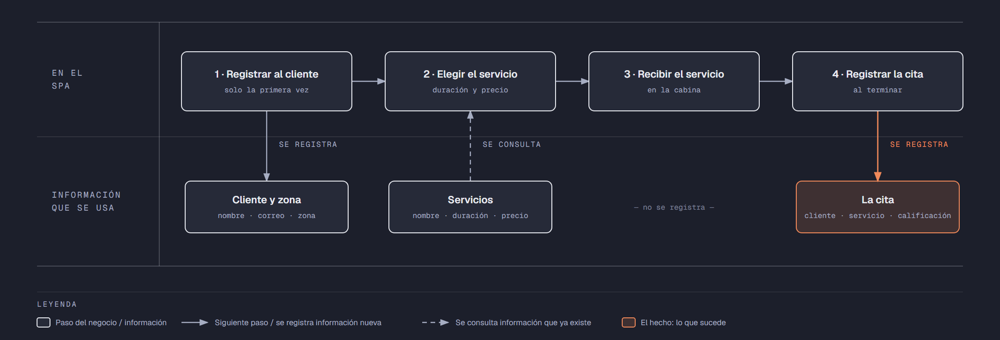

# PIA — Caso: SpaZen

**Alumno:** Montoya Moreno Ana Valeria (matrícula 2254069)
**Base de datos a crear:** `SpaZenDB`

← [Regresar a la descripción del PIA](../../descripcion-pia.md)

---

## Historia de usuario

**Como** dueño de SpaZen, **quiero** una base de datos que registre a mis clientes, mis servicios y cada cita que se atiende, y que además **cuide las reglas del negocio por sí misma**, **para** registrar la operación del día sin errores, saber cuánto se cobró en cada cita y conservar la historia de cada cambio de precio.

## El negocio

SpaZen es un **spa** que ofrece servicios de relajación, como masajes y faciales. Tiene varios **servicios**; cada uno tiene un **nombre** que no se repite, una **duración en minutos** y un **precio**. **Los precios cambian** de vez en cuando. Aun así, el negocio necesita saber **cuánto se cobró por cada cita**, con el precio que tenía el servicio el día de la cita.

Los **clientes** se registran una sola vez con su nombre, su correo electrónico, la fecha de registro y la **zona de la ciudad donde viven** (Norte, Sur, Centro, Poniente u Oriente). La zona no cambia el precio: solo sirve para saber de dónde vienen los clientes y dónde conviene repartir publicidad. El correo identifica al cliente: no puede haber dos clientes con el mismo. Cuando un cliente pide que borren su registro, se le **da de baja**, pero no se borra, para conservar sus citas.

Cada **cita** es un servicio para un cliente. Al terminar, el cliente **califica** el servicio del 1 (muy malo) al 5 (excelente).

Si el negocio deja de usar una zona o deja de ofrecer un servicio, no se borran: se **dan de baja**, para conservar el historial de citas.

## Los hechos de este negocio

En SpaZen, **el hecho es la cita**: cada vez que un cliente recibe un servicio, sucede una cita, en una fecha. Es la **tabla más importante** de tu modelo: tiene una fila por cada cita, es la que más crece y es donde se guarda lo que realmente pasó (qué cliente, qué servicio, cuándo, qué calificación le dio y cuánto se le cobró).

**Esta tabla la propones tú**: su nombre, sus columnas y sus llaves. No viene en "Lo que el negocio ya tiene definido", porque los hechos no se definen de antemano: suceden.

## Lo que el negocio ya tiene definido

Estos datos **no los inventas**: son los que SpaZen ya tiene. Tu base de datos debe guardarlos **exactamente así**, con los mismos nombres y valores. Los casos de prueba de los objetos dependen de ellos.

Son los **datos iniciales** con los que arranca tu base de datos: **zonas de la ciudad** y **servicios**. Hoy todo lo que aparece en estas tablas está **activo**.

**Zonas de la ciudad**

| Zona |
|---|
| Norte |
| Sur |
| Centro |
| Poniente |
| Oriente |

**Servicios**

| Nombre | Duración (minutos) | Precio |
|---|---|---|
| Masaje relajante | 60 | $750.00 |
| Masaje con piedras calientes | 90 | $1,100.00 |
| Facial hidratante | 45 | $600.00 |
| Reflexología | 40 | $500.00 |
| Aromaterapia | 50 | $650.00 |
| Exfoliación corporal | 60 | $800.00 |

Todo lo demás (clientes y citas) **lo inventas tú**, cumpliendo los mínimos de [Lo que debes construir](#lo-que-debes-construir).

## Flujo de negocio

Así funciona una operación de principio a fin. Arriba, lo que pasa en el spa; abajo, la información que cada paso consulta o registra.

Con detalle, una clienta imaginaria (Andrea) recorriendo el flujo:

1. **Andrea llega por primera vez** a SpaZen. En la recepción le piden su nombre, su correo y la zona donde vive (Norte), y la **registran como clienta** con la fecha de hoy. Si Andrea regresa otro día, ya no se le registra de nuevo: se le busca por su correo.
2. **Andrea elige el servicio.** La recepcionista le muestra la duración y el **precio vigente** de cada servicio. Andrea elige el "Masaje relajante": 60 minutos y, hoy, $750.00.
3. **Andrea recibe el servicio** en una de las cabinas del spa.
4. **Al terminar, se registra la cita:** clienta Andrea, servicio "Masaje relajante", fecha de hoy, la calificación que ella le da (5) y el precio con el que se le cobra ($750.00).

Si el mes siguiente el "Masaje relajante" sube a $820.00, la cita de Andrea tiene que seguir diciendo que se le cobró a $750.00.

Dos semanas después, Andrea regresa y pide el "Facial hidratante": es otra cita, de la misma clienta y de otro servicio. Ese mismo día, otro cliente pide el "Masaje relajante". Así, **un cliente acumula muchas citas y un servicio también**.

## Reglas de negocio

- Cada cliente vive en **una sola** zona.
- No puede haber dos zonas con el mismo nombre, ni dos servicios con el mismo nombre.
- No puede haber dos clientes con el mismo correo electrónico.
- La duración de un servicio siempre es **mayor a cero** minutos.
- El precio de un servicio siempre es **mayor a cero**.
- La calificación de una cita va **del 1 al 5**.
- Cuando cambia el precio de un servicio, las citas que ya se atendieron **conservan el precio con el que se cobraron**.
- Un cliente nuevo se registra como **activo**.
- Una zona nueva y un servicio nuevo también se registran como **activos**.
- **Nuevo:** cada cambio del precio de un servicio queda registrado en el **histórico de precios** (ver abajo).

## Lo nuevo: el histórico de precios

El precio de cada servicio dice cuánto cuesta **hoy**, y cada cita guarda cuánto se cobró **ese día**. Pero el negocio quiere saber también **cómo ha cambiado el precio con el tiempo**: cuándo subió, cuándo bajó y de cuánto a cuánto.

Por eso, cada vez que cambia el precio de un servicio, el negocio guarda un registro con:

- **qué servicio** cambió de precio;
- el **precio anterior**;
- el **precio nuevo**;
- la **fecha y hora** del cambio.

Así funciona:

- El histórico **arranca vacío**: los precios de "Lo que el negocio ya tiene definido" son los iniciales, no un cambio.
- **Nadie escribe a mano** en el histórico. Lo llena un trigger ([`trg_registrarHistoricoPrecio`](11-trigger-trg_registrarHistoricoPrecio.md)) cada vez que cambia un precio, venga de donde venga el cambio.
- Si un `UPDATE` toca un servicio pero **no le cambia el precio** (por ejemplo, solo lo da de baja), no se registra nada.
- Un registro del histórico **nunca se modifica ni se borra**.

**El nombre de la tabla, sus columnas y sus llaves los propones tú**, igual que la tabla de las citas.

## Lo que debes construir

1. El **modelo relacional**, con las tablas de tu caso **más la tabla del histórico de precios**, que respete las reglas de negocio con restricciones (`PRIMARY KEY`, `FOREIGN KEY`, `UNIQUE`, `CHECK`, `DEFAULT`).
2. El **paquete de instalación** de `SpaZenDB`: tablas, datos iniciales y los **11 objetos programados** de abajo.
3. El **paquete de reversa**, que deje el servidor sin rastro de `SpaZenDB`.
4. **Datos iniciales:**
   - **Lo que el negocio ya tiene definido**, exactamente como viene arriba: las 5 zonas y los 6 servicios.
   - **Lo que tú inventas**, como mínimo: 10 clientes y 20 citas, con
     - clientes de las cinco zonas;
     - 2 clientes que nunca hayan tenido una cita;
     - 2 servicios que nunca se hayan dado;
     - al menos 1 cliente dado de baja;
     - cada cita con el precio con el que se cobró (en tus datos, el precio del servicio que viene arriba).
   - El histórico de precios **vacío**.
5. Los **11 objetos programados**, cada uno con su ficha:

| # | Objeto | Tipo | Qué hace |
|---|---|---|---|
| 01 | [`usp_insertarCliente`](01-procedimiento-usp_insertarCliente.md) | Procedimiento | Registra un cliente nuevo |
| 02 | [`usp_darDeBajaCliente`](02-procedimiento-usp_darDeBajaCliente.md) | Procedimiento | Da de baja a un cliente |
| 03 | [`usp_insertarServicio`](03-procedimiento-usp_insertarServicio.md) | Procedimiento | Registra un servicio nuevo |
| 04 | [`usp_actualizarPrecioServicio`](04-procedimiento-usp_actualizarPrecioServicio.md) | Procedimiento | Cambia el precio de un servicio |
| 05 | [`usp_registrarCita`](05-procedimiento-usp_registrarCita.md) | Procedimiento | Registra una cita con el precio vigente |
| 06 | [`usp_obtenerCitasPorFecha`](06-procedimiento-usp_obtenerCitasPorFecha.md) | Procedimiento | Lista las citas de un rango de fechas |
| 07 | [`ufn_totalCobradoServicio`](07-funcion-ufn_totalCobradoServicio.md) | Función escalar | Total cobrado por cada servicio |
| 08 | [`ufn_nivelCliente`](08-funcion-ufn_nivelCliente.md) | Función escalar | Qué tan seguido viene un cliente |
| 09 | [`vw_DetalleCita`](09-vista-vw_DetalleCita.md) | Vista | Cada cita con su precio cobrado y el actual |
| 10 | [`vw_ResumenServicio`](10-vista-vw_ResumenServicio.md) | Vista | Totales por servicio |
| 11 | [`trg_registrarHistoricoPrecio`](11-trigger-trg_registrarHistoricoPrecio.md) | Trigger | Llena el histórico de precios |

Los objetos están en el orden en que conviene construirlos: los casos de prueba de cada uno usan los procedimientos anteriores para preparar sus datos.

## Cómo probar tus objetos

- **Cada ficha trae sus casos de prueba.** Todos parten de una **instalación limpia**: ejecuta tu reversa y tu instalación completa, y después las pruebas de esa ficha, en orden.
- Los resultados esperados dependen de **Lo que el negocio ya tiene definido**, no de tus datos inventados. Por eso los objetos reciben datos del negocio (nombres, claves, correos o teléfonos) y no ids.
- Las pruebas usan clientes con correo electrónico `prueba1@correo.com` y `prueba2@correo.com` y el servicio `Servicio de Prueba`, y citas de **diciembre de 2026**. **No uses esos valores ni esas fechas en tus datos inventados**, para que no choquen con las pruebas.
- Algunas pruebas escriben directamente en tus tablas. Como tú eliges los nombres, vienen con marcas como `<TuTablaDeCitas>`: cámbialas por los nombres de tu modelo.
- Los casos de prueba son para que compruebes tu trabajo: **no se entregan**.

## Si también presentas la 3ra o 5ta oportunidad de Base de Datos I

Tu caso del PIA es el **mismo negocio** que el de tu Evidencia Integral de Base de Datos I, pero son **dos entregas distintas**, cada una con su propio paquete de instalación:

| | Evidencia Integral (BD1) | PIA (BD2) |
|---|---|---|
| Tablas | Las de tu caso | Las de tu caso **más el histórico de precios** |
| Objetos programados | No | **Los 11** de este caso |
| `USE` en los scripts | En todos, menos el que crea la base de datos | Solo en los de tablas y datos; **nunca** en los de los objetos |
| Consultas | Las 10, en su propio ZIP | No se piden |
| PDF | Secciones 1 a 5 | Secciones 1 a 6 (agrega los objetos programados) |
| Dónde se entrega | Teams | NEXUS, en tres lugares |

Puedes partir de tu paquete de Base de Datos I, pero **arma y prueba cada uno por separado**: no subas el mismo ZIP en los dos lugares.

## Convenciones de código

- Palabras reservadas en **MAYÚSCULAS**; nombres de tablas y columnas en **PascalCase** y en singular; columnas id con prefijo `id` (`idServicio`).
- Nombre de cada objeto **exactamente** como se indica en su ficha (respeta mayúsculas y minúsculas), y parámetros con los nombres y tipos indicados.
- `SELECT` y `FROM` en líneas separadas; los campos comienzan en la misma línea del `SELECT`; máximo 5 campos por renglón.
- En los procedimientos, las validaciones se escriben como *guard clauses*: guarda el dato en una variable (`SELECT ... FROM ... WHERE`), revísala con `IF @variable IS NULL` / `IS NOT NULL` y, si falla, regresa el error y sal con `RETURN`. `IF EXISTS (SELECT ...)` y los `IF` anidados se permiten, pero se evitan.
- Los procedimientos regresan su resultado con el formato `ErrCodigo` / `ErrMensaje` ([Validaciones](../../../temas/Etapa-2/04-Validaciones.md)).
- Las funciones se llaman con el prefijo `dbo.`.
- Las vistas no llevan `ORDER BY`.

## Entrega

Ver [Entregables](../../descripcion-pia.md#entregables) y [Forma de entrega](../../descripcion-pia.md#forma-de-entrega) en la descripción del PIA.
