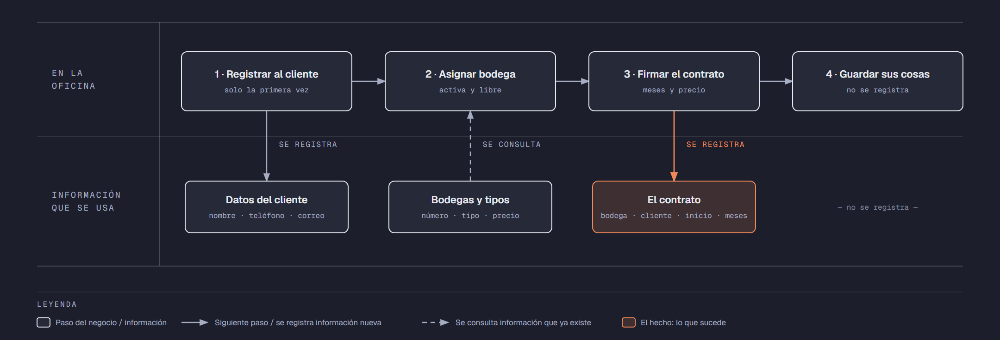

# PIA — Caso: GuardaTodo

**Alumno:** Morales Azuara Eduardo Gabriel (matrícula 2254090)
**Base de datos a crear:** `GuardaTodoDB`

← [Regresar a la descripción del PIA](../../descripcion-pia.md)

---

## Historia de usuario

**Como** dueña de GuardaTodo, **quiero** una base de datos que registre mis bodegas, a mis clientes y cada contrato de renta que firmo, y que además **cuide las reglas del negocio por sí misma**, **para** registrar la operación del día sin errores, saber cuánto se cobró en cada contrato y conservar la historia de cada cambio de precio.

## El negocio

GuardaTodo renta **minibodegas por mes**: espacios cerrados con candado donde las personas guardan muebles, cajas o mercancía. Maneja **tipos de bodega**: Chica (del tamaño de un clóset grande), Mediana (del tamaño de una recámara) y Grande (del tamaño de una cochera). Cada tipo tiene su propio **precio por mes**. **Los precios cambian** de vez en cuando. Aun así, el negocio necesita saber **cuánto se cobra por mes en cada contrato**, con el precio que estaba vigente el día en que se firmó; ese precio se queda fijo mientras dura el contrato.

El edificio tiene dos pisos. Cada **bodega** es de un tipo, tiene un **número** que no se repite y una **fecha de apertura**, que es el día en que empezó a rentarse. El número empieza con la letra B, luego el piso y luego el número de la bodega en ese piso: `B-104` es la bodega 4 del piso 1 y `B-203` es la bodega 3 del piso 2. Cuando una bodega se daña (por ejemplo, por una gotera) y ya no se puede rentar, se **da de baja**: no se borra, porque se quiere conservar su historial de contratos.

Los **clientes** se registran una sola vez con su nombre, su teléfono y su correo electrónico. El teléfono identifica al cliente: no puede haber dos clientes con el mismo.

Cada **contrato** es de una bodega para un cliente, empieza en una fecha y dura **de 1 a 12 meses**.

Si el negocio deja de manejar un tipo de bodega, tampoco lo borra: lo **da de baja**. Lo mismo pasa con los clientes: si un cliente ya no regresa, se lo da de baja en lugar de borrarlo. Así se conserva el historial de contratos.

## Los hechos de este negocio

En GuardaTodo, **el hecho es el contrato**: cada vez que un cliente renta una bodega, se firma un contrato, en una fecha. Es la **tabla más importante** de tu modelo: tiene una fila por cada contrato, es la que más crece y es donde se guarda lo que realmente pasó (quién la rentó, qué bodega, desde qué fecha, cuántos meses y con qué precio por mes se le cobró).

**Esta tabla la propones tú**: su nombre, sus columnas y sus llaves. No viene en "Lo que el negocio ya tiene definido", porque los hechos no se definen de antemano: suceden.

## Lo que el negocio ya tiene definido

Estos datos **no los inventas**: son los que GuardaTodo ya tiene. Tu base de datos debe guardarlos **exactamente así**, con los mismos nombres y valores. Los casos de prueba de los objetos dependen de ellos.

Son los **datos iniciales** con los que arranca tu base de datos: **tipos de bodega y precio por mes** y **bodegas**. Hoy todo lo que aparece en estas tablas está **activo**, salvo la bodega que se indica como dada de baja.

**Tipos de bodega y precio por mes**

| Tipo de bodega | Precio por mes |
|---|---|
| Chica | $900.00 |
| Mediana | $1,500.00 |
| Grande | $2,400.00 |

**Bodegas**

| Tipo de bodega | Número | Fecha de apertura | ¿Activa? |
|---|---|---|---|
| Chica | `B-101` | 02/05/2023 | Sí |
| Chica | `B-102` | 02/05/2023 | Sí |
| Mediana | `B-103` | 02/05/2023 | Sí |
| Grande | `B-104` | 02/05/2023 | Sí |
| Mediana | `B-105` | 02/05/2023 | **No** |
| Chica | `B-201` | 15/02/2024 | Sí |
| Mediana | `B-202` | 15/02/2024 | Sí |
| Grande | `B-203` | 15/02/2024 | Sí |
| Mediana | `B-204` | 01/08/2025 | Sí |
| Grande | `B-205` | 01/08/2025 | Sí |

Todo lo demás (clientes y contratos) **lo inventas tú**, cumpliendo los mínimos de [Lo que debes construir](#lo-que-debes-construir).

## Flujo de negocio

Así funciona una operación de principio a fin. Arriba, lo que pasa en la oficina; abajo, la información que cada paso consulta o registra.

Con detalle, un cliente imaginario (Alberto) recorriendo el flujo:

1. **Alberto llega por primera vez** a GuardaTodo porque se va a cambiar de casa. En la oficina le piden su nombre, su teléfono y su correo, y lo **registran como cliente**. Si Alberto regresa otro día, ya no se le registra de nuevo: se le busca por su teléfono.
2. **Se le asigna una bodega.** La encargada revisa qué bodegas están **activas** y libres; las dadas de baja ya no se rentan. Le asigna la bodega `B-104`, que es Grande, y le dice el precio por mes de ese tipo: hoy, $2,400.00.
3. **Alberto firma el contrato.** Se registra el contrato: bodega `B-104`, cliente Alberto, fecha de inicio de hoy, 2 meses y el precio por mes con el que se le cobra ($2,400.00).
4. **Alberto guarda sus cosas** en la bodega. Las veces que entra y sale no se registran en la base de datos.

Si el mes siguiente las bodegas Grandes suben a $2,600.00 por mes, el contrato de Alberto tiene que seguir diciendo que se le cobra a $2,400.00 por mes.

Cuando termina su contrato, Alberto renta la bodega `B-101`, que es Chica: es otro contrato, del mismo cliente y de otra bodega. Mientras tanto, la bodega `B-104` la renta otra clienta. Así, **un cliente acumula muchos contratos y una bodega también**.

## Reglas de negocio

- Cada bodega es de **un solo** tipo.
- No puede haber dos tipos de bodega con el mismo nombre, ni dos bodegas con el mismo número, ni dos clientes con el mismo teléfono.
- El precio por mes siempre es **mayor a cero**.
- Un contrato dura **de 1 a 12** meses.
- Una bodega nueva se registra como **activa**.
- Un tipo de bodega nuevo y un cliente nuevo también se registran como **activos**.
- Cuando cambia el precio de un tipo de bodega, los contratos que ya se firmaron **conservan el precio con el que se cobran**.
- **Nuevo:** cada cambio del precio por mes de un tipo de bodega queda registrado en el **histórico de precios** (ver abajo).

## Lo nuevo: el histórico de precios

El precio por mes de cada tipo de bodega dice cuánto cuesta **hoy**, y cada contrato guarda cuánto se cobró **ese día**. Pero el negocio quiere saber también **cómo ha cambiado el precio con el tiempo**: cuándo subió, cuándo bajó y de cuánto a cuánto.

Por eso, cada vez que cambia el precio por mes de un tipo de bodega, el negocio guarda un registro con:

- **qué tipo de bodega** cambió de precio;
- el **precio anterior**;
- el **precio nuevo**;
- la **fecha y hora** del cambio.

Así funciona:

- El histórico **arranca vacío**: los precios de "Lo que el negocio ya tiene definido" son los iniciales, no un cambio.
- **Nadie escribe a mano** en el histórico. Lo llena un trigger ([`trg_registrarHistoricoPrecio`](11-trigger-trg_registrarHistoricoPrecio.md)) cada vez que cambia un precio, venga de donde venga el cambio.
- Si un `UPDATE` toca un tipo de bodega pero **no le cambia el precio** (por ejemplo, solo lo da de baja), no se registra nada.
- Un registro del histórico **nunca se modifica ni se borra**.

**El nombre de la tabla, sus columnas y sus llaves los propones tú**, igual que la tabla de los contratos.

## Lo que debes construir

1. El **modelo relacional**, con las tablas de tu caso **más la tabla del histórico de precios**, que respete las reglas de negocio con restricciones (`PRIMARY KEY`, `FOREIGN KEY`, `UNIQUE`, `CHECK`, `DEFAULT`).
2. El **paquete de instalación** de `GuardaTodoDB`: tablas, datos iniciales y los **11 objetos programados** de abajo.
3. El **paquete de reversa**, que deje el servidor sin rastro de `GuardaTodoDB`.
4. **Datos iniciales:**
   - **Lo que el negocio ya tiene definido**, exactamente como viene arriba: los 3 tipos de bodega con su precio por mes y las 10 bodegas.
   - **Lo que tú inventas**, como mínimo: 10 clientes y 20 contratos, con
     - 2 clientes que nunca hayan rentado una bodega;
     - 2 bodegas que nunca se hayan rentado;
     - al menos 1 cliente dado de baja;
     - contratos de 6 meses o más;
     - cada contrato con el precio por mes con el que se cobra (en tus datos, el precio de su tipo de bodega que viene arriba).
   - El histórico de precios **vacío**.
5. Los **11 objetos programados**, cada uno con su ficha:

| # | Objeto | Tipo | Qué hace |
|---|---|---|---|
| 01 | [`usp_insertarCliente`](01-procedimiento-usp_insertarCliente.md) | Procedimiento | Registra un cliente nuevo |
| 02 | [`usp_darDeBajaCliente`](02-procedimiento-usp_darDeBajaCliente.md) | Procedimiento | Da de baja a un cliente |
| 03 | [`usp_insertarBodega`](03-procedimiento-usp_insertarBodega.md) | Procedimiento | Registra una bodega nueva |
| 04 | [`usp_actualizarPrecioTipoBodega`](04-procedimiento-usp_actualizarPrecioTipoBodega.md) | Procedimiento | Cambia el precio por mes de un tipo de bodega |
| 05 | [`usp_registrarContrato`](05-procedimiento-usp_registrarContrato.md) | Procedimiento | Registra un contrato con el precio vigente |
| 06 | [`usp_obtenerContratosPorFecha`](06-procedimiento-usp_obtenerContratosPorFecha.md) | Procedimiento | Lista los contratos de un rango de fechas |
| 07 | [`ufn_totalCobradoBodega`](07-funcion-ufn_totalCobradoBodega.md) | Función escalar | Total cobrado por cada bodega |
| 08 | [`ufn_nivelCliente`](08-funcion-ufn_nivelCliente.md) | Función escalar | Qué tan seguido viene un cliente |
| 09 | [`vw_DetalleContrato`](09-vista-vw_DetalleContrato.md) | Vista | Cada contrato con su precio cobrado y el actual |
| 10 | [`vw_ResumenTipoBodega`](10-vista-vw_ResumenTipoBodega.md) | Vista | Totales por tipo de bodega |
| 11 | [`trg_registrarHistoricoPrecio`](11-trigger-trg_registrarHistoricoPrecio.md) | Trigger | Llena el histórico de precios |

Los objetos están en el orden en que conviene construirlos: los casos de prueba de cada uno usan los procedimientos anteriores para preparar sus datos.

## Cómo probar tus objetos

- **Cada ficha trae sus casos de prueba.** Todos parten de una **instalación limpia**: ejecuta tu reversa y tu instalación completa, y después las pruebas de esa ficha, en orden.
- Los resultados esperados dependen de **Lo que el negocio ya tiene definido**, no de tus datos inventados. Por eso los objetos reciben datos del negocio (nombres, claves, correos o teléfonos) y no ids.
- Las pruebas usan clientes con teléfono `8199990001` y `8199990002`, la bodega `B-120` y el tipo de bodega `Nuevo tipo`, y contratos de **diciembre de 2026**. **No uses esos valores ni esas fechas en tus datos inventados**, para que no choquen con las pruebas.
- Algunas pruebas escriben directamente en tus tablas. Como tú eliges los nombres, vienen con marcas como `<TuTablaDeContratos>`: cámbialas por los nombres de tu modelo.
- Los casos de prueba son para que compruebes tu trabajo: **no se entregan**.

## Convenciones de código

- Palabras reservadas en **MAYÚSCULAS**; nombres de tablas y columnas en **PascalCase** y en singular; columnas id con prefijo `id` (`idBodega`).
- Nombre de cada objeto **exactamente** como se indica en su ficha (respeta mayúsculas y minúsculas), y parámetros con los nombres y tipos indicados.
- `SELECT` y `FROM` en líneas separadas; los campos comienzan en la misma línea del `SELECT`; máximo 5 campos por renglón.
- En los procedimientos, las validaciones se escriben como *guard clauses*: guarda el dato en una variable (`SELECT ... FROM ... WHERE`), revísala con `IF @variable IS NULL` / `IS NOT NULL` y, si falla, regresa el error y sal con `RETURN`. `IF EXISTS (SELECT ...)` y los `IF` anidados se permiten, pero se evitan.
- Los procedimientos regresan su resultado con el formato `ErrCodigo` / `ErrMensaje` ([Validaciones](../../../temas/Etapa-2/04-Validaciones.md)).
- Las funciones se llaman con el prefijo `dbo.`.
- Las vistas no llevan `ORDER BY`.

## Entrega

Ver [Entregables](../../descripcion-pia.md#entregables) y [Forma de entrega](../../descripcion-pia.md#forma-de-entrega) en la descripción del PIA.
