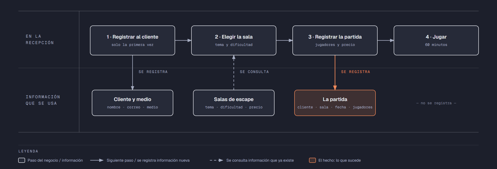

# PIA — Caso: EnigmaRoom

**Alumno:** Perez Morales Johan Valente (matrícula 2254047)
**Base de datos a crear:** `EnigmaRoomDB`

← [Regresar a la descripción del PIA](../../descripcion-pia.md)

---

## Historia de usuario

**Como** dueña de EnigmaRoom, **quiero** una base de datos que registre a mis clientes, mis salas de escape y cada partida que se juega, y que además **cuide las reglas del negocio por sí misma**, **para** registrar la operación del día sin errores, saber cuánto se cobró en cada partida y conservar la historia de cada cambio de precio.

## El negocio

EnigmaRoom es un negocio de **salas de escape** (*escape rooms*): un grupo de amigos entra a una sala ambientada y tiene 60 minutos para resolver acertijos y salir. Tiene varias **salas de escape**; cada una tiene un **nombre** que no se repite, un tema, una **dificultad** del 1 (la más fácil) al 5 (la más difícil) y un **precio por partida**. El precio es por grupo: se cobra lo mismo sin importar cuántos jugadores entren. **Los precios cambian** de vez en cuando. Aun así, el negocio necesita saber **cuánto se cobró por cada partida**, con el precio que tenía la sala el día de la partida.

Los **clientes** son las personas que reservan las partidas. Se registran una sola vez con su nombre, su correo electrónico, la fecha de registro y el **medio por el que conocieron el negocio** (por ejemplo, Redes sociales o Recomendación). El medio no cambia el precio: solo sirve para saber qué publicidad funciona. El correo identifica al cliente: no puede haber dos clientes con el mismo. Cuando un cliente pide que borren su registro, se le **da de baja**, pero no se borra, para conservar sus partidas.

En cada partida entran **de 2 a 6 jugadores**.

Si el negocio deja de usar un medio o deja de ofrecer una sala de escape, no se borran: se **dan de baja**, para conservar el historial de partidas.

## Los hechos de este negocio

En EnigmaRoom, **el hecho es la partida**: cada vez que un grupo juega en una sala, sucede una partida, en una fecha. Es la **tabla más importante** de tu modelo: tiene una fila por cada partida, es la que más crece y es donde se guarda lo que realmente pasó (quién reservó, en qué sala, cuándo, cuántos jugadores y cuánto se le cobró).

**Esta tabla la propones tú**: su nombre, sus columnas y sus llaves. No viene en "Lo que el negocio ya tiene definido", porque los hechos no se definen de antemano: suceden.

## Lo que el negocio ya tiene definido

Estos datos **no los inventas**: son los que EnigmaRoom ya tiene. Tu base de datos debe guardarlos **exactamente así**, con los mismos nombres y valores. Los casos de prueba de los objetos dependen de ellos.

Son los **datos iniciales** con los que arranca tu base de datos: **medios por los que los clientes conocen el negocio** y **salas de escape**. Hoy todo lo que aparece en estas tablas está **activo**.

**Medios por los que los clientes conocen el negocio**

| Medio |
|---|
| Redes sociales |
| Recomendación |
| Volante |
| Búsqueda en internet |

**Salas de escape**

| Nombre | Tema | Dificultad | Precio por partida |
|---|---|---|---|
| El Laboratorio | Ciencia | 3 | $900.00 |
| La Cripta | Terror | 5 | $1,100.00 |
| El Gran Robo | Robo de banco | 4 | $1,000.00 |
| La Cabaña | Misterio | 2 | $800.00 |
| El Submarino | Aventura | 3 | $950.00 |
| La Escuela de Magia | Fantasía | 1 | $750.00 |

Todo lo demás (clientes y partidas) **lo inventas tú**, cumpliendo los mínimos de [Lo que debes construir](#lo-que-debes-construir).

## Flujo de negocio

Así funciona una operación de principio a fin. Arriba, lo que pasa en la recepción; abajo, la información que cada paso consulta o registra.

Con detalle, una clienta imaginaria (Paola) recorriendo el flujo:

1. **Paola llega por primera vez** a EnigmaRoom con tres amigas. En la recepción le piden su nombre, su correo y cómo se enteró del negocio (Redes sociales), y la **registran como clienta** con la fecha de hoy. Si Paola regresa otro día, ya no se le registra de nuevo: se le busca por su correo.
2. **Paola elige la sala.** La recepcionista le muestra el tema, la dificultad y el **precio vigente** de cada sala. Paola elige "El Laboratorio": hoy, $900.00 por partida.
3. **Se registra la partida:** clienta Paola, sala "El Laboratorio", fecha de hoy, 4 jugadores y el precio con el que se le cobra ($900.00).
4. **El grupo juega** sus 60 minutos. Si escapan o no, no se registra en la base de datos.

Si el mes siguiente "El Laboratorio" sube a $980.00, la partida de Paola tiene que seguir diciendo que se le cobró a $900.00.

Un mes después, Paola regresa y juega "La Cripta": es otra partida, de la misma clienta y de otra sala. Ese mismo día, otro cliente juega "El Laboratorio". Así, **un cliente acumula muchas partidas y una sala también**.

## Reglas de negocio

- Cada cliente tiene **un solo** medio por el que conoció el negocio.
- No puede haber dos medios con el mismo nombre, ni dos salas de escape con el mismo nombre.
- No puede haber dos clientes con el mismo correo electrónico.
- La dificultad de una sala va **del 1 al 5**.
- El precio por partida siempre es **mayor a cero**.
- En una partida entran **de 2 a 6** jugadores.
- Cuando cambia el precio de una sala, las partidas que ya se jugaron **conservan el precio con el que se cobraron**.
- Un cliente nuevo se registra como **activo**.
- Un medio nuevo y una sala de escape nueva también se registran como **activos**.
- **Nuevo:** cada cambio del precio por partida de una sala de escape queda registrado en el **histórico de precios** (ver abajo).

## Lo nuevo: el histórico de precios

El precio por partida de cada sala de escape dice cuánto cuesta **hoy**, y cada partida guarda cuánto se cobró **ese día**. Pero el negocio quiere saber también **cómo ha cambiado el precio con el tiempo**: cuándo subió, cuándo bajó y de cuánto a cuánto.

Por eso, cada vez que cambia el precio por partida de una sala de escape, el negocio guarda un registro con:

- **qué sala de escape** cambió de precio;
- el **precio anterior**;
- el **precio nuevo**;
- la **fecha y hora** del cambio.

Así funciona:

- El histórico **arranca vacío**: los precios de "Lo que el negocio ya tiene definido" son los iniciales, no un cambio.
- **Nadie escribe a mano** en el histórico. Lo llena un trigger ([`trg_registrarHistoricoPrecio`](11-trigger-trg_registrarHistoricoPrecio.md)) cada vez que cambia un precio, venga de donde venga el cambio.
- Si un `UPDATE` toca una sala de escape pero **no le cambia el precio** (por ejemplo, solo la da de baja), no se registra nada.
- Un registro del histórico **nunca se modifica ni se borra**.

**El nombre de la tabla, sus columnas y sus llaves los propones tú**, igual que la tabla de las partidas.

## Lo que debes construir

1. El **modelo relacional**, con las tablas de tu caso **más la tabla del histórico de precios**, que respete las reglas de negocio con restricciones (`PRIMARY KEY`, `FOREIGN KEY`, `UNIQUE`, `CHECK`, `DEFAULT`).
2. El **paquete de instalación** de `EnigmaRoomDB`: tablas, datos iniciales y los **11 objetos programados** de abajo.
3. El **paquete de reversa**, que deje el servidor sin rastro de `EnigmaRoomDB`.
4. **Datos iniciales:**
   - **Lo que el negocio ya tiene definido**, exactamente como viene arriba: los 4 medios y las 6 salas de escape.
   - **Lo que tú inventas**, como mínimo: 10 clientes y 20 partidas, con
     - clientes de los cuatro medios;
     - 2 clientes que nunca hayan jugado;
     - 2 salas que nunca se hayan jugado;
     - al menos 1 cliente dado de baja;
     - cada partida con el precio con el que se cobró (en tus datos, el precio de la sala que viene arriba).
   - El histórico de precios **vacío**.
5. Los **11 objetos programados**, cada uno con su ficha:

| # | Objeto | Tipo | Qué hace |
|---|---|---|---|
| 01 | [`usp_insertarCliente`](01-procedimiento-usp_insertarCliente.md) | Procedimiento | Registra un cliente nuevo |
| 02 | [`usp_darDeBajaCliente`](02-procedimiento-usp_darDeBajaCliente.md) | Procedimiento | Da de baja a un cliente |
| 03 | [`usp_insertarSalaEscape`](03-procedimiento-usp_insertarSalaEscape.md) | Procedimiento | Registra una sala de escape nueva |
| 04 | [`usp_actualizarPrecioSalaEscape`](04-procedimiento-usp_actualizarPrecioSalaEscape.md) | Procedimiento | Cambia el precio por partida de una sala de escape |
| 05 | [`usp_registrarPartida`](05-procedimiento-usp_registrarPartida.md) | Procedimiento | Registra una partida con el precio vigente |
| 06 | [`usp_obtenerPartidasPorFecha`](06-procedimiento-usp_obtenerPartidasPorFecha.md) | Procedimiento | Lista las partidas de un rango de fechas |
| 07 | [`ufn_totalCobradoSalaEscape`](07-funcion-ufn_totalCobradoSalaEscape.md) | Función escalar | Total cobrado por cada sala de escape |
| 08 | [`ufn_nivelCliente`](08-funcion-ufn_nivelCliente.md) | Función escalar | Qué tan seguido viene un cliente |
| 09 | [`vw_DetallePartida`](09-vista-vw_DetallePartida.md) | Vista | Cada partida con su precio cobrado y el actual |
| 10 | [`vw_ResumenSalaEscape`](10-vista-vw_ResumenSalaEscape.md) | Vista | Totales por sala de escape |
| 11 | [`trg_registrarHistoricoPrecio`](11-trigger-trg_registrarHistoricoPrecio.md) | Trigger | Llena el histórico de precios |

Los objetos están en el orden en que conviene construirlos: los casos de prueba de cada uno usan los procedimientos anteriores para preparar sus datos.

## Cómo probar tus objetos

- **Cada ficha trae sus casos de prueba.** Todos parten de una **instalación limpia**: ejecuta tu reversa y tu instalación completa, y después las pruebas de esa ficha, en orden.
- Los resultados esperados dependen de **Lo que el negocio ya tiene definido**, no de tus datos inventados. Por eso los objetos reciben datos del negocio (nombres, claves, correos o teléfonos) y no ids.
- Las pruebas usan clientes con correo electrónico `prueba1@correo.com` y `prueba2@correo.com` y la sala de escape `Sala de Prueba`, y partidas de **diciembre de 2026**. **No uses esos valores ni esas fechas en tus datos inventados**, para que no choquen con las pruebas.
- Algunas pruebas escriben directamente en tus tablas. Como tú eliges los nombres, vienen con marcas como `<TuTablaDePartidas>`: cámbialas por los nombres de tu modelo.
- Los casos de prueba son para que compruebes tu trabajo: **no se entregan**.

## Convenciones de código

- Palabras reservadas en **MAYÚSCULAS**; nombres de tablas y columnas en **PascalCase** y en singular; columnas id con prefijo `id` (`idSalaEscape`).
- Nombre de cada objeto **exactamente** como se indica en su ficha (respeta mayúsculas y minúsculas), y parámetros con los nombres y tipos indicados.
- `SELECT` y `FROM` en líneas separadas; los campos comienzan en la misma línea del `SELECT`; máximo 5 campos por renglón.
- En los procedimientos, las validaciones se escriben como *guard clauses*: guarda el dato en una variable (`SELECT ... FROM ... WHERE`), revísala con `IF @variable IS NULL` / `IS NOT NULL` y, si falla, regresa el error y sal con `RETURN`. `IF EXISTS (SELECT ...)` y los `IF` anidados se permiten, pero se evitan.
- Los procedimientos regresan su resultado con el formato `ErrCodigo` / `ErrMensaje` ([Validaciones](../../../temas/Etapa-2/04-Validaciones.md)).
- Las funciones se llaman con el prefijo `dbo.`.
- Las vistas no llevan `ORDER BY`.

## Entrega

Ver [Entregables](../../descripcion-pia.md#entregables) y [Forma de entrega](../../descripcion-pia.md#forma-de-entrega) en la descripción del PIA.
