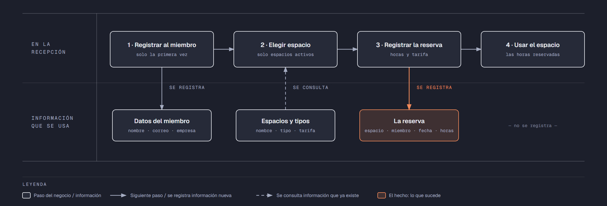

# PIA — Caso: EspacioUno

**Alumno:** Rodriguez Moreno Ricardo (matrícula 2254147)
**Base de datos a crear:** `EspacioUnoDB`

← [Regresar a la descripción del PIA](../../descripcion-pia.md)

---

## Historia de usuario

**Como** dueña de EspacioUno, **quiero** una base de datos que registre mis espacios de trabajo, a los miembros que los usan y cada reserva que hacen, y que además **cuide las reglas del negocio por sí misma**, **para** registrar la operación del día sin errores, saber cuánto se cobró en cada reserva y conservar la historia de cada cambio de precio.

## El negocio

EspacioUno es un **coworking**: un lugar donde personas que trabajan por su cuenta o para empresas pequeñas rentan un espacio **por hora**. Maneja **tipos de espacio**: Escritorio, Oficina privada y Sala de juntas. Cada tipo tiene su propia **tarifa por hora**; por ejemplo, la Sala de juntas cuesta más que un Escritorio. **Las tarifas cambian** de vez en cuando. Aun así, el negocio necesita saber **cuánto se cobró por cada reserva**, con la tarifa que estaba vigente el día de la reserva.

Cada **espacio** es de un tipo, tiene un **nombre** que no se repite (por ejemplo, "Escritorio Ventana" u "Oficina Chipinque") y una **fecha de apertura**, que es el día en que empezó a rentarse. Un espacio nunca cambia de tipo. Cuando un espacio deja de rentarse (por ejemplo, porque se convirtió en bodega), se **da de baja**: no se borra, porque se quiere conservar su historial de reservas.

Los **miembros** se registran una sola vez con su nombre, su correo electrónico y la **empresa** para la que trabajan (si trabajan por su cuenta, se anota "Independiente"). El correo identifica al miembro: no puede haber dos miembros con el mismo.

Cada reserva es **de 1 a 8 horas**, que es lo que dura la jornada del coworking.

Si el negocio deja de manejar un tipo de espacio, tampoco lo borra: lo **da de baja**. Lo mismo pasa con los miembros: si un miembro ya no regresa, se lo da de baja en lugar de borrarlo. Así se conserva el historial de reservas.

## Los hechos de este negocio

En EspacioUno, **el hecho es la reserva**: cada vez que un miembro reserva un espacio, sucede una reserva, en una fecha. Es la **tabla más importante** de tu modelo: tiene una fila por cada reserva, es la que más crece y es donde se guarda lo que realmente pasó (qué miembro, qué espacio, cuándo, cuántas horas y con qué tarifa se le cobró).

**Esta tabla la propones tú**: su nombre, sus columnas y sus llaves. No viene en "Lo que el negocio ya tiene definido", porque los hechos no se definen de antemano: suceden.

## Lo que el negocio ya tiene definido

Estos datos **no los inventas**: son los que EspacioUno ya tiene. Tu base de datos debe guardarlos **exactamente así**, con los mismos nombres y valores. Los casos de prueba de los objetos dependen de ellos.

Son los **datos iniciales** con los que arranca tu base de datos: **tipos de espacio y tarifa por hora** y **espacios**. Hoy todo lo que aparece en estas tablas está **activo**, salvo el espacio que se indica como dado de baja.

**Tipos de espacio y tarifa por hora**

| Tipo de espacio | Tarifa por hora |
|---|---|
| Escritorio | $80.00 |
| Oficina privada | $200.00 |
| Sala de juntas | $350.00 |

**Espacios**

| Tipo de espacio | Nombre | Fecha de apertura | ¿Activo? |
|---|---|---|---|
| Escritorio | Escritorio Ventana | 01/02/2024 | Sí |
| Escritorio | Escritorio Terraza | 01/02/2024 | Sí |
| Escritorio | Escritorio Jardín | 15/08/2024 | Sí |
| Oficina privada | Oficina Cerro de la Silla | 01/02/2024 | Sí |
| Oficina privada | Oficina Chipinque | 04/11/2024 | Sí |
| Sala de juntas | Sala Fundidora | 01/02/2024 | Sí |
| Sala de juntas | Sala Santa Lucía | 10/06/2025 | Sí |
| Oficina privada | Oficina Mitras | 15/08/2024 | **No** |
| Escritorio | Escritorio Biblioteca | 04/05/2026 | Sí |

Todo lo demás (miembros y reservas) **lo inventas tú**, cumpliendo los mínimos de [Lo que debes construir](#lo-que-debes-construir).

## Flujo de negocio

Así funciona una operación de principio a fin. Arriba, lo que pasa en la recepción; abajo, la información que cada paso consulta o registra.

Con detalle, una miembro imaginaria (Andrea) recorriendo el flujo:

1. **Andrea llega por primera vez** a EspacioUno. Es diseñadora y trabaja por su cuenta. En la recepción le piden su nombre, su correo y su empresa ("Independiente") y la **registran como miembro**. Si Andrea regresa otro día, ya no se le registra de nuevo: se le busca por su correo.
2. **Andrea elige un espacio.** La recepcionista revisa qué espacios están **activos**; los dados de baja ya no se rentan. Andrea elige el "Escritorio Ventana", que es de tipo Escritorio, y le dicen la tarifa por hora de ese tipo: hoy, $80.00.
3. **Se registra la reserva:** espacio "Escritorio Ventana", miembro Andrea, fecha de hoy, 4 horas y la tarifa con la que se le cobra ($80.00 por hora).
4. **Andrea usa el espacio** las 4 horas que reservó.

Si el mes siguiente sube la tarifa de los Escritorios a $95.00, la reserva de Andrea tiene que seguir diciendo que se le cobró a $80.00 por hora.

A la semana siguiente, Andrea tiene una junta con un cliente y reserva la "Sala Fundidora", que es Sala de juntas: es otra reserva, de la misma miembro y de otro espacio. Ese mismo día, el "Escritorio Ventana" lo usa otro miembro. Así, **un miembro acumula muchas reservas y un espacio también**.

## Reglas de negocio

- Cada espacio es de **un solo** tipo.
- No puede haber dos tipos de espacio con el mismo nombre, ni dos espacios con el mismo nombre.
- No puede haber dos miembros con el mismo correo electrónico.
- La tarifa por hora siempre es **mayor a cero**.
- Una reserva es **de 1 a 8** horas.
- Un espacio nuevo se registra como **activo**.
- Un tipo de espacio nuevo y un miembro nuevo también se registran como **activos**.
- Cuando cambia la tarifa de un tipo de espacio, las reservas que ya se hicieron **conservan la tarifa con la que se cobraron**.
- **Nuevo:** cada cambio de la tarifa por hora de un tipo de espacio queda registrado en el **histórico de precios** (ver abajo).

## Lo nuevo: el histórico de precios

La tarifa por hora de cada tipo de espacio dice cuánto cuesta **hoy**, y cada reserva guarda cuánto se cobró **ese día**. Pero el negocio quiere saber también **cómo ha cambiado el precio con el tiempo**: cuándo subió, cuándo bajó y de cuánto a cuánto.

Por eso, cada vez que cambia la tarifa por hora de un tipo de espacio, el negocio guarda un registro con:

- **qué tipo de espacio** cambió de precio;
- el **precio anterior**;
- el **precio nuevo**;
- la **fecha y hora** del cambio.

Así funciona:

- El histórico **arranca vacío**: los precios de "Lo que el negocio ya tiene definido" son los iniciales, no un cambio.
- **Nadie escribe a mano** en el histórico. Lo llena un trigger ([`trg_registrarHistoricoPrecio`](11-trigger-trg_registrarHistoricoPrecio.md)) cada vez que cambia un precio, venga de donde venga el cambio.
- Si un `UPDATE` toca un tipo de espacio pero **no le cambia el precio** (por ejemplo, solo lo da de baja), no se registra nada.
- Un registro del histórico **nunca se modifica ni se borra**.

**El nombre de la tabla, sus columnas y sus llaves los propones tú**, igual que la tabla de las reservas.

## Lo que debes construir

1. El **modelo relacional**, con las tablas de tu caso **más la tabla del histórico de precios**, que respete las reglas de negocio con restricciones (`PRIMARY KEY`, `FOREIGN KEY`, `UNIQUE`, `CHECK`, `DEFAULT`).
2. El **paquete de instalación** de `EspacioUnoDB`: tablas, datos iniciales y los **11 objetos programados** de abajo.
3. El **paquete de reversa**, que deje el servidor sin rastro de `EspacioUnoDB`.
4. **Datos iniciales:**
   - **Lo que el negocio ya tiene definido**, exactamente como viene arriba: los 3 tipos de espacio con su tarifa por hora y los 9 espacios.
   - **Lo que tú inventas**, como mínimo: 10 miembros y 20 reservas, con
     - 2 miembros que nunca hayan reservado;
     - 2 espacios que nunca se hayan reservado;
     - al menos 1 miembro dado de baja;
     - reservas de 4 horas o más;
     - cada reserva con la tarifa con la que se cobró (en tus datos, la tarifa de su tipo de espacio que viene arriba).
   - El histórico de precios **vacío**.
5. Los **11 objetos programados**, cada uno con su ficha:

| # | Objeto | Tipo | Qué hace |
|---|---|---|---|
| 01 | [`usp_insertarMiembro`](01-procedimiento-usp_insertarMiembro.md) | Procedimiento | Registra un miembro nuevo |
| 02 | [`usp_darDeBajaMiembro`](02-procedimiento-usp_darDeBajaMiembro.md) | Procedimiento | Da de baja a un miembro |
| 03 | [`usp_insertarEspacio`](03-procedimiento-usp_insertarEspacio.md) | Procedimiento | Registra un espacio nuevo |
| 04 | [`usp_actualizarTarifaTipoEspacio`](04-procedimiento-usp_actualizarTarifaTipoEspacio.md) | Procedimiento | Cambia la tarifa por hora de un tipo de espacio |
| 05 | [`usp_registrarReserva`](05-procedimiento-usp_registrarReserva.md) | Procedimiento | Registra una reserva con el precio vigente |
| 06 | [`usp_obtenerReservasPorFecha`](06-procedimiento-usp_obtenerReservasPorFecha.md) | Procedimiento | Lista las reservas de un rango de fechas |
| 07 | [`ufn_totalCobradoEspacio`](07-funcion-ufn_totalCobradoEspacio.md) | Función escalar | Total cobrado por cada espacio |
| 08 | [`ufn_nivelMiembro`](08-funcion-ufn_nivelMiembro.md) | Función escalar | Qué tan seguido viene un miembro |
| 09 | [`vw_DetalleReserva`](09-vista-vw_DetalleReserva.md) | Vista | Cada reserva con su precio cobrado y el actual |
| 10 | [`vw_ResumenTipoEspacio`](10-vista-vw_ResumenTipoEspacio.md) | Vista | Totales por tipo de espacio |
| 11 | [`trg_registrarHistoricoPrecio`](11-trigger-trg_registrarHistoricoPrecio.md) | Trigger | Llena el histórico de precios |

Los objetos están en el orden en que conviene construirlos: los casos de prueba de cada uno usan los procedimientos anteriores para preparar sus datos.

## Cómo probar tus objetos

- **Cada ficha trae sus casos de prueba.** Todos parten de una **instalación limpia**: ejecuta tu reversa y tu instalación completa, y después las pruebas de esa ficha, en orden.
- Los resultados esperados dependen de **Lo que el negocio ya tiene definido**, no de tus datos inventados. Por eso los objetos reciben datos del negocio (nombres, claves, correos o teléfonos) y no ids.
- Las pruebas usan miembros con correo electrónico `prueba1@correo.com` y `prueba2@correo.com`, el espacio `Escritorio Prueba` y el tipo de espacio `Nuevo tipo`, y reservas de **diciembre de 2026**. **No uses esos valores ni esas fechas en tus datos inventados**, para que no choquen con las pruebas.
- Algunas pruebas escriben directamente en tus tablas. Como tú eliges los nombres, vienen con marcas como `<TuTablaDeReservas>`: cámbialas por los nombres de tu modelo.
- Los casos de prueba son para que compruebes tu trabajo: **no se entregan**.

## Convenciones de código

- Palabras reservadas en **MAYÚSCULAS**; nombres de tablas y columnas en **PascalCase** y en singular; columnas id con prefijo `id` (`idEspacio`).
- Nombre de cada objeto **exactamente** como se indica en su ficha (respeta mayúsculas y minúsculas), y parámetros con los nombres y tipos indicados.
- `SELECT` y `FROM` en líneas separadas; los campos comienzan en la misma línea del `SELECT`; máximo 5 campos por renglón.
- En los procedimientos, las validaciones se escriben como *guard clauses*: guarda el dato en una variable (`SELECT ... FROM ... WHERE`), revísala con `IF @variable IS NULL` / `IS NOT NULL` y, si falla, regresa el error y sal con `RETURN`. `IF EXISTS (SELECT ...)` y los `IF` anidados se permiten, pero se evitan.
- Los procedimientos regresan su resultado con el formato `ErrCodigo` / `ErrMensaje` ([Validaciones](../../../temas/Etapa-2/04-Validaciones.md)).
- Las funciones se llaman con el prefijo `dbo.`.
- Las vistas no llevan `ORDER BY`.

## Entrega

Ver [Entregables](../../descripcion-pia.md#entregables) y [Forma de entrega](../../descripcion-pia.md#forma-de-entrega) en la descripción del PIA.
