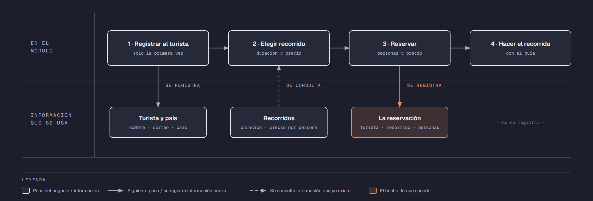

# PIA — Caso: RecorreMTY

**Alumno:** Ruiz Olguin Alejandro (matrícula 2253555)
**Base de datos a crear:** `RecorreMTYDB`

← [Regresar a la descripción del PIA](../../descripcion-pia.md)

---

## Historia de usuario

**Como** dueña de RecorreMTY, **quiero** una base de datos que registre a mis turistas, mis recorridos y cada reservación que hacen, y que además **cuide las reglas del negocio por sí misma**, **para** registrar la operación del día sin errores, saber cuánto se cobró en cada reservación y conservar la historia de cada cambio de precio.

## El negocio

RecorreMTY es un negocio de **recorridos turísticos guiados por Monterrey**. Tiene un módulo de atención en la Macroplaza, donde los turistas reservan. Ofrece varios **recorridos**; cada uno tiene un **nombre** que no se repite, una **duración en horas** (por ejemplo, 1.5 horas) y un **precio por persona**. **Los precios cambian** de vez en cuando. Aun así, el negocio necesita saber **cuánto se cobró en cada reservación**, con el precio por persona que tenía el recorrido el día que se reservó.

Los **turistas** son las personas que hacen las reservaciones. Se registran una sola vez con su nombre, su correo electrónico, la fecha de registro y su **país de origen**. El país no cambia el precio: todos pagan lo mismo; solo sirve para saber de dónde vienen los turistas. El correo identifica al turista: no puede haber dos turistas con el mismo. Cuando un turista pide que borren su registro, se le **da de baja**, pero no se borra, para conservar sus reservaciones.

En cada reservación, el turista aparta lugar para **de 1 a 10 personas** (él y sus acompañantes), que es lo que cabe en la camioneta del recorrido.

Si el negocio deja de usar un país o deja de ofrecer un recorrido, no se borran: se **dan de baja**, para conservar el historial de reservaciones.

## Los hechos de este negocio

En RecorreMTY, **el hecho es la reservación**: cada vez que un turista reserva un recorrido, sucede una reservación, en una fecha. Es la **tabla más importante** de tu modelo: tiene una fila por cada reservación, es la que más crece y es donde se guarda lo que realmente pasó (quién reservó, qué recorrido, para qué fecha, cuántas personas y con qué precio por persona se le cobró).

**Esta tabla la propones tú**: su nombre, sus columnas y sus llaves. No viene en "Lo que el negocio ya tiene definido", porque los hechos no se definen de antemano: suceden.

## Lo que el negocio ya tiene definido

Estos datos **no los inventas**: son los que RecorreMTY ya tiene. Tu base de datos debe guardarlos **exactamente así**, con los mismos nombres y valores. Los casos de prueba de los objetos dependen de ellos.

Son los **datos iniciales** con los que arranca tu base de datos: **países de origen de los turistas** y **recorridos**. Hoy todo lo que aparece en estas tablas está **activo**.

**Países de origen de los turistas**

| País |
|---|
| México |
| Estados Unidos |
| Canadá |
| España |
| Colombia |

**Recorridos**

| Nombre | Duración (horas) | Precio por persona |
|---|---|---|
| Barrio Antiguo | 2.0 | $250.00 |
| Paseo Santa Lucía | 1.5 | $200.00 |
| Parque Fundidora | 3.0 | $300.00 |
| Chipinque | 4.0 | $450.00 |
| Cerro de la Silla | 5.0 | $550.00 |
| Grutas de García | 6.0 | $650.00 |

Todo lo demás (turistas y reservaciones) **lo inventas tú**, cumpliendo los mínimos de [Lo que debes construir](#lo-que-debes-construir).

## Flujo de negocio

Así funciona una operación de principio a fin. Arriba, lo que pasa en el módulo de atención; abajo, la información que cada paso consulta o registra.

Con detalle, una turista imaginaria (Emily) recorriendo el flujo:

1. **Emily llega por primera vez** al módulo de RecorreMTY. Le piden su nombre, su correo y su país de origen (Canadá), y la **registran como turista** con la fecha de hoy. Si Emily regresa otro día, ya no se le registra de nuevo: se le busca por su correo.
2. **Emily elige el recorrido.** El encargado le muestra la duración y el **precio por persona vigente** de cada recorrido. Emily elige "Barrio Antiguo": hoy, $250.00 por persona.
3. **Se registra la reservación:** turista Emily, recorrido "Barrio Antiguo", fecha del recorrido, 3 personas (ella y dos amigas) y el precio por persona con el que se le cobra ($250.00). Se le cobran las personas por ese precio.
4. **El grupo hace el recorrido** con el guía. Lo que pasa durante el paseo no se registra en la base de datos.

Si el mes siguiente "Barrio Antiguo" sube a $280.00 por persona, la reservación de Emily tiene que seguir diciendo que se le cobró a $250.00 por persona.

Dos días después, Emily reserva "Chipinque": es otra reservación, de la misma turista y de otro recorrido. Ese mismo día, otro turista reserva "Barrio Antiguo". Así, **un turista acumula muchas reservaciones y un recorrido también**.

## Reglas de negocio

- Cada turista tiene **un solo** país de origen.
- No puede haber dos países con el mismo nombre, ni dos recorridos con el mismo nombre.
- No puede haber dos turistas con el mismo correo electrónico.
- La duración de un recorrido siempre es **mayor a cero**.
- El precio por persona siempre es **mayor a cero**.
- En una reservación se aparta lugar para **de 1 a 10** personas.
- Cuando cambia el precio de un recorrido, las reservaciones que ya se hicieron **conservan el precio con el que se cobraron**.
- Un turista nuevo se registra como **activo**.
- Un país nuevo y un recorrido nuevo también se registran como **activos**.
- **Nuevo:** cada cambio del precio por persona de un recorrido queda registrado en el **histórico de precios** (ver abajo).

## Lo nuevo: el histórico de precios

El precio por persona de cada recorrido dice cuánto cuesta **hoy**, y cada reservación guarda cuánto se cobró **ese día**. Pero el negocio quiere saber también **cómo ha cambiado el precio con el tiempo**: cuándo subió, cuándo bajó y de cuánto a cuánto.

Por eso, cada vez que cambia el precio por persona de un recorrido, el negocio guarda un registro con:

- **qué recorrido** cambió de precio;
- el **precio anterior**;
- el **precio nuevo**;
- la **fecha y hora** del cambio.

Así funciona:

- El histórico **arranca vacío**: los precios de "Lo que el negocio ya tiene definido" son los iniciales, no un cambio.
- **Nadie escribe a mano** en el histórico. Lo llena un trigger ([`trg_registrarHistoricoPrecio`](11-trigger-trg_registrarHistoricoPrecio.md)) cada vez que cambia un precio, venga de donde venga el cambio.
- Si un `UPDATE` toca un recorrido pero **no le cambia el precio** (por ejemplo, solo lo da de baja), no se registra nada.
- Un registro del histórico **nunca se modifica ni se borra**.

**El nombre de la tabla, sus columnas y sus llaves los propones tú**, igual que la tabla de las reservaciones.

## Lo que debes construir

1. El **modelo relacional**, con las tablas de tu caso **más la tabla del histórico de precios**, que respete las reglas de negocio con restricciones (`PRIMARY KEY`, `FOREIGN KEY`, `UNIQUE`, `CHECK`, `DEFAULT`).
2. El **paquete de instalación** de `RecorreMTYDB`: tablas, datos iniciales y los **11 objetos programados** de abajo.
3. El **paquete de reversa**, que deje el servidor sin rastro de `RecorreMTYDB`.
4. **Datos iniciales:**
   - **Lo que el negocio ya tiene definido**, exactamente como viene arriba: los 5 países y los 6 recorridos.
   - **Lo que tú inventas**, como mínimo: 10 turistas y 20 reservaciones, con
     - turistas de los cinco países;
     - 2 turistas que nunca hayan reservado;
     - 2 recorridos que nunca se hayan reservado;
     - al menos 1 turista dado de baja;
     - cada reservación con el precio por persona con el que se cobró (en tus datos, el precio del recorrido que viene arriba).
   - El histórico de precios **vacío**.
5. Los **11 objetos programados**, cada uno con su ficha:

| # | Objeto | Tipo | Qué hace |
|---|---|---|---|
| 01 | [`usp_insertarTurista`](01-procedimiento-usp_insertarTurista.md) | Procedimiento | Registra un turista nuevo |
| 02 | [`usp_darDeBajaTurista`](02-procedimiento-usp_darDeBajaTurista.md) | Procedimiento | Da de baja a un turista |
| 03 | [`usp_insertarRecorrido`](03-procedimiento-usp_insertarRecorrido.md) | Procedimiento | Registra un recorrido nuevo |
| 04 | [`usp_actualizarPrecioRecorrido`](04-procedimiento-usp_actualizarPrecioRecorrido.md) | Procedimiento | Cambia el precio por persona de un recorrido |
| 05 | [`usp_registrarReservacion`](05-procedimiento-usp_registrarReservacion.md) | Procedimiento | Registra una reservación con el precio vigente |
| 06 | [`usp_obtenerReservacionesPorFecha`](06-procedimiento-usp_obtenerReservacionesPorFecha.md) | Procedimiento | Lista las reservaciones de un rango de fechas |
| 07 | [`ufn_totalCobradoRecorrido`](07-funcion-ufn_totalCobradoRecorrido.md) | Función escalar | Total cobrado por cada recorrido |
| 08 | [`ufn_nivelTurista`](08-funcion-ufn_nivelTurista.md) | Función escalar | Qué tan seguido viene un turista |
| 09 | [`vw_DetalleReservacion`](09-vista-vw_DetalleReservacion.md) | Vista | Cada reservación con su precio cobrado y el actual |
| 10 | [`vw_ResumenRecorrido`](10-vista-vw_ResumenRecorrido.md) | Vista | Totales por recorrido |
| 11 | [`trg_registrarHistoricoPrecio`](11-trigger-trg_registrarHistoricoPrecio.md) | Trigger | Llena el histórico de precios |

Los objetos están en el orden en que conviene construirlos: los casos de prueba de cada uno usan los procedimientos anteriores para preparar sus datos.

## Cómo probar tus objetos

- **Cada ficha trae sus casos de prueba.** Todos parten de una **instalación limpia**: ejecuta tu reversa y tu instalación completa, y después las pruebas de esa ficha, en orden.
- Los resultados esperados dependen de **Lo que el negocio ya tiene definido**, no de tus datos inventados. Por eso los objetos reciben datos del negocio (nombres, claves, correos o teléfonos) y no ids.
- Las pruebas usan turistas con correo electrónico `prueba1@correo.com` y `prueba2@correo.com` y el recorrido `Recorrido de Prueba`, y reservaciones de **diciembre de 2026**. **No uses esos valores ni esas fechas en tus datos inventados**, para que no choquen con las pruebas.
- Algunas pruebas escriben directamente en tus tablas. Como tú eliges los nombres, vienen con marcas como `<TuTablaDeReservaciones>`: cámbialas por los nombres de tu modelo.
- Los casos de prueba son para que compruebes tu trabajo: **no se entregan**.

## Convenciones de código

- Palabras reservadas en **MAYÚSCULAS**; nombres de tablas y columnas en **PascalCase** y en singular; columnas id con prefijo `id` (`idRecorrido`).
- Nombre de cada objeto **exactamente** como se indica en su ficha (respeta mayúsculas y minúsculas), y parámetros con los nombres y tipos indicados.
- `SELECT` y `FROM` en líneas separadas; los campos comienzan en la misma línea del `SELECT`; máximo 5 campos por renglón.
- En los procedimientos, las validaciones se escriben como *guard clauses*: guarda el dato en una variable (`SELECT ... FROM ... WHERE`), revísala con `IF @variable IS NULL` / `IS NOT NULL` y, si falla, regresa el error y sal con `RETURN`. `IF EXISTS (SELECT ...)` y los `IF` anidados se permiten, pero se evitan.
- Los procedimientos regresan su resultado con el formato `ErrCodigo` / `ErrMensaje` ([Validaciones](../../../temas/Etapa-2/04-Validaciones.md)).
- Las funciones se llaman con el prefijo `dbo.`.
- Las vistas no llevan `ORDER BY`.

## Entrega

Ver [Entregables](../../descripcion-pia.md#entregables) y [Forma de entrega](../../descripcion-pia.md#forma-de-entrega) en la descripción del PIA.
