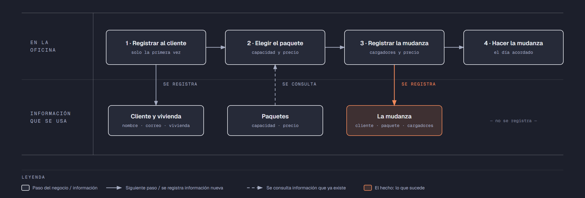

# PIA — Caso: MudaFacil

**Alumno:** Sifuentes Emiliano Mucio Rafael (matrícula 2212513)
**Base de datos a crear:** `MudaFacilDB`

← [Regresar a la descripción del PIA](../../descripcion-pia.md)

---

## Historia de usuario

**Como** dueño de MudaFacil, **quiero** una base de datos que registre a mis clientes, mis paquetes de mudanza y cada mudanza que hacemos, y que además **cuide las reglas del negocio por sí misma**, **para** registrar la operación del día sin errores, saber cuánto se cobró en cada mudanza y conservar la historia de cada cambio de precio.

## El negocio

MudaFacil es una empresa de **mudanzas** dentro de la ciudad. Ofrece varios **paquetes de mudanza**; cada uno tiene un **nombre** que no se repite, la **capacidad del camión en toneladas** (por ejemplo, 3.5 toneladas) y un **precio por mudanza**. **Los precios cambian** de vez en cuando. Aun así, el negocio necesita saber **cuánto se cobró por cada mudanza**, con el precio que tenía el paquete el día que se contrató.

Los **clientes** se registran una sola vez con su nombre, su correo electrónico, la fecha de registro y su **tipo de vivienda**: Casa, Departamento u Oficina. El tipo de vivienda no cambia el precio: solo sirve para saber a qué clientes atiende más el negocio. El correo identifica al cliente: no puede haber dos clientes con el mismo. Cuando un cliente pide que borren su registro, se le **da de baja**, pero no se borra, para conservar sus mudanzas.

En cada mudanza trabajan **de 1 a 6 cargadores**, según lo que haya que mover. El precio del paquete es por mudanza y ya incluye a los cargadores.

Si el negocio deja de usar un tipo de vivienda o deja de ofrecer un paquete de mudanza, no se borran: se **dan de baja**, para conservar el historial de mudanzas.

## Los hechos de este negocio

En MudaFacil, **el hecho es la mudanza**: cada vez que un cliente contrata un paquete para cambiarse de casa, sucede una mudanza, en una fecha. Es la **tabla más importante** de tu modelo: tiene una fila por cada mudanza, es la que más crece y es donde se guarda lo que realmente pasó (qué cliente, qué paquete, para qué fecha, cuántos cargadores y cuánto se le cobró).

**Esta tabla la propones tú**: su nombre, sus columnas y sus llaves. No viene en "Lo que el negocio ya tiene definido", porque los hechos no se definen de antemano: suceden.

## Lo que el negocio ya tiene definido

Estos datos **no los inventas**: son los que MudaFacil ya tiene. Tu base de datos debe guardarlos **exactamente así**, con los mismos nombres y valores. Los casos de prueba de los objetos dependen de ellos.

Son los **datos iniciales** con los que arranca tu base de datos: **tipos de vivienda** y **paquetes de mudanza**. Hoy todo lo que aparece en estas tablas está **activo**.

**Tipos de vivienda**

| Tipo de vivienda |
|---|
| Casa |
| Departamento |
| Oficina |

**Paquetes de mudanza**

| Nombre | Capacidad (toneladas) | Precio por mudanza |
|---|---|---|
| Express | 0.5 | $1,800.00 |
| Chico | 1.5 | $3,500.00 |
| Mediano | 3.5 | $6,000.00 |
| Grande | 5.0 | $8,500.00 |
| Familiar | 7.0 | $11,000.00 |
| Corporativo | 10.0 | $15,000.00 |

Todo lo demás (clientes y mudanzas) **lo inventas tú**, cumpliendo los mínimos de [Lo que debes construir](#lo-que-debes-construir).

## Flujo de negocio

Así funciona una operación de principio a fin. Arriba, lo que pasa en la oficina; abajo, la información que cada paso consulta o registra.

Con detalle, una clienta imaginaria (Sofía) recorriendo el flujo:

1. **Sofía llama por primera vez** a MudaFacil porque se cambia de casa. En la oficina le piden su nombre, su correo y su tipo de vivienda (Casa), y la **registran como clienta** con la fecha de hoy. Si Sofía vuelve a llamar otro día, ya no se le registra de nuevo: se le busca por su correo.
2. **Sofía elige el paquete.** El encargado le muestra la capacidad y el **precio vigente** de cada paquete. Sofía elige el paquete "Chico": hoy, $3,500.00 por mudanza.
3. **Se registra la mudanza:** clienta Sofía, paquete "Chico", la fecha en que se hará la mudanza, 3 cargadores y el precio con el que se le cobra ($3,500.00).
4. **El día acordado se hace la mudanza.** Cuánto tardan en cargar y descargar no se registra en la base de datos.

Si el mes siguiente el paquete "Chico" sube a $3,900.00, la mudanza de Sofía tiene que seguir diciendo que se le cobró a $3,500.00.

Dos meses después, Sofía contrata otra mudanza para llevar los muebles de su mamá, ahora con el paquete "Express": es otra mudanza, de la misma clienta y de otro paquete. Esa misma semana, otro cliente contrata el paquete "Chico". Así, **un cliente acumula muchas mudanzas y un paquete también**.

## Reglas de negocio

- Cada cliente tiene **un solo** tipo de vivienda.
- No puede haber dos tipos de vivienda con el mismo nombre, ni dos paquetes con el mismo nombre.
- No puede haber dos clientes con el mismo correo electrónico.
- La capacidad de un paquete siempre es **mayor a cero** toneladas.
- El precio por mudanza siempre es **mayor a cero**.
- En una mudanza trabajan **de 1 a 6** cargadores.
- Cuando cambia el precio de un paquete, las mudanzas que ya se contrataron **conservan el precio con el que se cobraron**.
- Un cliente nuevo se registra como **activo**.
- Un tipo de vivienda nuevo y un paquete de mudanza nuevo también se registran como **activos**.
- **Nuevo:** cada cambio del precio por mudanza de un paquete queda registrado en el **histórico de precios** (ver abajo).

## Lo nuevo: el histórico de precios

El precio por mudanza de cada paquete dice cuánto cuesta **hoy**, y cada mudanza guarda cuánto se cobró **ese día**. Pero el negocio quiere saber también **cómo ha cambiado el precio con el tiempo**: cuándo subió, cuándo bajó y de cuánto a cuánto.

Por eso, cada vez que cambia el precio por mudanza de un paquete, el negocio guarda un registro con:

- **qué paquete** cambió de precio;
- el **precio anterior**;
- el **precio nuevo**;
- la **fecha y hora** del cambio.

Así funciona:

- El histórico **arranca vacío**: los precios de "Lo que el negocio ya tiene definido" son los iniciales, no un cambio.
- **Nadie escribe a mano** en el histórico. Lo llena un trigger ([`trg_registrarHistoricoPrecio`](11-trigger-trg_registrarHistoricoPrecio.md)) cada vez que cambia un precio, venga de donde venga el cambio.
- Si un `UPDATE` toca un paquete pero **no le cambia el precio** (por ejemplo, solo lo da de baja), no se registra nada.
- Un registro del histórico **nunca se modifica ni se borra**.

**El nombre de la tabla, sus columnas y sus llaves los propones tú**, igual que la tabla de las mudanzas.

## Lo que debes construir

1. El **modelo relacional**, con las tablas de tu caso **más la tabla del histórico de precios**, que respete las reglas de negocio con restricciones (`PRIMARY KEY`, `FOREIGN KEY`, `UNIQUE`, `CHECK`, `DEFAULT`).
2. El **paquete de instalación** de `MudaFacilDB`: tablas, datos iniciales y los **11 objetos programados** de abajo.
3. El **paquete de reversa**, que deje el servidor sin rastro de `MudaFacilDB`.
4. **Datos iniciales:**
   - **Lo que el negocio ya tiene definido**, exactamente como viene arriba: los 3 tipos de vivienda y los 6 paquetes de mudanza.
   - **Lo que tú inventas**, como mínimo: 10 clientes y 20 mudanzas, con
     - clientes de los tres tipos de vivienda;
     - 2 clientes que nunca hayan contratado una mudanza;
     - 2 paquetes que nunca se hayan contratado;
     - al menos 1 cliente dado de baja;
     - cada mudanza con el precio con el que se cobró (en tus datos, el precio del paquete que viene arriba).
   - El histórico de precios **vacío**.
5. Los **11 objetos programados**, cada uno con su ficha:

| # | Objeto | Tipo | Qué hace |
|---|---|---|---|
| 01 | [`usp_insertarCliente`](01-procedimiento-usp_insertarCliente.md) | Procedimiento | Registra un cliente nuevo |
| 02 | [`usp_darDeBajaCliente`](02-procedimiento-usp_darDeBajaCliente.md) | Procedimiento | Da de baja a un cliente |
| 03 | [`usp_insertarPaquete`](03-procedimiento-usp_insertarPaquete.md) | Procedimiento | Registra un paquete nuevo |
| 04 | [`usp_actualizarPrecioPaquete`](04-procedimiento-usp_actualizarPrecioPaquete.md) | Procedimiento | Cambia el precio por mudanza de un paquete |
| 05 | [`usp_registrarMudanza`](05-procedimiento-usp_registrarMudanza.md) | Procedimiento | Registra una mudanza con el precio vigente |
| 06 | [`usp_obtenerMudanzasPorFecha`](06-procedimiento-usp_obtenerMudanzasPorFecha.md) | Procedimiento | Lista las mudanzas de un rango de fechas |
| 07 | [`ufn_totalCobradoPaquete`](07-funcion-ufn_totalCobradoPaquete.md) | Función escalar | Total cobrado por cada paquete |
| 08 | [`ufn_nivelCliente`](08-funcion-ufn_nivelCliente.md) | Función escalar | Qué tan seguido viene un cliente |
| 09 | [`vw_DetalleMudanza`](09-vista-vw_DetalleMudanza.md) | Vista | Cada mudanza con su precio cobrado y el actual |
| 10 | [`vw_ResumenPaquete`](10-vista-vw_ResumenPaquete.md) | Vista | Totales por paquete |
| 11 | [`trg_registrarHistoricoPrecio`](11-trigger-trg_registrarHistoricoPrecio.md) | Trigger | Llena el histórico de precios |

Los objetos están en el orden en que conviene construirlos: los casos de prueba de cada uno usan los procedimientos anteriores para preparar sus datos.

## Cómo probar tus objetos

- **Cada ficha trae sus casos de prueba.** Todos parten de una **instalación limpia**: ejecuta tu reversa y tu instalación completa, y después las pruebas de esa ficha, en orden.
- Los resultados esperados dependen de **Lo que el negocio ya tiene definido**, no de tus datos inventados. Por eso los objetos reciben datos del negocio (nombres, claves, correos o teléfonos) y no ids.
- Las pruebas usan clientes con correo electrónico `prueba1@correo.com` y `prueba2@correo.com` y el paquete `Paquete de Prueba`, y mudanzas de **diciembre de 2026**. **No uses esos valores ni esas fechas en tus datos inventados**, para que no choquen con las pruebas.
- Algunas pruebas escriben directamente en tus tablas. Como tú eliges los nombres, vienen con marcas como `<TuTablaDeMudanzas>`: cámbialas por los nombres de tu modelo.
- Los casos de prueba son para que compruebes tu trabajo: **no se entregan**.

## Si también presentas la 3ra o 5ta oportunidad de Base de Datos I

Tu caso del PIA es el **mismo negocio** que el de tu Evidencia Integral de Base de Datos I, pero son **dos entregas distintas**, cada una con su propio paquete de instalación:

| | Evidencia Integral (BD1) | PIA (BD2) |
|---|---|---|
| Tablas | Las de tu caso | Las de tu caso **más el histórico de precios** |
| Objetos programados | No | **Los 11** de este caso |
| `USE` en los scripts | En todos, menos el que crea la base de datos | Solo en los de tablas y datos; **nunca** en los de los objetos |
| Consultas | Las 10, en su propio ZIP | No se piden |
| PDF | Secciones 1 a 5 | Secciones 1 a 6 (agrega los objetos programados) |
| Dónde se entrega | Teams | NEXUS, en tres lugares |

Puedes partir de tu paquete de Base de Datos I, pero **arma y prueba cada uno por separado**: no subas el mismo ZIP en los dos lugares.

## Convenciones de código

- Palabras reservadas en **MAYÚSCULAS**; nombres de tablas y columnas en **PascalCase** y en singular; columnas id con prefijo `id` (`idPaquete`).
- Nombre de cada objeto **exactamente** como se indica en su ficha (respeta mayúsculas y minúsculas), y parámetros con los nombres y tipos indicados.
- `SELECT` y `FROM` en líneas separadas; los campos comienzan en la misma línea del `SELECT`; máximo 5 campos por renglón.
- En los procedimientos, las validaciones se escriben como *guard clauses*: guarda el dato en una variable (`SELECT ... FROM ... WHERE`), revísala con `IF @variable IS NULL` / `IS NOT NULL` y, si falla, regresa el error y sal con `RETURN`. `IF EXISTS (SELECT ...)` y los `IF` anidados se permiten, pero se evitan.
- Los procedimientos regresan su resultado con el formato `ErrCodigo` / `ErrMensaje` ([Validaciones](../../../temas/Etapa-2/04-Validaciones.md)).
- Las funciones se llaman con el prefijo `dbo.`.
- Las vistas no llevan `ORDER BY`.

## Entrega

Ver [Entregables](../../descripcion-pia.md#entregables) y [Forma de entrega](../../descripcion-pia.md#forma-de-entrega) en la descripción del PIA.
