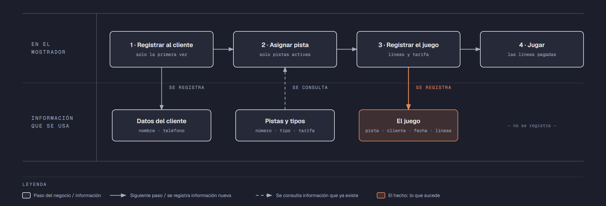

# PIA — Caso: StrikeMax

**Alumno:** Vazquez Anaya Johann Adad (matrícula 2253497)
**Base de datos a crear:** `StrikeMaxDB`

← [Regresar a la descripción del PIA](../../descripcion-pia.md)

---

## Historia de usuario

**Como** dueño de StrikeMax, **quiero** una base de datos que registre mis pistas de boliche, a los clientes que vienen y cada juego que se hace, y que además **cuide las reglas del negocio por sí misma**, **para** registrar la operación del día sin errores, saber cuánto se cobró en cada juego y conservar la historia de cada cambio de precio.

## El negocio

StrikeMax es un **boliche**. Se cobra **por línea**: una línea es un juego completo de 10 turnos para todo el grupo. Maneja **tipos de pista**: Normal, Infantil (con barreras para que la bola no se salga) y VIP (con sillones y servicio a la pista). Cada tipo tiene su propia **tarifa por línea**; por ejemplo, la VIP cuesta más que la Normal. **Las tarifas cambian** de vez en cuando. Aun así, el negocio necesita saber **cuánto se cobró por cada juego**, con la tarifa que estaba vigente el día del juego.

Cada **pista** es de un tipo, tiene un **número** que no se repite (1, 2, 3…) y una **fecha de instalación**. Una pista nunca cambia de tipo. Cuando una pista se descompone y ya no se va a reparar, se **da de baja**: no se borra, porque se quiere conservar su historial de juegos.

Los **clientes** se registran una sola vez con su nombre y su teléfono. El teléfono identifica al cliente: no puede haber dos clientes con el mismo.

En cada juego se pagan **de 1 a 5 líneas**.

Si el negocio deja de manejar un tipo de pista, tampoco lo borra: lo **da de baja**. Lo mismo pasa con los clientes: si un cliente ya no regresa, se lo da de baja en lugar de borrarlo. Así se conserva el historial de juegos.

## Los hechos de este negocio

En StrikeMax, **el hecho es el juego**: cada vez que un cliente juega en una pista, sucede un juego, en una fecha. Es la **tabla más importante** de tu modelo: tiene una fila por cada juego, es la que más crece y es donde se guarda lo que realmente pasó (qué cliente, en qué pista, cuándo, cuántas líneas y con qué tarifa por línea se le cobró).

**Esta tabla la propones tú**: su nombre, sus columnas y sus llaves. No viene en "Lo que el negocio ya tiene definido", porque los hechos no se definen de antemano: suceden.

## Lo que el negocio ya tiene definido

Estos datos **no los inventas**: son los que StrikeMax ya tiene. Tu base de datos debe guardarlos **exactamente así**, con los mismos nombres y valores. Los casos de prueba de los objetos dependen de ellos.

Son los **datos iniciales** con los que arranca tu base de datos: **tipos de pista y tarifa por línea** y **pistas**. Hoy todo lo que aparece en estas tablas está **activo**, salvo la pista que se indica como dada de baja.

**Tipos de pista y tarifa por línea**

| Tipo de pista | Tarifa por línea |
|---|---|
| Normal | $90.00 |
| Infantil | $70.00 |
| VIP | $150.00 |

**Pistas**

| Tipo de pista | Número | Fecha de instalación | ¿Activa? |
|---|---|---|---|
| Infantil | 1 | 01/06/2023 | Sí |
| Infantil | 2 | 01/06/2023 | Sí |
| Normal | 3 | 01/06/2023 | Sí |
| Normal | 4 | 01/06/2023 | Sí |
| Normal | 5 | 01/06/2023 | Sí |
| Normal | 6 | 15/04/2024 | **No** |
| VIP | 7 | 15/04/2024 | Sí |
| VIP | 8 | 15/04/2024 | Sí |
| Normal | 9 | 01/09/2025 | Sí |
| VIP | 10 | 15/05/2026 | Sí |

Todo lo demás (clientes y juegos) **lo inventas tú**, cumpliendo los mínimos de [Lo que debes construir](#lo-que-debes-construir).

## Flujo de negocio

Así funciona una operación de principio a fin. Arriba, lo que pasa en el mostrador; abajo, la información que cada paso consulta o registra.

Con detalle, un cliente imaginario (Rodrigo) recorriendo el flujo:

1. **Rodrigo llega por primera vez** a StrikeMax con sus amigos. En el mostrador le piden su nombre y su teléfono y lo **registran como cliente**. Si Rodrigo regresa otro día, ya no se le registra de nuevo: se le busca por su teléfono.
2. **Se le asigna una pista.** El encargado revisa qué pistas están **activas**; las dadas de baja ya no se usan. Le asigna la pista 7, que es VIP, y le dice la tarifa por línea de ese tipo: hoy, $150.00.
3. **Se registra el juego:** pista 7, cliente Rodrigo, fecha de hoy, 3 líneas y la tarifa con la que se le cobra ($150.00 por línea).
4. **El grupo juega** las 3 líneas que pagó.

Si el mes siguiente sube la tarifa de las pistas VIP a $170.00, el juego de Rodrigo tiene que seguir diciendo que se le cobró a $150.00 por línea.

Dos semanas después, Rodrigo regresa con su familia y le toca la pista 1, que es Infantil: es otro juego, del mismo cliente y de otra pista. Ese mismo día, la pista 7 la usa otro cliente. Así, **un cliente acumula muchos juegos y una pista también**.

## Reglas de negocio

- Cada pista es de **un solo** tipo.
- No puede haber dos tipos de pista con el mismo nombre, ni dos pistas con el mismo número, ni dos clientes con el mismo teléfono.
- La tarifa por línea siempre es **mayor a cero**.
- En un juego se pagan **de 1 a 5** líneas.
- Una pista nueva se registra como **activa**.
- Un tipo de pista nuevo y un cliente nuevo también se registran como **activos**.
- Cuando cambia la tarifa de un tipo de pista, los juegos que ya se hicieron **conservan la tarifa con la que se cobraron**.
- **Nuevo:** cada cambio de la tarifa por línea de un tipo de pista queda registrado en el **histórico de precios** (ver abajo).

## Lo nuevo: el histórico de precios

La tarifa por línea de cada tipo de pista dice cuánto cuesta **hoy**, y cada juego guarda cuánto se cobró **ese día**. Pero el negocio quiere saber también **cómo ha cambiado el precio con el tiempo**: cuándo subió, cuándo bajó y de cuánto a cuánto.

Por eso, cada vez que cambia la tarifa por línea de un tipo de pista, el negocio guarda un registro con:

- **qué tipo de pista** cambió de precio;
- el **precio anterior**;
- el **precio nuevo**;
- la **fecha y hora** del cambio.

Así funciona:

- El histórico **arranca vacío**: los precios de "Lo que el negocio ya tiene definido" son los iniciales, no un cambio.
- **Nadie escribe a mano** en el histórico. Lo llena un trigger ([`trg_registrarHistoricoPrecio`](11-trigger-trg_registrarHistoricoPrecio.md)) cada vez que cambia un precio, venga de donde venga el cambio.
- Si un `UPDATE` toca un tipo de pista pero **no le cambia el precio** (por ejemplo, solo lo da de baja), no se registra nada.
- Un registro del histórico **nunca se modifica ni se borra**.

**El nombre de la tabla, sus columnas y sus llaves los propones tú**, igual que la tabla de los juegos.

## Lo que debes construir

1. El **modelo relacional**, con las tablas de tu caso **más la tabla del histórico de precios**, que respete las reglas de negocio con restricciones (`PRIMARY KEY`, `FOREIGN KEY`, `UNIQUE`, `CHECK`, `DEFAULT`).
2. El **paquete de instalación** de `StrikeMaxDB`: tablas, datos iniciales y los **11 objetos programados** de abajo.
3. El **paquete de reversa**, que deje el servidor sin rastro de `StrikeMaxDB`.
4. **Datos iniciales:**
   - **Lo que el negocio ya tiene definido**, exactamente como viene arriba: los 3 tipos de pista con su tarifa por línea y las 10 pistas.
   - **Lo que tú inventas**, como mínimo: 10 clientes y 20 juegos, con
     - 2 clientes que nunca hayan jugado;
     - 2 pistas que nunca se hayan usado;
     - al menos 1 cliente dado de baja;
     - juegos de 3 líneas o más;
     - cada juego con la tarifa con la que se cobró (en tus datos, la tarifa de su tipo de pista que viene arriba);
     - clientes que tengan "Garza" en su nombre.
   - El histórico de precios **vacío**.
5. Los **11 objetos programados**, cada uno con su ficha:

| # | Objeto | Tipo | Qué hace |
|---|---|---|---|
| 01 | [`usp_insertarCliente`](01-procedimiento-usp_insertarCliente.md) | Procedimiento | Registra un cliente nuevo |
| 02 | [`usp_darDeBajaCliente`](02-procedimiento-usp_darDeBajaCliente.md) | Procedimiento | Da de baja a un cliente |
| 03 | [`usp_insertarPista`](03-procedimiento-usp_insertarPista.md) | Procedimiento | Registra una pista nueva |
| 04 | [`usp_actualizarTarifaTipoPista`](04-procedimiento-usp_actualizarTarifaTipoPista.md) | Procedimiento | Cambia la tarifa por línea de un tipo de pista |
| 05 | [`usp_registrarJuego`](05-procedimiento-usp_registrarJuego.md) | Procedimiento | Registra un juego con el precio vigente |
| 06 | [`usp_obtenerJuegosPorFecha`](06-procedimiento-usp_obtenerJuegosPorFecha.md) | Procedimiento | Lista los juegos de un rango de fechas |
| 07 | [`ufn_totalCobradoPista`](07-funcion-ufn_totalCobradoPista.md) | Función escalar | Total cobrado por cada pista |
| 08 | [`ufn_nivelCliente`](08-funcion-ufn_nivelCliente.md) | Función escalar | Qué tan seguido viene un cliente |
| 09 | [`vw_DetalleJuego`](09-vista-vw_DetalleJuego.md) | Vista | Cada juego con su precio cobrado y el actual |
| 10 | [`vw_ResumenTipoPista`](10-vista-vw_ResumenTipoPista.md) | Vista | Totales por tipo de pista |
| 11 | [`trg_registrarHistoricoPrecio`](11-trigger-trg_registrarHistoricoPrecio.md) | Trigger | Llena el histórico de precios |

Los objetos están en el orden en que conviene construirlos: los casos de prueba de cada uno usan los procedimientos anteriores para preparar sus datos.

## Cómo probar tus objetos

- **Cada ficha trae sus casos de prueba.** Todos parten de una **instalación limpia**: ejecuta tu reversa y tu instalación completa, y después las pruebas de esa ficha, en orden.
- Los resultados esperados dependen de **Lo que el negocio ya tiene definido**, no de tus datos inventados. Por eso los objetos reciben datos del negocio (nombres, claves, correos o teléfonos) y no ids.
- Las pruebas usan clientes con teléfono `8199990001` y `8199990002`, la pista `20` y el tipo de pista `Nuevo tipo`, y juegos de **diciembre de 2026**. **No uses esos valores ni esas fechas en tus datos inventados**, para que no choquen con las pruebas.
- Algunas pruebas escriben directamente en tus tablas. Como tú eliges los nombres, vienen con marcas como `<TuTablaDeJuegos>`: cámbialas por los nombres de tu modelo.
- Los casos de prueba son para que compruebes tu trabajo: **no se entregan**.

## Convenciones de código

- Palabras reservadas en **MAYÚSCULAS**; nombres de tablas y columnas en **PascalCase** y en singular; columnas id con prefijo `id` (`idPista`).
- Nombre de cada objeto **exactamente** como se indica en su ficha (respeta mayúsculas y minúsculas), y parámetros con los nombres y tipos indicados.
- `SELECT` y `FROM` en líneas separadas; los campos comienzan en la misma línea del `SELECT`; máximo 5 campos por renglón.
- En los procedimientos, las validaciones se escriben como *guard clauses*: guarda el dato en una variable (`SELECT ... FROM ... WHERE`), revísala con `IF @variable IS NULL` / `IS NOT NULL` y, si falla, regresa el error y sal con `RETURN`. `IF EXISTS (SELECT ...)` y los `IF` anidados se permiten, pero se evitan.
- Los procedimientos regresan su resultado con el formato `ErrCodigo` / `ErrMensaje` ([Validaciones](../../../temas/Etapa-2/04-Validaciones.md)).
- Las funciones se llaman con el prefijo `dbo.`.
- Las vistas no llevan `ORDER BY`.

## Entrega

Ver [Entregables](../../descripcion-pia.md#entregables) y [Forma de entrega](../../descripcion-pia.md#forma-de-entrega) en la descripción del PIA.
