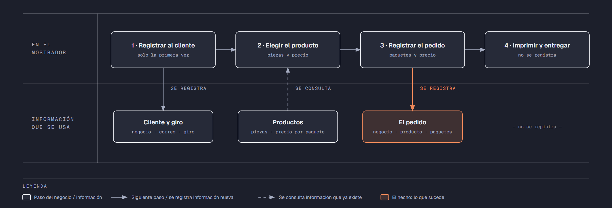

# PIA — Caso: ImprimeYa

**Alumno:** Villanueva Mata Brandon Gabriel (matrícula 2253572)
**Base de datos a crear:** `ImprimeYaDB`

← [Regresar a la descripción del PIA](../../descripcion-pia.md)

---

## Historia de usuario

**Como** dueño de ImprimeYa, **quiero** una base de datos que registre a los negocios que me compran, los productos que imprimo y cada pedido que me hacen, y que además **cuide las reglas del negocio por sí misma**, **para** registrar la operación del día sin errores, saber cuánto se cobró en cada pedido y conservar la historia de cada cambio de precio.

## El negocio

ImprimeYa es una **imprenta rápida** que trabaja para negocios: les imprime tarjetas de presentación, volantes, menús, etiquetas y otros productos. Cada **producto** tiene un **nombre** que no se repite, se vende **por paquete** (por ejemplo, un paquete de tarjetas de presentación trae 100 tarjetas) y tiene un **precio por paquete**. **Los precios cambian** de vez en cuando. Aun así, la imprenta necesita saber **cuánto se cobró por cada pedido**, con el precio por paquete que tenía el producto el día del pedido.

Los **clientes** son negocios. Se registran una sola vez con el nombre del negocio, su correo electrónico, la fecha de registro y su **giro** (por ejemplo, Restaurante o Escuela). El giro no cambia el precio: solo sirve para saber a qué tipo de negocios se les vende más. El correo identifica al cliente: no puede haber dos clientes con el mismo. Cuando un negocio cierra o deja de comprar, se le **da de baja**, pero no se borra, para conservar sus pedidos.

En cada pedido, el cliente pide **un producto** y **de 1 a 50 paquetes** de ese producto. Si un negocio quiere dos productos distintos, se registran dos pedidos.

Si el negocio deja de usar un giro o deja de ofrecer un producto, no se borran: se **dan de baja**, para conservar el historial de pedidos.

## Los hechos de este negocio

En ImprimeYa, **el hecho es el pedido**: cada vez que un cliente encarga un producto, sucede un pedido, en una fecha. Es la **tabla más importante** de tu modelo: tiene una fila por cada pedido, es la que más crece y es donde se guarda lo que realmente pasó (qué cliente, qué producto, cuándo, cuántos paquetes y con qué precio por paquete se le cobró).

**Esta tabla la propones tú**: su nombre, sus columnas y sus llaves. No viene en "Lo que el negocio ya tiene definido", porque los hechos no se definen de antemano: suceden.

## Lo que el negocio ya tiene definido

Estos datos **no los inventas**: son los que ImprimeYa ya tiene. Tu base de datos debe guardarlos **exactamente así**, con los mismos nombres y valores. Los casos de prueba de los objetos dependen de ellos.

Son los **datos iniciales** con los que arranca tu base de datos: **giros de los negocios cliente** y **productos**. Hoy todo lo que aparece en estas tablas está **activo**.

**Giros de los negocios cliente**

| Giro |
|---|
| Restaurante |
| Escuela |
| Tienda |
| Despacho |

**Productos**

| Nombre | Piezas por paquete | Precio por paquete |
|---|---|---|
| Tarjetas de presentación | 100 | $250.00 |
| Volantes media carta | 500 | $450.00 |
| Menús enmicados | 10 | $380.00 |
| Etiquetas adhesivas | 200 | $300.00 |
| Lona de 1 x 2 metros | 1 | $420.00 |
| Folders impresos | 50 | $600.00 |
| Calendarios de pared | 25 | $520.00 |

Todo lo demás (clientes y pedidos) **lo inventas tú**, cumpliendo los mínimos de [Lo que debes construir](#lo-que-debes-construir).

## Flujo de negocio

Así funciona una operación de principio a fin. Arriba, lo que pasa en el mostrador; abajo, la información que cada paso consulta o registra.

Con detalle, un cliente imaginario (Ernesto, dueño de la Taquería El Güero) recorriendo el flujo:

1. **Ernesto llega por primera vez** a ImprimeYa. En el mostrador le piden el nombre de su negocio, su correo y su giro (Restaurante), y **registran a la taquería como cliente** con la fecha de hoy. Si Ernesto regresa otro día, ya no se le registra de nuevo: se le busca por su correo.
2. **Ernesto elige el producto.** El encargado le muestra cuántas piezas trae cada paquete y el **precio vigente** de cada producto. Ernesto elige "Menús enmicados": un paquete trae 10 menús y hoy cuesta $380.00.
3. **Se registra el pedido:** cliente Taquería El Güero, producto "Menús enmicados", fecha de hoy, 2 paquetes y el precio por paquete con el que se le cobra ($380.00).
4. **Se imprime y se entrega** el pedido. La entrega no se registra en la base de datos.

Si el mes siguiente los menús enmicados suben a $420.00 por paquete, el pedido de Ernesto tiene que seguir diciendo que se le cobró a $380.00 por paquete.

Un mes después, Ernesto regresa y pide volantes: es otro pedido, del mismo cliente y de otro producto. Ese mismo día, una cafetería pide menús enmicados. Así, **un cliente acumula muchos pedidos y un producto también**.

## Reglas de negocio

- Cada cliente tiene **un solo** giro.
- No puede haber dos giros con el mismo nombre, ni dos productos con el mismo nombre.
- No puede haber dos clientes con el mismo correo electrónico.
- Las piezas por paquete de un producto siempre son **mayores a cero**.
- El precio por paquete siempre es **mayor a cero**.
- En un pedido se piden **de 1 a 50** paquetes.
- Cuando cambia el precio de un producto, los pedidos que ya se hicieron **conservan el precio con el que se cobraron**.
- Un cliente nuevo se registra como **activo**.
- Un giro nuevo y un producto nuevo también se registran como **activos**.
- **Nuevo:** cada cambio del precio por paquete de un producto queda registrado en el **histórico de precios** (ver abajo).

## Lo nuevo: el histórico de precios

El precio por paquete de cada producto dice cuánto cuesta **hoy**, y cada pedido guarda cuánto se cobró **ese día**. Pero el negocio quiere saber también **cómo ha cambiado el precio con el tiempo**: cuándo subió, cuándo bajó y de cuánto a cuánto.

Por eso, cada vez que cambia el precio por paquete de un producto, el negocio guarda un registro con:

- **qué producto** cambió de precio;
- el **precio anterior**;
- el **precio nuevo**;
- la **fecha y hora** del cambio.

Así funciona:

- El histórico **arranca vacío**: los precios de "Lo que el negocio ya tiene definido" son los iniciales, no un cambio.
- **Nadie escribe a mano** en el histórico. Lo llena un trigger ([`trg_registrarHistoricoPrecio`](11-trigger-trg_registrarHistoricoPrecio.md)) cada vez que cambia un precio, venga de donde venga el cambio.
- Si un `UPDATE` toca un producto pero **no le cambia el precio** (por ejemplo, solo lo da de baja), no se registra nada.
- Un registro del histórico **nunca se modifica ni se borra**.

**El nombre de la tabla, sus columnas y sus llaves los propones tú**, igual que la tabla de los pedidos.

## Lo que debes construir

1. El **modelo relacional**, con las tablas de tu caso **más la tabla del histórico de precios**, que respete las reglas de negocio con restricciones (`PRIMARY KEY`, `FOREIGN KEY`, `UNIQUE`, `CHECK`, `DEFAULT`).
2. El **paquete de instalación** de `ImprimeYaDB`: tablas, datos iniciales y los **11 objetos programados** de abajo.
3. El **paquete de reversa**, que deje el servidor sin rastro de `ImprimeYaDB`.
4. **Datos iniciales:**
   - **Lo que el negocio ya tiene definido**, exactamente como viene arriba: los 4 giros y los 7 productos.
   - **Lo que tú inventas**, como mínimo: 10 clientes y 20 pedidos, con
     - clientes de los cuatro giros;
     - 2 clientes que nunca hayan hecho un pedido;
     - 2 productos que nunca se hayan pedido;
     - al menos 1 cliente dado de baja;
     - cada pedido con el precio por paquete con el que se cobró (en tus datos, el precio del producto que viene arriba);
     - clientes cuyo nombre de negocio contenga la palabra "Colegio".
   - El histórico de precios **vacío**.
5. Los **11 objetos programados**, cada uno con su ficha:

| # | Objeto | Tipo | Qué hace |
|---|---|---|---|
| 01 | [`usp_insertarCliente`](01-procedimiento-usp_insertarCliente.md) | Procedimiento | Registra un cliente nuevo |
| 02 | [`usp_darDeBajaCliente`](02-procedimiento-usp_darDeBajaCliente.md) | Procedimiento | Da de baja a un cliente |
| 03 | [`usp_insertarProducto`](03-procedimiento-usp_insertarProducto.md) | Procedimiento | Registra un producto nuevo |
| 04 | [`usp_actualizarPrecioProducto`](04-procedimiento-usp_actualizarPrecioProducto.md) | Procedimiento | Cambia el precio por paquete de un producto |
| 05 | [`usp_registrarPedido`](05-procedimiento-usp_registrarPedido.md) | Procedimiento | Registra un pedido con el precio vigente |
| 06 | [`usp_obtenerPedidosPorFecha`](06-procedimiento-usp_obtenerPedidosPorFecha.md) | Procedimiento | Lista los pedidos de un rango de fechas |
| 07 | [`ufn_totalCobradoProducto`](07-funcion-ufn_totalCobradoProducto.md) | Función escalar | Total cobrado por cada producto |
| 08 | [`ufn_nivelCliente`](08-funcion-ufn_nivelCliente.md) | Función escalar | Qué tan seguido viene un cliente |
| 09 | [`vw_DetallePedido`](09-vista-vw_DetallePedido.md) | Vista | Cada pedido con su precio cobrado y el actual |
| 10 | [`vw_ResumenProducto`](10-vista-vw_ResumenProducto.md) | Vista | Totales por producto |
| 11 | [`trg_registrarHistoricoPrecio`](11-trigger-trg_registrarHistoricoPrecio.md) | Trigger | Llena el histórico de precios |

Los objetos están en el orden en que conviene construirlos: los casos de prueba de cada uno usan los procedimientos anteriores para preparar sus datos.

## Cómo probar tus objetos

- **Cada ficha trae sus casos de prueba.** Todos parten de una **instalación limpia**: ejecuta tu reversa y tu instalación completa, y después las pruebas de esa ficha, en orden.
- Los resultados esperados dependen de **Lo que el negocio ya tiene definido**, no de tus datos inventados. Por eso los objetos reciben datos del negocio (nombres, claves, correos o teléfonos) y no ids.
- Las pruebas usan clientes con correo electrónico `prueba1@correo.com` y `prueba2@correo.com` y el producto `Producto de Prueba`, y pedidos de **diciembre de 2026**. **No uses esos valores ni esas fechas en tus datos inventados**, para que no choquen con las pruebas.
- Algunas pruebas escriben directamente en tus tablas. Como tú eliges los nombres, vienen con marcas como `<TuTablaDePedidos>`: cámbialas por los nombres de tu modelo.
- Los casos de prueba son para que compruebes tu trabajo: **no se entregan**.

## Convenciones de código

- Palabras reservadas en **MAYÚSCULAS**; nombres de tablas y columnas en **PascalCase** y en singular; columnas id con prefijo `id` (`idProducto`).
- Nombre de cada objeto **exactamente** como se indica en su ficha (respeta mayúsculas y minúsculas), y parámetros con los nombres y tipos indicados.
- `SELECT` y `FROM` en líneas separadas; los campos comienzan en la misma línea del `SELECT`; máximo 5 campos por renglón.
- En los procedimientos, las validaciones se escriben como *guard clauses*: guarda el dato en una variable (`SELECT ... FROM ... WHERE`), revísala con `IF @variable IS NULL` / `IS NOT NULL` y, si falla, regresa el error y sal con `RETURN`. `IF EXISTS (SELECT ...)` y los `IF` anidados se permiten, pero se evitan.
- Los procedimientos regresan su resultado con el formato `ErrCodigo` / `ErrMensaje` ([Validaciones](../../../temas/Etapa-2/04-Validaciones.md)).
- Las funciones se llaman con el prefijo `dbo.`.
- Las vistas no llevan `ORDER BY`.

## Entrega

Ver [Entregables](../../descripcion-pia.md#entregables) y [Forma de entrega](../../descripcion-pia.md#forma-de-entrega) en la descripción del PIA.
