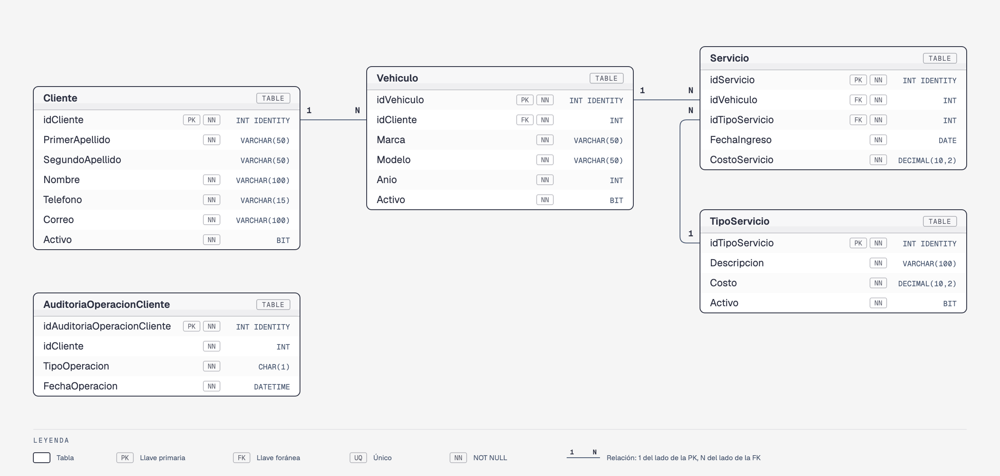

# AutoFixDB — versión de Base de Datos II

Es la base de datos del taller mecánico **AutoFix** de Base de Datos I ([sesión 10](../../../../base-datos-1/sesiones/sesion-10)), ampliada con los objetos de Base de Datos II que se construyeron en la [sesión 11](../README.md): un procedimiento almacenado, una tabla de auditoría y dos triggers.

> La versión de Base de Datos I queda **congelada** tal como se vio en ese curso. Esta versión se instala completa desde aquí y **usa el mismo nombre**, `AutoFixDB`. Si ya tienes instalada la de Base de Datos I, ejecuta primero su [reversa](../../../../base-datos-1/sesiones/sesion-10/05-Ejercicio-2/reversa).

Los datos son ficticios.

---

## Modelo

| Tabla | Qué guarda | Registros iniciales |
|-------|------------|---------------------|
| [`Cliente`](docs/tablas/Cliente.md) | Dueños de los vehículos | 215 |
| [`TipoServicio`](docs/tablas/TipoServicio.md) | Catálogo de servicios del taller, con su costo | 6 |
| [`Vehiculo`](docs/tablas/Vehiculo.md) | Vehículos de cada cliente | 170 |
| [`Servicio`](docs/tablas/Servicio.md) | Cada servicio que se le hizo a un vehículo | 200 |
| [`AuditoriaOperacionCliente`](docs/tablas/AuditoriaOperacionCliente.md) | Bitácora de inserciones, modificaciones y eliminaciones de clientes | 0 |

## Diferencias con la versión de Base de Datos I

| | Base de Datos I | Base de Datos II |
|---|---|---|
| Tablas | 4 | 5: se agrega `AuditoriaOperacionCliente` |
| Clientes | 200 | 215: los 200 originales y 15 agregados en la sesión 11 |
| Procedimientos almacenados | — | [`usp_insertarCliente`](docs/procedimientos/usp_insertarCliente.md) |
| Triggers | — | [`trg_mensajeInsertarCliente`](docs/triggers/trg_mensajeInsertarCliente.md) y [`trg_registroAuditoriaOperacionCliente`](docs/triggers/trg_registroAuditoriaOperacionCliente.md) |

Las cuatro tablas originales **no cambian**: mismas columnas, mismas restricciones y mismos datos.

## Objetos programados

| Objeto | Tipo | Sobre | Qué hace |
|--------|------|-------|----------|
| [`usp_insertarCliente`](docs/procedimientos/usp_insertarCliente.md) | Procedimiento almacenado | `Cliente` | Da de alta un cliente si su correo y su teléfono no están registrados |
| [`trg_mensajeInsertarCliente`](docs/triggers/trg_mensajeInsertarCliente.md) | Trigger `AFTER INSERT` | `Cliente` | Imprime cuántos clientes se insertaron |
| [`trg_registroAuditoriaOperacionCliente`](docs/triggers/trg_registroAuditoriaOperacionCliente.md) | Trigger `AFTER INSERT, UPDATE, DELETE` | `Cliente` | Registra en la auditoría cada cliente afectado y el tipo de operación |

---

## Instalación

**Opción rápida:** abre [`instalar-completo.sql`](instalar-completo.sql) en SSMS y ejecútalo completo (F5).

**Script por script**, en este orden:

| Orden | Script | Qué hace |
|-------|--------|----------|
| 1 | `instalacion/00-create-database.sql` | Crea la base de datos `AutoFixDB` |
| 2 | `instalacion/01-Cliente/01-create-table.sql` | Crea la tabla `Cliente` |
| 3 | `instalacion/01-Cliente/02-insert.sql` | Inserta los 215 clientes |
| 4 | `instalacion/01-Cliente/03-usp-insertar.sql` | Crea `usp_insertarCliente` |
| 5 | `instalacion/01-Cliente/04-trg-mensaje-insertar.sql` | Crea `trg_mensajeInsertarCliente` |
| 6 | `instalacion/02-TipoServicio/01-create-table.sql` | Crea la tabla `TipoServicio` |
| 7 | `instalacion/02-TipoServicio/02-insert.sql` | Inserta los 6 tipos de servicio |
| 8 | `instalacion/03-Vehiculo/01-create-table.sql` | Crea la tabla `Vehiculo` |
| 9 | `instalacion/03-Vehiculo/02-insert.sql` | Inserta los 170 vehículos |
| 10 | `instalacion/04-Servicio/01-create-table.sql` | Crea la tabla `Servicio` |
| 11 | `instalacion/04-Servicio/02-insert.sql` | Inserta los 200 servicios |
| 12 | `instalacion/05-AuditoriaOperacionCliente/01-create-table.sql` | Crea la tabla `AuditoriaOperacionCliente` |
| 13 | `instalacion/05-AuditoriaOperacionCliente/02-trg-registro-auditoria.sql` | Crea `trg_registroAuditoriaOperacionCliente` |

Los datos de `Cliente` se insertan **antes** de crear los triggers: por eso la instalación no imprime mensajes ni llena la auditoría.

## Pruebas

[`pruebas.sql`](pruebas.sql) tiene 11 pruebas, cada una con su resultado esperado: inserción de uno y de varios clientes, el procedimiento almacenado, modificación, eliminación, una sentencia que no afecta filas y la desactivación y activación de triggers. Ejecútalas **una sección a la vez**, sobre una instalación limpia.

## Reversa

| Orden | Script | Qué hace |
|-------|--------|----------|
| 1 | `reversa/01-drop-objetos.sql` | Elimina los dos triggers y el procedimiento almacenado |
| 2 | `reversa/02-drop-tables.sql` | Elimina las tablas en orden inverso a las llaves foráneas |
| 3 | `reversa/03-drop-database.sql` | Elimina la base de datos |

> Antes del script 3, selecciona **otra** base de datos en SSMS (por ejemplo, `master`).
