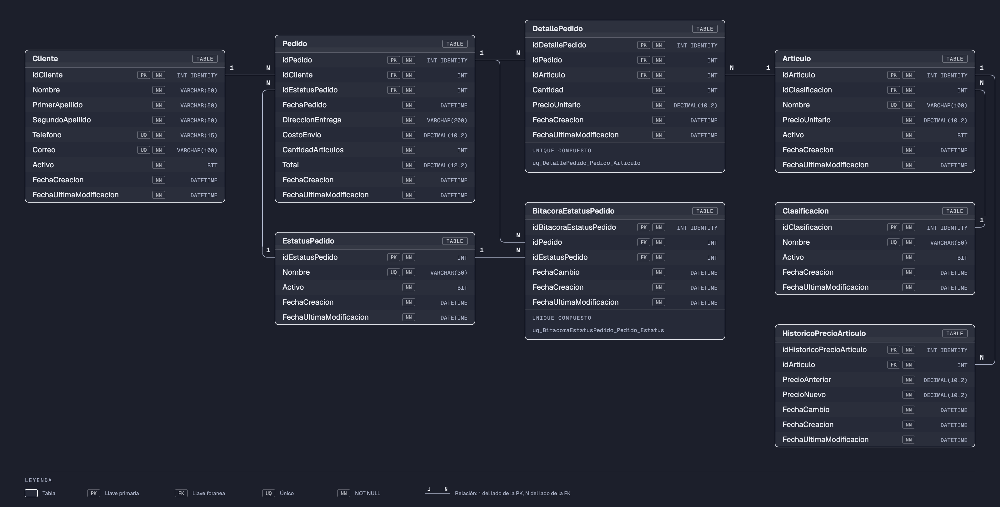

# Sesión 12 — Triggers sobre un modelo construido desde cero

En la [sesión 11](../sesion-11) se vieron los triggers sobre una base que ya existía. En esta se construyó **desde cero** una base nueva, **TiendaDB**: los pedidos a domicilio de una tienda de conveniencia. Primero se modeló tabla por tabla y después se le agregaron dos triggers con un uso real: llevar el **histórico de precios** y mantener la **cabecera** del pedido al día.

> La base se instala desde [`TiendaDB/`](TiendaDB). Su documentación (una página por tabla y por trigger) está en el [README de TiendaDB](TiendaDB/README.md).

---

## Cómo se desarrolló la clase

Sábado 24 de octubre de 2026.

| Hora | Qué se hizo |
|------|-------------|
| Antes de clase | Se modeló TiendaDB tabla por tabla y se publicó la versión preliminar: 8 tablas, con datos solo en los catálogos |
| 9:28 | Se exploraron los catálogos: clientes, clasificaciones, artículos y estatus |
| 9:36 – 9:57 | Primer trigger: el **histórico de precios** de los artículos |
| 9:54 – 10:21 | Pruebas: se cambió el precio de varios artículos y se revisó el histórico |
| 10:03 – 10:14 | Se creó un pedido "a mano" y se obtuvo su id con `SCOPE_IDENTITY()` para registrar su primer estatus en la bitácora |
| 10:17 – 10:38 | Se agregaron artículos al pedido "a mano", recalculando la cabecera en cada línea |
| 10:42 | Segundo trigger: la **cabecera** del pedido. La primera versión marcaba un error de llave única |
| 11:00 | Versión final del trigger de cabecera |

## Qué se hizo en esta sesión

| # | Objeto | Script | Qué hace |
|---|--------|--------|----------|
| 1 | `TiendaDB` | [`instalar-completo.sql`](TiendaDB/instalar-completo.sql) | 8 tablas: clientes, artículos y sus clasificaciones, pedidos con sus líneas, estatus, bitácora e histórico de precios |
| 2 | `trg_insertarHistoricoPrecioArticulo` | [`05-HistoricoPrecioArticulo/02-trg-insertar-historico-precio.sql`](TiendaDB/instalacion/05-HistoricoPrecioArticulo/02-trg-insertar-historico-precio.sql) | `AFTER UPDATE` sobre `Articulo`: registra el precio anterior y el nuevo |
| 3 | `trg_insertarDetallePedido` | [`07-DetallePedido/02-trg-insertar-detalle-pedido.sql`](TiendaDB/instalacion/07-DetallePedido/02-trg-insertar-detalle-pedido.sql) | `AFTER INSERT` sobre `DetallePedido`: recalcula el número de líneas y el total del pedido |
| 4 | `trg_actualizarDetallePedido` *(después de clase)* | [`07-DetallePedido/03-trg-actualizar-detalle-pedido.sql`](TiendaDB/instalacion/07-DetallePedido/03-trg-actualizar-detalle-pedido.sql) | `AFTER UPDATE` sobre `DetallePedido`: recalcula la cabecera cuando se modifica una línea |
| 5 | `trg_eliminarDetallePedido` *(después de clase)* | [`07-DetallePedido/04-trg-eliminar-detalle-pedido.sql`](TiendaDB/instalacion/07-DetallePedido/04-trg-eliminar-detalle-pedido.sql) | `AFTER DELETE` sobre `DetallePedido`: recalcula la cabecera cuando se quita una línea |
| 6 | Pruebas | [`pruebas.sql`](TiendaDB/pruebas.sql) | El flujo de la clase y los triggers de después de clase, paso a paso, con los resultados esperados (pruebas 1 a 12) |

> En la [sesión 13](../sesion-13) se agregaron a TiendaDB la bitácora de estatus por trigger y los procedimientos para crear y modificar pedidos (pruebas 13 a 19).

## Prerequisito

Instala TiendaDB desde [`TiendaDB/instalar-completo.sql`](TiendaDB/instalar-completo.sql).

---

## Contenido de estudio

### 1. El modelo, tabla por tabla



Se construyó en este orden, decidiendo cada tabla antes de pasar a la siguiente:

| Tabla | Decisión clave |
|-------|----------------|
| `Cliente` | Teléfono y correo `UNIQUE`: así se identifica al cliente. Baja lógica con `Activo` |
| `Pedido` | Es la **cabecera**. Guarda la dirección de entrega (si el cliente se muda, sus pedidos anteriores siguen diciendo a dónde se enviaron) y el costo de envío. `CantidadArticulos` y `Total` empiezan en 0 y **los mantiene un trigger** |
| `EstatusPedido` | Sin `IDENTITY`: los números (1 Creado, 2 Enviado, 3 Cancelado, 4 Entregado) son parte de las reglas de negocio |
| `BitacoraEstatusPedido` | Resuelve la relación **N:M** entre pedidos y estatus. Como un pedido nunca regresa a un estatus anterior, `UNIQUE (idPedido, idEstatusPedido)` |
| `Clasificacion` y `Articulo` | El artículo guarda su precio **vigente** |
| `DetallePedido` | Son las **líneas**: resuelve la relación N:M entre pedidos y artículos. Guarda el precio **con el que se vendió**, y un artículo aparece una sola vez por pedido |
| `HistoricoPrecioArticulo` | Cada cambio de precio: el anterior y el nuevo |

Todas las tablas tienen `FechaCreacion` y `FechaUltimaModificacion`.

### 2. Primer trigger: el histórico de precios

Cada vez que cambia el precio de un artículo, queda registrado de cuánto a cuánto:

```sql
CREATE TRIGGER trg_insertarHistoricoPrecioArticulo
ON Articulo
AFTER UPDATE
AS
BEGIN

	DECLARE
		@PrecioAnterior decimal(10,2),
		@PrecioNuevo decimal (10,2),
		@idArticulo int

	-- Obtener el precio anterior (a eliminar)

	SELECT
		@PrecioAnterior = PrecioUnitario,
		@idArticulo = idArticulo
	FROM deleted

	-- Obtener el precio actual (a insertar)

	SELECT
		@PrecioNuevo = PrecioUnitario
	FROM inserted

	IF @PrecioAnterior = @PrecioNuevo BEGIN -- Si el precio es el mismo, nos salimos porque no tiene caso el registro
		RETURN
	END

	IF @PrecioAnterior IS NULL OR @PrecioNuevo IS NULL BEGIN
		RETURN
	END

	INSERT INTO HistoricoPrecioArticulo (idArticulo, PrecioAnterior, PrecioNuevo, FechaCambio, FechaCreacion, FechaUltimaModificacion)
	VALUES (
		@idArticulo,
		@PrecioAnterior,
		@PrecioNuevo,
		GETDATE(),
		GETDATE(),
		GETDATE()
	)

END
```

- En un `UPDATE`, **`deleted` tiene la fila como estaba** y **`inserted`, como quedó**. Por eso el precio anterior sale de `deleted` y el nuevo de `inserted`.
- El trigger se dispara con **cualquier** `UPDATE` de `Articulo`, aunque solo cambie el nombre. El primer `IF` evita registrar un "cambio" de precio que no existió.
- El segundo `IF` cubre el `UPDATE` que no encontró ninguna fila: el trigger se dispara igual, con las tablas vacías y las variables en `NULL`. Es el mismo caso que vimos en la [sesión 11](../sesion-11/README.md#el-if-con-return-el-caso-que-faltaba).

### 3. Crear un pedido: SCOPE_IDENTITY()

Para registrar el primer estatus del pedido en la bitácora hace falta su `idPedido`, que lo genera el `IDENTITY` al insertar:

```sql
DECLARE @idPedido int

INSERT INTO Pedido (idCliente, idEstatusPedido, FechaPedido, DireccionEntrega, CostoEnvio,
                    CantidadArticulos, Total, FechaCreacion, FechaUltimaModificacion)
VALUES (8, 1, GETDATE(), 'Jiménez 321 Sur, Col. Centro, CP 64000', 50.32,
        0, 0, GETDATE(), GETDATE())

SELECT @idPedido = SCOPE_IDENTITY()

INSERT INTO BitacoraEstatusPedido (idPedido, idEstatusPedido, FechaCambio, FechaCreacion, FechaUltimaModificacion)
VALUES (@idPedido, 1, GETDATE(), GETDATE(), GETDATE())
```

Hay tres funciones parecidas, y con triggers solo una es segura:

| Función | Qué regresa | ¿Sirve aquí? |
|---------|-------------|--------------|
| `SCOPE_IDENTITY()` | El último `IDENTITY` de **este** lote o procedimiento | ✅ El `idPedido` recién insertado |
| `@@IDENTITY` | El último `IDENTITY` de la sesión, **incluidos los triggers** | ❌ Si un trigger de `Pedido` inserta en otra tabla con `IDENTITY` (por ejemplo, en la bitácora), regresaría **ese** id |
| `IDENT_CURRENT('Pedido')` | El último `IDENTITY` de la tabla, **de cualquier usuario** | ❌ Si otra persona inserta un pedido al mismo tiempo, regresa el suyo |

En clase, el primer estatus se registró **a mano** en la bitácora. Desde la [sesión 13](../sesion-13) lo registra `usp_crearPedido`.

### 4. Agregar artículos: primero sin trigger

Cada línea nueva obligaba a hacer tres cosas: buscar el precio vigente del artículo, insertar la línea y **recalcular la cabecera**:

```sql
SELECT
	@CantidadArticulos = COUNT(idDetallePedido),
	@Total = SUM(PrecioUnitario * Cantidad)
FROM DetallePedido
WHERE idPedido = @idPedido

UPDATE Pedido
SET
	CantidadArticulos = @CantidadArticulos,
	Total = @Total
WHERE idPedido = @idPedido
```

Si alguien inserta una línea y olvida el `UPDATE`, la cabecera queda mal. Esa es la razón del segundo trigger: **garantizar** que la cabecera se recalcule siempre, la línea venga de donde venga.

### 5. Segundo trigger: la cabecera del pedido

```sql
CREATE TRIGGER trg_insertarDetallePedido
ON DetallePedido
AFTER INSERT
AS
BEGIN

	DECLARE
		@idPedido int,
		@idArticulo int,
		@Total decimal(12,2),
		@CantidadArticulos int

	SELECT
		@idPedido = idPedido
	FROM inserted

	SELECT
		@CantidadArticulos = COUNT(idDetallePedido),
		@Total = SUM(PrecioUnitario * Cantidad)
	FROM DetallePedido
	WHERE idPedido = @idPedido

	UPDATE Pedido
	SET
		CantidadArticulos = @CantidadArticulos,
		Total = @Total,
		FechaUltimaModificacion = GETDATE()
	WHERE idPedido = @idPedido
END
```

Como es `AFTER INSERT`, cuando se ejecuta el `SELECT` la línea nueva **ya está** en `DetallePedido`: por eso el conteo y la suma la incluyen.

#### El error de la primera versión

La primera versión, además de recalcular la cabecera, hacía un `INSERT INTO DetallePedido` con el precio vigente. Cualquier línea nueva fallaba con:

```
Violation of UNIQUE KEY constraint 'uq_DetallePedido_Pedido_Articulo'.
```

1. El `INSERT` del usuario mete la línea (pedido 1, artículo 30).
2. El trigger `AFTER INSERT` se dispara **después**: esa fila **ya existe**.
3. El `INSERT` del trigger vuelve a meter (pedido 1, artículo 30): eso viola la llave única.
4. El error dentro del trigger **deshace también el `INSERT` original**. Por eso parecía que el problema era la sentencia del usuario.

> **La regla:** un trigger `AFTER INSERT` no inserta la fila, porque ya existe. Si hay que cambiarle algo, se hace con un `UPDATE` sobre las filas de `inserted`. Si hay que insertarla de otra forma, se usa un trigger `INSTEAD OF INSERT`.

### 6. Después de clase: modificar y quitar líneas

El trigger de clase solo atiende `INSERT`. Si se cambia la cantidad de una línea o se quita, la cabecera queda mal: la [prueba 8](TiendaDB/pruebas.sql), con la versión de clase, dejaba el total en $332.00 cuando debía ser $348.00. Se agregaron dos triggers más sobre `DetallePedido`, uno por evento, con el mismo estilo que el de clase:

| Evento | Trigger | De dónde sale el pedido a recalcular |
|--------|---------|--------------------------------------|
| `INSERT` | [`trg_insertarDetallePedido`](TiendaDB/docs/triggers/trg_insertarDetallePedido.md) | `inserted` |
| `UPDATE` | [`trg_actualizarDetallePedido`](TiendaDB/docs/triggers/trg_actualizarDetallePedido.md) | `inserted` (a dónde quedó la línea) y `deleted` (de dónde salió) |
| `DELETE` | [`trg_eliminarDetallePedido`](TiendaDB/docs/triggers/trg_eliminarDetallePedido.md) | `deleted`: en un `DELETE`, `inserted` está vacía |

Tres detalles que no aparecían con el `INSERT`:

- **La última línea.** Si se quita la única línea de un pedido, `SUM` sobre cero filas regresa `NULL`, y `Pedido.Total` no acepta `NULL`: el trigger falla y **deshace el `DELETE`**. Por eso los dos triggers nuevos usan `ISNULL(SUM(...), 0)`.
- **Una línea que cambia de pedido.** Si un `UPDATE` cambia el `idPedido` de una línea, cambian **dos** cabeceras: la del pedido al que llegó (`inserted`) y la del pedido del que salió (`deleted`).
- **Sentencias que no encuentran nada.** Un `UPDATE` o `DELETE` cuyo `WHERE` no encuentra líneas también dispara el trigger; con las tablas vacías, la variable queda en `NULL` y el trigger sale con `RETURN`.

### 7. Lo que falta

| Pendiente | Qué pasa hoy |
|-----------|--------------|
| **Varias filas en una sentencia** | Los triggers guardan `inserted` y `deleted` en variables, que solo tienen un valor. Un `UPDATE` que cambia el precio de 10 artículos registra uno solo en el histórico, y un `DELETE` que quita líneas de varios pedidos solo recalcula uno |
| **El precio de la línea** | Lo trae el `INSERT`: ningún trigger verifica que sea el precio vigente del artículo |
| **Las transiciones de estatus** | Nada impide un cambio de estatus inválido, como de Enviado a Creado. Para que un trigger **rechace** el cambio haría falta lanzar un error propio, un tema que queda fuera del curso |

---

## Resumen

| Concepto | En una frase |
|----------|--------------|
| `deleted` en un `UPDATE` | La fila como estaba antes |
| `inserted` en un `UPDATE` | La fila como quedó |
| `AFTER INSERT` | Se ejecuta cuando la fila **ya está** en la tabla: no se vuelve a insertar |
| `SCOPE_IDENTITY()` | El `IDENTITY` recién generado en este lote; `@@IDENTITY` puede regresar uno de un trigger |
| Cabecera calculada por trigger | Garantiza que el total se actualice siempre, aunque la línea no venga de un procedimiento |
| `deleted` en un `DELETE` | La única tabla con la fila eliminada: `inserted` está vacía |
| `ISNULL(SUM(...), 0)` | `SUM` sobre cero filas regresa `NULL`; si la columna no acepta `NULL`, el trigger falla y deshace la operación |
