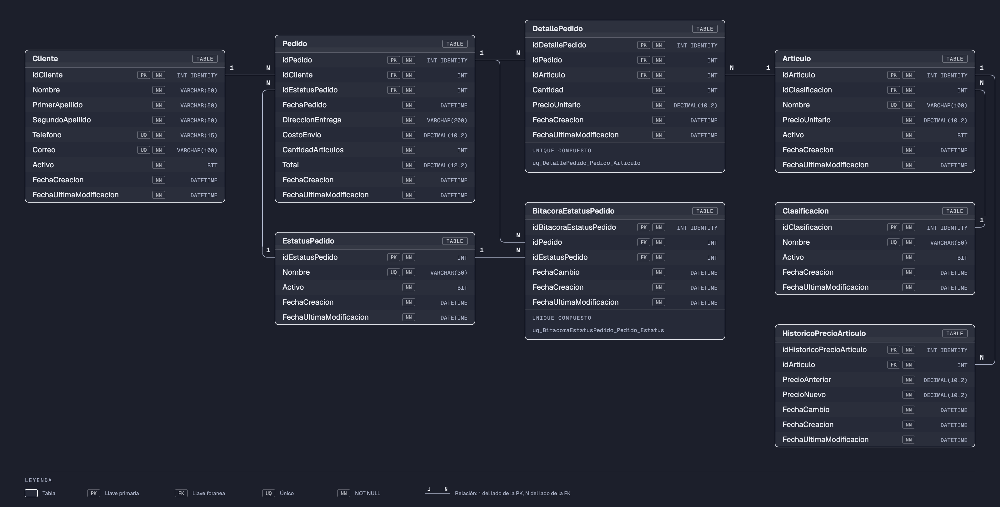

# TiendaDB

Base de datos de los **pedidos a domicilio de una tienda de conveniencia**: clientes, artículos por clasificación, pedidos con sus líneas, el estatus de cada pedido y el histórico de precios. Se modeló tabla por tabla en la [sesión 12](../README.md) para trabajar **triggers** sobre un modelo cabecera-detalle.

Los datos son ficticios.

---

## Modelo

| Tabla | Qué guarda | Registros iniciales |
|-------|------------|---------------------|
| [`Cliente`](docs/tablas/Cliente.md) | Clientes que hacen pedidos | 20 |
| [`EstatusPedido`](docs/tablas/EstatusPedido.md) | Catálogo de estatus: 1 Creado, 2 Enviado, 3 Cancelado, 4 Entregado | 4 |
| [`Clasificacion`](docs/tablas/Clasificacion.md) | Catálogo de clasificaciones de artículos (Bebidas, Botanas, Lácteos…) | 8 |
| [`Articulo`](docs/tablas/Articulo.md) | Artículos de la tienda, con su precio **vigente** | 40 |
| [`HistoricoPrecioArticulo`](docs/tablas/HistoricoPrecioArticulo.md) | Cada cambio de precio de un artículo: precio anterior y nuevo | 0 |
| [`Pedido`](docs/tablas/Pedido.md) | **Cabecera** del pedido: cliente, estatus vigente, dirección de entrega, costo de envío, número de líneas y total | 0 |
| [`DetallePedido`](docs/tablas/DetallePedido.md) | **Líneas** del pedido: artículo, cantidad y precio con el que se vendió | 0 |
| [`BitacoraEstatusPedido`](docs/tablas/BitacoraEstatusPedido.md) | Cada estatus por el que pasa un pedido, con su fecha | 0 |

Todas las tablas tienen `FechaCreacion` y `FechaUltimaModificacion`.

### Reglas del negocio

- Un pedido nace en estatus **Creado** (1). Mientras está en Creado se le pueden agregar o cambiar artículos.
- Las transiciones permitidas son 1 → 2, 2 → 3 y 2 → 4. **Nunca** hacia atrás: por eso un pedido pasa por cada estatus una sola vez (`UNIQUE (idPedido, idEstatusPedido)` en la bitácora).
- Cada cambio de estatus queda en la bitácora: el primero (Creado) lo registra `usp_crearPedido` y los demás, el trigger `trg_actualizarEstatusPedido`.
- La dirección de entrega y el costo de envío solo se modifican mientras el pedido está en Creado (`usp_actualizarPedido`).
- Un artículo aparece una sola vez por pedido (`UNIQUE (idPedido, idArticulo)`): si se quieren más piezas, se cambia la cantidad de su línea.
- La línea guarda el precio **con el que se vendió**; `Articulo.PrecioUnitario` es el precio **vigente** y puede cambiar.
- `Pedido.CantidadArticulos` y `Pedido.Total` (suma de `Cantidad × PrecioUnitario` de sus líneas, sin el envío) los mantienen los triggers de `DetallePedido`: al agregar, modificar o quitar una línea.

## Objetos programados

| Objeto | Tipo | Sobre | Qué hace |
|--------|------|-------|----------|
| [`trg_insertarHistoricoPrecioArticulo`](docs/triggers/trg_insertarHistoricoPrecioArticulo.md) | Trigger `AFTER UPDATE` | `Articulo` | Si cambió el precio, registra el anterior y el nuevo en `HistoricoPrecioArticulo` |
| [`trg_insertarDetallePedido`](docs/triggers/trg_insertarDetallePedido.md) | Trigger `AFTER INSERT` | `DetallePedido` | Recalcula `CantidadArticulos` y `Total` del pedido al que se le agregó una línea |
| [`trg_actualizarDetallePedido`](docs/triggers/trg_actualizarDetallePedido.md) | Trigger `AFTER UPDATE` | `DetallePedido` | Recalcula la cabecera cuando se modifica una línea; si la línea cambió de pedido, recalcula los dos |
| [`trg_eliminarDetallePedido`](docs/triggers/trg_eliminarDetallePedido.md) | Trigger `AFTER DELETE` | `DetallePedido` | Recalcula la cabecera con las líneas que le quedan al pedido |
| [`trg_actualizarEstatusPedido`](docs/triggers/trg_actualizarEstatusPedido.md) | Trigger `AFTER UPDATE` | `Pedido` | Registra en la bitácora cada cambio de estatus; los `UPDATE` que no cambian el estatus no registran nada |
| [`usp_crearPedido`](docs/procedimientos/usp_crearPedido.md) | Procedimiento almacenado | `Pedido` | Crea un pedido en estatus Creado y registra ese estatus en la bitácora |
| [`usp_actualizarPedido`](docs/procedimientos/usp_actualizarPedido.md) | Procedimiento almacenado | `Pedido` | Cambia la dirección y el costo de envío de un pedido en estatus Creado |

---

## Instalación

**Opción rápida:** abre [`instalar-completo.sql`](instalar-completo.sql) en SSMS y ejecútalo completo (F5).

**Script por script**, en este orden:

| Orden | Script | Qué hace |
|-------|--------|----------|
| 1 | `instalacion/00-create-database.sql` | Crea la base de datos `TiendaDB` |
| 2 | `instalacion/01-Cliente/01-create-table.sql` | Crea la tabla `Cliente` |
| 3 | `instalacion/01-Cliente/02-insert.sql` | Inserta 20 clientes |
| 4 | `instalacion/02-EstatusPedido/01-create-table.sql` | Crea la tabla `EstatusPedido` |
| 5 | `instalacion/02-EstatusPedido/02-insert.sql` | Inserta los 4 estatus de un pedido |
| 6 | `instalacion/03-Clasificacion/01-create-table.sql` | Crea la tabla `Clasificacion` |
| 7 | `instalacion/03-Clasificacion/02-insert.sql` | Inserta las 8 clasificaciones de artículos |
| 8 | `instalacion/04-Articulo/01-create-table.sql` | Crea la tabla `Articulo` |
| 9 | `instalacion/04-Articulo/02-insert.sql` | Inserta 40 artículos |
| 10 | `instalacion/05-HistoricoPrecioArticulo/01-create-table.sql` | Crea la tabla `HistoricoPrecioArticulo` |
| 11 | `instalacion/05-HistoricoPrecioArticulo/02-trg-insertar-historico-precio.sql` | Crea `trg_insertarHistoricoPrecioArticulo` |
| 12 | `instalacion/06-Pedido/01-create-table.sql` | Crea la tabla `Pedido` |
| 13 | `instalacion/06-Pedido/02-usp-crear.sql` | Crea `usp_crearPedido` |
| 14 | `instalacion/06-Pedido/03-usp-actualizar.sql` | Crea `usp_actualizarPedido` |
| 15 | `instalacion/07-DetallePedido/01-create-table.sql` | Crea la tabla `DetallePedido` |
| 16 | `instalacion/07-DetallePedido/02-trg-insertar-detalle-pedido.sql` | Crea `trg_insertarDetallePedido` |
| 17 | `instalacion/07-DetallePedido/03-trg-actualizar-detalle-pedido.sql` | Crea `trg_actualizarDetallePedido` |
| 18 | `instalacion/07-DetallePedido/04-trg-eliminar-detalle-pedido.sql` | Crea `trg_eliminarDetallePedido` |
| 19 | `instalacion/08-BitacoraEstatusPedido/01-create-table.sql` | Crea la tabla `BitacoraEstatusPedido` |
| 20 | `instalacion/08-BitacoraEstatusPedido/02-trg-actualizar-estatus-pedido.sql` | Crea `trg_actualizarEstatusPedido` |

Cada trigger está en la carpeta de la tabla que necesita que ya exista: el del histórico va con `HistoricoPrecioArticulo`, los tres de la cabecera con `DetallePedido` y el de la bitácora con `BitacoraEstatusPedido`. Los procedimientos van con `Pedido`.

## Reversa

| Orden | Script | Qué hace |
|-------|--------|----------|
| 1 | `reversa/01-drop-tables.sql` | Elimina las 8 tablas en orden inverso a las llaves foráneas. Los triggers se eliminan junto con su tabla; los procedimientos, con la base de datos en el paso 2 |
| 2 | `reversa/02-drop-database.sql` | Elimina la base de datos `TiendaDB` |

> Antes del script 2, selecciona **otra** base de datos (por ejemplo, `master`): no se puede eliminar la base de datos a la que estás conectado.

## Pruebas

[`pruebas.sql`](pruebas.sql) repite el flujo de la clase sobre una instalación limpia, con el resultado esperado de cada paso: cambios de precio, crear un pedido, agregarle artículos y, después, modificar, mover y quitar líneas, y los procedimientos y la bitácora.
